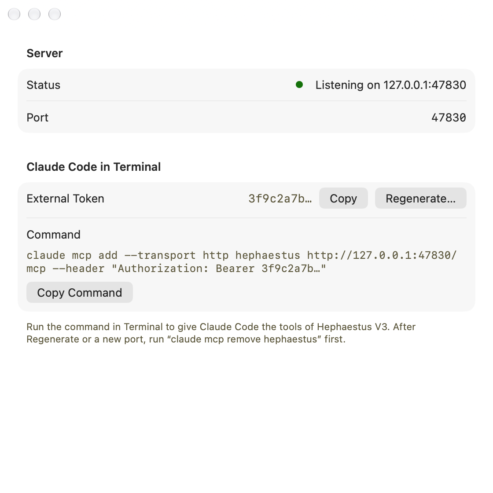

# MCP server

Hephaestus V3 serves its tools to Claude over the Model Context Protocol. Each tool's window and Claude call
the same operations: an MCP tool is a `ToolOperation` that a kit declares beside its window, and it runs the
function the window calls ([Architecture › MCPKit](architecture.md#mcpkit)). The server is HephaestusV2's
(V2's `docs/mcp.md`), with the tools V3 has brought over so far; each feature adds its own as it comes over.

## Overview

| Item | Value |
| --- | --- |
| Component | `MCPServer` in `MCPKit`, started by ToolsScenes' `AppData` once the projects are loaded |
| Address | `127.0.0.1` only, TCP port `mcpPort` of `settings.yml` (default 47830, [Data › Settings file](data.md#settings-file)); `HEPHAESTUS_MCP_PORT` replaces it while set |
| Endpoint | `/mcp` |
| Transport | MCP Streamable HTTP, limited to POST requests answered with `application/json`: no SSE stream, no sessions |
| Protocol versions | `2025-06-18` and `2025-03-26`, negotiated in `initialize` |
| JSON-RPC methods | `initialize`, `ping`, `tools/list`, `tools/call`; every notification is accepted and ignored |
| Server name | `hephaestus`, so Claude names the tools `mcp__hephaestus__<tool>` |
| Authentication | `Authorization: Bearer <token>` with the external token ([Authentication](#authentication)) |
| Tools | [Tools](#tools): 6 today |

## Server lifecycle

- The server starts once the projects are loaded, after the data folder's lock is taken, and stops with the
  app.
- It listens on `127.0.0.1` at the port in effect: `HEPHAESTUS_MCP_PORT` when set, otherwise `mcpPort`. Port
  0, which tests use, lets the system pick a free port.
- When the port can't be bound, the server tries again once a second, 5 attempts in all, then stays failed
  until the port changes or the app restarts. A listener that fails after it was listening becomes failed too.
- Its state is `stopped`, `listening(port)` or `failed(message)`, the message being the system's. Settings ▸
  MCP shows it ([Settings ▸ MCP](#settings--mcp)).
- A new port in Settings ▸ MCP is written to `settings.yml` and moves the server at once, unless
  `HEPHAESTUS_MCP_PORT` is set: then it applies when the app runs without the variable. Terminal sessions must
  add the server again ([External use](#external-use)).

## HTTP transport

Each request goes through these steps in order; the first that fails sends its response.

1. **Head.** Empty lines before the request line are skipped. The request line and the header fields, up to
   the first empty line, must parse as HTTP/1.1 or HTTP/1.0: `<method> <target> HTTP/1.1`, fields
   `<name>: <value>`, at most one `Content-Length` of digits, no `Transfer-Encoding` other than `chunked`;
   otherwise 400. A head longer than 65 536 bytes gets 413.
2. **Origin.** A request with an `Origin` header, whatever its value, gets 403.
3. **Path.** The target's path, without its query, must be `/mcp`; otherwise 404.
4. **Method.** Only POST; otherwise 405 with `Allow: POST`. (The Claude CLI's `GET /mcp`, which asks for an
   SSE stream, gets this 405 and goes on without one.)
5. **Authorization.** Exactly one `Authorization` field, `Bearer` in any letter case, one or more spaces, a
   token the server accepts; otherwise 401 with `WWW-Authenticate: Bearer realm="hephaestus"`.
6. **Declared size.** A `Content-Length` above 4 194 304 bytes gets 413 before the body is read.
7. **Continue.** With `Expect: 100-continue`, the interim `HTTP/1.1 100 Continue` is sent.
8. **Body.** `Content-Length` bytes, or the decoded chunks with `Transfer-Encoding: chunked` (extensions and
   trailer fields ignored); none without either. A chunked body beyond 4 194 304 bytes gets 413, a malformed
   chunk 400.
9. **JSON-RPC.** The body is handled as [JSON-RPC](#json-rpc) says, and answered with 200, 202, or 400 for an
   unsupported `MCP-Protocol-Version`.

| Status | Sent when | Body (`text/plain; charset=utf-8` for rejections) |
| --- | --- | --- |
| 200 OK | A JSON-RPC request was handled, its errors included | The JSON-RPC response, `application/json` |
| 202 Accepted | A notification, or a response from the client | None |
| 400 Bad Request | A malformed head or chunked body | `Bad Request: malformed HTTP request.` |
| 400 Bad Request | `ping`, `tools/list` or `tools/call` with an unsupported `MCP-Protocol-Version` | `Bad Request: unsupported MCP-Protocol-Version <value>; supported: 2025-06-18, 2025-03-26.` |
| 401 Unauthorized | A missing, malformed or unknown token | `Unauthorized: missing or invalid bearer token.` |
| 403 Forbidden | An `Origin` header | `Forbidden: requests with an Origin header are refused.` |
| 404 Not Found | Another path | `Not Found: the MCP endpoint is /mcp.` |
| 405 Method Not Allowed | Another method | `Method Not Allowed: use POST.` |
| 413 Content Too Large | The head exceeds 65 536 bytes | `Content Too Large: the request head exceeds 65536 bytes.` |
| 413 Content Too Large | The body exceeds 4 194 304 bytes | `Content Too Large: the request body exceeds 4194304 bytes.` |

- Every response has `Content-Length` and `Cache-Control: no-store`. Rejections, answers to HTTP/1.0 requests
  and answers to requests with `Connection: close` carry `Connection: close`, and the connection closes after
  them.
- HTTP/1.1 connections are persistent: their requests are answered one after the other; connections are
  served concurrently. A connection silent for 60 seconds is closed.
- The server is stateless: no `Mcp-Session-Id`, no state per client; `initialize` isn't required first. A JSON
  array, a batch, is refused with -32600.

## Authentication

- The server accepts the **external token**: 64 lowercase hexadecimal characters encoding 32 bytes from
  `SecRandomCopyBytes`, made at the first start and kept as `mcpExternalToken` in the data folder's
  `secrets.json`, mode 0600 ([Data › Secrets file](data.md#secrets-file)). Tokens are compared in constant
  time and never logged.
- **Regenerate…** in Settings ▸ MCP replaces it at once: requests with the old one get 401. When
  `secrets.json` can't be written, the old token stays and Settings shows "Regenerate failed: <reason>".
- The chats' own tokens come with the Chat feature.

## JSON-RPC

The body is decoded as UTF-8 JSON and classified by the first matching step:

| Step | Condition | Outcome |
| --- | --- | --- |
| 1 | Not valid JSON, an empty body included | -32700 `Parse error` |
| 2 | A JSON array | -32600 `Invalid Request: batches are not supported` |
| 3 | Not a JSON object | -32600 `Invalid Request: the message must be a JSON object` |
| 4 | `jsonrpc` missing or not `"2.0"` | -32600 `Invalid Request: jsonrpc must be "2.0"` |
| 5 | `method` present, not a string | -32600 `Invalid Request: method must be a string` |
| 6 | `method` present, `id` absent | A notification: 202, no effect |
| 7 | `method` present, `id` neither a string nor an integer (`null` included) | -32600 `Invalid Request: id must be a string or an integer` |
| 8 | `method` present, `id` valid | A request: [Methods](#methods) |
| 9 | `method` absent, `result` or `error` present | A response from the client: 202, ignored |
| 10 | Anything else | -32600 `Invalid Request: method must be a string` |

The errors of this table carry `"id": null`. Other errors:

| Code | Message | When |
| --- | --- | --- |
| -32601 | `Method not found: <method>` | Another method than `initialize`, `ping`, `tools/list`, `tools/call` |
| -32602 | `Invalid params: params must be an object` | `params` present and not an object |
| -32602 | `Invalid params: protocolVersion must be a string` | `initialize` without a string `protocolVersion` |
| -32602 | `Invalid params: name must be a string` | `tools/call` without a string `name` |
| -32602 | `Invalid params: arguments must be an object` | `tools/call` with `arguments` neither absent, `null` nor an object |
| -32602 | `Unknown tool: <name>` | `tools/call` names a tool `tools/list` doesn't list |

-32601 is checked before the protocol version, and the version before -32602. A request for `ping`,
`tools/list` or `tools/call` whose `MCP-Protocol-Version` field names a version other than `2025-06-18` and
`2025-03-26` gets the 400 of [HTTP transport](#http-transport), the first such value named; a request without
the field is accepted. A response is one JSON object, `{"jsonrpc": "2.0", "id": <id>, "result": <result>}` or
`{"jsonrpc": "2.0", "id": <id>, "error": {"code": <code>, "message": <message>}}`, UTF-8, without
insignificant white space, keys sorted.

## Methods

- **`initialize`**: `protocolVersion` is required; `capabilities` and `clientInfo` are ignored. The result is
  `{"protocolVersion": <the requested version when supported, else 2025-06-18>, "capabilities": {"tools":
  {"listChanged": false}}, "serverInfo": {"name": "hephaestus", "version": <the app's version>}}`.
- **Notifications** get 202 and do nothing.
- **`ping`**: the result is `{}`.
- **`tools/list`**: `params`, when present, must be an object; its members, `cursor` included, are ignored. The
  result is `{"tools": [...]}`, every tool of [Tools](#tools) in its order, each `{"name", "description",
  "inputSchema"}` with the exact values given there. No `nextCursor`.
- **`tools/call`**: `name` names a listed tool; `arguments` absent or `null` means `{}`. The arguments are
  validated ([Argument validation](#argument-validation)), then the operation runs. From validation on, every
  failure is a tool result with `isError: true`, never a JSON-RPC error.

## Tool results

```json
{"content": [{"type": "text", "text": "{}"}], "isError": false}
```

- `content` holds exactly one text item: the operation's result as JSON, keys sorted, slashes not escaped;
  `{}` for an empty result. Absent optional values are left out.
- On failure, the text is the error's message alone, with `isError: true`. Every error has a code, for the
  logs: `notFound`, `invalid`, `conflict`, `forbidden`, `unavailable` or `internal`.

## Argument validation

The server checks `arguments` against the tool's `inputSchema`, with these keywords only: `type` (`object`,
`array`, `string`, `boolean`, `integer`; an integer is a JSON number with an integral value), `properties`,
`required`, `additionalProperties` (always `false`: other properties are refused), `items`, `enum`,
`minimum`, `maximum` (inclusive), `description` (not checked). Every other rule is the operation's, so Claude
gets the same message the window shows.

- A property whose value is `null` is removed first, at every depth, and counts as absent; a `null` element of
  an array stays and fails its type.
- Validation stops at the first violation. Within an object: first the properties `properties` doesn't name,
  in ascending order of name; then the missing `required` properties, in order; then each present property in
  the order of `properties`, checked completely before the next. For a value: `type`, then `enum`, `minimum`,
  `maximum`.

| Violation | Text |
| --- | --- |
| A property not in `properties` | `<path>: unknown argument.` |
| A missing required property | `<path>: required.` |
| A wrong type | `<path>: must be <a string, an integer, a boolean, an array, an object>.` |
| Not in `enum` | `<path>: must be one of <values joined by ", ">.` |
| Below `minimum`, above `maximum` | `<path>: must be at least <n>.`, `<path>: must be at most <n>.` |

`<path>` names the argument from the top level, indexes from 0: `projectID`, `target.kind`, `items[2].label`;
`arguments` for the whole value. These failures have the code `invalid`.

## External use

Terminal Claude Code sessions on this Mac use the server with the external token. Settings ▸ MCP shows this
command with the port and the token filled in, and copies it:

```sh
claude mcp add --transport http hephaestus http://127.0.0.1:47830/mcp --header "Authorization: Bearer <token>"
```

After Regenerate or a new port, run `claude mcp remove hephaestus`, then the new command: `claude mcp add`
refuses a name that exists.

## Settings ▸ MCP

The Settings window's **MCP** tab (`point.3.connected.trianglepath.dotted`):


*Settings ▸ MCP, the server listening.*


| Row | Shows and does |
| --- | --- |
| **Status** | "Listening on 127.0.0.1:<port>" with a green dot, "Not running" with a gray one, or "Not listening: <reason>" with a red one. |
| **Port** | Text field, monospaced, 90 pt; Return applies a port from 1024 to 65535 ("Enter a port from 1024 to 65535." otherwise), stores it and moves the server. Disabled while `HEPHAESTUS_MCP_PORT` is set, with "HEPHAESTUS_MCP_PORT sets the port to <n> while the app runs." |
| **External Token** | Its first 8 characters and "…", monospaced; **Copy** copies it whole; **Regenerate…** asks "Regenerate the external token?" ("Terminal sessions that use the current token stop working until you add the server again.") with **Regenerate** (destructive). |
| **Command** | The `claude mcp add` command, the token shortened the same way, monospaced; **Copy Command** copies it whole. |

The section "Claude Code in Terminal" ends with: "Run the command in Terminal to give Claude Code the tools of
Hephaestus V3. After Regenerate or a new port, run “claude mcp remove hephaestus” first." Identifiers:
`settings.mcp.status`, `.port`, `.copyToken`, `.regenerate`, `.command`, `.copyCommand`.

## Tools

Each tool runs the operation its kit declares ([Architecture › MCPKit](architecture.md#mcpkit)); its section
gives what it calls, its result, its errors, then the exact `description` and `inputSchema` of `tools/list`.
Every tool can also return the [argument validation](#argument-validation) errors. The tools aren't limited to
a project: Claude may read and change every project of this Mac, as the user can.

| Tool | Kit | Permission | Calls |
| --- | --- | --- | --- |
| `list_projects` | ProjectsKit | read | the session's snapshot |
| `get_project` | ProjectsKit | read | the session's snapshot |
| `create_project` | ProjectsKit | change | `ProjectSession.create` |
| `update_project` | ProjectsKit | change | `ProjectSession.update` |
| `remove_project` | ProjectsKit | change | `ProjectSession.remove` |
| `list_tickets`, `get_ticket`, `list_bundles`, `get_bundle` | TicketsKit | read | the ticket library's snapshot |
| `create_ticket`, `update_ticket`, `delete_ticket`, `set_ticket_status`, `add_comment`, `update_comment`, `delete_comment`, `remove_attachment` | TicketsKit | change | `TicketLibrary`, as Claude (`TicketTools`) |
| `create_bundle`, `update_bundle`, `set_bundle_status`, `delete_bundle` | TicketsKit | change | `TicketLibrary`, as Claude |
| `open_in_app` | ToolsScenes | read | a route ([Navigation › Routes](ui/navigation.md#routes)) |

A project's JSON (`get_project`, `create_project`, `update_project`): `id`, `name`, `type` (`none`,
`goService`, `swiftApplication`, `library`), `color`, `icon`, `folder`, `parentID`, `subprojects` (the loaded
sub projects' identifiers), `docsPath`, `githubPage` (as it resolves), `useParentSettings`, `graphEnabled` (as
it resolves), `environments` (as they apply), `inheritedEnvironments`, `currentEnvironment`, `fileIssue`. Each
environment: `name`, `url`, `port`, `baseURL`, `allowInvalidCertificates`, `namespace`, `deployment`, `jaeger`,
`argoCDApplication`, `kubeconfig`. Absent values are left out. Errors map to codes this way: an identifier in
use or a folder that holds a project, `conflict`; a broken rule or a folder outside the parent, `invalid`; an
unknown project or folder, `notFound`; no data folder, `unavailable`; a file that can't be written,
`internal`. The messages are the English ones of [Data › Validation](data.md#validation) and `ProjectError`.

**Tickets and bundles.** The ticket tools act as Claude (`TicketActor.claude(chat: "external")`, the external
token; the chats' tokens come with Chat), so V2's rules for Claude hold ([Data › Ticket rules](data.md#ticket-rules)),
and every change shows in the open Tickets windows at once. A ticket's JSON: `id`, `title`, `status` (`draft`,
`todo`, `in_progress`, `review`, `done`), `created`, `updated`, `createdBy`, `description`, `priority` (when
set), `labels`, `attachments` (`id`, `name`, `path` absolute, `contentType`, `size`), `comments` (`id`, `author`,
`created`, `updated` when edited, `text`, `attachments`), `chats`, `links` and `inverseLinks` (`kind`,
`ticket`), `history` (`kind`, `date`, `from`, `to`, `author`, `device`, `chat`, as stored). A bundle's JSON:
`id`, `title`, `status`, `created`, `updated`, `tickets`, `chats`. Dates are ISO 8601. Attachment paths are
files on this Mac: absolute, `~/`, or relative to the project's folder. Errors map to codes this way: a broken
rule, `invalid`; an unknown project, ticket, bundle, comment or attachment, `notFound`; a change Claude may not
make, `forbidden`; a file that can't be moved to the Trash, `unavailable`; a file that can't be written,
`internal`. V2's `implement_ticket` and `implement_bundle` aren't brought over.

### list_projects

- **Calls:** the session's snapshot.
- **Result:** an array, each project's `id`, `name`, `type`, `folder`, `parentID`, `subprojects` and
  `fileIssue`, depth first: each top-level project followed by its sub projects.

Description:

```text
List the projects of Hephaestus V3 on this Mac, sub projects included: identifier, name, type, folder, parent and sub projects.
```

Input schema:

```json
{
  "type": "object",
  "properties": {},
  "additionalProperties": false
}
```

### get_project

- **Calls:** the session's snapshot.
- **Result:** the project's JSON.
- **Errors:** an unknown project (`notFound`, `No project <ID>.`).

Description:

```text
Get a project: its settings (name, type, color, icon, docs folder, GitHub page, use parent settings, graph enabled), folder, parent, sub projects, and its environments as they apply (environments; for a sub project that uses its parent's settings, the parent's with its changes first, then its own), the inherited ones (inheritedEnvironments) and the one the user works in (currentEnvironment).
```

Input schema:

```json
{
  "type": "object",
  "properties": {
    "projectID": {"type": "string", "description": "Project identifier: 2 to 8 letters, for example ORD."}
  },
  "required": ["projectID"],
  "additionalProperties": false
}
```

### create_project

- **Calls:** `ProjectSession.create` with the `path` (a leading `~/` is the home folder), the `name`, the
  `identifier`, the `type` (`none` when omitted), the `parentID` when given, and `createsFolder`.
- A `path` that isn't absolute once expanded fails first: `path: use an absolute path or a path starting with
  ~/.` (`invalid`).
- **Result:** the new project's JSON.
- **Errors:** those of [Data › Changes](data.md#changes): an identifier in use or a folder that holds a project
  (`conflict`), an unknown parent (`notFound`), a broken rule or a folder outside the parent (`invalid`).

Description:

```text
Create a project in a folder on this Mac (the folder is created when missing) and add it to Hephaestus V3. The identifier is 2 to 8 letters, unique and permanent: ask the user for the name and the identifier unless they gave them. With parentID the folder must be inside the parent project's folder and the new project becomes its sub project. type is none when omitted.
```

Input schema:

```json
{
  "type": "object",
  "properties": {
    "path": {"type": "string", "description": "Absolute path of the project folder, or a path starting with ~/."},
    "name": {"type": "string", "description": "Project name shown in the app."},
    "identifier": {"type": "string", "description": "2 to 8 letters A to Z, stored uppercase, unique on this Mac, never changed."},
    "type": {
      "type": "string",
      "description": "Project type: none, goService (a service), swiftApplication (an app) or library.",
      "enum": ["none", "goService", "swiftApplication", "library"]
    },
    "parentID": {"type": "string", "description": "Identifier of the parent project, to create a sub project."}
  },
  "required": ["path", "name", "identifier"],
  "additionalProperties": false
}
```

### update_project

- **Calls:** `ProjectSession.update` with the values given: `name`, `type`, `color` (an empty one removes it),
  `icon` (an empty one removes it) and `docsPath`. Claude never changes a project's GitHub page, Use parent
  settings, graph or environments: only the user does, in [Project Settings](ui/project-settings.md).
- An `icon` that isn't an SF Symbol of this Mac fails first: `<name> is not an SF Symbol of this Mac.`
  (`invalid`).
- **Result:** the project's JSON.
- **Errors:** an unknown project (`notFound`), a broken rule (`invalid`).

Description:

```text
Change a project's name, type, color, icon or docs folder. Omitted arguments are left unchanged. color is a tint (accent, accentSecondary, info, success, warning) or a hex color #RRGGBB, and an empty color removes it. icon is the name of an SF Symbol of this Mac, for example hammer, and an empty icon removes it.
```

Input schema:

```json
{
  "type": "object",
  "properties": {
    "projectID": {"type": "string", "description": "Project identifier: 2 to 8 letters, for example ORD."},
    "name": {"type": "string", "description": "New project name."},
    "type": {
      "type": "string",
      "description": "Project type: none, goService (a service), swiftApplication (an app) or library.",
      "enum": ["none", "goService", "swiftApplication", "library"]
    },
    "color": {"type": "string", "description": "The project's tint: accent, accentSecondary, info, success, warning, or #RRGGBB; an empty string removes it."},
    "icon": {"type": "string", "description": "Name of an SF Symbol of this Mac shown as the project's icon, for example hammer; an empty string removes it."},
    "docsPath": {"type": "string", "description": "Docs folder relative to the project's folder, for example docs."}
  },
  "required": ["projectID"],
  "additionalProperties": false
}
```

### remove_project

- **Calls:** `ProjectSession.remove`: the project and its sub projects leave the list; no file changes.
- **Result:** `{}`.
- **Errors:** an unknown project (`notFound`, `No project <ID> is loaded.`).

Description:

```text
Remove a project and its sub projects from Hephaestus V3 on this Mac. Their folders and files are left untouched; adding the folder again brings the project back.
```

Input schema:

```json
{
  "type": "object",
  "properties": {
    "projectID": {"type": "string", "description": "Project identifier: 2 to 8 letters, for example ORD."}
  },
  "required": ["projectID"],
  "additionalProperties": false
}
```

### list_tickets

- **Calls:** the ticket library's snapshot: the tickets of the project, then of each of its loaded sub projects in tree order, each in ascending number, with `status` only those in it.
- **Result:** an array of tickets' JSON.
- **Errors:** an unknown project (`notFound`, `Project <ID> not found.`).

Description:

```text
List a project's tickets, those of its sub projects included, optionally only those with one status: draft, todo, in_progress, review or done.
```

Input schema:

```json
{
  "additionalProperties" : false,
  "properties" : {
    "projectID" : {
      "description" : "Project identifier: 2 to 8 letters, for example ORD.",
      "type" : "string"
    },
    "status" : {
      "description" : "Only list tickets with this status.",
      "enum" : [
        "draft",
        "todo",
        "in_progress",
        "review",
        "done"
      ],
      "type" : "string"
    }
  },
  "required" : [
    "projectID"
  ],
  "type" : "object"
}
```

### get_ticket

- **Calls:** the ticket library's snapshot.
- **Result:** the ticket's JSON, its attachments' paths absolute (`<project folder>/.hephaestus/<path>`).
- **Errors:** a malformed id (`invalid`), an unknown ticket (`notFound`).

Description:

```text
Get a ticket: title, status, priority, labels, dates, creator, description, attachments (with their absolute paths), comments, chat ids, links and history. links are the links the ticket declares (dependsOn, related); inverseLinks are the links other tickets declare to it (blocks, related). history lists its creation, status changes, renames, link changes and description edits with their authors and dates.
```

Input schema:

```json
{
  "additionalProperties" : false,
  "properties" : {
    "ticketID" : {
      "description" : "Ticket id, for example ORD-12.",
      "type" : "string"
    }
  },
  "required" : [
    "ticketID"
  ],
  "type" : "object"
}
```

### create_ticket

- **Calls:** `TicketLibrary.create` as Claude: [Data › Ticket changes](data.md#ticket-changes). The description is checked against the template; the ticket starts `todo`, `createdBy: claude`. `title`, `priority` and `labels` are V3's: without a title, the provisional title is kept.
- **Result:** the new ticket's JSON.
- **Errors:** an unknown project or linked ticket (`notFound`); a description off the template, a title, an attachment or a link that breaks a rule (`invalid`).

Description:

```text
Create a ticket in a project. It starts as todo. Without a title, its title is the description's first line that is not a heading. The description must use this template, the six headings alone on their lines and in this order:
Problem
(Explain the problem)
Current Behavior
(Explain the current behaviour)
Expected
(Explain the behaviour that should be expected)
Change
(Explain what should change)
Testing
(List the tests that decide whether the ticket is done)
Docs
(List all docs files and paragraphs relevant to the issue)
attachments are paths of files on this Mac (absolute, starting with ~/, or relative to the project's folder) that are copied into the ticket. links are links to other tickets of the same project: dependsOn when this ticket needs the other ticket to be done first, related when they are only related.
```

Input schema:

```json
{
  "additionalProperties" : false,
  "properties" : {
    "attachments" : {
      "description" : "Files on this Mac to attach: absolute paths, paths starting with ~/, or paths relative to the project's folder.",
      "items" : {
        "type" : "string"
      },
      "type" : "array"
    },
    "description" : {
      "description" : "Ticket description following the template.",
      "type" : "string"
    },
    "labels" : {
      "description" : "Labels, replacing the current ones; [] removes them all.",
      "items" : {
        "type" : "string"
      },
      "type" : "array"
    },
    "links" : {
      "description" : "Links to other tickets of the same project.",
      "items" : {
        "additionalProperties" : false,
        "properties" : {
          "kind" : {
            "description" : "dependsOn when this ticket needs the other ticket to be done first, related otherwise.",
            "enum" : [
              "dependsOn",
              "related"
            ],
            "type" : "string"
          },
          "ticket" : {
            "description" : "Id of a ticket of the same project, for example ORD-15.",
            "type" : "string"
          }
        },
        "required" : [
          "kind",
          "ticket"
        ],
        "type" : "object"
      },
      "type" : "array"
    },
    "priority" : {
      "description" : "Priority: low, medium, high or urgent; an empty string removes it.",
      "enum" : [
        "",
        "low",
        "medium",
        "high",
        "urgent"
      ],
      "type" : "string"
    },
    "projectID" : {
      "description" : "Project identifier: 2 to 8 letters, for example ORD.",
      "type" : "string"
    },
    "title" : {
      "description" : "Ticket title, one line of 1 to 200 characters.",
      "type" : "string"
    }
  },
  "required" : [
    "projectID",
    "description"
  ],
  "type" : "object"
}
```

### update_ticket

- **Calls:** `TicketLibrary.update` as Claude. `links` replaces the declared links; each new one is checked with the [link rules](data.md#link-rules). A call that changes nothing writes nothing.
- **Result:** the ticket's JSON.
- **Errors:** an unknown ticket or newly linked ticket (`notFound`); a malformed id, a title, a description off the template or a link that breaks a rule (`invalid`).

Description:

```text
Change a ticket's title, description, priority, labels or links. Omitted arguments are left unchanged; a new description must follow the same template as create_ticket; links replaces the links the ticket declares, so list every link to keep, and [] removes them all. Use set_ticket_status for the status and add_comment to report work.
```

Input schema:

```json
{
  "additionalProperties" : false,
  "properties" : {
    "description" : {
      "description" : "New description, following the ticket template.",
      "type" : "string"
    },
    "labels" : {
      "description" : "Labels, replacing the current ones; [] removes them all.",
      "items" : {
        "type" : "string"
      },
      "type" : "array"
    },
    "links" : {
      "description" : "The links this ticket declares, replacing the current ones: every link to keep and the new ones; [] removes them all.",
      "items" : {
        "additionalProperties" : false,
        "properties" : {
          "kind" : {
            "description" : "dependsOn when this ticket needs the other ticket to be done first, related otherwise.",
            "enum" : [
              "dependsOn",
              "related"
            ],
            "type" : "string"
          },
          "ticket" : {
            "description" : "Id of a ticket of the same project, for example ORD-15.",
            "type" : "string"
          }
        },
        "required" : [
          "kind",
          "ticket"
        ],
        "type" : "object"
      },
      "type" : "array"
    },
    "priority" : {
      "description" : "Priority: low, medium, high or urgent; an empty string removes it.",
      "enum" : [
        "",
        "low",
        "medium",
        "high",
        "urgent"
      ],
      "type" : "string"
    },
    "ticketID" : {
      "description" : "Ticket id, for example ORD-12.",
      "type" : "string"
    },
    "title" : {
      "description" : "New title, one line.",
      "type" : "string"
    }
  },
  "required" : [
    "ticketID"
  ],
  "type" : "object"
}
```

### delete_ticket

- **Calls:** `TicketLibrary.delete`: its bundles and the other tickets' links first, then its file and attachments to the Trash.
- **Result:** `{}`.
- **Errors:** an unknown ticket (`notFound`); a file that can't be moved to the Trash (`unavailable`).

Description:

```text
Delete a ticket and its attachments, moved to the Trash; it is also removed from every bundle and from the links of the other tickets.
```

Input schema:

```json
{
  "additionalProperties" : false,
  "properties" : {
    "ticketID" : {
      "description" : "Ticket id, for example ORD-12.",
      "type" : "string"
    }
  },
  "required" : [
    "ticketID"
  ],
  "type" : "object"
}
```

### set_ticket_status

- **Calls:** `TicketLibrary.setStatus` as Claude; the bundles that list the ticket follow their automatic rules.
- **Result:** the ticket's JSON.
- **Errors:** another status (`invalid`, `status: must be one of todo, in_progress, review, done.`); an unknown ticket (`notFound`); a done ticket or a draft (`forbidden`, `<ID> is done; only the user can change its status.`, `<ID> is a draft; only the user can change its status.`).

Description:

```text
Set a ticket's status to todo, in_progress, review or done. Set in_progress when you start working on a ticket, and review or done when you have finished it. Only the user changes a done ticket or a draft.
```

Input schema:

```json
{
  "additionalProperties" : false,
  "properties" : {
    "status" : {
      "description" : "New status.",
      "enum" : [
        "todo",
        "in_progress",
        "review",
        "done"
      ],
      "type" : "string"
    },
    "ticketID" : {
      "description" : "Ticket id, for example ORD-12.",
      "type" : "string"
    }
  },
  "required" : [
    "ticketID",
    "status"
  ],
  "type" : "object"
}
```

### add_comment

- **Calls:** `TicketLibrary.addComment` as Claude (`author: claude`).
- **Result:** the ticket's JSON.
- **Errors:** an unknown ticket (`notFound`); empty text without files, or a file that isn't readable or is over 20 MB (`invalid`).

Description:

```text
Add a comment by Claude to a ticket, in markdown, optionally with files attached (paths on this Mac: absolute, starting with ~/, or relative to the project's folder).
```

Input schema:

```json
{
  "additionalProperties" : false,
  "properties" : {
    "attachments" : {
      "description" : "Files on this Mac to attach: absolute paths, paths starting with ~/, or paths relative to the project's folder.",
      "items" : {
        "type" : "string"
      },
      "type" : "array"
    },
    "text" : {
      "description" : "Comment text (markdown).",
      "type" : "string"
    },
    "ticketID" : {
      "description" : "Ticket id, for example ORD-12.",
      "type" : "string"
    }
  },
  "required" : [
    "ticketID",
    "text"
  ],
  "type" : "object"
}
```

### update_comment

- **Calls:** `TicketLibrary.updateComment`.
- **Result:** the ticket's JSON.
- **Errors:** an unknown ticket or comment (`notFound`, `Comment <id> not found.`); empty text on a comment without files (`invalid`).

Description:

```text
Change the text of a comment of a ticket, whoever wrote it. The comment's attached files do not change.
```

Input schema:

```json
{
  "additionalProperties" : false,
  "properties" : {
    "commentID" : {
      "description" : "Comment id (a UUID), from get_ticket.",
      "type" : "string"
    },
    "text" : {
      "description" : "New comment text (markdown).",
      "type" : "string"
    },
    "ticketID" : {
      "description" : "Ticket id, for example ORD-12.",
      "type" : "string"
    }
  },
  "required" : [
    "ticketID",
    "commentID",
    "text"
  ],
  "type" : "object"
}
```

### delete_comment

- **Calls:** `TicketLibrary.deleteComment`: the ticket file, then the comment's files to the Trash.
- **Result:** the ticket's JSON.
- **Errors:** an unknown ticket or comment (`notFound`); a file that can't be moved to the Trash (`unavailable`).

Description:

```text
Delete a comment of a ticket, whoever wrote it; its attached files are moved to the Trash.
```

Input schema:

```json
{
  "additionalProperties" : false,
  "properties" : {
    "commentID" : {
      "description" : "Comment id (a UUID), from get_ticket.",
      "type" : "string"
    },
    "ticketID" : {
      "description" : "Ticket id, for example ORD-12.",
      "type" : "string"
    }
  },
  "required" : [
    "ticketID",
    "commentID"
  ],
  "type" : "object"
}
```

### remove_attachment

- **Calls:** `TicketLibrary.removeAttachment`: the ticket file, then the file to the Trash.
- **Result:** the ticket's JSON.
- **Errors:** an unknown ticket or ticket attachment (`notFound`, `Attachment <id> not found.`); a file that can't be moved to the Trash (`unavailable`).

Description:

```text
Remove a file attached to a ticket itself (not to one of its comments); the file is moved to the Trash.
```

Input schema:

```json
{
  "additionalProperties" : false,
  "properties" : {
    "attachmentID" : {
      "description" : "Attachment id (a UUID), from get_ticket.",
      "type" : "string"
    },
    "ticketID" : {
      "description" : "Ticket id, for example ORD-12.",
      "type" : "string"
    }
  },
  "required" : [
    "ticketID",
    "attachmentID"
  ],
  "type" : "object"
}
```

### list_bundles

- **Calls:** the ticket library's snapshot.
- **Result:** an array of the project's bundles' JSON, in ascending number.
- **Errors:** an unknown project (`notFound`).

Description:

```text
List a project's bundles: named groups of its tickets, in the order they are to be done, each with its status (todo, in_progress, done).
```

Input schema:

```json
{
  "additionalProperties" : false,
  "properties" : {
    "projectID" : {
      "description" : "Project identifier: 2 to 8 letters, for example ORD.",
      "type" : "string"
    }
  },
  "required" : [
    "projectID"
  ],
  "type" : "object"
}
```

### get_bundle

- **Calls:** the ticket library's snapshot.
- **Result:** the bundle's JSON.
- **Errors:** a malformed id (`invalid`), an unknown bundle (`notFound`).

Description:

```text
Get a bundle: title, status, dates, ticket ids in the order they are to be done and chat ids.
```

Input schema:

```json
{
  "additionalProperties" : false,
  "properties" : {
    "bundleID" : {
      "description" : "Bundle id, for example ORD-B2.",
      "type" : "string"
    }
  },
  "required" : [
    "bundleID"
  ],
  "type" : "object"
}
```

### create_bundle

- **Calls:** `TicketLibrary.createBundle`; without a title, the provisional one from its tickets' titles.
- **Result:** the new bundle's JSON.
- **Errors:** an unknown project or ticket (`notFound`); no ticket, a ticket of another project or listed twice, a title that breaks the rule (`invalid`).

Description:

```text
Create a bundle of tickets of one project, in the order they are to be done. Without a title, its title is made of its tickets' titles. A bundle of tickets that are all done starts done.
```

Input schema:

```json
{
  "additionalProperties" : false,
  "properties" : {
    "projectID" : {
      "description" : "Project identifier: 2 to 8 letters, for example ORD.",
      "type" : "string"
    },
    "ticketIDs" : {
      "description" : "Ids of tickets of the project, in order; at least one.",
      "items" : {
        "type" : "string"
      },
      "type" : "array"
    },
    "title" : {
      "description" : "Bundle title, one line of 1 to 200 characters.",
      "type" : "string"
    }
  },
  "required" : [
    "projectID",
    "ticketIDs"
  ],
  "type" : "object"
}
```

### update_bundle

- **Calls:** `TicketLibrary.updateBundle`; a change of its set of tickets applies the automatic rules.
- **Result:** the bundle's JSON.
- **Errors:** an unknown bundle or ticket (`notFound`); a ticket of another project or listed twice (`invalid`).

Description:

```text
Change a bundle's title or tickets. Omitted arguments are left unchanged; ticketIDs replaces the bundle's tickets and their order.
```

Input schema:

```json
{
  "additionalProperties" : false,
  "properties" : {
    "bundleID" : {
      "description" : "Bundle id, for example ORD-B2.",
      "type" : "string"
    },
    "ticketIDs" : {
      "description" : "Ids of tickets of the project, in order, replacing the current ones.",
      "items" : {
        "type" : "string"
      },
      "type" : "array"
    },
    "title" : {
      "description" : "New title, one line.",
      "type" : "string"
    }
  },
  "required" : [
    "bundleID"
  ],
  "type" : "object"
}
```

### set_bundle_status

- **Calls:** `TicketLibrary.setBundleStatus` as Claude.
- **Result:** the bundle's JSON.
- **Errors:** another status (`invalid`); an unknown bundle (`notFound`); a done bundle (`forbidden`, `<ID> is done; only the user can change its status.`).

Description:

```text
Set a bundle's status to todo or in_progress. A bundle becomes done by itself when all its tickets are done, and only the user changes a done bundle.
```

Input schema:

```json
{
  "additionalProperties" : false,
  "properties" : {
    "bundleID" : {
      "description" : "Bundle id, for example ORD-B2.",
      "type" : "string"
    },
    "status" : {
      "description" : "New status.",
      "enum" : [
        "todo",
        "in_progress"
      ],
      "type" : "string"
    }
  },
  "required" : [
    "bundleID",
    "status"
  ],
  "type" : "object"
}
```

### delete_bundle

- **Calls:** `TicketLibrary.deleteBundle`.
- **Result:** `{}`.
- **Errors:** an unknown bundle (`notFound`); a file that can't be moved to the Trash (`unavailable`).

Description:

```text
Delete a bundle; its file is moved to the Trash and its tickets are kept.
```

Input schema:

```json
{
  "additionalProperties" : false,
  "properties" : {
    "bundleID" : {
      "description" : "Bundle id, for example ORD-B2.",
      "type" : "string"
    }
  },
  "required" : [
    "bundleID"
  ],
  "type" : "object"
}
```

### open_in_app

- **Calls:** a route: `project` opens the Projects window with the project selected (`.project(id)`),
  `projectSettings` its Project Settings window (`.projectSettings(id)`), `ticket` and `bundle` the Tickets
  window of its project with it selected (`.tool(.tickets, project:, focus: <id>)`); an open window comes
  forward. Each feature adds its own kinds as it comes over.
- **Result:** `{}`.
- **Errors:** an unknown project, ticket or bundle (`notFound`); no window has appeared yet to open routes
  (`unavailable`, `The app has no window to show it in.`).

Description:

```text
Show something to the user in Hephaestus V3: a project in the Projects window, a project's settings, or a ticket or a bundle in its Tickets window.
```

Input schema:

```json
{
  "additionalProperties" : false,
  "properties" : {
    "target" : {
      "additionalProperties" : false,
      "description" : "What to show. kind decides the other properties: project: projectID; projectSettings: projectID; ticket: ticketID; bundle: bundleID.",
      "properties" : {
        "bundleID" : {
          "description" : "Bundle id, for example ORD-B2.",
          "type" : "string"
        },
        "kind" : {
          "description" : "Kind of item to show.",
          "enum" : [
            "project",
            "projectSettings",
            "ticket",
            "bundle"
          ],
          "type" : "string"
        },
        "projectID" : {
          "description" : "Project identifier: 2 to 8 letters, for example ORD.",
          "type" : "string"
        },
        "ticketID" : {
          "description" : "Ticket id, for example ORD-12.",
          "type" : "string"
        }
      },
      "required" : [
        "kind"
      ],
      "type" : "object"
    }
  },
  "required" : [
    "target"
  ],
  "type" : "object"
}
```

## Checking it

With the app running, from Terminal (the token from Settings ▸ MCP):

```sh
curl -s -X POST http://127.0.0.1:47830/mcp -H "Authorization: Bearer <token>" \
  -d '{"jsonrpc":"2.0","id":1,"method":"tools/list"}'
```

`ToolsScenesTests` check that this page lists exactly the registered tools, in their order, with their exact
descriptions and input schemas.
