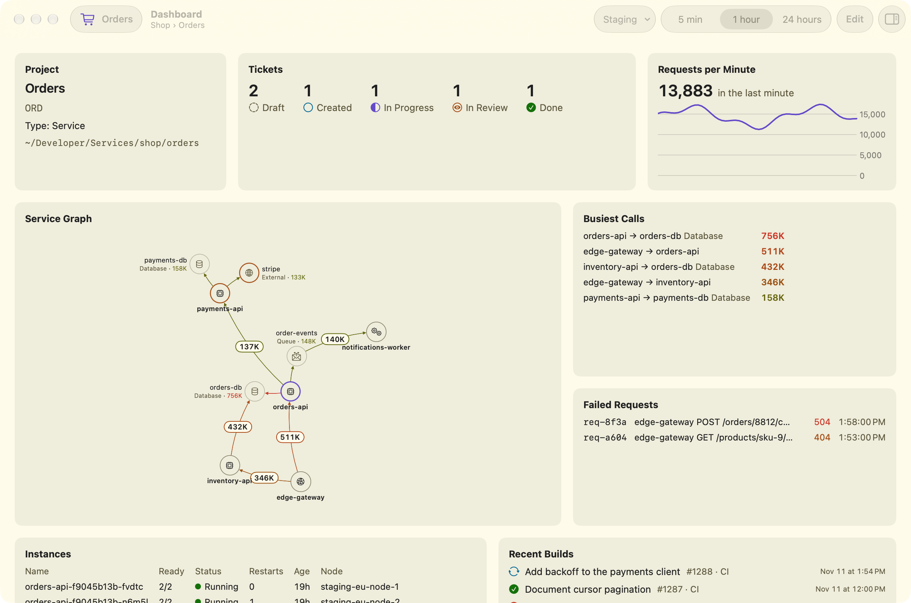

# Hephaestus V3 — UI specification

Hephaestus V3 is a suite of developer tools for the Mac: projects and their sub projects, a Dashboard, Tickets,
a Service Map, Contracts, Builds, Chat and Virtual Machines. Each tool has its own window for one project
at a time. This specification describes every window: what it is for, its parts, its controls, its states,
how it adapts from a Mac's width to an iPhone's, and how it is made accessible.

It describes the app as it is built, from its code (`HephaestusV3Kit/Sources`), not as a wish list. Where
the code doesn't yet meet the workspace's rules (`~/Developer/Apple/CLAUDE.md`), the page lists it under
**Open issues**.

*The Dashboard of Orders, a service of the Shop project.*

## Contents

**How it is built:** [Architecture](../architecture.md) covers the code: targets, models, stores, routes,
strings and tests. The shared, generic components come from AZDesign, whose reference is in
`~/Developer/Apple/Libraries/AZDesign/docs/`.

**Across the app**

| Page | Covers |
| --- | --- |
| [Foundations](foundations.md) | Principles, colors, typography, shapes, Liquid Glass, icons, motion, the Mac / iPad / iPhone layout system, states, accessibility, previews, localization |
| [Navigation](navigation.md) | Windows and their tabs, tools per project, the anatomy of a window, the status bar, routes, window reuse, tabs and the chat panel, Settings ▸ General, menus and shortcuts |
| [Components](components.md) | Project switcher, icons, status dots, badges, figures, toolbar padding, empty states, phone stack, the chat panel's button, glass overlays |

**Windows**

| Page | Covers |
| --- | --- |
| [Projects](projects.md) | The project selector: the project tree, a project's overview, sub projects |
| [Project Settings](project-settings.md) | One project's settings: name, type, tint, icon, folder, GitHub page, a service's graph and environments |
| [Menu bar](menu-bar.md) | The menu bar item and its Open Project panel |
| [Dashboard](dashboard.md) | Widgets on a 24-column grid, edit mode, widget settings, the one-per-row list |
| [Tickets](tickets.md) | Filters, the ticket list, a ticket's page, its actions, New Ticket |
| [Service Map](service-map.md) | The X-Ray-style graph, focus and request views, requests, details |
| [Contracts](contracts.md) | A contract's operations and the request builder |
| [Builds](builds.md) | Runs, releases, jobs, steps and logs |
| [Chat](chat.md) | The Chat window, the chat panel beside every tool, Settings ▸ Chat |
| [Virtual Machines](virtual-machines.md) | The Mac's virtual machines |

## Conventions

- **Sizes** are in points. Window widths name the layout they trigger ([Layout system](foundations.md#layout-system)).
- **Controls** are named by their visible label in bold, and **symbols** by their SF Symbol name in code font.
  Keyboard shortcuts use ⌘ ⌥ ⌃ ⇧.
- **Identifiers** are the elements' `accessibilityIdentifier` values, shaped `screen.element[.qualifier]`.
- **"(the user's choice)"** marks a behavior the owner decided. Keep it unless the owner changes it.
- **"Not wired yet"** marks a control that is drawn but whose action is still empty.
- **Data** is sample data throughout, fixed around 11 November 2026 at 14:00.

## Screenshots

The images in `images/` are renders of the app's own views with the sample data, made on 13 November 2026
in US English. They show the light and dark appearances, and the iPad and iPhone widths where the layout
changes. Each page uses only its own window's images.

## Keeping it current

This specification is part of the app. Every change to the UI updates the page of the window it touches,
and its screenshots, in the same change: controls, layouts, states, shortcuts and identifiers. A new window
gets a new page, and a row in the contents above.
