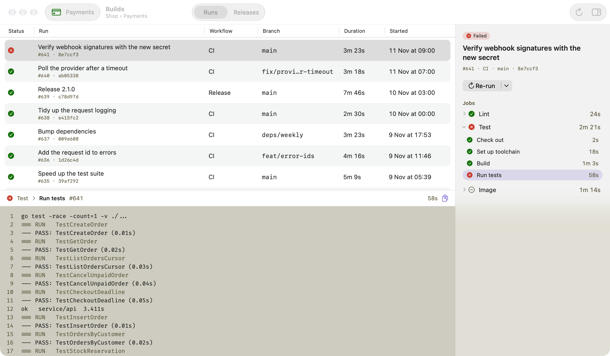
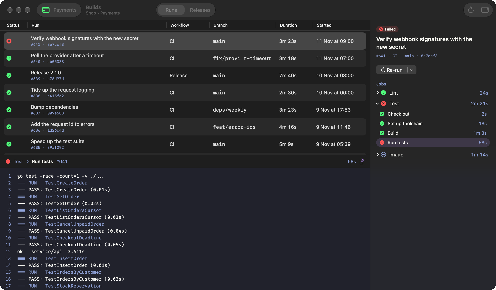
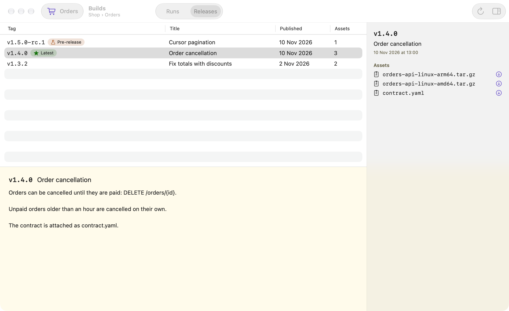
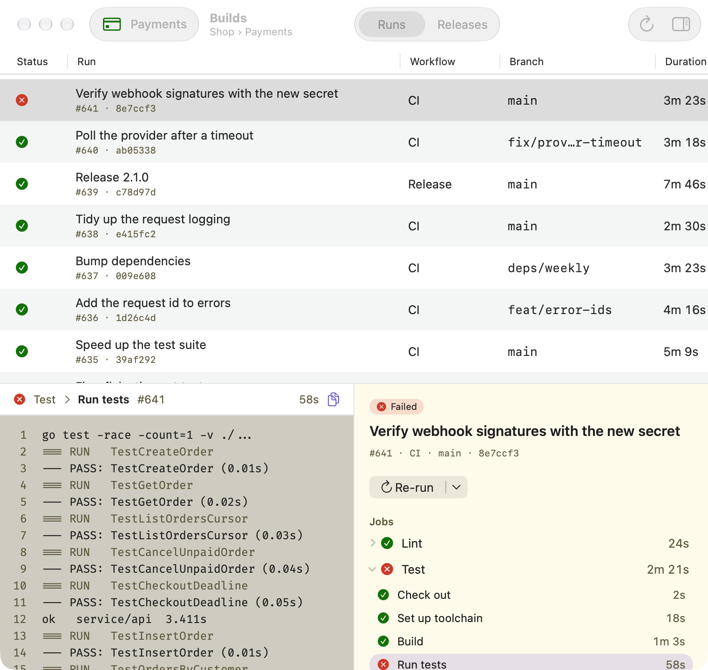
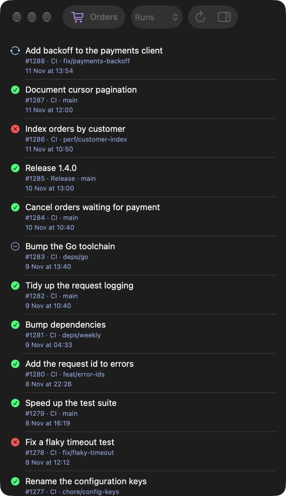
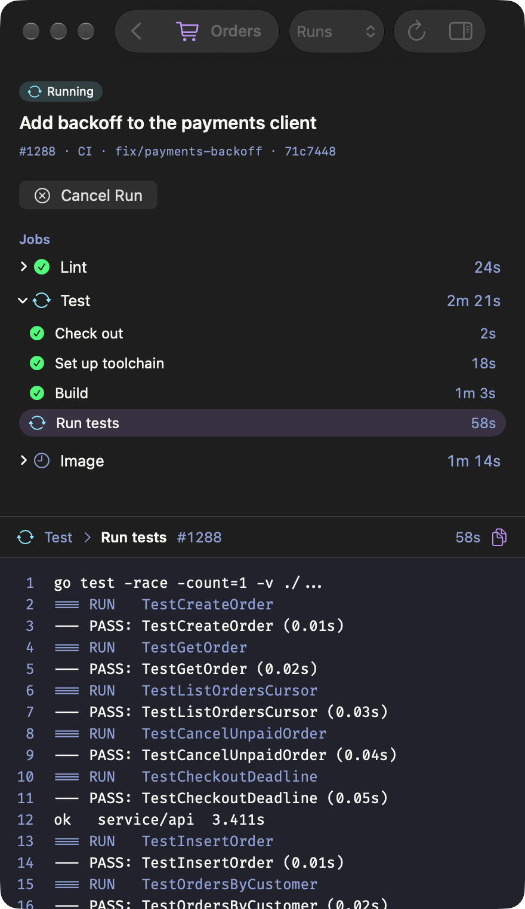

# Builds

The Builds window shows the CI of one project's repository: its workflow runs and its releases, read from
GitHub with the GitHub CLI, `gh`, which the user installs and logs in to ([Data › Builds](../data.md#builds)). For the run
picked it shows the run's details, its jobs and their steps, and under the table the log of one step. For
the release picked it shows its details and assets, and its notes under the table. The details are always
open: at the window's right on a Mac, beside the log under the table on an iPad (the user's choice).

*Payments' runs with run 641 selected. It failed in Test › Run tests, whose log fills the pane under the table.*

*The same run in dark mode.*

## Opening it

Every project has Builds, whatever its kind ([Tools per project](navigation.md#tools-per-project)).

- **Projects window.** The **Builds** tile (`hammer`) reads "Last run on" and the date of the last run. Its
  **Open** button (`projects.tool.builds.open`) opens the window.
- **Window ▸ Builds (⌘5).** Opens Builds for the key window's project.
- **Menu bar panel.** The `hammer` button in the highlighted project's row, or ⌘5 ([Menu bar](menu-bar.md)).
- **Project switcher.** Every project can be picked. Picking one keeps the window and selects the newest run
  of that project's repository.
- **Links from other tools.** Each asks for the route `.tool(.builds, project:, focus:)`, whose focus names
  a run or a release ([Routes](navigation.md#routes)).

**Focus formats:**

| Focus | Selects | Example |
| --- | --- | --- |
| A run's id on GitHub (`databaseId`; a sample's number) | The run, in **Runs** | `11873246123`, `1288` |
| `release:` and a tag | The release, in **Releases** | `release:v1.4.0` |

A focus that names no run or release of the repository opens the window on its newest run, and changes
nothing in a window that is already open.

| From | Control | Focus |
| --- | --- | --- |
| Dashboard | A row of the Recent Builds widget (`dashboard.build.<number>`), outside edit mode. Help: "Open the run in Builds". | The run |
| Tickets | A build link in a ticket, such as "Run 641" | `641` |
| Projects | A Builds event in the Activity list, such as "Run failed: verify webhook signatures with the new secret" | `641`. Releases and older history open without one. |
| Chat | **Open** on a tool call or a referenced run or release, such as "Run 1288" or "Release v1.4.0" | `1288`, `release:v1.4.0` |

Without a focus the window opens in **Runs** on the newest run. A run's focus selects that run, and a
release's switches to **Releases** with that release selected. At iPhone width the window starts on the
item's page. Either way the log shows the run's first step to read (see [Step log](#step-log)).

A route for a project whose Builds window is already open brings that window forward, un-minimized, and
selects the route's run or release there, switching to its mode ([Window reuse](navigation.md#window-reuse)).
The window keeps its state otherwise: the other mode's selection stays as it was. A route to the item asked
for last time selects it again, even after the user has picked another. At iPhone width the item's page
opens.

**Which runs.** The window shows the newest 50 runs, of every branch and workflow, and the newest 50 published
releases of the project's GitHub repository: its GitHub page as it resolves, so a sub project on its parent's
settings shows its parent's. In the samples, ToolsKit, inside the Tools app's repository, shows the runs and
releases of Tools. A focus that names a run not read yet is applied once the list is read.

**Refresh.** The shown mode's list is read when the window shows it, then every 30 s while it does, counted from
the end of the last read; then the selected run's jobs (again while it runs) and its step's log. **Refresh**
reads at once; a re-run or a cancel reads again once done. The lists keep what they show while a read runs.

The window opens at 1180 × 720 pt.

## Anatomy

| Region | Contents |
| --- | --- |
| **Toolbar** | Project switcher, the **Runs** / **Releases** control, **Refresh**, the chat panel's button. |
| **Table** | The runs, or the releases, newest first. |
| **Lower pane** | The log of the selected step, or the selected release's notes. |
| **Details** | The run's details: status, title, number, workflow, branch, commit, **Re-run**, **Open on GitHub**, jobs and steps. Or the release's details and assets. |
| **Chat panel** | Optional, at the window's right edge. See [Chat](chat.md). |

The table sits over the lower pane in a vertical split whose divider moves. The details are always open,
and there is no button to hide them (the user's choice):

- **Mac:** at the window's right as an inspector column, 280 to 440 pt wide (330 pt ideal), beside the
  table and the lower pane.
- **iPad:** under the table, at the right of the log or the notes, in a split whose divider moves: 280 to
  440 pt wide (330 pt ideal), the log or the notes taking the rest. The table spans the window's width
  (the user's choice).

The chat panel, when shown, sits at the right edge. See [Layouts](#layouts).

## Toolbar

| Item | Control | Symbol | Shortcut | Behavior | Layouts |
| --- | --- | --- | --- | --- | --- |
| Project switcher | Button with a popover | The project's icon | — | Moves the window to another project. See [Project switcher](components.md#project-switcher). | Mac, iPad, iPhone |
| Back | The stack's own button | — | — | Returns to the list and clears the selection. | iPhone, on a page |
| **Runs** / **Releases** | Picker "Show": segmented in the toolbar's middle; a menu labeled with the current mode on an iPhone | — | — | Switches between the runs and the releases. | Mac, iPad (segmented); iPhone (menu) |
| **Refresh** | Button | `arrow.clockwise` | — | Reads the shown mode's list again; a small spinner takes its place while it reads. Help: "Refresh". | Mac, iPad, iPhone |
| **Chat** | `ChatPanelToolbarItem` | `sidebar.right` | ⌃⌘C | Shows or hides the chat panel. Always the last item (the user's choice). See [Chat panel button](components.md#chat-panel-button). | Mac, iPad, iPhone |

There is no button for the details: they are always open (the user's choice). The window's title, "Builds",
and its subtitle, the project's path such as "Shop › Payments", show from 760 pt wide.

## Modes

- **Runs** (the default): the runs table over the step log, with the run's details.
- **Releases**: the releases table over the release's notes, with the release's details.

Each mode keeps its own selection, so switching back returns to the same run or release. The window starts
in **Runs**, with the newest release selected for **Releases**. A window opened on a release starts in
**Releases**, with the newest run selected for **Runs**.

## Runs table

One row per run, newest first. The table selects one run at a time, with a click or the arrow keys. Its
columns don't sort. Identifier: `builds.runs`.

| Column | Width | Contents |
| --- | --- | --- |
| **Status** | 48 pt | The status symbol, in the status color (the system's primary color on a selected row). |
| **Run** | 220 pt minimum, 340 pt ideal | The head commit's message on one line, over "#641 · 8e7ccf3" (number and commit) in `caption` monospaced, secondary. VoiceOver reads the two as one element, `builds.run.<number>`. |
| **Workflow** | 70 pt minimum, 90 pt ideal | The workflow's name, such as "CI" or "Release". |
| **Branch** | 100 pt minimum, 150 pt ideal | The branch, monospaced, on one line, truncated in the middle. |
| **Duration** | 80 pt | The run's length, such as "3m 23s". A running run reads "Running", in `info`. |
| **Started** | 100 pt minimum, 120 pt ideal | Day, short month and time, such as "11 Nov at 09:00", with monospaced digits. |

**Statuses**, shared by runs, jobs and steps:

| Status | Symbol | Color |
| --- | --- | --- |
| Passed | `checkmark.circle.fill` | `success` |
| Failed | `xmark.circle.fill` | `danger` |
| Running | `arrow.triangle.2.circlepath` | `info` |
| Queued | `clock` | `textSecondary` |
| Cancelled | `minus.circle` | `textSecondary` |

Picking a run shows its details, shows the log of its first step to read, and makes it the chat panel's
subject. The step changes with the run, so the run's details open on the job that holds it. There are no
context menus and no drag and drop.

## Run details

The details scroll, with 16 pt padding. Identifier: `builds.inspector.run`.

- **Status**: a badge with the status's title and symbol, in its color, such as "Failed".
- **Title**: the head commit's message, in `title3` semibold, with the header trait.
- **Where it ran**: "#641 · CI · main · 8e7ccf3" (number, workflow, branch, commit), in `caption`
  monospaced, `textSecondary`, selectable.
- **Re-run** (`arrow.clockwise`), for a completed run: runs every job again (help "Re-run All Jobs"). When
  some job failed, it is a menu button whose click runs the failed jobs again (help "Re-run Failed Jobs") and
  whose menu offers **Re-run Failed Jobs** and **Re-run All Jobs**.
- **Cancel Run** (`xmark.circle`), in its place while the run is queued or running.
- While one of these runs, they are disabled; a failure shows the alert "Re-run Failed Jobs failed", "Re-run
  All Jobs failed" or "Cancel Run failed" with gh's reason.
- **Open on GitHub** (`arrow.up.forward.square`): opens `https://github.com/<owner>/<name>/actions/runs/<id>`
  in the browser. Not shown for a sample.
- **Jobs**: a heading in `subheadline` semibold, secondary, with the header trait, over one disclosure row
  per job.

**Job rows.** The job's status symbol, its name and its duration, in the secondary color. A job opens on
its steps when it failed, when it is running, or when it holds the step whose log is shown. The others
start closed; a click on the disclosure arrow opens them. Each newly picked run's details start this way.

**Step rows.** Inside an open job: the step's status symbol, its name and its duration, in `callout`. A
click on a step shows its log under the table. The selected step has an `accent` capsule at 16% opacity
behind it and the selected trait.

## Step log

The pane under the runs table shows the log of the selected step, as wide and as tall as the pane. It is a
code view. Identifier: `builds.log`.

**Which step.** When a run is picked, the log shows its first failed step, otherwise its first running
step, otherwise its last passed step. A click on another step in the details changes it.

**Header row**, in `callout`, with 14 pt horizontal and 8 pt vertical padding: the step's status symbol, the
job's name (secondary), `chevron.forward`, the step's name (semibold), the run number such as "#641"
(secondary), then at the right the step's duration and **Copy Log** (`doc.on.doc`, icon only, help
"Copy Log"), which copies the step's lines; disabled while the log has none.

**Lines**, under a divider, on the `surfaceSunken` color: a line number (secondary, right-aligned) and the
line, in Fira Code at the `callout` size, with its ligatures (AZDesign's code font). Lines don't wrap: the
log scrolls both ways and starts at its top-left corner. The text is selectable. 14 pt padding, 16 pt
between the columns, 3 pt between lines. Identifier: `builds.log.lines`.

| Line starts with | Color |
| --- | --- |
| `FAIL`, `--- FAIL`, `Error` or `✘` | `danger` |
| Four spaces, or `  Expectation` | `warning` |
| `=== RUN` | `textSecondary` |
| Anything else | `textPrimary` |

**Reading.** gh gives a job's log once the job has completed: while it reads, a small spinner fills the pane
(`builds.log.loading`); a job still running reads "No Log" and "The log shows once the job has finished.", and
a failed read "No Log" with gh's reason (`builds.log.failure`); a step that wrote nothing reads "No Log" and
"This step wrote nothing." (`builds.log.empty`). GitHub's time at the start of each line is left out. In the
samples, a queued step's log reads "Waiting for a runner.", a cancelled step's "The run was cancelled before
this step started.", and a running step's ends with "…".

## Releases table

*Releases mode, opened on Orders' `release:v1.4.0`: the release's notes under the table, its details and assets at the right.*

One row per release, newest first. One release at a time is selected. Picking one shows its notes and
details, and makes it the chat panel's subject. Identifier: `builds.releases`.

| Column | Width | Contents |
| --- | --- | --- |
| **Tag** | 160 pt minimum, 220 pt ideal | The tag, monospaced, then a badge: **Latest** (`star.fill`, `success`) or **Pre-release** (`flask`, `warning`). VoiceOver reads the two as one element, `builds.release.<tag>`. |
| **Title** | Flexible | The release's title. |
| **Published** | 110 pt | Day, short month and year. |
| **Assets** | 60 pt | The number of assets. |

## Release notes and details

**Notes**, under the releases table, on the `canvas` color, with 20 pt padding. The tag in `title3`
monospaced semibold beside the title in `title3`, together a header. Under them the notes, with 3 pt line
spacing, selectable. "No notes." in `textSecondary` when there are none. Identifier: `builds.releaseNotes`.

**Details**, with 16 pt padding: at the window's right on a Mac, beside the notes on an iPad, over them on
an iPhone's page. Identifier: `builds.inspector.release`.

- The tag in `title3` monospaced semibold, with the header trait.
- The title.
- The publication date and time, in `caption`, secondary.
- **Assets**: a heading in `subheadline` semibold, secondary, with the header trait, over one row per
  asset: `doc.zipper` and the file name, monospaced, then **Download** (`arrow.down.circle`, icon only,
  help "Download"), which saves the file in the Downloads folder ([Data › Builds › Downloads](../data.md#downloads)):
  a small spinner while it saves, then **Show in Finder** (`magnifyingglass`), which reveals the file, until the
  window closes. A failure shows the alert "Download failed" with gh's reason. "No assets." when there are none.

## States

| State | When | What shows |
| --- | --- | --- |
| **Runs** | The repository has runs. | The runs table over the step log, the run's details at the right. |
| **No Runs** | The repository has no runs, as in the **No Runs** preview. | In place of the table and the log: "No Runs" (`hammer`): "This project's repository has no workflow runs yet." On a Mac the details read "No Run Selected"; on an iPad and an iPhone the message fills the window. |
| **No Releases** | **Releases** mode, and the repository has no releases (Edge Gateway and Shop in the samples, as in the **No Releases** preview). | "No Releases" (`hammer`): "This project's repository has no releases yet." On a Mac the details read "No Release Selected"; on an iPad and an iPhone the message fills the window. |
| **Reading** | The list isn't read yet. | "Reading the runs…" or "Reading the releases…" with a spinner, in place of the table (`builds.loading`). |
| **Can't Show the Runs** / **Can't Show the Releases** | gh can't read the list: no GitHub page, no gh, no login, or gh failed. | `exclamationmark.triangle`, the title, the reason ([Data › Builds › Failures](../data.md#failures)), and **Try Again**, which reads again (`builds.unavailable`, `builds.tryAgain`). |
| **No Run Selected** | No run is selected. | In the details: "No Run Selected" (`hammer`). |
| **No Step Selected** | No step is selected, or no run is. | In the log pane: "No Step Selected" (`text.alignleft`): "Pick a step in the run's details to read its log." |
| **No Release Selected** | **Releases** mode with no release selected. | In the notes pane and the details: "No Release Selected" (`tag`). |
| **Running run** | The run is still running. | "Running" in the **Duration** column, **Re-run** disabled, and a log ending with "…". Its later jobs are queued. |
| **Release without notes or assets** | — | "No notes." in the notes, "No assets." in the details. |

## Layouts

See [Layout system](foundations.md#layout-system). Builds' Mac width is 900 pt.

| Layout | When | What changes |
| --- | --- | --- |
| **Mac** | At least 900 pt wide, or 1241 pt with the chat panel open. | The table over the log (runs: table 150 pt minimum, 320 pt ideal; log 140 pt minimum, 300 pt ideal) or over the notes (releases: table 120 pt minimum, 220 pt ideal; notes 140 pt minimum, 360 pt ideal). The details are always open at the right (the user's choice). The mode is a segmented control in the toolbar's middle. The chat panel sits beside the tool, which narrows to make room. |
| **iPad** | From 640 pt to the Mac width. | The table spans the window's width, over a split whose divider moves (runs: table 150 pt minimum, 280 pt ideal; under it 200 pt minimum, 340 pt ideal. Releases: table 120 pt minimum, 220 pt ideal; under it 200 pt minimum, 360 pt ideal). Under the table, the log or the notes (300 pt minimum) sit beside the details, at the right (280 to 440 pt wide, 330 pt ideal), in a split whose divider moves. The details stay always open, with no button to hide them (the user's choice). The mode is a segmented control in the toolbar's middle. The chat panel slides over the content, with a shadow. |
| **iPhone** | Narrower than 640 pt. | One pane at a time (the user's choice), with [`PhoneStack`](components.md#phone-stack). The mode becomes a menu at the toolbar's right. **Runs** lists compact rows: the status symbol, the title on up to two lines, "#1288 · CI · fix/payments-backoff" in `caption`, and the start date. Picking a run pushes its page: its details over its log, in a split whose divider moves (details 180 pt minimum, 300 pt ideal; log 140 pt minimum, 300 pt ideal). **Releases** lists compact rows: the tag, monospaced, with "Latest" (`success`) or "Pre-release" (`warning`), the title and the date. A release's page shows its details over its notes. A window opened on a run starts on its page (the user's choice), and one opened on a release on the release's page. A route that arrives while the window is open opens its item's page. The chat panel becomes a full page. A window that narrows to this width keeps its selection and shows that item's page, as a collapsing split view does ([Foundations › Layout system](foundations.md#layout-system)). |

*At iPad width, 760 pt: the runs table spans the window, and the log of run 641's failed step sits beside its details (the user's choice).*

*At iPhone width: Orders' runs as compact rows, with the mode as a menu.*

*Run 1288's page: its details over the log of Test › Run tests, still running.*

## Chat panel

The chat panel's subject is the selected item of the mode shown:

| Mode | Subject | Reference title | Focus | Composer |
| --- | --- | --- | --- | --- |
| **Runs** | The selected run | Run 641 | `641` | "Ask about Run 641…" |
| **Releases** | The selected release | Release v1.4.0 | `release:v1.4.0` | "Ask about Release v1.4.0…" |

The next message carries the subject as a chip. Switching modes changes the subject.

**What Claude reads**: Claude calls the Builds MCP tools (`list_runs`, `get_run`, `get_run_log`, `list_releases`,
`get_release`, and with the user's permission `rerun_run` and `cancel_run`; [MCP](../mcp.md#tools)). The chat's
rows and suggestions come from `BuildsReader.read(_:project:store:)`, from the same runs and releases as the
window, those of the repository's owner. Each detail line is one localized sentence with the values in it.

| Item | Action | Detail |
| --- | --- | --- |
| Run | "Read run 641" | "Verify webhook signatures with the new secret · Failed · CI on main": title · status · workflow on branch |
| Release | "Read release v1.4.0" | "Order cancellation · Latest · Published 10 Nov 2026": title · Latest or Pre-release (nothing for an older release) · date |

**Suggestions.** The reader also words the questions worth asking about the item in its state, which the
panel offers. "Run" is lowercase inside a question.

| Item | Suggestions |
| --- | --- |
| Failed run | "Why did run 641 fail?" · "What changed in run 641?" |
| Running run | "Which step is run 1288 on?" · "What changed in run 1288?" |
| Queued run | "Why is run 1288 still queued?" · "What changed in run 1288?" |
| Cancelled run | "Why was run 1283 cancelled?" · "What changed in run 1283?" |
| Passed run | "What changed in run 640?" · "Was run 640 slower than usual?" |
| Release | "What's new in release v1.4.0?" · "Which runs went into release v1.4.0?" |
| Pre-release | "What's new in release v1.5.0-rc.1?" · "What's left before release v1.5.0-rc.1 is final?" |

**No selection**, such as after Back at iPhone width: the panel asks about the project, with the
suggestions "What changed this week?" and "What needs my attention?".

See [Chat](chat.md).

## Accessibility

| Element | Identifier | Label or notes |
| --- | --- | --- |
| Project switcher | `toolbar.projectSwitcher` | See [Components](components.md#project-switcher). |
| Mode | `builds.mode` | Picker "Show": "Runs", "Releases". |
| Refresh | `builds.refresh` | "Refresh". |
| Runs table | `builds.runs` | Each status symbol reads its status: "Passed", "Failed", "Running", "Queued", "Cancelled". |
| Runs list (iPhone) | `builds.runs.compact` | Each row reads as one element. |
| Releases table | `builds.releases` | — |
| Releases list (iPhone) | `builds.releases.compact` | Each row reads as one element. |
| Run row | `builds.run.<number>`, such as `builds.run.641` | In the table, on the **Run** cell, which reads as one element. At iPhone width, the compact row. |
| Release row | `builds.release.<tag>`, such as `builds.release.v1.4.0` | In the table, on the **Tag** cell, which reads as one element with its badge. At iPhone width, the compact row. |
| Run details | `builds.inspector.run` | The title and the **Jobs** heading have the header trait. |
| Re-run | `builds.inspector.rerun` | "Re-run". |
| Open on GitHub | `builds.inspector.openOnGitHub` | "Open on GitHub". |
| Job row | `builds.inspector.job.<job>`, such as `builds.inspector.job.Test` | Its status symbol reads its status. |
| Step row | `builds.inspector.step.<job>.<step>`, such as `builds.inspector.step.Test.Run tests` | The names are used as they are, spaces included. The selected step has the selected trait. |
| Log | `builds.log` | `chevron.forward` is hidden from VoiceOver. The lines' scroll view is `builds.log.lines`. |
| Copy Log | `builds.log.copy` | "Copy Log". |
| Release details | `builds.inspector.release` | The tag and the **Assets** heading have the header trait. |
| Download | `builds.inspector.download.<file>`, such as `builds.inspector.download.contract.yaml` | "Download" and the file's name, such as "Download contract.yaml". |
| Release notes | `builds.releaseNotes` | The tag and title are one header element. |
| No Runs, No Releases | `builds.noRuns`, `builds.noReleases` | — |
| No Run Selected, No Release Selected (details) | `builds.inspector.noRun`, `builds.inspector.noRelease` | — |
| No Step Selected (log pane) | `builds.log.noStep` | — |
| No Release Selected (notes pane) | `builds.releaseNotes.noRelease` | — |
| Chat panel button | `toolbar.chatPanel` | See [Components](components.md#chat-panel-button). |

## Sample data and limits

- **Live data.** The app reads runs and releases from GitHub with gh (`LiveBuildStore`); nothing is stored.
  Builds is every project's tool, but only a project with a GitHub page has runs.
- **Sample runs and releases.** Previews and captures use sample data (`WorkflowRun.samples(for:)`,
  `Release.samples(for:)`, `SampleBuildStore`). Each repository has a few named
  runs over a few weeks of ordinary history. The commit hashes are computed from the run numbers.
- **Jobs.** Every run has the jobs Lint (Check out, Lint) and Test (Check out, Set up toolchain, Build, Run
  tests). CI and Release runs add Image (Build image, Push image).
- **Logs** are sample lines in the shape of a CI log: Go for the services, Swift for the Tools and AZDesign
  workflows.
- **Releases**: Orders has three (one pre-release), Payments, Tools and AZDesign one each. Edge Gateway and
  Shop have none.
- **Running runs don't advance.** Their duration stays "Running".
- **Samples can't act**: their Re-run, Cancel and Download show an alert, and they have no Open on GitHub.

## Previews

In `BuildsKit/BuildsRootView.swift`, each on the window's model with the sample runs:

| Preview | Layout | Shows |
| --- | --- | --- |
| **Runs** | Mac, 1180 × 720 pt | Orders, on its newest run, 1288, still running. |
| **Runs, Dark** | Mac, 1180 × 720 pt | Payments, on run 641, in dark mode. |
| **Releases** | Mac, 1180 × 720 pt | Orders, on release v1.4.0. |
| **Releases, Dark** | Mac, 1180 × 720 pt | Orders, on the pre-release v1.5.0-rc.1, in dark mode. |
| **No Runs** | Mac, 900 × 600 pt | A new project without runs. |
| **No Releases** | Mac, 1180 × 720 pt | Shop, in **Releases**. |
| **Largest Text** | Mac, 1180 × 720 pt | Payments, on run 641, at the largest Dynamic Type size. |
| **iPad** | iPad, 760 × 720 pt | Payments, on run 641: the log and the details under the table. |
| **iPad, Dark** | iPad, 760 × 720 pt | Orders, on run 1288, in dark mode. |
| **iPad, Releases** | iPad, 760 × 720 pt | Orders, on release v1.4.0. |
| **iPad, Largest Text** | iPad, 760 × 720 pt | Payments, on run 641, at the largest Dynamic Type size. |
| **iPhone** | iPhone, 420 × 800 pt | Orders' runs as a list. |
| **iPhone, Run** | iPhone, 420 × 800 pt | Run 1288's page. |
| **iPhone, Run, Dark** | iPhone, 420 × 800 pt | Run 641's page, in dark mode. |
| **iPhone, Release** | iPhone, 420 × 800 pt | Release v1.4.0's page. |
| **iPhone, Largest Text** | iPhone, 420 × 800 pt | Run 1288's page, at the largest Dynamic Type size. |

The Dashboard's Recent Builds widget has its own, in `BuildsKit/BuildsDashboardWidget.swift`, each 460 pt
wide: **Recent Builds** (Orders), **Recent Builds, Dark** (Payments, in dark mode) and **No Builds** (a project
without runs). See [Dashboard](dashboard.md).

## Open issues

None.
