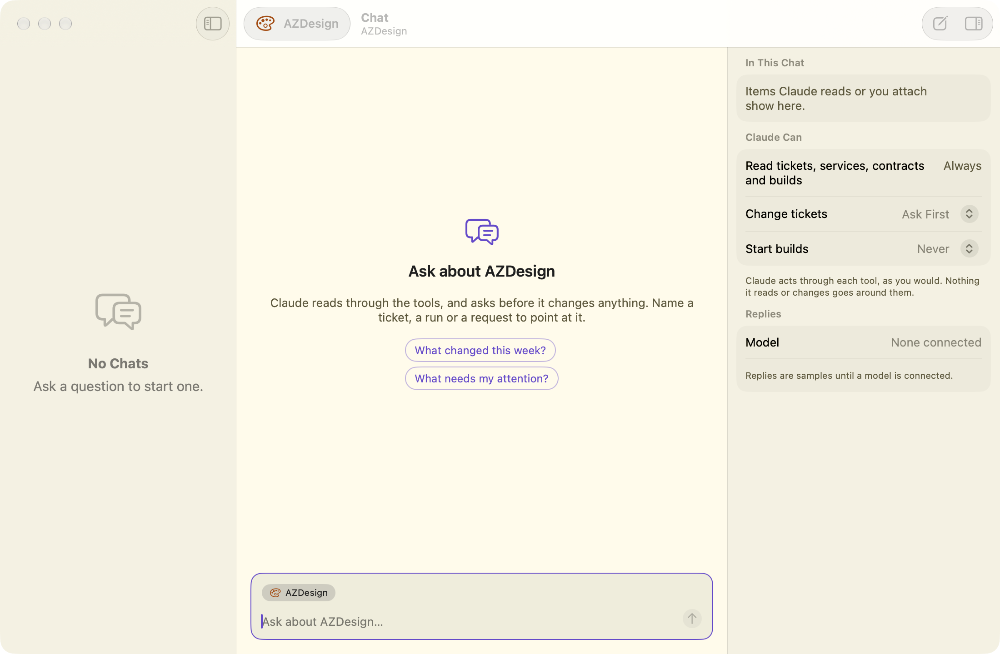
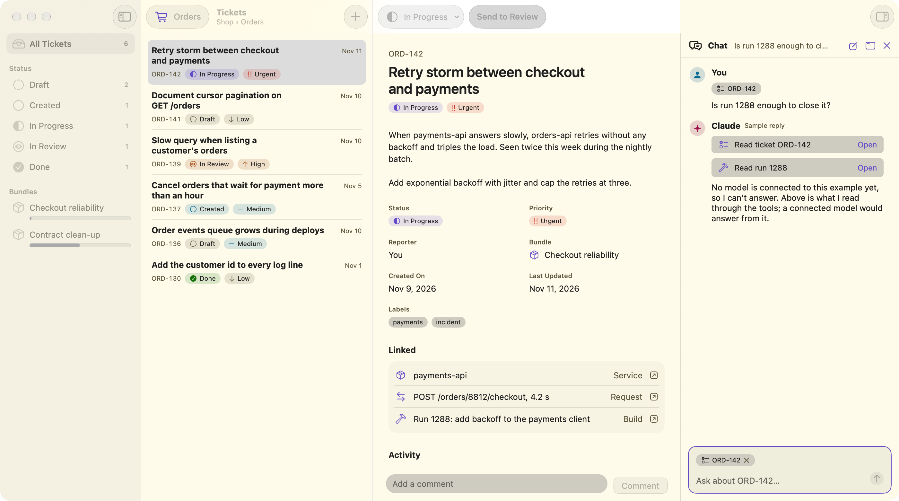

# Chat

Chat is where the user asks Claude about a project. Claude is one more client of the tools, never their center: it reads items only through each tool's read function, every read shows in the conversation with an **Open** button, and it asks before it changes anything (the user's principle). Chat appears in two places (the user's choice). The **Chat window** is a tool window like the others: it lists every conversation of a project and shows one with an inspector. The **chat panel** sits beside every other tool window and asks about the item that tool has selected. Both show the same conversations, from one shared store. No model is connected yet: a sample engine replies, and the conversations are sample data.

*The Chat window for Orders, light appearance. Claude's reply lists what it read through Service Map, Tickets and Builds, each with Open, then asks to comment on ORD-142.*

*The same window in the dark appearance.*

## Opening it

| From | How | Result |
|---|---|---|
| Projects window | **Open** on the **Chat** tile of the project's Tools section. The tile reads "Ask Claude, which reads through these tools". | The project's Chat window. Every project kind offers Chat, last in tool order. |
| Window menu | **Chat**, ⌘6 | The Chat window for the key window's project. Disabled when the key window has no project. |
| Menu bar panel | ⌘6 for the highlighted project, or the Chat button of the row under the pointer | The Chat window for that project. |
| Project switcher | Pick another project in the Chat window's toolbar | The same window switches project and drops its focus. |
| Chat panel | **Open in Chat Window** (`macwindow`) in the panel's header | The project's Chat window, with the panel's conversation selected. |

The route is `.tool(.chat, project:, focus:)`. The focus is a conversation id, such as `chat-checkout`. Without a focus, or with one that isn't a conversation of the project or its sub projects, the window selects the latest conversation of the project and its sub projects. If a Chat window already shows the project, it comes forward, un-minimized, and selects the focus without starting afresh: the draft, the list's grouping and the inspector stay as they are. A second route to the same conversation selects it again, even after the user picked another. A focus the list doesn't have leaves the selection as it is. See [navigation.md](navigation.md) for window reuse.

The window opens at 1180 × 780 pt and gets no smaller than 390 × 420 pt. Its title is **Chat**; its subtitle is the project's path, such as `Shop › Orders`.

## Anatomy

| Region | Contents |
|---|---|
| Conversation list | The conversations of the project and its sub projects, latest first, grouped by project for a parent. |
| Transcript | The selected conversation's turns: messages, tool-call rows, approval cards, and the reading indicator while a reply is coming. |
| New-chat prompt | In place of the transcript when no conversation is selected: what to ask, and suggestions. |
| Composer | Under the transcript or prompt: the chips the message carries, the field, and **Send**. |
| Inspector | What the conversation read or attached, what Claude may do, and which model replies. |

On a Mac the list is the split view's sidebar column, the transcript (or prompt) over the composer fills the center, and the inspector is a trailing column. The center column has the `canvas` background.

## Toolbar

| Item | Control | Symbol | Shortcut | Behavior | Layouts |
|---|---|---|---|---|---|
| Project switcher | `ProjectSwitcher`, leading (see [components.md](components.md)) | Project icon | — | Switches this window's project and clears its focus. | Mac, iPad, iPhone |
| Title and subtitle | Window title | — | — | **Chat** and the project's path. Dropped below 760 pt wide. | Mac, iPad |
| Sidebar | The split view's own button | System | System | Shows or hides the conversation list. | Mac, iPad |
| **New Chat** | Button | `square.and.pencil` | ⇧⌘N (File ▸ New Chat) | Clears the selection and the draft, and shows the new-chat prompt in place. In the iPhone layout it opens the prompt as a page. Help: "New Chat (⇧⌘N)". | Mac, iPad, iPhone |
| **Inspector** | Button | `sidebar.right` | — | Shows or hides the inspector. In the iPhone layout it opens the inspector as a sheet. Help: "Show Inspector" or "Hide Inspector". | Mac, iPad, iPhone |

The Chat window has no chat panel and no chat panel button. Its `sidebar.right` button belongs to the inspector.

## Conversation list

- **Rows.** Each row shows the conversation's title on one line, then a caption in `textSecondary`: the date of its last turn (day, abbreviated month, hour and minute) and, for a conversation started in a tool's panel, "· from *Tool*" (for example "· from Builds"). The date and the origin are one sentence for translators. A row reads as one element.
- **Order.** Latest first, by the date of the last turn. A new message moves its conversation to the top.
- **Grouping.** For a project with sub projects, the list has one section per project that has conversations, in tree order, the project itself first. Each header shows the project's icon and name, and is a heading for VoiceOver. For a project without sub projects, the rows are not grouped.
- **Selection.** Single selection. The selected conversation shows in the transcript. The list column is 220 to 340 pt wide, 260 pt ideally.
- **Empty.** When neither the project nor its sub projects have a conversation, the list shows "No Chats" with the Chat symbol (`bubble.left.and.text.bubble.right`) and "Ask a question to start one."
- There is no context menu, no drag, no rename and no delete.

## Transcript

The transcript scrolls. A short conversation starts at the top. A long one opens on its end and follows new turns as they arrive. It has 24 pt of padding, or 16 pt in the iPhone layout.

### Turns

Turns have no bubbles. Each turn starts with an author row: a circular badge, 24 pt and scaled with Dynamic Type, then the author's name in headline weight. The name is a heading for VoiceOver, so the rotor steps from turn to turn.

| Author | Badge symbol | Badge color | Name |
|---|---|---|---|
| The user | `person.fill` | `info` | **You** |
| Claude | `sparkle` | `accentSecondary` | **Claude** |

Under the name, in order:

1. **Attachments.** The items the user's message carried, as chips (tool symbol and title; tooltip "*Tool*: *title*").
2. **Blocks.** Text, tool-call rows and approval cards, in the order Claude produced them. Text is selectable.

A reply from the sample engine adds a **Sample reply** caption after **Claude**, with the tooltip "No model is connected yet: the reply comes from the example's sample engine."

### Tool-call rows

Each item Claude read shows as one row on a `surfaceSunken` card. The row shows the tool's symbol in `accent`, the action ("Read ticket ORD-142") and, on the same line, the tool's one-line answer in `textSecondary`, truncated at the end. The tooltip shows the full answer.

**Open** opens the item in its tool's window, with the item selected: the route `.tool(tool, project:, focus:)`. A window already showing the item comes forward. Help: "Open ORD-142 in Tickets".

For VoiceOver the row is one button: its label is the action, its value the tool's answer, its hint the help text, and activating it opens the item.

### Approval cards

A change Claude wants to make shows as a card. Nothing changes until the user answers.

- **Title.** `hand.raised.fill` in `warning`, then the request as one sentence, such as "Claude wants to comment on ORD-142". Each kind of change has its own sentence, so a translation orders the words as its language needs. Commenting on a ticket is the only kind so far. The title is a heading for VoiceOver.
- **Preview.** What it would write, selectable, on a `surfaceSunken` box.
- **Note.** The tool's symbol and "Through *Tickets*, as if you did it".
- **Answer.** **Don't Allow** and **Allow** (prominent). After the answer, the buttons give way to **Allowed** (`checkmark.circle.fill`, `success`) or **Not Allowed** (`xmark.circle`, `textSecondary`).
- **Outline.** `warning` at 50 % opacity while the card waits; `divider` once answered.
- The note and the answer share one line when they fit and stack when they don't.

The decision is kept with the conversation for as long as the app runs. Allowing records the decision only: nothing is written to the tool yet (Not wired yet).

### Reading indicator

While a reply is coming, the transcript ends with a **Claude** row showing a small progress indicator and "Reading…" (`chat.responding`). The sample engine waits 700 ms before it replies, only to show how a reply arrives.

## Composer

The composer is a card at the bottom of the center column, with 16 pt of padding around it, or 12 pt in the iPhone layout. Its outline is `focus` while the field has focus, `divider` otherwise.

- **Chips.** In the Chat window, the project's chip: its icon and name. It can't be removed. Messages from the Chat window carry no attachments; items they name are read instead (see [Mentions](#mentions)).
- **Field.** Plain, one to eight lines, then it scrolls. Prompt: "Ask about *Orders*…". It takes focus when the composer appears.
- **Send.** A round, prominent button with `arrow.up`. Disabled while the field is empty or only whitespace, and while the conversation waits for a reply. Help: "Send (Return)".
- **Keyboard.** **Return** sends. **⌥Return** starts a new line.

Sending adds the message to the selected conversation. With no conversation selected, it starts one: the title is the message's first 80 characters, the project is the window's, and it has no origin. The new conversation is selected and the draft clears. The draft is kept when the user picks another conversation, and when a suggestion is sent.

## New chat

The new-chat prompt replaces the transcript when no conversation is selected: after **New Chat**, or when the project has no conversations.

*AZDesign has no chats yet. The list shows its empty state and the prompt offers two questions.*

Centered, it shows:

1. The Chat symbol in large title size, in `accent`.
2. "Ask about *AZDesign*", title 2, semibold, a heading for VoiceOver.
3. "Claude reads through the tools, and asks before it changes anything. Name a ticket, a run or a request to point at it."
4. Two suggestions, as outlined capsule buttons in `accent`: **What changed this week?** and **What needs my attention?**

A suggestion sends at once and starts the conversation; the draft stays as it is. When the largest text sizes need more room than the window has, the prompt scrolls.

## Inspector

A grouped form in a trailing column, 260 to 400 pt wide, 300 pt ideally.

| Section | Contents |
|---|---|
| **In This Chat** | Every item the conversation attached or read, in the order it first came up. Each row: the tool's symbol, the item's title, the tool's name as a caption, and **Open**, which opens the item in its tool's window (help "Open *item* in *Tool*"). An item seen in two Service Map environments has a row for each. With none: "Items Claude reads or you attach show here." |
| **Claude Can** | **Read tickets, services, contracts and builds**: Always (fixed text). **Change tickets**: Never, Ask First or Always; Ask First by default. **Start builds**: Never or Ask First; Never by default. Footer: "Claude acts through each tool, as you would. Nothing it reads or changes goes around them." The same settings as [Settings ▸ Chat](#settings--chat). |
| **Replies** | **Model**: None connected. Caption: "Replies are samples until a model is connected." |

The permissions are stored in the user defaults (`chat.ticketChanges`, `chat.buildStarts`). Nothing reads them yet (Not wired yet).

## How Claude reaches the tools

Claude reaches a tool only through that tool's read function, as any other client of the tool would (the user's principle). ChatKit imports no tool. ToolsScenes, the only target that knows every tool, gives every window a `toolReader` that sends each item to the tool it belongs to.

1. **A tool says what is selected.** A tool window reports its selected item as a reference (tool, project, focus, title, and for the Service Map the environment on screen) through `reportChatSubject`. The window keeps it for its chat panel. The chat never looks into the tool's window.
2. **The message carries it.** Sent from the panel, the item travels with the message as an attachment.
3. **The tool reads it.** The reply engine asks `toolReader` to read each attached or mentioned item. `toolReader` calls the tool's read function, which answers with an action, a one-line detail, and the questions worth asking about the item in its state.
4. **The read shows.** Each answer becomes a tool-call row with **Open**, and the item is listed under **In This Chat**. An item the tool can't find is skipped and shows nothing.
5. **Changes ask first.** A change shows as an approval card. Nothing changes until the user allows it.

The panel also reads its attached item before the first message, only for the tool's questions, which it offers as suggestions (see [What it asks about](#what-it-asks-about)).

| Tool | Read function | Focus | Action | Detail |
|---|---|---|---|---|
| Tickets | `TicketsReader.read(_:)` | Ticket id: `ORD-142` | Read ticket ORD-142 | Title · status · priority |
| Service Map | `ServiceMapReader.read(_:environment:project:)` | `service:<name>` or `request:<id>` | Read service payments-api; Read request req-8f3a | Service: environment · health · p95 · error rate · ready pods. Request: environment · method and path · status and duration · number of services. |
| Builds | `BuildsReader.read(_:project:)` | Run number: `1288` | Read run 1288 | Title · status · workflow on branch |
| Builds | `BuildsReader.read(_:project:)` | `release:<tag>`: `release:v1.4.0` | Read release v1.4.0 | Title · Latest or Pre-release (nothing for older releases) · published date |
| Contracts | `ContractsReader.read(_:project:)` | operationId: `createOrder` | Read operation createOrder | Method and path · summary · contract title and version |
| Dashboard, Chat | None | — | — | — |

- The Service Map's reader reads the environment the reference carries: the one the Service Map showed when it reported the item. A request named in a message carries none; the reader then reads the project's first environment that isn't healthy, or its first environment. The same item seen in two environments is two items.
- The Builds reader reads the runs of the project that owns the repository, so a sub project that shares a repository reads its owner's runs.
- The Tickets reader finds a ticket by its id among all tickets.

### Mentions

Items a message names are read too. A ticket belongs to the project its prefix names; a request or a run is looked up in the project of the window the message was sent from.

| Written | Read as | Example |
|---|---|---|
| Two to five capital letters, a hyphen and a number, when the letters are a project's id | A ticket of that project | ORD-142 |
| `req-` and four hexadecimal digits | A request in the Service Map | req-8f3a |
| "run" and a number, any case, with or without `#` | A run in Builds | run 1288, Run #1288 |

Attachments are read first, then ticket mentions, request mentions and run mentions. Within one reply, each item shows once: an item that is both attached and named is read once, as attached, in the environment the Service Map showed. Operations and releases are read only when attached from the Contracts or Builds window's panel.

### Replies

No model is connected yet. The sample engine stands in for the reply engine a model would be: it reads what the message attaches or names, then says it can't answer.

- With reads: "No model is connected to this example yet, so I can't answer. Above is what I read through the tools; a connected model would answer from it."
- Without: "No model is connected to this example yet, so I can't answer. Attach an item, or name one such as ORD-142, run 1288 or req-8f3a, and I'll show what I would read through its tool."

## States

| State | When | What shows |
|---|---|---|
| Conversation | A conversation is selected. | Its transcript over the composer. |
| New chat | **New Chat**, or no conversation selected. | The new-chat prompt over the composer. |
| No chats | The project and its sub projects have no conversation. | "No Chats" in the list; the new-chat prompt. |
| Waiting for a reply | After sending, until the reply arrives. | The "Reading…" row; **Send** disabled for that conversation. |
| Sample reply | A reply from the sample engine. | **Sample reply** after **Claude**. |
| Approval waiting | A card has no answer. | **Don't Allow** and **Allow**; `warning` outline. |
| Approval answered | The user answered. | **Allowed** or **Not Allowed**; `divider` outline. |
| Nothing in this chat | The conversation read and attached nothing, or none is selected. | "Items Claude reads or you attach show here." in the inspector. |
| No project | The window was restored without a known project. | "No Project", `folder`, "Open this window from the Projects window." |

## Layouts

The window measures its width and picks a layout; see [foundations.md](foundations.md) › Layout system. The Chat window needs 960 pt for its Mac layout: below that, beside the list and the inspector, the conversation would get too narrow. Each time the layout changes, the list and the inspector take that layout's default visibility.

| Layout | When | What changes |
|---|---|---|
| Mac | 960 pt and wider | List, conversation and inspector side by side; the list and the inspector show. |
| iPad | 640 to 959 pt | The list folds away behind the sidebar button and the inspector hides behind **Inspector**. The conversation fills the window. One side column shows at a time, so the conversation keeps its room: opening the inspector folds the list, and showing the list closes the inspector. |
| iPhone | Narrower than 640 pt | One pane at a time. The list fills the window, with nothing selected, when the window opens at this width; a conversation opens as a page with Back. **New Chat** opens the prompt as a page, which becomes the conversation once sent. The inspector opens as a sheet, at least 360 × 480 pt, with **Done** (Return). Transcript padding is 16 pt, composer padding 12 pt. A window opened on a conversation starts on its page. A window that narrows to this width keeps its selection and shows that item's page, as a collapsing split view does ([Foundations › Layout system](foundations.md#layout-system)). |

Below 760 pt the toolbar also drops the window's title; the project switcher names the project.

*At 820 pt the list folds away and the inspector hides; the conversation fills the window.*

*In the iPhone layout the list of chats fills the window, with "from Builds" and "from Tickets" origins.*

*A conversation opens as a page over the list, with Back.*

## Chat panel

The Chat window has no panel of its own. This section specifies the panel that every other tool window (Dashboard, Tickets, Service Map, Contracts, Builds) can show beside its tool. The panel asks about the item the tool has selected. Its conversations are the Chat window's too: they appear in its list, "from *Tool*".

*Tickets in the Mac layout, with the panel beside the ticket. The panel's button is the toolbar's last item.*

### What it asks about

The panel's subject is the item the tool window reports as selected. It shows as a chip in the composer, and the next message carries it.

**Suggestions** come from the item's tool: its read function proposes the questions worth asking about the item in its current state, so they change with it. A failed run offers "Why did run 641 fail?", a passed one doesn't. Each tool's page lists its own. When the tool proposes none, the panel offers general questions that suit any item of the kind, whatever its state.

| Window | Subject | Chip | Suggestions from the tool, for example | General suggestions |
|---|---|---|---|---|
| Tickets | The selected ticket | ORD-142 | See [Tickets](tickets.md) | What's left before ORD-142 can be closed? · Summarize ORD-142 |
| Service Map, a service in view | The service, in the environment on screen | payments-api | See [Service Map](service-map.md) | What calls payments-api? · What does payments-api depend on? |
| Service Map, a request in view | The request, in the environment on screen | req-8f3a | See [Service Map](service-map.md) | Which services did req-8f3a go through? · Where did req-8f3a spend its time? |
| Contracts | The selected operation | createOrder | Last call failed: Why did createOrder answer 504? · Show an example request for createOrder. Otherwise: Show an example request for createOrder · What does createOrder return? | Show an example request for createOrder |
| Builds, Runs | The selected run | Run 1288 | Failed: Why did run 641 fail? · What changed in run 641? Passed: What changed in run 640? · Was run 640 slower than usual? See [Builds](builds.md). | What changed in run 1288? · Summarize run 1288 |
| Builds, Releases | The selected release | Release v1.4.0 | See [Builds](builds.md) | What changed in release v1.4.0? · Summarize release v1.4.0 |
| Dashboard; or no selection; or the Service Map's whole namespace | None | The project's chip | — | What changed this week? · What needs my attention? |

With the subject taken off, the panel offers the project's suggestions, as with no subject.

*Beside the Dashboard, which has no selection: the panel asks about Orders and offers the project's suggestions.*

The chip has three states:

- **Attached.** The item's tool symbol and title, with an `xmark` button, "Remove *ORD-142*", that takes it off the next message. Its tooltip, and its VoiceOver label, name the tool too: "Tickets: ORD-142".
- **Taken off.** A borderless **Attach *ORD-142*** button with `plus` puts it back. A new selection in the tool attaches the new item again.
- **No subject.** The project's chip, which can't be removed.

### Header

| Item | Control | Symbol | Behavior |
|---|---|---|---|
| **Chat** | Label, headline, a heading for VoiceOver | `bubble.left.and.text.bubble.right` | — |
| Conversation title | Text, one line, truncated | — | Shows when a conversation is open. |
| **New Chat** | Icon button | `square.and.pencil` | Leaves the conversation and clears the draft; the empty state returns. Disabled when no conversation is open. |
| **Open in Chat Window** | Icon button | `macwindow` | Opens the project's Chat window with this conversation selected. With no conversation open, it opens the project's Chat window without a focus. Help: "Open in the Chat Window". |
| **Hide Chat** | Icon button | `xmark` | Hides the panel, sliding it out. Help: "Hide the Chat Panel (⌃⌘C)". |

A divider separates the header from the conversation.

### Conversation and composer

- **Empty state.** Before the first message: "Ask about *ORD-142*" (or the project's name when nothing is attached), title 3, semibold, a heading for VoiceOver. Then, with an item attached, "Claude reads it through *Tickets*, and asks before it changes anything." (the item's tool); with nothing attached, the Chat window's sentence: "Claude reads through the tools, and asks before it changes anything. Name a ticket, a run or a request to point at it." Then the suggestions for the subject. A suggestion sends at once, with the chip; the draft stays as it is. When the largest text sizes need more room than the panel has, the empty state scrolls.
- **Transcript.** The same turns, rows and cards as the Chat window, tighter: 14 pt of padding and less space between turns. A tool-call row shows the action only, on one line; its detail is in the tooltip.
- **Composer.** The same composer, with 12 pt of padding. Prompt: "Ask about *ORD-142*…", or the project's name when nothing is attached. **Return** sends, **⌥Return** starts a new line.
- **Sending.** The first message starts a conversation with the window's project and the window's tool as its origin. Later messages go to the same conversation, each with whatever the chip shows at that moment.

*"Is run 1288 enough to close it?" sent with Return from Tickets: the sample reply reads ORD-142, the attached ticket, and run 1288, which the message names.*

### Showing and hiding

The panel shows or hides per window (the user's choice). Each window remembers its own choice across launches; a new window starts with the panel hidden.

| Item | Control | Symbol | Shortcut | Behavior | Layouts |
|---|---|---|---|---|---|
| **Chat** | Toolbar button, `ChatPanelToolbarItem` (see [components.md](components.md)) | `sidebar.right` | ⌃⌘C (View menu) | Shows or hides the panel. Always the toolbar's last item, at its right end (the user's choice). Help: "Show the Chat Panel (⌃⌘C)" or "Hide the Chat Panel (⌃⌘C)". | Mac, iPad, iPhone |
| **Show Chat Panel** / **Hide Chat Panel** | View menu item, after the sidebar items | — | ⌃⌘C | Shows or hides the panel of the key window. Disabled when the key window has no panel: the Chat window, the Projects window, Virtual Machines, or when Settings turns the panel off. See [navigation.md](navigation.md). | Mac, iPad, iPhone |
| **Hide Chat** | Header button | `xmark` | — | Hides the panel. | Mac, iPad, iPhone |

In Tickets, on the Mac and iPad layouts, the button sits at the right end of the ticket's column; the list's column doesn't repeat it. In the iPhone layout it ends both the list's toolbar and the ticket page's.

### Placement in each layout

The window keeps one panel in every layout, so its conversation survives a resize. With the panel open, the window takes the Mac layout only when it is as wide as the tool's columns plus the panel.

| Layout | When | What changes |
|---|---|---|
| Mac | At least the tool's Mac width + 341 pt | The panel sits beside the tool, 341 pt wide with its leading divider. The tool narrows by 341 pt to make room. |
| iPad | 640 pt up to the tool's Mac width + 341 pt | The panel slides over the tool's trailing edge, 341 pt wide, with its divider and a shadow (radius 14 pt). The tool keeps its full width and takes its own iPad layout. |
| iPhone | Narrower than 640 pt | The panel fills the window as a full page, without a divider, over the tool. The toolbar stays, with the panel's button last. |

| Tool | Mac layout without the panel | With the panel | Default window width | With the panel open at that width |
|---|---|---|---|---|
| Dashboard | 900 pt | 1241 pt | 1240 pt | Over the tool |
| Tickets | 900 pt | 1241 pt | 1180 pt | Over the tool |
| Service Map | 880 pt | 1221 pt | 1320 pt | Beside the tool |
| Contracts | 760 pt | 1101 pt | 1120 pt | Beside the tool |
| Builds | 900 pt | 1241 pt | 1180 pt | Over the tool |

*The Service Map at 1000 pt, dark: the panel slides over the map and asks about payments-api.*

*In the iPhone layout the panel covers the window. Here it asks about ORD-142.*

### Animation

The panel slides in from the window's right edge and back out (the user's choice), with AZDesign's `panel` motion: a smooth curve of 0.3 s. The toolbar button, the View menu item and **Hide Chat** all animate it. In the Mac layout the tool narrows or widens in the same animation. With Reduce Motion on, the panel fades in and out in 0.15 s instead of sliding. The window's edge hides the panel while it slides; nothing is clipped, so the toolbar keeps its room. See [Motion](foundations.md#motion).

### Panel states

| State | When | What shows |
|---|---|---|
| Hidden | The window's panel is off. | The tool alone; the toolbar button's help reads "Show the Chat Panel (⌃⌘C)". |
| New chat | No conversation yet, or after **New Chat**. | The empty state with suggestions. |
| Conversation | After the first message. | The compact transcript; the title in the header. |
| Waiting for a reply | After sending. | The "Reading…" row; **Send** disabled. |
| Subject taken off | The user removed the chip. | **Attach *item*** in place of the chip; the project's suggestions. |
| No subject | The tool has nothing selected, or is the Dashboard. | The project's chip; "Claude reads through the tools…"; the project's suggestions. |
| Turned off | Settings ▸ Chat switch off. | No panel, no toolbar button; the View menu item is disabled. |

Hiding the panel keeps its open conversation, its draft and a subject the user took off: shown again, the panel is as the user left it (the user's choice). The window keeps them, not the panel. **New Chat** leaves them. Switching the window to another project starts a new conversation, with an empty draft and no subject until the tool reports one; the old conversation stays in the Chat window's list.

## Settings ▸ Chat

The Settings window has one tab, **Chat** (`bubble.left.and.text.bubble.right`), at 520 × 440 pt. It opens from the app menu's Settings item (⌘,); see [navigation.md](navigation.md).

*Settings ▸ Chat: the panel switch, what Claude can do, and the model.*

| Section | Control | Default | Behavior |
|---|---|---|---|
| (first) | **Show the chat panel in tool windows**, switch | On | Off, no tool window offers the panel: the panel and its toolbar button disappear, and View ▸ Show Chat Panel is disabled (the user's choice). Each window still remembers whether its panel was open, and shows it again when the switch is turned back on. Footer: "Off, tool windows have no Chat button and no panel. The Chat window stays in the Window menu." |
| **Claude Can** | **Read tickets, services, contracts and builds** | Always | Fixed text. |
| | **Change tickets**, pop-up: Never, Ask First, Always | Ask First | Shared with the Chat window's inspector. Not enforced yet (Not wired yet). |
| | **Start builds**, pop-up: Never, Ask First | Never | Shared with the inspector. Not enforced yet (Not wired yet). |
| | Footer | — | "Claude acts through each tool, as you would. Nothing it reads or changes goes around them." |
| **Replies** | **Model** | None connected | Read-only. |

The switch is stored as `chat.showsPanel` in the user defaults.

## Accessibility

Identifiers are qualified by an id, never by a position in a list. An *item id* is the reference's id: `tool/project/focus`, plus `@environment` for an item the Service Map reported, such as `tickets/ORD/ORD-142` or `serviceMap/ORD/service:payments-api@Staging`. A *turn id* is stable for the conversation's life; the samples' read `chat-checkout.2`.

**Chat window**

| Element | Identifier | Label or notes |
|---|---|---|
| New Chat | `chat.new` | "New Chat" |
| Inspector button | `chat.inspectorToggle` | "Inspector"; help "Show Inspector" or "Hide Inspector" |
| Conversation list | `chat.list` | — |
| Conversation row | `chat.list.row.<conversation id>` | One element: title, date and origin |
| No Chats | `chat.list.empty` | "No Chats" and "Ask a question to start one." |
| New-chat prompt | `chat.newChat` | A container; its title is a heading |
| Inspector sheet's Done | `chat.inspector.done` | "Done", Return |
| In This Chat row | `chat.inspector.reference.<item id>` | A container: title and tool name as one element, then **Open** |
| In This Chat row's Open | `chat.inspector.reference.<item id>.open` | "Open"; help "Open *item* in *Tool*" |
| Nothing in this chat | `chat.inspector.empty` | "Items Claude reads or you attach show here." |
| Read (inspector) | `chat.inspector.permissions.reads` | "Read tickets, services, contracts and builds", "Always" |
| Change tickets (inspector) | `chat.inspector.permissions.tickets` | Pop-up button |
| Start builds (inspector) | `chat.inspector.permissions.builds` | Pop-up button |
| Model (inspector) | `chat.inspector.model` | "Model", "None connected" |

**Conversations, in the window and the panel**

| Element | Identifier | Label or notes |
|---|---|---|
| Turn | `chat.turn.<turn id>` | A container; the author's name is a heading |
| Attachment of a turn | `chat.attachment.<turn id>.<item id>` | "*Tool*: *item*" |
| Tool-call row | `chat.toolCall.<turn id>.<item id>` | One button: label the action, value the tool's answer, hint "Open *item* in *Tool*"; activating it opens the item |
| Approval card | `chat.approval.<approval id>` | A container; its title is a heading. The sample's id is `chat-checkout.comment` |
| Allow | `chat.approval.<approval id>.allow` | "Allow" |
| Don't Allow | `chat.approval.<approval id>.deny` | "Don't Allow" |
| Answer | `chat.approval.<approval id>.decision` | "Allowed" or "Not Allowed", with its symbol |
| Reading indicator | `chat.responding` | One element: "Claude" and "Reading…" |
| Suggestion | `chat.suggestion.<words>` | The question's text. Qualified by its words, lowercased and joined by hyphens: `chat.suggestion.whats-left-before-ord-142-can-be-closed` |
| Composer field | `chat.composer.field` | "Message"; prompt "Ask about *item*…" |
| Send | `chat.composer.send` | "Send", icon only; help "Send (Return)" |
| Project chip | `chat.composer.project` | One element: the project's name |
| Attached item's chip | `chat.composer.attachment` | A container: "*Tool*: *item*", then its remove button (panel only) |
| Chip's remove button | `chat.composer.attachment.remove` | "Remove *item*", icon only |
| Attach *item* | `chat.composer.attach` | "Attach *item*" (panel only) |

**Chat panel**

| Element | Identifier | Label or notes |
|---|---|---|
| Chat panel | `chat.panel` | A container; its **Chat** label is a heading |
| Conversation title | `chat.panel.title` | The open conversation's title |
| Panel's New Chat | `chat.panel.new` | "New Chat", icon only |
| Open in Chat Window | `chat.panel.openWindow` | "Open in Chat Window", icon only |
| Hide Chat | `chat.panel.hide` | "Hide Chat", icon only |
| Empty state | `chat.panel.empty` | A container; its title is a heading |
| Chat panel toolbar button | `toolbar.chatPanel` | "Chat" |
| Chat tile (Projects window) | `projects.tool.chat.open` | "Open" in the tile labeled "Chat" |

**Settings ▸ Chat**

| Element | Identifier | Label or notes |
|---|---|---|
| Panel switch | `settings.chat.showsPanel` | "Show the chat panel in tool windows" |
| Read | `settings.chat.permissions.reads` | "Read tickets, services, contracts and builds", "Always" |
| Change tickets | `settings.chat.permissions.tickets` | Pop-up button |
| Start builds | `settings.chat.permissions.builds` | Pop-up button |
| Model | `settings.chat.model` | "Model", "None connected" |

- Author badges and tool symbols are hidden from VoiceOver; the author's name and the item's title carry the meaning.
- Each turn is a container, so VoiceOver steps through its blocks. Authors' names, section headers, the new-chat prompt's and the panel's titles, and approval titles are headings.
- The chip's remove button reads "Remove *item*"; the put-back button reads "Attach *item*".
- An approval's answer shows a symbol and a word, never a color alone.
- The author badge scales with Dynamic Type. At the largest sizes the new-chat prompt and the panel's empty state scroll rather than clip.

## Sample data and limits

- **Conversations.** Five sample conversations, about Orders (three), Payments and Shop, come back at each launch. New conversations last as long as the app runs; nothing is saved.
- **Sample conversations.** Their replies are written as if a model had answered, so they carry no **Sample reply** caption, and their reads are fixed text, not read live. Their Service Map reads were seen in Staging.
- **Replies.** From the sample engine, which reads attachments and mentions through the tools and then says it can't answer. **Model** reads "None connected".
- **Readers.** Each tool's reader answers from that tool's sample data.
- **Approvals.** **Allow** and **Don't Allow** record the decision only; the tool is not changed (Not wired yet).
- **Permissions.** **Change tickets** and **Start builds** are stored but not enforced (Not wired yet).

## Previews

Previews use the windows' models with the sample conversations, and with the sample engine, slowed down where a reply must stay on its way.

- `ChatRootView.swift`: "Chat" (Orders, 1240 × 800 pt), "Chat, Dark", "New Chat" (Tools, which has no chats, 1000 × 680 pt), "Grouped" (Shop and its sub projects), "Reading" (a reply on its way), "Approval Answered" (Not Allowed), "iPad" (820 pt), "iPhone" (the list, 420 pt), "iPhone, Conversation" (opened on `chat-checkout`), "iPhone, Dark", "Largest Text", "New Chat, Largest Text".
- `ChatPanel.swift`: "Panel, Ticket" (ORD-142 attached, 341 × 640 pt), "Panel, No Subject" (the Dashboard), "Panel, Subject Taken Off", "Panel, Conversation", "Panel, Conversation, Dark", "Panel, Approval Answered" (Allowed), "Panel, Reading", "Panel, iPhone" (420 pt), "Panel, Largest Text", "Panel, Conversation, Largest Text".
- `ChatTranscript.swift`: "Approval, Waiting", "Approval, Allowed", "Approval, Not Allowed, Dark", "Approval, Narrow, Largest Text" (the note and the answer stacked).
- `ChatSettingsView.swift`: "Settings" (520 × 440 pt), "Settings, Dark", "Settings, Largest Text".

## Open issues

None.
