# Chat

Chat is where the user asks Claude about a project. Claude is one more client of the tools, never their center: it reads items only through each tool's read function, every read shows in the conversation with an **Open** button, and it asks before it changes anything (the user's principle). Chat appears in two places (the user's choice). The **Chat window** is a tool window like the others: it lists every conversation of a project and shows one with an inspector. The **chat panel** sits beside every other tool window and asks about the item that tool has selected. Both show the same conversations, from one shared store. Claude replies through the Claude CLI on this Mac: each conversation is a chat of the project, kept in its `.hephaestus/chats/` ([Data › Chats](../data.md#chats)). Of the CLI's own tools, Claude has only those that read and edit the project's files ([Files](#files)), and no shell or web: it reads and changes everything else only through the app's tools, over the MCP server, and the user's permissions decide what it may change without asking.

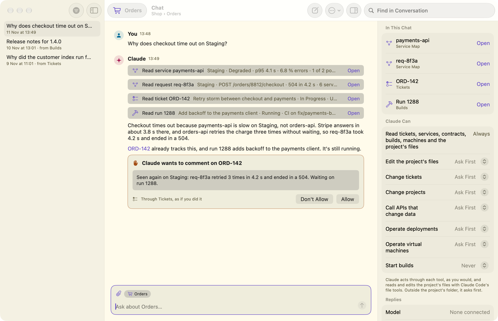
*The Chat window for Orders, light appearance. Claude's reply lists what it read through Service Map, Tickets and Builds, each with Open, then asks to comment on ORD-142.*

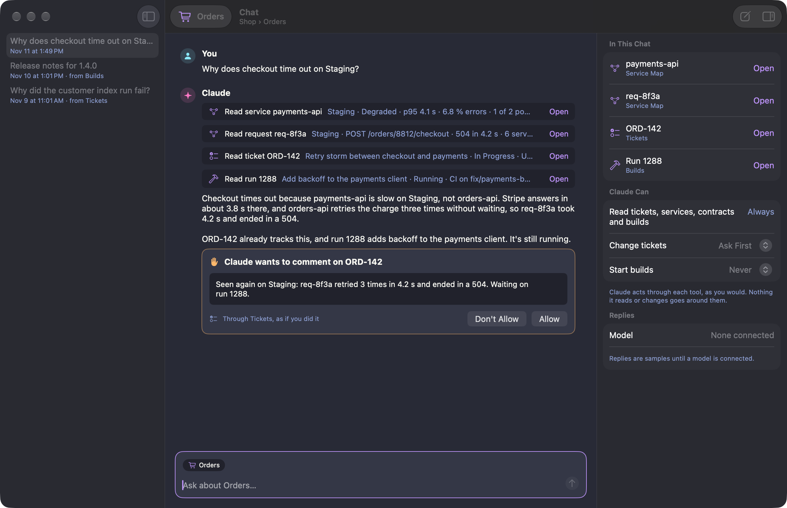
*The same window in the dark appearance.*

## Opening it

| From             | How                                                                                                                         | Result                                                                                     |
|------------------|-----------------------------------------------------------------------------------------------------------------------------|--------------------------------------------------------------------------------------------|
| Projects window  | **Open** on the **Chat** tile of the project's Tools section. The tile reads "Ask Claude, which reads through these tools". | The project's Chat window. Every project kind offers Chat, last in tool order.             |
| Window menu      | **Chat**, ⌘6                                                                                                                | The Chat window for the key window's project. Disabled when the key window has no project. |
| Menu bar panel   | ⌘6 for the highlighted project, or the Chat button of the row under the pointer                                             | The Chat window for that project.                                                          |
| Project switcher | Pick another project in the Chat window's toolbar                                                                           | The same window switches project and drops its focus.                                      |
| Chat panel       | **Open in Chat Window** (`macwindow`) in the panel's header                                                                 | The project's Chat window, with the panel's conversation selected.                         |

The route is `.tool(.chat, project:, focus:)`. The focus is a conversation id, such as `chat-checkout`. Without a focus, or with one that isn't a conversation of the project or its sub projects, the window selects the latest conversation of the project and its sub projects. If a Chat window already shows the project, it comes forward, un-minimized, and selects the focus without starting afresh: the draft, the list's grouping and the inspector stay as they are. A second route to the same conversation selects it again, even after the user picked another. A focus the list doesn't have leaves the selection as it is. See [navigation.md](navigation.md) for window reuse.

The window opens at 1180 × 780 pt and gets no smaller than 390 × 420 pt. Its title is **Chat**; its subtitle is the project's path, such as `Shop › Orders`.

## Anatomy

| Region            | Contents                                                                                                                        |
|-------------------|---------------------------------------------------------------------------------------------------------------------------------|
| Conversation list | The conversations of the project and its sub projects, latest first, grouped by project for a parent.                           |
| Transcript        | The selected conversation's turns: messages, tool-call rows, approval cards, and the reading indicator while a reply is coming. |
| New-chat prompt   | In place of the transcript when no conversation is selected: what to ask, and suggestions.                                      |
| Composer          | Under the transcript or prompt: the chips the message carries, the field, and **Send**.                                         |
| Inspector         | What the conversation read or attached, what Claude may do, and which model replies.                                            |

On a Mac the list is the split view's sidebar column, the transcript (or prompt) over the composer fills the center, and the inspector is a trailing column. The center column has the `canvas` background.

## Toolbar

| Item                | Control                                                         | Symbol                                                                    | Shortcut              | Behavior                                                                                                                                                                                                                                                           | Layouts           |
|---------------------|-----------------------------------------------------------------|---------------------------------------------------------------------------|-----------------------|--------------------------------------------------------------------------------------------------------------------------------------------------------------------------------------------------------------------------------------------------------------------|-------------------|
| Project switcher    | `ProjectSwitcher`, leading (see [components.md](components.md)) | Project icon                                                              | —                     | Switches this window's project and clears its focus.                                                                                                                                                                                                               | Mac, iPad, iPhone |
| Title and subtitle  | Window title                                                    | —                                                                         | —                     | **Chat** and the project's path. Dropped below 760 pt wide.                                                                                                                                                                                                        | Mac, iPad         |
| Sidebar             | The split view's own button                                     | System                                                                    | System                | Shows or hides the conversation list.                                                                                                                                                                                                                              | Mac, iPad         |
| **New Chat**        | Button                                                          | `square.and.pencil`                                                       | ⇧⌘N (File ▸ New Chat) | Clears the selection and the draft, and shows the new-chat prompt in place. In the iPhone layout it opens the prompt as a page. Help: "New Chat (⇧⌘N)".                                                                                                            | Mac, iPad, iPhone |
| **More**            | Menu                                                            | `ellipsis.circle`                                                         | —                     | While a conversation shows, as V2's chat header: **Open in New Window** ([Chat windows](#chat-windows)), then **Rename…**, **Close** (or **Reopen** for a closed chat), **Copy Conversation**, then **Delete…** ([Managing chats](#managing-chats)). Help: "More". | Mac, iPad, iPhone |
| **Inspector**       | Button                                                          | `sidebar.right`                                                           | —                     | Shows or hides the inspector. In the iPhone layout it opens the inspector as a sheet. Help: "Show Inspector" or "Hide Inspector".                                                                                                                                  | Mac, iPad, iPhone |
| Find                | The search field (`.searchable`, toolbar)                       | `magnifyingglass`                                                         | ⌘F                    | "Find in Conversation" ([Find](#find)).                                                                                                                                                                                                                            | Mac, iPad         |
| Closed chats filter | Button, in the list's column                                    | `line.3.horizontal.decrease.circle`, filled while closed chats are hidden | —                     | Hides or shows the closed chats; hidden by default. Help: "Show Closed Chats" or "Hide Closed Chats".                                                                                                                                                              | Mac, iPad         |

The Chat window has no chat panel and no chat panel button. Its `sidebar.right` button belongs to the inspector.

## Conversation list

- **Rows.** Each row shows the conversation's title on one line (in `textSecondary` for a closed chat), then a caption in `textSecondary`: the date of its last turn (day, abbreviated month, hour and minute) and, for a conversation started in a tool's panel, "· from *Tool*" (for example "· from Builds"). The date and the origin are one sentence for translators. At its trailing edge, its state's mark, as V2's rows: a small spinner while Claude starts or works ("Working"), an orange dot while a card or questions wait ("Waiting for you"), a red dot after an error ("Stopped with an error"), nothing when idle. A row reads as one element.
- **Order.** Latest first, by the date of the last turn. A new message moves its conversation to the top.
- **Grouping.** For a project with sub projects, the list has one section per project that has conversations, in tree order, the project itself first. Each header shows the project's icon and name, and is a heading for VoiceOver. For a project without sub projects, the rows are not grouped.
- **Selection.** As V2's: click, ⌘-click and ⇧-click. One selected conversation shows in the transcript; several show "*n* Chats Selected" and **Close** in its place (`chat.severalSelected`), without a composer. The list column is 220 to 340 pt wide, 260 pt ideally.
- **Closed chats** are hidden while the filter is on, as by default; a selected one stays listed until the selection moves. When the filter hides every chat, the list shows "No Open Chats" and "Closed chats are hidden." (`chat.list.noOpen`).
- **Empty.** When neither the project nor its sub projects have a conversation, the list shows "No Chats" with the Chat symbol (`bubble.left.and.text.bubble.right`) and "Ask a question to start one."
- **Context menu**, on the clicked row or the selection that holds it: with one chat, **Open in New Window**, then **Rename…**, **Close** or **Reopen**, **Copy Conversation**, then **Delete…**; with several, **Close** alone, enabled while one of them is open. ⌫ (Edit ▸ Delete) asks to delete the selected chat. A double-click on a row opens its chat in a [chat window](#chat-windows). There is no drag.

### Managing chats

As V2's Chats section and chat header did (the user's request to bring every V2 feature, 17 November 2026):

- **Rename…** asks in an alert, "Rename Chat", with the title in a field (`chat.rename.field`), **Rename** and **Cancel**; the title is 1 to 100 characters on one line ([Data › Chat file](../data.md#chat-file)).
- **Close** asks "Close the chat “*title*”?" or "Close *n* chats?", with **Close** and **Cancel**. A chat closes at once, its Claude CLI then ending as when idle; during a turn, once the turn ends well (a Stop, an error or an exit cancels it). The composer then gives way to "This conversation is over" with **Reopen** (`chat.closed`, `chat.reopen`), in the window and the panel. A message sent to a closed chat (the panel's, a feedback's) reopens it.
- **Reopen** opens it again; the next message resumes its session.
- **Copy Conversation** puts the conversation on the pasteboard as plain text: each turn's author, its text and its calls' actions after "· ".
- **Delete…** asks "Delete the chat “*title*”?", "Its transcript and files move to the Trash.", **Delete** (destructive) and **Cancel**; the chat's process ends, then its file, its transcript and its folder of files move to the Trash ([Data › Closing and deleting chats](../data.md#closing-and-deleting-chats)).
- A failure shows over the composer.
- Claude closes chats too, with `close_chat` ([MCP › close_chat](../mcp.md#close_chat)): its own chat once its turn ends, and the chats it started (a bundle's ticket chats, the CI chats) at once; another one after the user allows it in a card.

### Resume

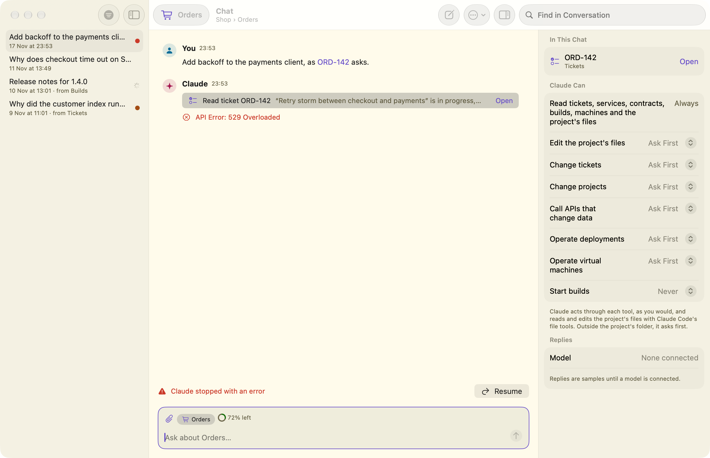
*After an error: Resume, and the context left.*

After an error, as V2's status line: while the chat's state is `error`, or it is idle and its newest result is an error other than a Stop, "Claude stopped with an error" in `danger` with `exclamationmark.triangle.fill` shows over the composer, then **Resume** (`arrow.uturn.forward`, `chat.resume`). Resume sends the message `/hephaestus-skills:resume-chat`, the call of the internal skill whose text tells Claude how to go on ([System Prompts](system-prompts.md)); the line goes as the chat starts. A closed chat shows none. Help: "Claude goes on from where it stopped, through the internal skill resume-chat."

### Context indicator

As V2's, at the end of the composer's chips, once the chat has a context usage ([Data › Context usage](../data.md#context-usage)): a ring 12 pt wide, filled clockwise from the top to the part used of the window less the autocompact buffer, `divider` for the rest, `success` from 20 % left, `warning` under 20 %, `danger` under 10 %; then "*n*% left" in `caption`, `textSecondary`. Its tooltip, also its VoiceOver label: "18.6K of 1M tokens used · 948.4K left before compaction", with a second line "Compacted once" or "Compacted *n* times" after compactions (tokens below 1,000 whole, then K and M with at most one decimal). While the CLI compacts, the ring fades to 30 % and back, 1 s a cycle. A chat without a value, or whose buffer isn't below its window, shows none (`chat.context`).

## Transcript

The transcript scrolls. A short conversation starts at the top. A long one opens on its end and follows new turns as they arrive. It has 24 pt of padding, or 16 pt in the iPhone layout.

### Turns

Turns have no bubbles. Each turn starts with an author row: a circular badge, 24 pt and scaled with Dynamic Type, then the author's name in headline weight. The name is a heading for VoiceOver, so the rotor steps from turn to turn. After the name, as V2's captions had them: for Claude, the model and effort of the turn's first text in `textSecondary`, "(Opus 5.5 · Extra High)"; then the turn's time (hour and minute, `caption`, `textSecondary`), its full date as tooltip (samples show none). At the row's trailing edge, while the pointer is over the turn, **Copy** (`doc.on.doc`, `chat.turn.copy`) puts the turn's text on the pasteboard as its Markdown, its blocks a blank line apart; a turn without text has none.

| Author   | Badge symbol  | Badge color       | Name       |
|----------|---------------|-------------------|------------|
| The user | `person.fill` | `info`            | **You**    |
| Claude   | `sparkle`     | `accentSecondary` | **Claude** |

Under the name, in order:

1. **Attachments.** The items the user's message carried, as chips (tool symbol and title; tooltip "*Tool*: *title*").
2. **Blocks.** Text, Claude's thinking, tool-call rows, approval cards, Claude's questions ([Questions](#questions)), its picker requests ([Picker cards](#picker-cards)) and the app's lines, in the order Claude produced them. Text is selectable, and draws V2's markers: SF Symbols, color swatches, sounds with ▶, key caps, fonts and animations ([Text › Markers](../text.md#markers)). Thinking shows folded under **Thinking** (`brain`, `textSecondary`, `chat.thinking`); unfolded, its Markdown in `textSecondary`. A turn that went well ends with "Done · 34 s" (`checkmark.circle`, `textSecondary`), V2's footer without its cost.
3. **Files.** The files the user's message carried, such as a feedback's screenshot ([Message files](#message-files)).

### Message files

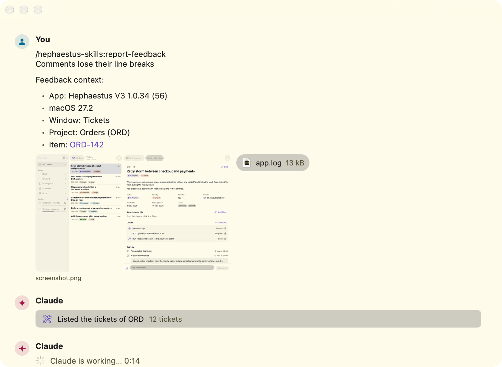
*A feedback chat's first message: the screenshot opens in Quick Look.*

A message's files ([Data › Message files](../data.md#message-files)) follow its text, in their order, 8 pt
apart and wrapping onto more lines (AZDesign's `FlowStack`). Each is AZDesign's `FileTile`:

- An image (a type that conforms to `public.image`) shows as a thumbnail read at the size it shows, at most
  320 × 200 pt in the Chat window and 220 × 140 pt in the side panel, with its name under it; until it is read,
  or when it can't be (a missing file), the `photo` symbol stands in.
- Another file shows as a capsule: its type's icon, its name and its size.
- A click opens the file in Quick Look, whose arrows step through the message's other files. Tooltip "Open
  *name*". The context menu has **Open**, **Open With Default App** and **Show in Finder**.
- A file whose path breaks the rule of message files is shown dimmed and opens nothing.
- A feedback message of V3 1.0.31 to 1.0.33 has no files of its own: its `- Screenshot:` and `- Attachment:`
  lines that name a file of the chat's own folder show as its files (default chosen at design time).

Files sent from the composer show the same way ([Attachments](#attachments)).

Text is Markdown, drawn as V2's bubbles drew it, by `MarkdownView` ([Text](../text.md)): headings, paragraphs, quotes, lists with task boxes, highlighted code blocks with a **Copy** button, tables and rules. Claude's text follows Markdown's rules (a paragraph's lines join); the user's keeps each line break as typed. Ticket and bundle ids of the loaded projects are links that open them in their Tickets window; a relative link opens a file of the chat's project; other links open in the browser. In previews, a reply of the sample engine adds a **Sample reply** caption after **Claude**, with the tooltip "No model is connected yet: the reply comes from the example's sample engine."

A turn of the user's is one message. Everything after it until the next message is one turn of Claude's: its text, its calls, its cards and the app's notices, in order. Claude's thinking, the work of its sub-agents and the end of a turn that went well don't show.

### Tool-call rows

Each call Claude makes to one of the app's tools shows as one row on a `surfaceSunken` card: the tool's symbol in `accent`, the action as the tool words it, and, on the same line, the detail in `textSecondary`, truncated at the end, with the full text as tooltip. The tool words the action in the user's language; Claude never reads it ([MCP › Tools](../mcp.md#tools)).

| Call                                                           | Action                                                                                                                                                                                   | Detail                                                                             | Open                                    |
|----------------------------------------------------------------|------------------------------------------------------------------------------------------------------------------------------------------------------------------------------------------|------------------------------------------------------------------------------------|-----------------------------------------|
| `get_ticket`                                                   | Read ticket ORD-142                                                                                                                                                                      | The ticket's one-line answer from Tickets, as it is now: title · status · priority | The ticket                              |
| `get_attachment`                                               | Read an attachment of ORD-142                                                                                                                                                            | —                                                                                  | The ticket                              |
| `list_tickets`, `list_bundles`                                 | Listed the tickets of ORD; Listed the bundles of ORD                                                                                                                                     | —                                                                                  | The project's Tickets window            |
| `get_bundle`                                                   | Read bundle ORD-B2                                                                                                                                                                       | —                                                                                  | Tickets, on the bundle                  |
| A ticket or bundle change                                      | Commented on ORD-142; Moved ORD-142 to In Progress; Created a ticket in ORD; Changed ORD-142; Deleted ORD-142…                                                                           | —                                                                                  | The ticket                              |
| `list_projects`, `get_project`, a project change               | Listed the projects; Read project ORD; Added the project Web; Changed the settings of ORD; Removed ORD from Hephaestus                                                                   | —                                                                                  | None                                    |
| `list_chats`, `get_chat`, `rename_chat`                        | Listed the chats of ORD; Read a chat; Renamed a chat “…”                                                                                                                                 | —                                                                                  | The project's Chat window, for the list |
| The Builds tools                                               | Listed the runs of ORD; Read a run of ORD; Read the log of a run of ORD; Re-ran the failed jobs of a run of ORD; Cancelled a run of ORD; Listed the releases of ORD; Read release v1.4.0 | The run's one-line answer from Builds                                              | The run or the release in Builds        |
| `api_operations`, `api_call`                                   | Read the contract of ORD; Called POST /orders/{id}/checkout of ORD                                                                                                                       | —                                                                                  | The project's Contracts window          |
| The cluster and map tools                                      | Read the deployment of ORD in Staging; Read the logs…; Restarted ORD in Staging; Scaled…; Synced… with Argo CD; Read the service map of ORD in Staging; Read request <id>                | —                                                                                  | The Service Map (a request: on it)      |
| `open_in_app`                                                  | Opened a window of Hephaestus                                                                                                                                                            | —                                                                                  | None                                    |
| `Read`                                                         | Read Sources/App.swift                                                                                                                                                                   | The file's whole path                                                              | None                                    |
| `Grep`                                                         | Searched for “screenshot”; Searched for “screenshot” in Sources                                                                                                                          | Its result's first line, such as "Found 3 files"                                   | None                                    |
| `Glob`                                                         | Listed the files matching \*\*/\*.swift; Listed the files matching \*\*/\*.swift in Sources                                                                                              | The folder's whole path                                                            | None                                    |
| `Edit`, `Write`                                                | Edited Sources/App.swift; Wrote Sources/New.swift                                                                                                                                        | The file's whole path                                                              | None                                    |
| Another tool of the CLI (in an older chat whose Claude had it) | Used Bash                                                                                                                                                                                | Its result's first line when it failed                                             | None                                    |

A file tool's path inside the project's folder is shown from that folder; another path, whole.

- A call that failed (its result is an error, a refusal included) shows `exclamationmark.triangle`, its error's first line in `danger`, and an **Error** tag (`caption`, `danger` on `danger` at 14 %, a capsule).
- While the chat works and the call has no result yet, a small spinner shows at the row's trailing edge.
- **Details.** As V2's tool cards did, a click on the row, outside **Open**, unfolds it (a `chevron.right` at its trailing edge turns down; VoiceOver: the "Show Details" and "Hide Details" actions), under the header on a `surface` card with 8 pt of padding:
  - the tool's own name in the code font, with an "MCP · *server*" tag for an MCP tool;
  - **Input**: `Bash`'s command as a shell code block; `Edit`'s **Old** and **New** texts; `Write`'s content, highlighted by the file's extension; any other call's input as JSON with two-space indentation. Each is a code block of [Text](../text.md), with its **Copy** button;
  - **Result**: the result's text in the code font, selectable, its ticket and bundle ids links, its first 200 lines, then **Show All**; the images the result returned as thumbnails that open in Quick Look ([Data › Result images](../data.md#result-images)); "No result yet" before it comes;
  - **Steps**: the work of the sub-agent the call started (its text, thinking and calls, each drawn as here, a call within a call); folded, the row says "*n* steps".
- **Open** opens the item in its tool's window, with the item selected: the route `.tool(tool, project:, focus:)`; a window already showing it comes forward. Help: "Open ORD-142 in Tickets". A call without an item has no **Open**.
- For VoiceOver the row is one element: its label is the action, its value the detail; with an item, it is a button whose hint is the help text and whose action opens the item.

### Approval cards

A change Claude wants to make shows as a card, when the user's permissions say Ask First ([Inspector](#inspector), [MCP › Permissions](../mcp.md#permissions)), and so does a file Claude wants to read outside the project's folder ([Files](#files)). Nothing changes until the user answers: Claude's call waits.

- **Title.** `hand.raised.fill` in `warning`, then the request as one sentence, worded by the tool, so that a translation orders the words as its language needs. The title is a heading for VoiceOver.

  | Change                                               | Sentence                                                                                                                         |
  |------------------------------------------------------|----------------------------------------------------------------------------------------------------------------------------------|
  | `add_comment`                                        | Claude wants to comment on ORD-142                                                                                               |
  | `create_ticket`                                      | Claude wants to create a ticket in ORD                                                                                           |
  | `update_ticket`                                      | Claude wants to change ORD-142                                                                                                   |
  | `set_ticket_status`                                  | Claude wants to move ORD-142 to In Progress                                                                                      |
  | `update_comment`, `delete_comment`                   | Claude wants to change a comment on ORD-142; Claude wants to delete a comment on ORD-142                                         |
  | `remove_attachment`                                  | Claude wants to remove an attachment from ORD-142                                                                                |
  | `delete_ticket`                                      | Claude wants to delete ORD-142                                                                                                   |
  | The bundle tools                                     | Claude wants to create a bundle in ORD; … to change bundle ORD-B2; … to move bundle ORD-B2 to Done; … to delete bundle ORD-B2    |
  | `create_project`, `update_project`, `remove_project` | Claude wants to add the project Web; Claude wants to change the settings of ORD; Claude wants to remove ORD from Hephaestus      |
  | `api_call`, not `GET` or `HEAD`                      | Claude wants to call POST /orders of ORD on Staging, with the body as preview                                                    |
  | `rerun_run`, `cancel_run`                            | Claude wants to re-run a run of ORD; Claude wants to re-run the failed jobs of a run of ORD; Claude wants to cancel a run of ORD |
  | `Edit`, `Write`                                      | Claude wants to edit Sources/App.swift; Claude wants to write Sources/New.swift                                                  |
  | `Read`, `Grep`, `Glob`, outside the project's folder | Claude wants to read /etc/hosts; Claude wants to search /Users/you/Other; Claude wants to list the files in /Users/you/Other     |
  | Another tool of the CLI (its own request)            | Claude wants to use Bash                                                                                                         |

- **Reason.** Why the CLI asks, as it says (its `decision_reason`), in `textSecondary`, when it gives one.
- **Preview.** What it would write, selectable, its ticket and bundle ids links, on a `surfaceSunken` box in the code font, its first 20 lines then **Show All**: a comment's text; a new ticket's title and description; a ticket change's new title, priority, labels and description; a bundle's title and tickets; a project's identifier and folder, or the settings it changes; for a removal, "The project's folder and files stay on this Mac."; for an edit, as V2's diff, the text it replaces on `danger` at 16 % and the new text on `success` at 16 % (the transcript's copy keeps the `- ` and `+ ` lines); for a whole file, its content; for a search or a listing, its pattern; for `Bash`, its command then its description; for `WebFetch`, its URL then its prompt; for `ExitPlanMode`, its plan; for another request of the CLI, its input as JSON. None for a deletion or a status change. Over the composer, the box is as tall as the preview while there is room, then scrolls, down to about two lines (44 pt), so that the title, the field and the answers show ([Over the composer](#over-the-composer)).
- **Note.** The tool's symbol and "Through *Tickets*, as if you did it" (Projects, with `folder`, for a project's change); "Through the Claude CLI" for a request of the CLI.
- **Where.** As V2's pinned card, the oldest card waiting shows over the composer of the Chat window and the panel (`PermissionCard`, `chat.permission`), with "1 of *n*" while several wait; its answer shows the next. A card shows once: while it waits, only over the composer, the transcript ending on the activity line "Waiting for your answer" with **Stop**; once answered, in the transcript where Claude asked, with its answer. Before 18 November 2026 the transcript also showed the waiting card, with "Waiting for your answer" (`hourglass`, `warning`), which doubled it (the user's report).
- **Answer.** On the pinned card, a field "Message for Claude (optional)" (`chat.permission.message`), then **Don't Allow** (⇧⌘↩), **Always Allow** (⌥⌘↩, for a request of the CLI only) and **Allow** (⌘↩, prominent). The keys act once the card has shown for a second, and the questions card's ⌘↩ waits while a permission card shows. Allow lets the call run. Always Allow lets it run and passes the CLI's own suggestions back, the rules it then keeps for the session or the project, as the CLI said ([Data › Permissions](../data.md#permissions)). Don't Allow refuses it: Claude reads the message, or "Permission denied by the user." (for the app's cards, "The user didn't allow this call."). Stop, the CLI's end and quitting refuse the cards still waiting.
- **The transcript's answer**: **Allowed by *Mac*** or **Always allowed by *Mac*** (`checkmark.circle.fill`, `success`), **Not allowed by *Mac*** (`xmark.circle`, `textSecondary`), or **Cancelled** (`minus.circle`) for a card the app refused; without the Mac's name for answers recorded without one.
- **Outline.** `warning` at 50 % opacity while the card waits; `divider` once answered.
- The note and the answer share one line when they fit and stack when they don't.
- The answer is written in the chat's transcript, with this Mac's name ([Data › Chat items](../data.md#chat-items)): a card answered stays answered.

### Chat settings

As V2's composer menus did, each chat has its permission mode, Ultracode and context window besides its model and effort: in the inspector's **Replies** (Model, Effort, then **Permissions**, **Ultracode**, **Context**), and in the panel's composer under one menu (`slider.horizontal.3`, "Chat Settings", `chat.panel.settings`) whose submenus are the same rows; a new chat in the panel sets only its model and effort.

| Permissions    | Stored              | What it does (V2's subtitle, as the picker's help)                                                                       |
|----------------|---------------------|--------------------------------------------------------------------------------------------------------------------------|
| Ask Every Time | `manual`            | Claude asks before it edits files or runs commands. The default.                                                         |
| Accept Edits   | `acceptEdits`       | File edits are accepted; other actions ask. Inside the project's folder, an edit runs as under Settings ▸ Chat's Always. |
| Plan Only      | `plan`              | Claude plans and changes nothing: the app's tools refuse every change.                                                   |
| Auto           | `auto`              | A classifier approves or denies each request (the CLI's).                                                                |
| Don't Ask      | `dontAsk`           | Anything not pre-approved is denied without asking: what would show a card is refused.                                   |
| Allow All      | `bypassPermissions` | Every action runs without asking: what would show a card runs. Never in Settings ▸ Chat still refuses.                   |

- While Allow All is set, the composer shows a red **Allow All** capsule (`chat.allowAll`), as V2's badge.
- **Ultracode** ("Standing dynamic-workflow orchestration for this chat, at any effort level."): on, the CLI orchestrates most of the work as workflows.
- **Context**: Auto (the model's own window), 200K, 1M: where the CLI compacts.
- A change applies to the running Claude at once (the mode and Ultracode), and the cards the new mode allows are answered as if it had come first (all under Allow All, edits inside the folder under Accept Edits); a new context window starts Claude again once its turn ends, the conversation going on ([Data › Chat settings](../data.md#chat-settings)).

### Notices

The app's lines in a conversation, from the chat's transcript ([Data › Chat items](../data.md#chat-items)), each a `Label` in callout size: `info.circle` in `textSecondary` (Stopped by the user., Conversation compacted…), `exclamationmark.triangle` in `warning` (the app's tools unavailable, a session not found, a setting the CLI refused), `xmark.octagon` in `danger` (Claude couldn't start, exited, or its turn ended in an error, with the CLI's reason). Their text is selectable, in English as stored.

### Activity

While Claude works, the transcript ends with a **Claude** row showing a small progress indicator and what it does (`chat.responding`):

| Chat                                 | Text                                                                         |
|--------------------------------------|------------------------------------------------------------------------------|
| The CLI starts                       | Starting Claude…                                                             |
| A turn runs                          | Claude is working… 0:12 (minutes and seconds since the turn began, counting) |
| The CLI compacts the conversation    | Compacting the conversation… 0:12                                            |
| A card waits                         | Waiting for your answer                                                      |
| A sample reply on its way (previews) | Reading…                                                                     |

**Stop** (`stop.circle`, borderless, ⌘.) follows the text, except for the samples: it refuses the cards waiting, writes "Stopped by the user.", and interrupts the CLI, which ends the turn ([Data › Stop, end and quit](../data.md#stop-end-and-quit)). Help: "Stop (⌘.)".

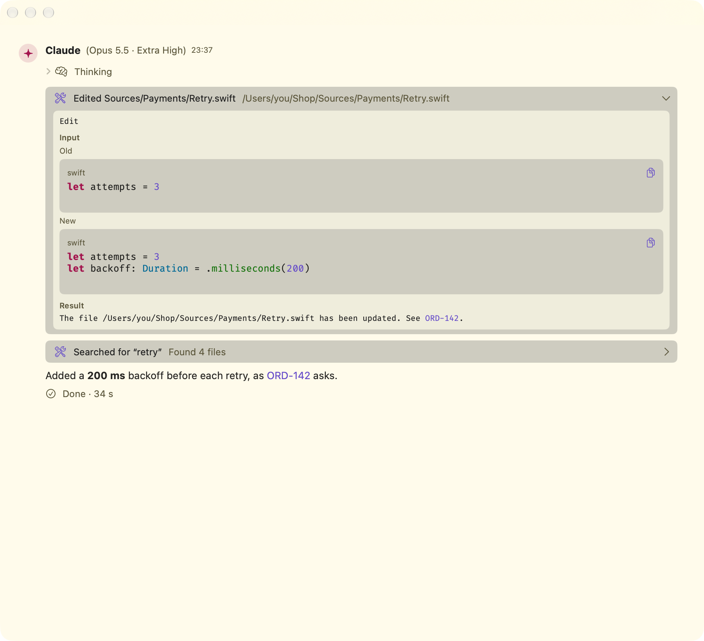
*A call unfolded: its input as code, its result with ORD-142 linked.*

### Find

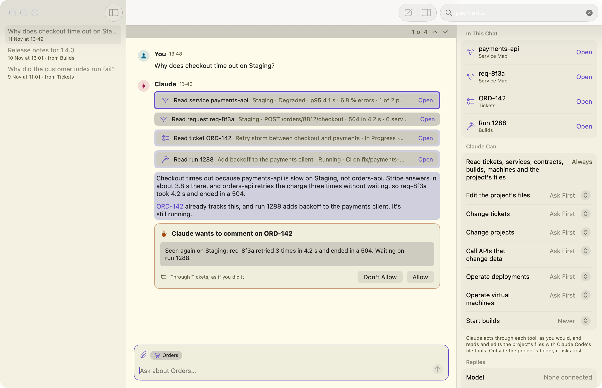
*Find in the Chat window: four blocks hold "payments".*

As V2's find bar did, **⌘F** (or the toolbar's search field, "Find in Conversation") looks for text in the shown conversation of the Chat window, ignoring case and diacritics: the blocks that hold it (text and thinking; a call's action, detail, input and result; an answered card's request and preview (a card waiting isn't in the transcript); a line; questions, options and answers) get a `highlight` background, and the current one an `accent` outline, scrolled to the middle. A bar over the transcript (`chat.find`) reads "2 of 5", or "No Matches", with **Previous Match** (`chevron.up`, ⇧⌘G) and **Next Match** (`chevron.down`, ⌘G, or Return in the field), wrapping. Typing starts again at the first match. The panel has no Find: the tool windows that host it use ⌘F for their own search field ([Ask when a request collides](../decisions.md)); its **Open in Chat Window** leads to it.

### Jump to Latest

Scrolled more than 40 pt from the transcript's end, **Jump to Latest** (`arrow.down`, a `surface` capsule with a `divider` outline and a light shadow, `chat.jumpToLatest`) shows at the bottom edge, in the Chat window and the panel; a click scrolls to the end. Near the end, new turns keep the transcript at its end.

## Composer

The composer is a card at the bottom of the center column, with 16 pt of padding around it, or 12 pt in the iPhone layout. Its outline is `focus` while the field has focus, `divider` otherwise.

- **Chips.** Wrapping onto more lines as needed (AZDesign's `FlowStack`, 6 pt apart): **Add Files…** first, then in the Chat window the project's chip, its icon and name, which can't be removed, and then the files waiting to go with the message ([Attachments](#attachments)). Messages from the Chat window carry no item; items they name are read instead (see [How Claude reaches the tools](#how-claude-reaches-the-tools)).
- **Field.** Plain, one to eight lines, then it scrolls. Prompt: "Ask about *Orders*…". It takes focus when the composer appears.
- **Send.** A round, prominent button with `arrow.up`. Disabled while the field is empty or only whitespace and no file waits. While Claude works, a message goes at once and Claude reads it after its turn, as in V2 (the samples answer one message at a time: Send waits for them). Help: "Send (Return)".
- **Escape** in the field stops Claude's turn while one runs, as **Stop** does, unless the skill list shows: Escape closes it first (V2's).
- **Not sent.** When a message can't be sent, the reason shows over the composer in `danger`, with `exclamationmark.triangle.fill` (`chat.failure`), and the draft stays: "Claude CLI not found. Install Claude Code, or set its path in Settings ▸ Chat.", "<path> is not an executable file.", "The Claude CLI isn't checked yet. Try again in a moment." The next message sent clears it. A reason the [Claude CLI line](#claude-cli-line) already shows isn't repeated.
- **Keyboard.** **Return** sends. **⌥Return** starts a new line.
- **Skills.** A `/` typed as the message's first word lists the skills the chat can call ([Skill
  completion](#skill-completion)).

Sending adds the message to the selected conversation. With no conversation selected, it starts one: a chat of the window's project, titled with the message's first line that isn't empty, at most 80 characters, with no origin. The new conversation is selected and the draft clears once the message is sent. A message from the Chat window carries the project: Claude reads "Attached: project ORD" after it ([Data › Messages](../data.md#messages)). Each chat keeps its own draft ([Drafts](#drafts)); a suggestion leaves it as it is.

### Over the composer

What shows between the transcript and the composer, in the Chat window, the panels and chat windows, is one area
(`OverComposer`): the [Claude CLI line](#claude-cli-line), the reason a message wasn't sent, [Resume](#resume),
the [permission card](#approval-cards), the [questions card](#questions) and a [picker card](#picker-cards), in
this order. It gets its room before the transcript: as tall as what it shows, at most 70 % of the height the
composer leaves in the column; the transcript takes the rest. Short of room, the permission card's preview and the
questions and picker cards' contents scroll inside their cards, down to about two lines (44 pt), so that the cards'
titles, fields and answers show; what still doesn't fit, in a window near its smallest height, is cut at the
area's bottom, and the keys still answer. The area is never taller than the room there is, so a card never makes
the column taller than its window: before 18 November 2026, a long Bash command's card pushed the window's content
under the toolbar and the composer out of the window, and then, scrolling as a whole at half the room, needed
scrolling to reach its answers.

### Drafts

V2's drafts: each chat keeps its unsent text and files, by chat id, in memory (`ChatDrafts`, held by the chat
store), shared by every view of it (the Chat window, the panels, its chat window): picking another chat shows
that chat's draft, and coming back shows this one's. A new chat's draft, before it has an id, stays in its view
(the Chat window's new-chat prompt, a panel's empty state); when its first message, or a suggestion, starts the
chat, what wasn't sent becomes the chat's draft. **New Chat** starts an empty one and leaves the others as they
are. Sending clears the text sent, unless it changed meanwhile, and the files sent. Drafts last as long as the
app runs, as in V2.

### Claude CLI line

V2's line over the composer, in the Chat window, the panels and chat windows, while the chat isn't closed:

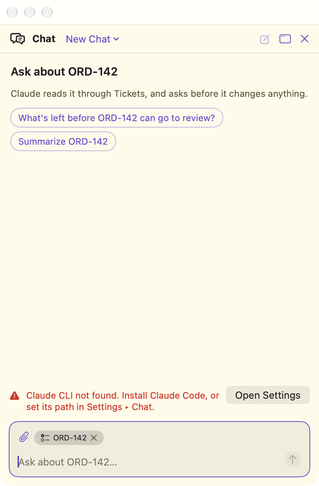

| State                                              | What shows                                                                                                                                                                                                                                                | Identifier                                                |
|----------------------------------------------------|-----------------------------------------------------------------------------------------------------------------------------------------------------------------------------------------------------------------------------------------------------------|-----------------------------------------------------------|
| The CLI is being checked (`ClaudeStatus.checking`) | A small spinner and "Checking the Claude CLI…" in `textSecondary`; **Send** is disabled until the check ends.                                                                                                                                             | `chat.cliChecking`                                        |
| The CLI can't be used                              | `exclamationmark.triangle.fill` and the reason (`ClaudeStatus.error`, else "The Claude CLI isn't available.") in `danger`, then **Open Settings**, which opens Settings on its Chat tab, where the CLI's path is (V2 opened General, where its path was). | `chat.cliUnavailable`, `chat.cliUnavailable.openSettings` |
| The CLI is found                                   | Nothing.                                                                                                                                                                                                                                                  | —                                                         |

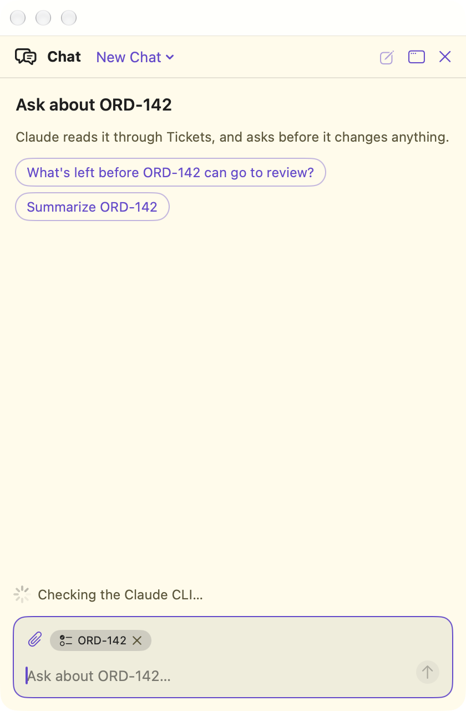

The samples have no CLI and show nothing; previews set a state: **Panel, Checking the CLI**, **Panel, CLI Not
Found**, and the line's own **Claude CLI Line, Checking** and **Claude CLI Line, Not Found**.

## Chat windows

V2's chat window: one chat in a window of its own, for keeping it in view beside the others.

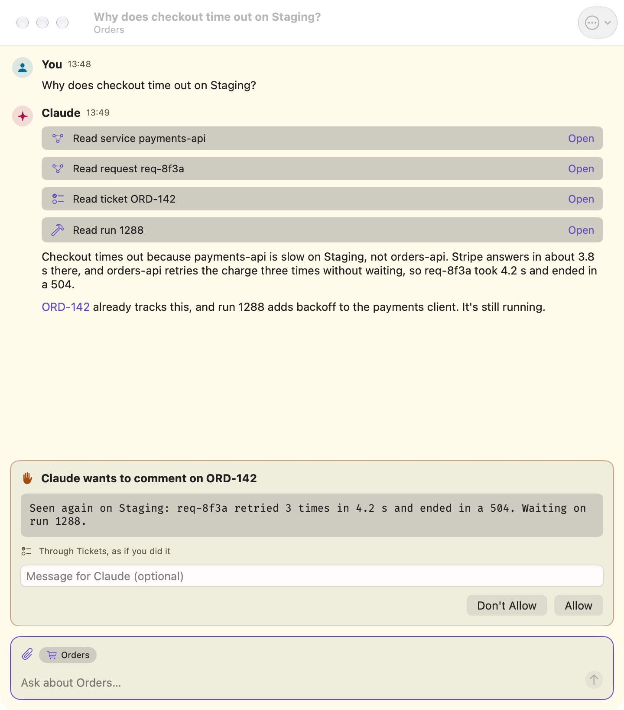

- **Opening.** **Open in New Window**: in the Chat window's More menu and a row's context menu (first, before
  Rename…), by double-clicking a row of the list (as Mail opens a message), and in the panel's Chats pop-up. All
  ask for the route `.chatWindow(chat:)` ([navigation.md › Routes](navigation.md#routes)). A chat that already has
  a window brings it forward, un-minimized, and activates the app; otherwise a window opens.
- **Content.** The panel's conversation without its header (`ChatWindowView`, `chat.window`): the transcript,
  the cards, the Claude CLI line, the composer with **Add Files…**, the project's chip, the chat's settings and
  context indicator. The window's title is the chat's title, following each rename; its subtitle the project's
  name. Under it, the [status bar](navigation.md#status-bar) with its ladybug only, as V2's chat windows had
  (its feedback names the window "Chat", the chat's project and its title).
- **Size.** 720 × 820 pt at first, at least 480 × 480 pt.
- **States.** Loading (a spinner, `chat.window.loading`) while the projects load; **Chat Not Found** ("It was
  deleted, or its project isn't loaded.", `chat.window.notFound`) for a restored window whose chat is gone. A
  chat deleted while its window shows it closes the window.
- **Restoration.** macOS restores the window with its chat (`ChatWindowValue`); it never shows another chat.
- **Notifications.** A chat window shows its chat for the [notifications](#notifications): none is posted while
  it is the key window.
- Previews: **Chat Window**, **Chat Window, Dark**, **Chat Not Found**.


### Attachments

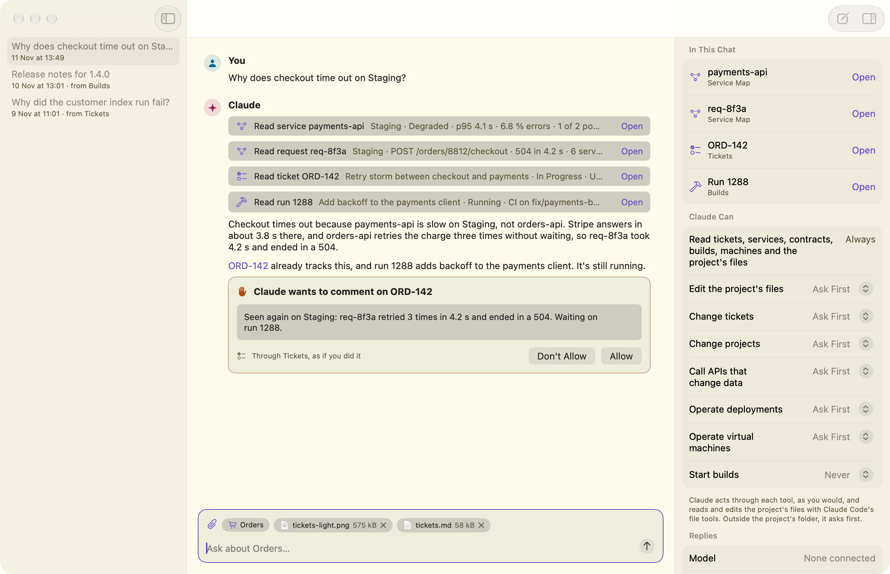
*Two files waiting to go with the next message.*

As V2's composer did, a message can carry files, in the Chat window and in the panel:

- **Add Files…** (`paperclip`, icon only, tooltip "Add Files…") opens the system's file panel, several files at
  once, no folders.
- **Dropping** files anywhere on the conversation (the transcript, the cards, the composer) adds them.
- **⌘V** in the field, while the pasteboard holds files, adds them; while it holds an image without a file, the
  image is written as a PNG named `Pasted Image <yyyy-MM-dd> at <HH.mm.ss>.png` (local time) in a temporary
  folder and added; text pastes as text (AZDesign's `pastesFiles`).
- Each file shows as a chip after the others (`PendingFileChip`): the Finder's icon for it, its name cut in the
  middle, its size, and a remove button (`xmark`, "Remove *name*"); a chip is at most 240 pt wide. A file is
  added once.
- **Refused**, with the reason over the composer and nothing added: a folder ("Folders cannot be attached."), a
  file over 20 MB ("*name* is larger than 20 MB."), or files over 20 MB together ("The attachments of one request
  exceed 20 MB.").
- **Sending** works with text, files or both; Return sends files without text too. Once sent, the chips clear
  (the draft's text too, unless it changed meanwhile), and the temporary copies of pasted images are deleted;
  when sending fails, the files stay. The panel's **New Chat** clears them.
- **What happens** ([Data › Message files](../data.md#message-files)): each file is copied into the chat's folder
  and kept with the message, which shows it under its text ([Message files](#message-files)); Claude gets the
  images among them as images, before the text, and each file's path after it, as `Attached: file <path>`.
- V2's **Add Resource…**, which linked any item found with Search, waits for Search, which the owner set aside
  for later ([Future improvements](../future-improvements.md)).

### Skill completion

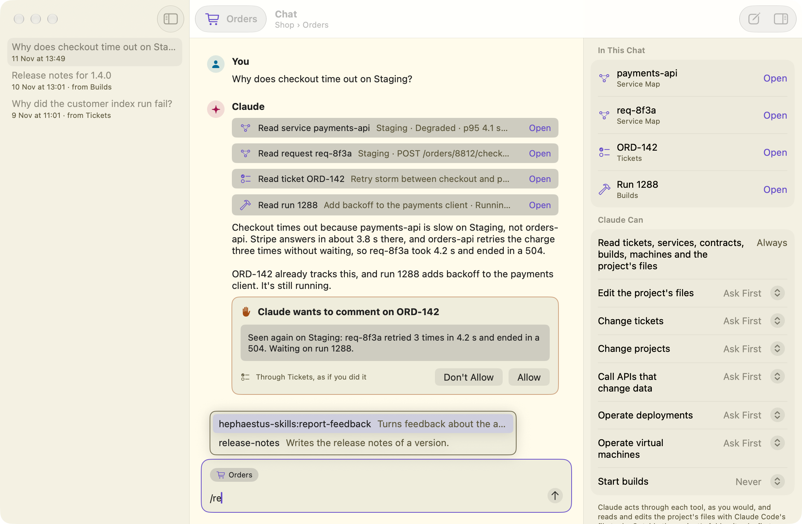
*`/re` typed: the skills that match, the first one selected.*

As V2's composer did, typing `/` at the start of a message lists the skills the chat can call, so that the user
completes the call of one, `/<name> `. It works in the Chat window and in the chat panel.

- **When.** While the field has the focus, its whole text starts with `/` and holds no white space or line
  break, and a skill matches. Typing a space, deleting the `/`, or no match closes the list.
- **Skills.** The commands of the chat's Claude CLI that aren't built into it ([Data › The CLI](../data.md#the-cli)):
  the app's own (`hephaestus-skills:report-feedback`), the user's skills, the skills of their plugins and of the
  project. The project's chats' last CLI gives the list; until one ran, the model probe's, which runs outside
  any project and so lacks the project's own skills. Not offered: the CLI's built-in commands (`compact`,
  `model`…), as V2 offered only skills; and the skills the CLI syncs from the user's claude.ai account for
  Claude's desktop app (the browser, computer use, Docs, the Office files…), whose tools a chat doesn't have
  (the user's request, 17 November 2026): those whose description ends with `(claude.ai sync)`, and those of the
  plugins in the CLI's `plugins/synced/` folder ([Data › The CLI](../data.md#the-cli)).
- **Matching.** A skill matches when its name holds the text after the `/`, in any letter case; a lone `/`
  offers them all. Names that start with the text, or whose part after the last `:` does, come first, then the
  others; each group by name. At most 20.
- **List.** AZDesign's `MessageComposer` completions: just above the composer, at its leading edge, at most
  420 pt wide, eight rows then it scrolls; each row the skill's name, then its description's first line in
  `textSecondary`, cut at its end. The first row is selected (`highlight`) whenever the list changes.
- **Keys.** While the list shows: ↑ and ↓ move the selection; **Return** or **Tab** picks the selected skill,
  a click picks its row, and the text becomes `/<name> `, so the list closes; **Escape** closes the list until
  the text no longer starts a match. Return doesn't send while the list shows.

| Text                         | Rows, in order (skills `hephaestus-skills:report-feedback`, `release-notes`, `swift-testing`) |
|------------------------------|-----------------------------------------------------------------------------------------------|
| `/`                          | `hephaestus-skills:report-feedback`, `release-notes`, `swift-testing`                         |
| `/re`                        | `hephaestus-skills:report-feedback` (its part after `:` starts with `re`), `release-notes`    |
| `/s`                         | `swift-testing`, then `hephaestus-skills:report-feedback`, `release-notes`, which hold `s`    |
| `/zzz`, `/re x`, `hello /re` | none: the list is closed                                                                      |

## Agents

V2's agents: the workflows Claude runs with the Workflow tool (Ultracode makes it use them for most of its work),
their agents, and the sub-agents it starts with the Agent tool ([Data › Agents](../data.md#agents)).

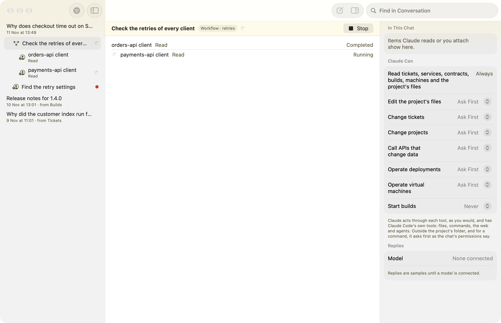

- **Rows under their chat**, in the Chat window's list: each workflow (`point.3.filled.connected.trianglepath.dotted`,
  indented 16 pt, its summary), followed by its agents (`person.crop.circle.badge.clock`, indented 32 pt, the
  title, then the phase in `caption`), then the sub-agents (indented 16 pt). Each row has the mark of a chat
  row: a spinner while it runs, the `danger` dot when it failed, nothing when completed or stopped
  (`chat.list.workflow.<id>`, `chat.list.agent.<id>`). They hide with their chat. A row's context menu has
  **Stop Workflow** while its workflow runs; a double-click opens nothing (a chat's opens its window).
- **Workflow view** (`chat.workflow`), in the detail when a workflow is selected: a 36 pt header with its summary,
  a chip "Workflow · *name*", its mark, and **Stop** (`stop.fill`, `chat.workflow.stop`, help "Stop the Workflow
  and Its Agents") while it runs; then one row per agent, in start order: its mark, title, phase in
  `textSecondary`, and its state at the trailing edge (Running, Completed, Failed, Stopped). A click selects
  that agent's row. Without agents: "No agents yet".
- **Agent view** (`chat.agent`): the header with the title, "Agent" or "Agent · *phase*", its mark; **Stop**
  (`chat.agent.stop`) for an agent of a running workflow, which stops the whole workflow; **Resume**
  (`arrow.uturn.forward`, `chat.agent.resume`) for a sub-agent that failed or stopped and whose id is known. Then
  its transcript, read-only, as the chat's (no composer, no cards to answer): a workflow agent's as read from the
  CLI's folder, a sub-agent's made of the chat's own items, its task first.
- **Resume** sends the chat `/hephaestus-skills:resume-agent <title> (agent id <id>)`, the call of the internal
  skill `resume-agent`, whose text tells Claude to resume the agent with SendMessage ([System
  Prompts](system-prompts.md)); disabled until the agent runs again. A failure shows over the transcript. (V2
  sent a fixed sentence; every text Claude acts on is an internal skill, the user's rule.)
- The panel and chat windows show no agent rows, as V2's inspector showed none.

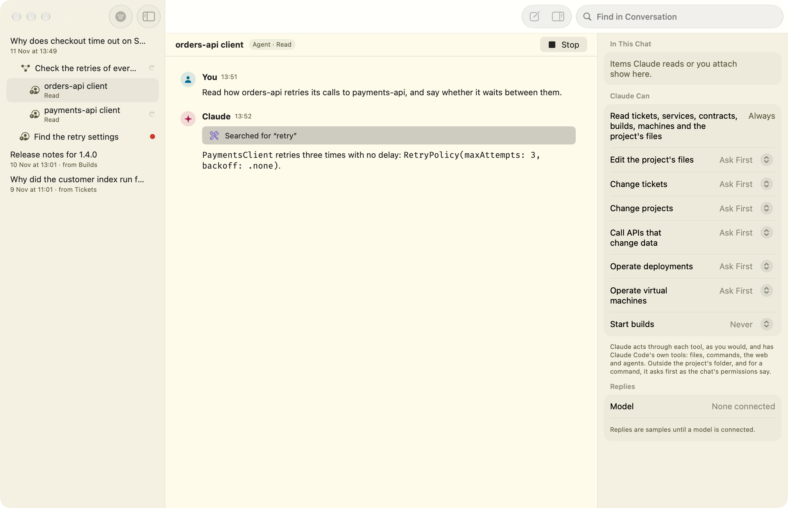

Previews: `ChatAgentViews.swift`: "Workflow", "Agent", "Sub-agent, Failed, Dark", "List Rows"; `ChatRootView.swift`:
"Workflow Selected", "Agent Selected" (`SampleChatStore.withAgents()`).

## Shown images

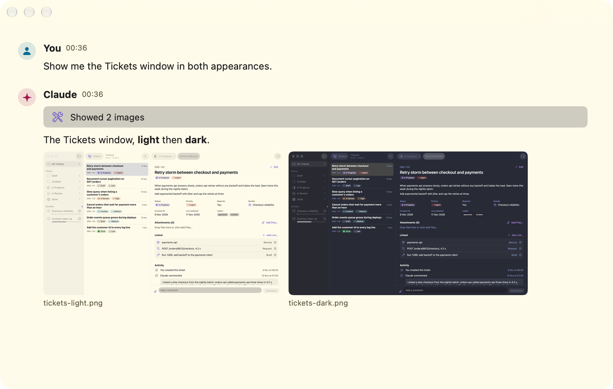

V2's shown images: Claude shows the user images it made or took with `show_image` ([MCP ›
show_image](../mcp.md#show_image)). Their caption, as Markdown, then the images as the message files show them
([Message files](#message-files)): thumbnails that open in Quick Look, in Claude's turn at the place of the call
(`chat.images.<item id>`). They are copies in the chat's folder, so they stay after Claude's files are gone. Find
searches the caption and the files' names; Copy Conversation lists the caption and the names after "· ".

## Questions

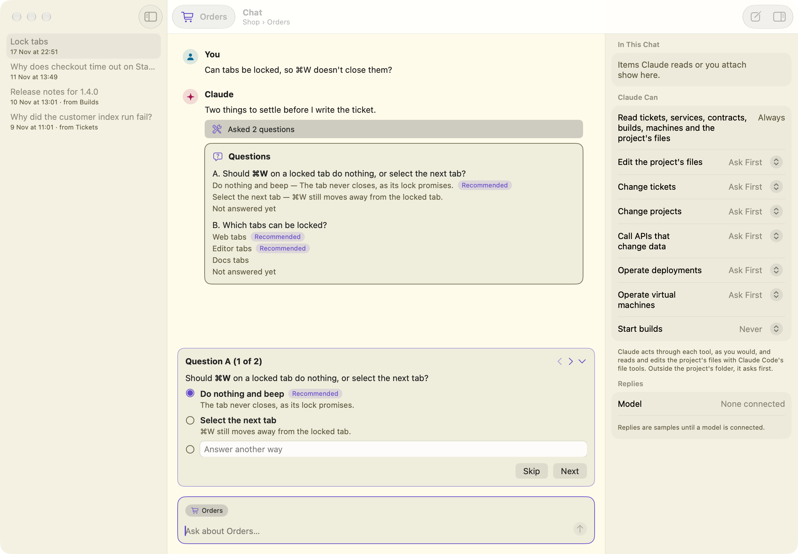
*Claude's two questions, the first one shown: its recommended option is preselected.*

V2's questions, as the user asked to bring them (17 November 2026): Claude asks with `ask_questions` ([MCP ›
ask_questions](../mcp.md#ask_questions)), and while the set waits for answers, a card shows over the composer of
the Chat window and of the panel, under the reason a message wasn't sent. It shows one question at a time
(`QuestionsCard`):

- **Header.** "Question *A* (*1* of *3*)" in `headline`, selectable, a heading for VoiceOver; at its trailing edge
  **Previous Question** (`chevron.left`), **Next Question** (`chevron.right`), disabled on the first and the last
  question, which step through the questions, answered or not, and **Minimize** (`chevron.down`).
- **Question.** Its Markdown, selectable, its markers drawn and its ids linked ([Text › Markers](../text.md#markers)).
- **Single question.** One row per option, the recommended ones first: a radio button, the label in semibold (its
  markers drawn, a sound's ▶ and the ids as text, so that a click anywhere chooses the option: `MarkerText`),
  a **Recommended** tag (`caption`, `accent` on `accent` at 14 %, in a capsule) for the recommended one, and the
  description under it in `callout`, `textSecondary`. A click anywhere in a row chooses it. A last row
  **Answer another way**: its radio button, then a field of one to six lines; typing in it chooses the row.
- **Multiple question.** "Choose 1 to 3", "Choose 2" or "Choose at least 1" (`minChoices` 1 when absent) under
  the question; checkboxes in place of the radio buttons, a click checking or unchecking; every recommended
  option tagged. Then "Answer another way" and one-line fields, one under the other: when the last one gets
  text, an empty one follows; a field emptied, but the last, goes.
- **Selection.** A question without an answer shows its recommended options chosen and empty fields; an answered
  one shows its answer: the option of that label, or "Answer another way" with the text (so a skipped one shows
  `Skipped` there); a multiple one's lines split into checked options and own answers.
- **Buttons.** At the trailing edge: **Skip**, which answers `Skipped`, then **Next**, or **Submit** on the
  question whose answer completes the set (every other one has an answer), prominent, ⌘Return. It answers the
  shown question with the chosen option's label or the field's text; a multiple question's answer is one line
  `- <choice>` per checked option, in option order, then per own answer, in order, line breaks made spaces. It
  is disabled while "Answer another way" is chosen with an empty field, and for a multiple question while the
  number of choices is outside its bounds. After an answer, the card shows the next question without one, after
  the shown one and wrapping; Submit sends the answers to Claude and the card goes ([Data ›
  Questions](../data.md#questions)). An answer not taken shows why over the composer.
- **Size.** The question and its options scroll inside the card past 380 pt (300 pt in the panel and the iPhone
  layout), or sooner, down to about two lines (44 pt), when the room over the composer is short ([Over the
  composer](#over-the-composer)). Card: 12 pt of padding, `surface`, `CardShape(minimum: 10)`, a 1 pt outline in `accent` at 50 %.
- **Minimized.** One line: the header text and `chevron.up`; a click opens the card again. It lasts while the
  conversation stays shown (default chosen at design time; V2 kept it across restarts).

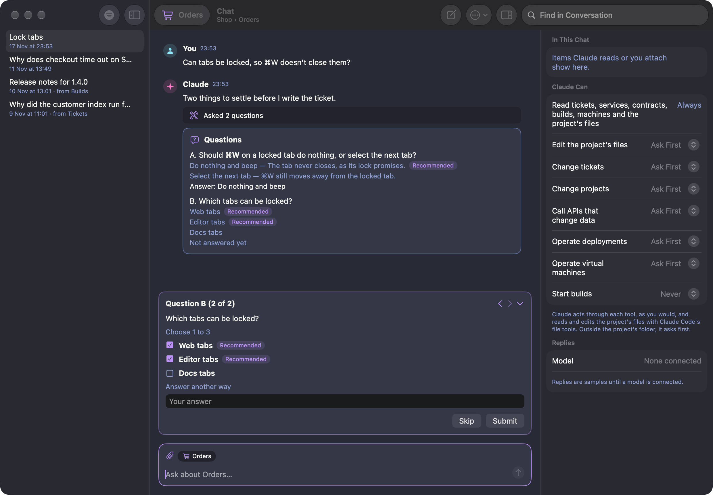
*Question A answered: B, a multiple question, completes the set, so its button reads Submit.*

In the transcript, the turn that asked shows the set as a card titled **Questions** (`questionmark.bubble`):
each question as "*A*. *question*", its options in `textSecondary` ("*label* — *description*", the recommended
ones tagged), then "Answer: *answer*" or "Not answered yet" (`QuestionsSummary`); the question, the options and
the answers draw their markers. The Answers message shows as
the user's turn. The activity line shows nothing while the set waits: the card is the cue.

## Picker cards

V2's picker requests, brought over on the user's request (18 November 2026): Claude asks the user to choose an
SF Symbol, a color, a sound, a keyboard shortcut, a font or an animation with `ask_symbol`, `ask_color`,
`ask_sound`, `ask_shortcut`, `ask_font` and `ask_animation` ([MCP › ask_symbol](../mcp.md#ask_symbol); the
sound, shortcut and animation ones only in an App project). While a request waits for its answer, its card shows
over the composer of the Chat window and of the panel, under the reason a message wasn't sent and the permission
card, as the questions card does (`PickerCard`, ChatPickerCard.swift). A chat has one request waiting at most,
questions included, so the questions card and a picker card never show together ([Data › Picker
requests](../data.md#picker-requests)).

Every card shares its frame (`PickerCardChrome`), as the questions card's:

- **Header.** The kind, "Symbol", "Color", "Sound", "Shortcut", "Font" or "Animation", in `headline`, selectable,
  a heading for VoiceOver; at its trailing edge **Minimize** (`chevron.down`).
- **Question.** Its Markdown (`MarkdownView`), its markers drawn and its ids linked ([Text ›
  Markers](../text.md#markers)), selectable.
- **The card's rows**, below.
- **Answer another way** (`OtherAnswerRow`): a radio button, then a field of one to six lines; a click on the
  button, or typing in the field, chooses it and leaves the card's own choice.
- **Buttons.** At the trailing edge **Skip**, which answers `Skipped`, then **Submit**, prominent, ⌘Return (not while
  a permission card shows, nor while the shortcut recorder records). Submit answers with the card's marker, or the
  field's text trimmed; it is disabled while "Answer another way" is chosen with an empty field, and in each card's
  cases below. Once answered, the card goes and Claude gets `<Kind>: <answer>`; an answer not taken shows why over
  the composer. The animation card puts **Play All** at the leading edge.
- **Size.** The question and the rows scroll inside the card past 460 pt (340 pt in the panel and the iPhone
  layout), or sooner, down to about two lines (44 pt), when the room over the composer is short ([Over the
  composer](#over-the-composer)). Card: 12 pt of padding, `surface`, `CardShape(minimum: 10)`, a 1 pt outline in `accent` at 50 %.
- **Selection.** A chosen cell or row has `accent` at 20 % behind it and a 1.5 pt `accent` outline
  (`pickerSelection`), so its content keeps its own colors; the recommended suggestion carries a star (`star.fill`,
  8 pt, `accent`) at its top trailing corner, or at a row's trailing end.
- **Minimized.** One line: the title and `chevron.up`; a click opens the card again. It lasts while the
  conversation stays shown, as the questions card's.
- **When the card appears** the recommended suggestion is chosen, and the fields are empty.

In the transcript, the turn that asked shows the request as a card titled with its kind and a symbol
(`square.grid.3x3`, `paintpalette`, `speaker.wave.2`, `command`, `textformat`,
`point.forward.to.point.capsulepath`) in `accent`: the question as Markdown, one line per suggestion in `callout`,
`textSecondary`, drawn as its marker (a pair `Light , Dark `; `MarkerText`), the
recommended one tagged **Recommended**, then "Answer:" and the answer with its markers drawn, or "Not answered
yet" (`PickerSummary`). Find searches the question, the suggestions' lines and the answer; Copy Conversation lists
the question. The answer's message shows as the user's turn, its marker drawn.


*Picker requests in the transcript: their suggestions and answers drawn as markers.*

### Symbol card

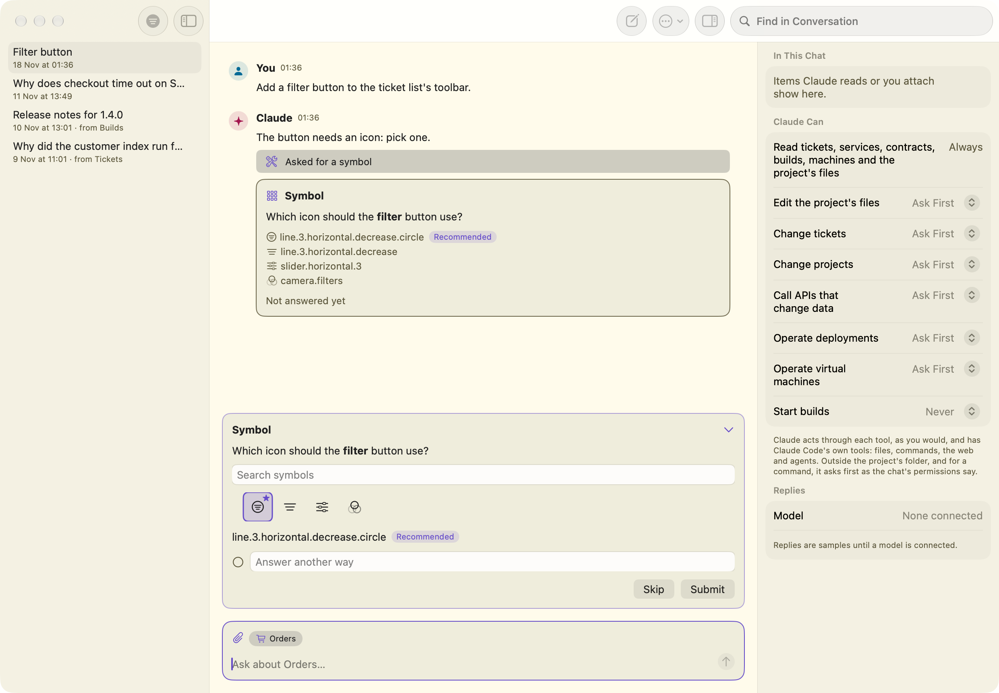

- **Search symbols**, a field: the Mac's symbols as the user types ([Data › Picker
  catalogues](../data.md#picker-catalogues)), read once, off the main actor.
- **The grid**: the suggestions in Claude's order, then the search's results; the suggestions alone while the field
  is empty. Cells 36 × 36 pt, 4 pt apart, as many columns as fit, at most 4 rows, then the grid scrolls inside
  itself. A cell shows the symbol (`title3`, `textPrimary`), or `questionmark.square.dashed` for a name this Mac
  can't draw, with the name as tooltip and label; a click chooses it.
- Under the grid, the chosen symbol's name, with **Recommended** when it is the recommended one; empty while
  "Answer another way" is chosen.
- Answers ``.

### Color card

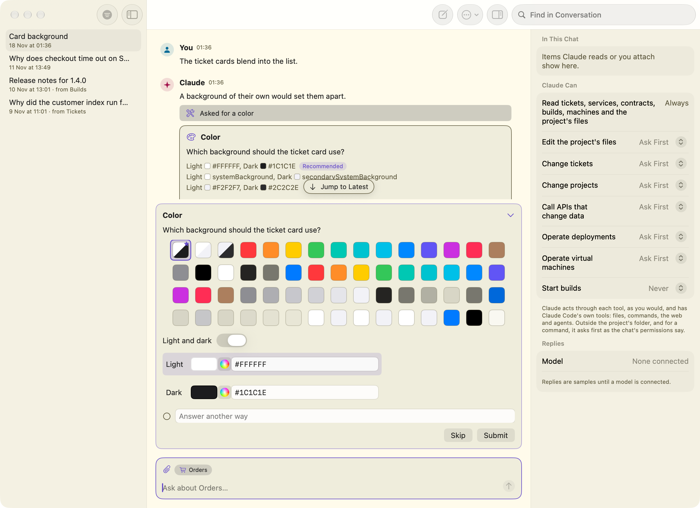

- **The grid** of swatches: the suggestions, then every system color name ([Text › System
  colors](../text.md#system-colors)) that isn't a suggestion, laid out as the symbol grid. A swatch is 28 × 28 pt,
  `CardShape(minimum: 6)`, a 1 pt border of `textSecondary` at 30 %, drawn as the Mac draws the color in the
  window's appearance; tooltip the color. A pair suggestion is split by the diagonal from its bottom leading corner
  to its top trailing one, its light color above, tooltip "Light <color>, Dark <color>"; while the switch is off it
  shows and gives its light color only.
- A cell is outlined when its color is the card's, or the selected row's while the switch is on; a pair when its
  two colors are the two rows'; none while "Answer another way" is chosen. Colors compare as [Text › System
  colors](../text.md#system-colors) says.
- **Light and dark**, a switch: on when Claude asked for a pair. Turning it on gives both rows the card's color and
  selects Light; off gives the card the Light row's.
- **The rows**: switch off, one row: the color well, then the hex field. On, **Light** and **Dark**, each with its
  label, its well and its field; the selected row has `accent` at 15 % behind it; a click on a row, its well or its
  field selects it.
- **The color well** is AppKit's in its expanded style (`ColorWell`, `NSColorWell(style: .expanded)`, no opacity):
  its swatch shows the row's color, its button opens the color panel; a color picked is made sRGB and given as
  `#RRGGBB` in uppercase.
- **The hex field**, system monospaced: the row's hex color, or its system color's name; the row takes the trimmed
  text once it is a hex color or a name; a hex color is written in uppercase when the field loses the focus.
- A click on a color sets the card's color, or the selected row's; a pair sets both rows, or the card to its light
  color while the switch is off.
- Answers `` or `Light , Dark `, a hex color in uppercase;
  Submit is disabled while a field shown holds neither a hex color nor a system color name.

### Sound card

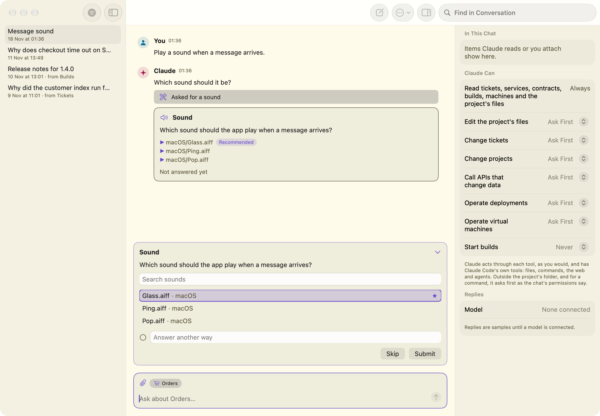

- **Search sounds**: the project's sound catalogue ([Data › Picker catalogues](../data.md#picker-catalogues)), read
  when the card appears; until it arrives the search lists nothing.
- **The list**: the suggestions, then the search's results, the suggestions alone while the field is empty; one
  line each, 24 pt, "<file> · <source>" (`textPrimary`, then `textSecondary`), such as "sms-received1.caf · iOS
  26.1", tooltip the name; at most 8 rows, then it scrolls inside itself.
- A click on a row chooses it and plays its sound, also when it is already chosen ([Text ›
  Markers › Sounds](../text.md#sounds)); the recommended one is chosen without playing when the card appears. A
  failure shows **Play Sound failed** with its message.
- Answers ``.

### Shortcut card

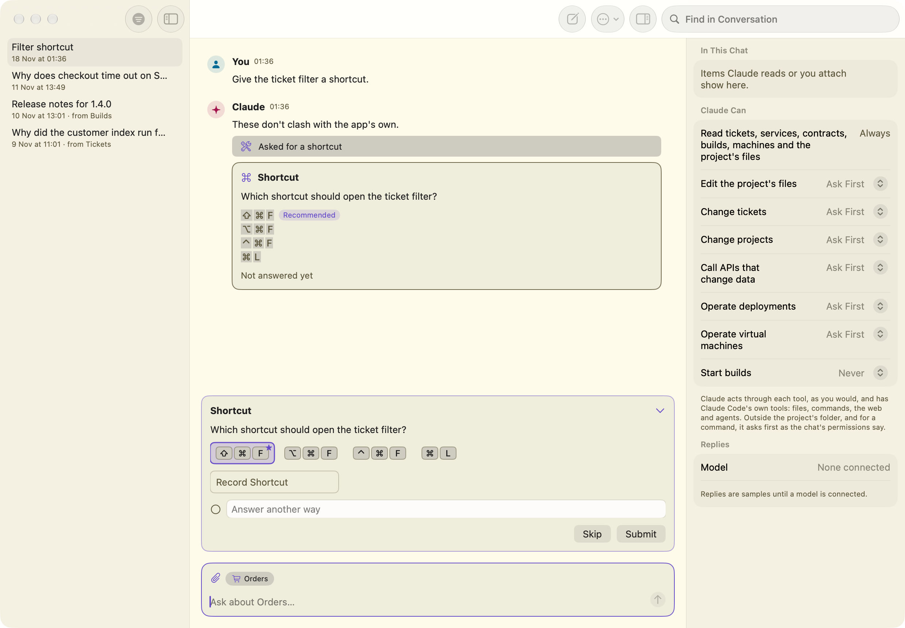

- **The suggestions**, buttons that show their key caps (`KeyCaps`: each cap `callout` medium on `surfaceSunken`,
  `CardShape(minimum: 4)`, a 1 pt border of `textSecondary` at 50 %), tooltip the shortcut, wrapping onto as many
  rows as needed (`FlowStack`); a click chooses one.
- **The recorder field**: the recorded shortcut's key caps, or "Record Shortcut" in `textSecondary`; at least
  160 pt wide. A click chooses it and starts recording: it then has `surfaceSunken` behind it and a 2 pt `accent`
  border. While it records, every key press of the app goes to it (`ShortcutRecording`, an `NSEvent` local monitor),
  menus and ⌘Return included: a modifier alone records nothing; another key records the shortcut of that key and
  the modifiers held among ⌃ ⌥ ⇧ ⌘ ([Text › Shortcut notation](../text.md#shortcut-notation)) and stops; a key the
  notation can't write records nothing and recording goes on. A click anywhere, or a window losing its key status,
  stops it; the field keeps its shortcut. The combinations macOS takes first, such as ⌘⇥, never reach it.
- **Warnings** under the recorder, for the chosen shortcut: "Used by macOS: <action>" for a standard macOS shortcut
  ([Text › Standard macOS shortcuts](../text.md#standard-macos-shortcuts)), then "Used by the app: <command>" for
  one of the request's `inUse`, each with `exclamationmark.triangle.fill`, in `warning`. They don't block Submit.
- Answers ``, a key `(`, `)` or `\` written with a `\` before it; Submit is disabled while
  the recorder is chosen without a shortcut.

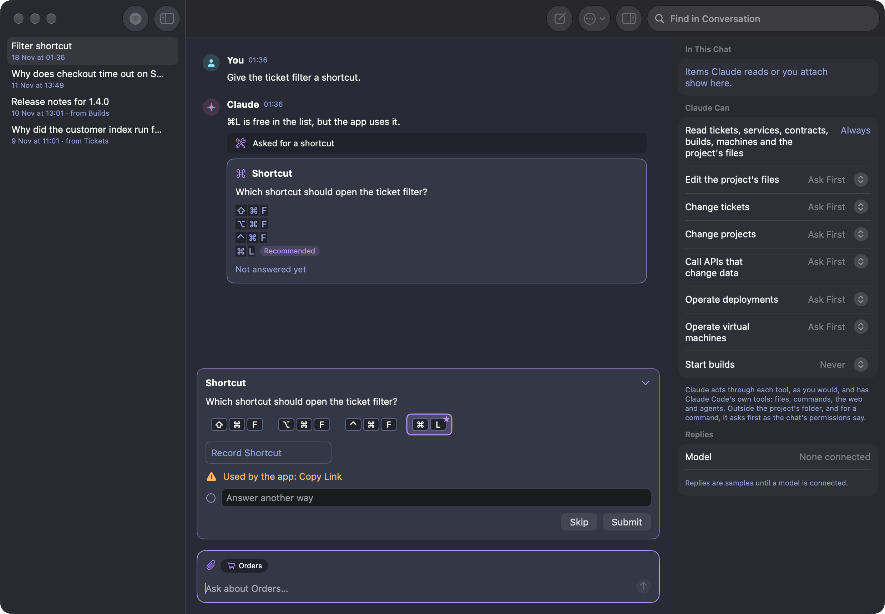

### Font card


- **Search fonts**: the project's font catalogue ([Data › Picker catalogues](../data.md#picker-catalogues)), read
  when the card appears; it registers the project's faces so that every view can draw them.
- **The list**: the suggestions, then the search's results, an empty query listing every family and text style;
  one line each. A family suggestion reads "<family> · <weight> · <size> pt" in its family and weight at the
  card's text size; a text style its notation in that style; a family of the results its name, in its `Regular`
  face or the one nearest 0; a font the Mac can't draw in the card's font. At most 8 rows, then it scrolls.
- **Weight**, a menu of the chosen family's weights, then **Size**, a field, and "pt": a family suggestion sets
  them to its own; a family of the results keeps the size and takes the nearest weight ([Data › Picker
  catalogues](../data.md#picker-catalogues)); before a family suggestion sets them they hold `Regular` and `17`.
  Both are disabled while a text style or "Answer another way" is chosen.
- **The sample**: the request's sample in the chosen font, a family at the field's size, wrapping, at most 200 pt
  high then scrolling, on `surfaceSunken`; empty while "Answer another way" is chosen and while the size isn't one.
- Answers `` with the menu's weight and the field's size (`17`, `15.5`), or
  ``; Submit is disabled while a family is chosen and the size isn't a size.

### Animation card

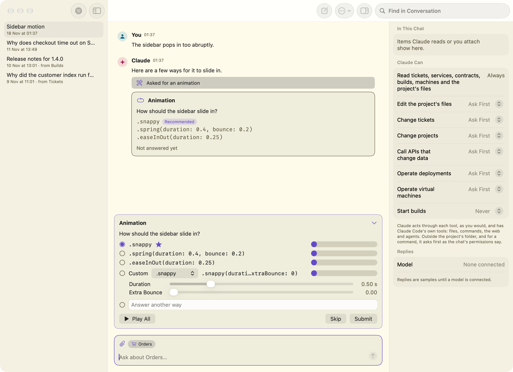

- **One row per suggestion**: a radio button, the expression as Claude wrote it in the system monospaced font, a
  star after the recommended one, and at the trailing end its lane. A click anywhere in the row chooses it and
  plays its lane.
- **Custom**: a radio button, "Custom", a menu of the presets `.smooth`, `.snappy`, `.bouncy`, `.spring`,
  `.easeIn`, `.easeOut`, `.easeInOut`, `.linear`, the row's expression (every parameter of its preset,
  `fullExpression`), and its lane. Under it, one slider per parameter of the preset, with its label and its value
  (two decimals, then " s" for the duration): **Duration** 0.1 to 2 s, **Bounce** -1 to 1 for `.spring`, **Extra
  Bounce** 0 to 1 for `.smooth`, `.snappy` and `.bouncy`, each value rounded to two decimals ([Text › Animation
  expressions](../text.md#animation-expressions)). Choosing a preset or moving a slider chooses the row; choosing a
  preset, a click on the row and releasing a slider play its lane. Changing the preset keeps the three values.
  When the card appears, the row holds the recommended suggestion's preset and parameters, SwiftUI's defaults for
  those it leaves out.
- **A lane** (`AnimationLane`): a capsule track 160 × 14 pt in `textSecondary` at 20 %, a circle 14 pt across in `accent` resting at
  its left end; playing puts it back at the left end, then animates it to the right end with SwiftUI's animation of
  the expression, where it stays (a spring with bounce passes the end before it settles). The user starts each
  play, so it plays under Reduce Motion too.
- **Play All** (`play.fill`), at the leading edge of the buttons: plays every lane together.
- Answers ``: the suggestion as Claude wrote it, or the Custom row's expression.

## New chat

The new-chat prompt replaces the transcript when no conversation is selected: after **New Chat**, or when the project has no conversations.


*AZDesign has no chats yet. The list shows its empty state and the prompt offers two questions.*

Centered, it shows:

1. The Chat symbol in large title size, in `accent`.
2. "Ask about *AZDesign*", title 2, semibold, a heading for VoiceOver.
3. "Claude reads through the tools, and asks before it changes anything. Name a ticket, a run or a request to point at it."
4. Two suggestions, as outlined capsule buttons in `accent`: **What changed this week?** and **What needs my attention?**

A suggestion sends at once and starts the conversation; the draft stays as it is. When the largest text sizes need more room than the window has, the prompt scrolls.

## Inspector

A grouped form in a trailing column, 260 to 400 pt wide, 300 pt ideally.

| Section          | Contents                                                                                                                                                                                                                                                                                                                                                                                                                                                                                                                                                                                                                                                                                                                                                                                                                                                                                                                                                                                                                    |
|------------------|-----------------------------------------------------------------------------------------------------------------------------------------------------------------------------------------------------------------------------------------------------------------------------------------------------------------------------------------------------------------------------------------------------------------------------------------------------------------------------------------------------------------------------------------------------------------------------------------------------------------------------------------------------------------------------------------------------------------------------------------------------------------------------------------------------------------------------------------------------------------------------------------------------------------------------------------------------------------------------------------------------------------------------|
| **In This Chat** | Every item the conversation attached or read, in the order it first came up. Each row: the tool's symbol, the item's title, the tool's name as a caption, and **Open**, which opens the item in its tool's window (help "Open *item* in *Tool*"). An item seen in two Service Map environments has a row for each. With none: "Items Claude reads or you attach show here."                                                                                                                                                                                                                                                                                                                                                                                                                                                                                                                                                                                                                                                 |
| **Claude Can**   | **Read tickets, services, contracts, builds, machines and the project's files**: Always (fixed text). **Edit the project's files**: Never, Ask First or Always; Ask First by default ([Files](#files)). **Change tickets**: Never, Ask First or Always; Ask First by default. **Change projects**: Never, Ask First or Always; Ask First by default. **Call APIs that change data**: Never, Ask First or Always; Ask First by default (a `GET` or `HEAD` call always runs). **Operate deployments** (restart, scale, Argo CD sync, port forwards): Never, Ask First or Always; Ask First by default. **Operate virtual machines** (create, start, stop, shell, input, files): Never, Ask First or Always; Ask First by default. **Start builds**: Never or Ask First; Never by default. Footer: "Claude acts through each tool, as you would, and reads and edits the project's files with Claude Code's file tools. Outside the project's folder, it asks first." The same settings as [Settings ▸ Chat](#settings--chat). |
| **Replies**      | **Model**: a pop-up of the CLI's models (Default, Opus, Fable, Sonnet, Haiku until the CLI answers). **Effort**: Low, Medium, High, Extra High, Max, the levels the model has; hidden for a model without one. For the selected conversation, its own; with no conversation selected, those of new chats. A change applies to the running CLI at once. In previews: **Model**: None connected, and "Replies are samples until a model is connected."                                                                                                                                                                                                                                                                                                                                                                                                                                                                                                                                                                        |

The permissions are stored in the user defaults (`chat.fileEdits`, `chat.ticketChanges`, `chat.projectChanges`, `chat.apiCalls`, `chat.clusterChanges`, `chat.machineChanges`, `chat.buildStarts`). The app applies **Edit the project's files** to the CLI's requests ([Files](#files)); the MCP server applies the others to every chat's calls ([MCP › Permissions](../mcp.md#permissions)): Always runs the change, Ask First shows a card and waits, Never refuses it. A deletion (a ticket, a bundle, a comment, an attachment) or a project's removal asks first even under Always. **Start builds** covers re-running and cancelling runs: Never refuses them, Ask First shows a card.

## How Claude reaches the tools

Claude reaches a tool only through that tool's operations, the same functions the tool's window calls, served by the app's MCP server (the user's principle). ChatKit imports no tool. ToolsScenes, the only target that knows every tool, gives the chat the tools' wording of each call, and every window a `toolReader` for the rows' details.

1. **A tool says what is selected.** A tool window reports its selected item as a reference (tool, project, focus, title, and for the Service Map the environment on screen) through `reportChatSubject`. The window keeps it for its chat panel. The chat never looks into the tool's window.
2. **The message carries it.** Sent from the panel, the item travels with the message as a chip; from the Chat window, the project. Claude reads one line after the message's text, such as "Attached: ticket ORD-142 of project ORD" ([Data › Messages](../data.md#messages)).
3. **Claude calls the tools.** It reads and changes through the app's MCP tools (`get_ticket`, `add_comment`…), as any client of them would; besides them it has the CLI's own tools, as in V2: files ([Files](#files)), the shell, the web, agents and workflows.
4. **The call shows.** Each call becomes a tool-call row with **Open**, and its item is listed under **In This Chat**.
5. **Changes ask first.** A change the user's permissions set to Ask First shows as an approval card; Claude's call waits for the answer.

The panel also reads its attached item before the first message, through `toolReader`, only for the tool's questions, which it offers as suggestions (see [What it asks about](#what-it-asks-about)).

| Tool            | Read function                                   | Focus                              | Detail of a row                                                                                                                                   |
|-----------------|-------------------------------------------------|------------------------------------|---------------------------------------------------------------------------------------------------------------------------------------------------|
| Tickets         | `TicketsReader.read(_:)`                        | Ticket id: `ORD-142`               | Title · status · priority                                                                                                                         |
| Service Map     | `ServiceMapReader.read(_:environment:project:)` | `service:<name>` or `request:<id>` | Service: environment · health · p95 · error rate · ready pods. Request: environment · method and path · status and duration · number of services. |
| Builds          | `BuildsReader.read(_:project:)`                 | Run number, or `release:<tag>`     | Title · status · workflow on branch; title · Latest or Pre-release · published date                                                               |
| Contracts       | `ContractsReader.read(_:project:)`              | operationId: `createOrder`         | Method and path · summary · contract title and version                                                                                            |
| Dashboard, Chat | None                                            | —                                  | —                                                                                                                                                 |

The app's MCP tools are those of Projects, Tickets, Chat, Builds, Contracts and the Service Map, and every tool's reader reads the app's data.

### Files

Claude reads and edits the project's files with the Claude CLI's own file tools: `Read`, `Grep` and `Glob` read,
`Edit`, `Write` and `NotebookEdit` edit. It has the CLI's other tools too, as V2's chats had them (the user's
request, 17 November 2026): `Bash` (also in the background), `WebFetch`, `WebSearch`, `Agent`, `Workflow` and the
rest, but not the CLI's question tool, which `ask_questions` replaces. Their calls ask as the chat's permission mode
says, each with a card ([Approval cards](#approval-cards)). For the file tools, the app answers at once where
Settings ▸ Chat decides it, or shows a card ([Data › File tools](../data.md#file-tools)):

| Call                                                            | Edit the project's files | Answer                                                                                                                                                                                                    |
|-----------------------------------------------------------------|--------------------------|-----------------------------------------------------------------------------------------------------------------------------------------------------------------------------------------------------------|
| A read inside the project's folder                              | Any                      | Runs, without a card.                                                                                                                                                                                     |
| A read outside the project's folder                             | Any                      | A card.                                                                                                                                                                                                   |
| An edit                                                         | Never                    | Refused; Claude reads "The user doesn't let Claude edit files from chats (Settings ▸ Chat)." A chat started under Never has no `Edit`, `Write` or `NotebookEdit` (its shell still asks as its mode says). |
| An edit                                                         | Ask First (default)      | A card, with the change as preview.                                                                                                                                                                       |
| An edit inside the project's folder, outside its `.hephaestus/` | Always                   | Runs, without a card.                                                                                                                                                                                     |
| An edit in `.hephaestus/`, or outside the project's folder      | Always                   | A card: the app's tools change its data.                                                                                                                                                                  |

- A relative path is taken from the project's folder, and symbolic links are resolved (defaults chosen at design
  time, as V2's Accept Edits).
- The CLI's own rules still apply before it asks: it runs a read inside its working folder on its own, and the
  user's Claude Code permission rules may allow a tool without asking.
- A change of the setting applies to the next request; whether the CLI has its editing tools is decided when its
  process starts.

**The CLI's other tools** read in their rows and cards as V2 named them (`CLIToolText`):

| Tool                                | Row                                                                                                          | Detail      | Card                                                              |
|-------------------------------------|--------------------------------------------------------------------------------------------------------------|-------------|-------------------------------------------------------------------|
| `Bash`                              | "Ran *description*" (else the command's first line); "Started in the background: …" with `run_in_background` | The command | "Claude wants to run a command", the command then its description |
| `BashOutput`, `TaskOutput`          | "Read a background command's output"                                                                         | —           | —                                                                 |
| `KillShell`, `KillBash`, `TaskStop` | "Stopped a background task"                                                                                  | —           | —                                                                 |
| `WebFetch`                          | "Fetched *host*"                                                                                             | The address | "Claude wants to fetch *host*", the address then the prompt       |
| `WebSearch`                         | "Searched the web for “*query*”"                                                                             | —           | "Claude wants to search the web"                                  |
| `Agent`, `Task`                     | "Ran an agent: *description*"; "Started an agent in the background: …"                                       | The prompt  | "Claude wants to start an agent"                                  |
| `Workflow`                          | "Started a workflow: *description*"                                                                          | —           | "Claude wants to start a workflow"                                |
| `SendMessage`                       | "Sent a message to an agent"                                                                                 | —           | —                                                                 |
| `TodoWrite`                         | "Updated the to-do list"                                                                                     | —           | —                                                                 |
| `ExitPlanMode`                      | "Presented a plan"                                                                                           | —           | "Claude wants to leave Plan Only", the plan                       |
| `Skill`                             | "Used the skill *name*"                                                                                      | —           | —                                                                 |
| Any other                           | "Used *name*"                                                                                                | —           | "Claude wants to use *name*", its input as JSON                   |

### Samples

Previews and the documentation's captures run on sample conversations and a sample engine instead of the CLI. The sample engine reads what a message attaches or names through the tools, then says it can't answer: a ticket id whose letters are a project's id (ORD-142), `req-` and four hexadecimal digits (req-8f3a), "run" and a number (run 1288), in that order after the attachments, each item once.

- With reads: "No model is connected to this example yet, so I can't answer. Above is what I read through the tools; a connected model would answer from it."
- Without: "No model is connected to this example yet, so I can't answer. Attach an item, or name one such as ORD-142, run 1288 or req-8f3a, and I'll show what I would read through its tool."

## States

| State                    | When                                                                         | What shows                                                                                           |
|--------------------------|------------------------------------------------------------------------------|------------------------------------------------------------------------------------------------------|
| Conversation             | A conversation is selected.                                                  | Its transcript over the composer.                                                                    |
| New chat                 | **New Chat**, or no conversation selected.                                   | The new-chat prompt over the composer.                                                               |
| No chats                 | The project and its sub projects have no conversation.                       | "No Chats" in the list; the new-chat prompt.                                                         |
| Starting                 | The CLI was started for the message.                                         | "Starting Claude…" and **Stop**; **Send** disabled.                                                  |
| Working                  | Claude works on the messages.                                                | "Claude is working… m:ss" and **Stop**; the text Claude writes grows as it streams.                  |
| Compacting               | The CLI compacts the conversation.                                           | "Compacting the conversation… m:ss" and **Stop**.                                                    |
| Waiting for your answers | Claude's questions wait, and no turn runs.                                   | The questions card over the composer; no activity line.                                              |
| Waiting for your answer  | A card waits.                                                                | The card's **Don't Allow** and **Allow**, `warning` outline; "Waiting for your answer" and **Stop**. |
| Approval answered        | The user answered, or Stop refused it.                                       | **Allowed** or **Not Allowed**; `divider` outline.                                                   |
| Error                    | The CLI couldn't start, didn't start within 60 s, or exited during the turn. | The error notice; the next message starts the CLI again.                                             |
| Not sent                 | The CLI isn't available.                                                     | The reason over the composer; the draft kept.                                                        |
| Sample reply             | A reply from the sample engine (previews).                                   | **Sample reply** after **Claude**.                                                                   |
| Nothing in this chat     | The conversation read and attached nothing, or none is selected.             | "Items Claude reads or you attach show here." in the inspector.                                      |
| No project               | The window was restored without a known project.                             | "No Project", `folder`, "Open this window from the Projects window."                                 |

## Layouts

The window measures its width and picks a layout; see [foundations.md](foundations.md) › Layout system. The Chat window needs 960 pt for its Mac layout: below that, beside the list and the inspector, the conversation would get too narrow. Each time the layout changes, the list and the inspector take that layout's default visibility.

| Layout | When                 | What changes                                                                                                                                                                                                                                                                                                                                                                                                                                                                                                                                                                                                         |
|--------|----------------------|----------------------------------------------------------------------------------------------------------------------------------------------------------------------------------------------------------------------------------------------------------------------------------------------------------------------------------------------------------------------------------------------------------------------------------------------------------------------------------------------------------------------------------------------------------------------------------------------------------------------|
| Mac    | 960 pt and wider     | List, conversation and inspector side by side; the list and the inspector show.                                                                                                                                                                                                                                                                                                                                                                                                                                                                                                                                      |
| iPad   | 640 to 959 pt        | The list folds away behind the sidebar button and the inspector hides behind **Inspector**. The conversation fills the window. One side column shows at a time, so the conversation keeps its room: opening the inspector folds the list, and showing the list closes the inspector.                                                                                                                                                                                                                                                                                                                                 |
| iPhone | Narrower than 640 pt | One pane at a time. The list fills the window, with nothing selected, when the window opens at this width; a conversation opens as a page with Back. **New Chat** opens the prompt as a page, which becomes the conversation once sent. The inspector opens as a sheet, at least 360 × 480 pt, with **Done** (Return). Transcript padding is 16 pt, composer padding 12 pt. A window opened on a conversation starts on its page. A window that narrows to this width keeps its selection and shows that item's page, as a collapsing split view does ([Foundations › Layout system](foundations.md#layout-system)). |

Below 760 pt the toolbar also drops the window's title; the project switcher names the project.

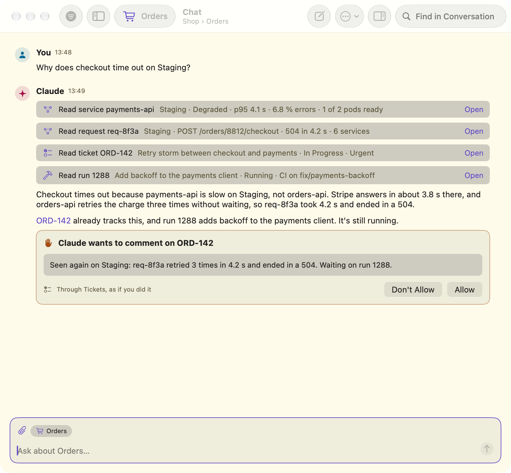
*At 820 pt the list folds away and the inspector hides; the conversation fills the window.*


*In the iPhone layout the list of chats fills the window, with "from Builds" and "from Tickets" origins.*


*A conversation opens as a page over the list, with Back.*

## Chat panel

Every window has one chat panel, on the right, outside its tabs ([Navigation › Tabs](navigation.md#tabs)); Chat's own tab has none. The panel asks about the item the selected tab has selected. It holds one conversation per project in the window and shows the selected tab's project's (the user's choice): switching tabs loses none. In Projects it is the selected project's; in a tab without a project (Virtual Machines), the last project the window showed; with none, "No Project", "Select a project to chat about it." (`chatPanel.noProject`). Its conversations are the Chat window's too: they appear in its list, "from *Tool*".

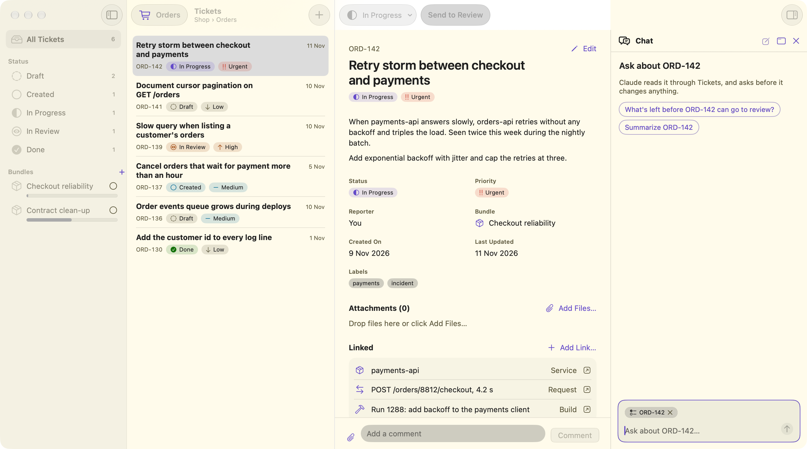
*Tickets in the Mac layout, with the panel beside the ticket. The panel's button is the toolbar's last item.*

### What it asks about

The panel's subject is the item the selected tab reports as selected. It shows as a chip in the composer, and the next message carries it.

**Suggestions** come from the item's tool: its read function proposes the questions worth asking about the item in its current state, so they change with it. A failed run offers "Why did run 641 fail?", a passed one doesn't. Each tool's page lists its own. When the tool proposes none, the panel offers general questions that suit any item of the kind, whatever its state.

| Window                                                                                                         | Subject                                   | Chip               | Suggestions from the tool, for example                                                                                                                                          | General suggestions                                                          |
|----------------------------------------------------------------------------------------------------------------|-------------------------------------------|--------------------|---------------------------------------------------------------------------------------------------------------------------------------------------------------------------------|------------------------------------------------------------------------------|
| Tickets                                                                                                        | The selected ticket                       | ORD-142            | See [Tickets](tickets.md)                                                                                                                                                       | What's left before ORD-142 can be closed? · Summarize ORD-142                |
| Service Map, a service in view                                                                                 | The service, in the environment on screen | payments-api       | See [Service Map](service-map.md)                                                                                                                                               | What calls payments-api? · What does payments-api depend on?                 |
| Service Map, a request in view                                                                                 | The request, in the environment on screen | req-8f3a           | See [Service Map](service-map.md)                                                                                                                                               | Which services did req-8f3a go through? · Where did req-8f3a spend its time? |
| Contracts                                                                                                      | The selected operation                    | createOrder        | Last call failed: Why did createOrder answer 504? · Show an example request for createOrder. Otherwise: Show an example request for createOrder · What does createOrder return? | Show an example request for createOrder                                      |
| Builds, Runs                                                                                                   | The selected run                          | Run 1288           | Failed: Why did run 641 fail? · What changed in run 641? Passed: What changed in run 640? · Was run 640 slower than usual? See [Builds](builds.md).                             | What changed in run 1288? · Summarize run 1288                               |
| Builds, Releases                                                                                               | The selected release                      | Release v1.4.0     | See [Builds](builds.md)                                                                                                                                                         | What changed in release v1.4.0? · Summarize release v1.4.0                   |
| Dashboard, Projects, Project Settings, Virtual Machines; or no selection; or the Service Map's whole namespace | None                                      | The project's chip | —                                                                                                                                                                               | What changed this week? · What needs my attention?                           |

With the subject taken off, the panel offers the project's suggestions, as with no subject.

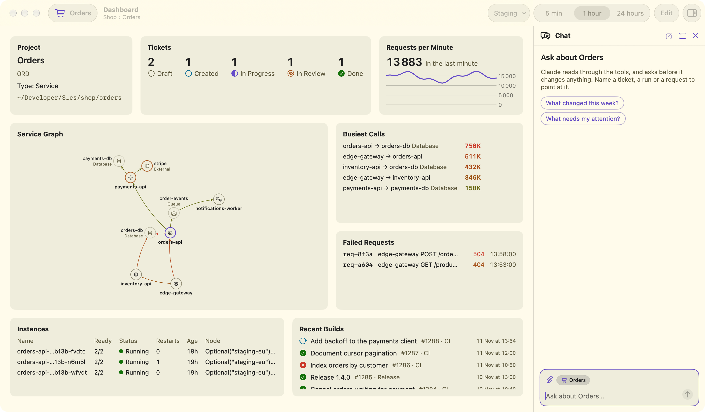
*Beside the Dashboard, which has no selection: the panel asks about Orders and offers the project's suggestions.*

The chip has three states:

- **Attached.** The item's tool symbol and title, with an `xmark` button, "Remove *ORD-142*", that takes it off the next message. Its tooltip, and its VoiceOver label, name the tool too: "Tickets: ORD-142".
- **Taken off.** A borderless **Attach *ORD-142*** button with `plus` puts it back. A new selection in the tool attaches the new item again.
- **No subject.** The project's chip, which can't be removed.

### Header

| Item                                  | Control                                         | Symbol                              | Behavior                                                                                                                                                                                                                                                                                                                                                                                                                                                                                                                                                                                                                                                                                                                                                                           |
|---------------------------------------|-------------------------------------------------|-------------------------------------|------------------------------------------------------------------------------------------------------------------------------------------------------------------------------------------------------------------------------------------------------------------------------------------------------------------------------------------------------------------------------------------------------------------------------------------------------------------------------------------------------------------------------------------------------------------------------------------------------------------------------------------------------------------------------------------------------------------------------------------------------------------------------------|
| **Chat**                              | Label, headline, a heading for VoiceOver        | `bubble.left.and.text.bubble.right` | —                                                                                                                                                                                                                                                                                                                                                                                                                                                                                                                                                                                                                                                                                                                                                                                  |
| **Chats** pop-up (`chat.panel.chats`) | Borderless menu, `callout`, one line, truncated | —                                   | V2's pop-up of the project's chats. Its label is the open conversation's title, or "New Chat". It lists the project's chats (not its sub projects'), the latest first, a closed chat only while it is open, the open one checked; each with its mark, a menu's symbol since a spinner can't turn there: `progress.indicator` while Claude works (V2's), `hand.raised` while it waits for the user, `exclamationmark.triangle` after an error. Picking one shows it, with its own draft ([Drafts](#drafts)). Then, after a divider, **Open in New Window** (`macwindow.badge.plus`, `chat.panel.openNewWindow`), disabled with no conversation open, which opens the chat in a [chat window](#chat-windows). Disabled when the project has no chat and none is open. Help: "Chats". |
| **New Chat**                          | Icon button                                     | `square.and.pencil`                 | Leaves the conversation and clears the draft; the empty state returns. Disabled when no conversation is open.                                                                                                                                                                                                                                                                                                                                                                                                                                                                                                                                                                                                                                                                      |
| **Open in Chat Window**               | Icon button                                     | `macwindow`                         | Opens the project's Chat window with this conversation selected. With no conversation open, it opens the project's Chat window without a focus. Help: "Open in the Chat Window".                                                                                                                                                                                                                                                                                                                                                                                                                                                                                                                                                                                                   |
| **Hide Chat**                         | Icon button                                     | `xmark`                             | Hides the panel, sliding it out. Help: "Hide the Chat Panel (⌃⌘C)".                                                                                                                                                                                                                                                                                                                                                                                                                                                                                                                                                                                                                                                                                                                |

A divider separates the header from the conversation.

### Conversation and composer

- **Empty state.** Before the first message: "Ask about *ORD-142*" (or the project's name when nothing is attached), title 3, semibold, a heading for VoiceOver. Then, with an item attached, "Claude reads it through *Tickets*, and asks before it changes anything." (the item's tool); with nothing attached, the Chat window's sentence: "Claude reads through the tools, and asks before it changes anything. Name a ticket, a run or a request to point at it." Then the suggestions for the subject. A suggestion sends at once, with the chip; the draft stays as it is. When the largest text sizes need more room than the panel has, the empty state scrolls.
- **Transcript.** The same turns, rows and cards as the Chat window, tighter: 14 pt of padding and less space between turns. A tool-call row shows the action only, on one line; its detail is in the tooltip.
- **Composer.** The same composer, with 12 pt of padding. Prompt: "Ask about *ORD-142*…", or the project's name when nothing is attached. **Return** sends, **⌥Return** starts a new line.
- **Sending.** The first message starts a conversation with the panel's project and the selected tab's tool as its origin (the Dashboard for Projects, Project Settings and Virtual Machines). Later messages go to the same conversation, each with whatever the chip shows at that moment.


*"Is run 1288 enough to close it?" sent with Return from Tickets: the sample reply reads ORD-142, the attached ticket, and run 1288, which the message names.*

### Showing and hiding

The panel shows or hides per window, for all its tabs (the user's choice). Each window remembers its own choice across launches; a new window starts with the panel shown (the user's choice, 17 November 2026).

| Item                                      | Control                                                                     | Symbol          | Shortcut        | Behavior                                                                                                                                                                                   | Layouts           |
|-------------------------------------------|-----------------------------------------------------------------------------|-----------------|-----------------|--------------------------------------------------------------------------------------------------------------------------------------------------------------------------------------------|-------------------|
| **Chat**                                  | Toolbar button, `ChatPanelToolbarItem` (see [components.md](components.md)) | `sidebar.right` | ⌃⌘C (View menu) | Shows or hides the panel. Always the toolbar's last item, at its right end (the user's choice), in every tab but Chat's. Help: "Show the Chat Panel (⌃⌘C)" or "Hide the Chat Panel (⌃⌘C)". | Mac, iPad, iPhone |
| **Show Chat Panel** / **Hide Chat Panel** | View menu item, after the sidebar items                                     | —               | ⌃⌘C             | Shows or hides the panel of the key window. Disabled when the window has no panel: Chat's tab is selected, or Settings turns the panel off. See [navigation.md](navigation.md).            | Mac, iPad, iPhone |
| **Hide Chat**                             | Header button                                                               | `xmark`         | —               | Hides the panel.                                                                                                                                                                           | Mac, iPad, iPhone |

In Tickets, on the Mac and iPad layouts, the button sits at the right end of the ticket's column; the list's column doesn't repeat it. In the iPhone layout it ends both the list's toolbar and the ticket page's.

### Placement in each layout

The window keeps one panel in every layout, so its conversation survives a resize. With the panel open, the window takes the Mac layout only when it is as wide as the selected tool's columns plus the panel (760 pt for Projects, Project Settings and Virtual Machines).

| Layout | When                                       | What changes                                                                                                                                                           |
|--------|--------------------------------------------|------------------------------------------------------------------------------------------------------------------------------------------------------------------------|
| Mac    | At least the tool's Mac width + 341 pt     | The panel sits beside the tabs, from under the toolbar to the status bar, 341 pt wide with its leading divider. The tab bar and the tab narrow by 341 pt to make room. |
| iPad   | 640 pt up to the tool's Mac width + 341 pt | The panel slides over the tabs' trailing edge, 341 pt wide, with its divider and a shadow (radius 14 pt). The tab keeps its full width and takes its own iPad layout.  |
| iPhone | Narrower than 640 pt                       | The panel fills the window as a full page, without a divider, over the tabs. The toolbar stays, with the panel's button last.                                          |

| Tool        | Mac layout without the panel | With the panel | At a new window's 1320 pt, panel open |
|-------------|------------------------------|----------------|---------------------------------------|
| Dashboard   | 900 pt                       | 1241 pt        | Beside the tabs                       |
| Tickets     | 900 pt                       | 1241 pt        | Beside the tabs                       |
| Service Map | 880 pt                       | 1221 pt        | Beside the tabs                       |
| Contracts   | 760 pt                       | 1101 pt        | Beside the tabs                       |
| Builds      | 900 pt                       | 1241 pt        | Beside the tabs                       |


*The Service Map at 1000 pt, dark: the panel slides over the map and asks about payments-api.*

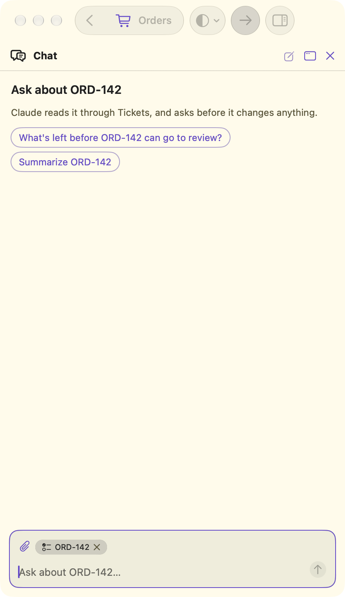
*In the iPhone layout the panel covers the window. Here it asks about ORD-142.*

### Animation

The panel slides in from the window's right edge and back out (the user's choice), with AZDesign's `panel` motion: a smooth curve of 0.3 s. The toolbar button, the View menu item and **Hide Chat** all animate it. In the Mac layout the tool narrows or widens in the same animation. With Reduce Motion on, the panel fades in and out in 0.15 s instead of sliding. The window's edge hides the panel while it slides; nothing is clipped, so the toolbar keeps its room. See [Motion](foundations.md#motion).

### Panel states

| State               | When                                                                                               | What shows                                                                        |
|---------------------|----------------------------------------------------------------------------------------------------|-----------------------------------------------------------------------------------|
| Hidden              | The window's panel is off.                                                                         | The tabs alone; the toolbar button's help reads "Show the Chat Panel (⌃⌘C)".      |
| New chat            | No conversation yet, or after **New Chat**.                                                        | The empty state with suggestions.                                                 |
| Conversation        | After the first message.                                                                           | The compact transcript; the title in the header.                                  |
| Waiting for a reply | After sending, while Claude works.                                                                 | The activity row with **Stop**; **Send** disabled.                                |
| Subject taken off   | The user removed the chip.                                                                         | **Attach *item*** in place of the chip; the project's suggestions.                |
| No subject          | The tab has nothing selected, or is the Dashboard, Projects, Project Settings or Virtual Machines. | The project's chip; "Claude reads through the tools…"; the project's suggestions. |
| No project          | No tab of the window has shown a project.                                                          | "No Project", "Select a project to chat about it."                                |
| Turned off          | Settings ▸ Chat switch off.                                                                        | No panel, no toolbar button; the View menu item is disabled.                      |

Hiding the panel keeps its open conversations, their drafts and a subject the user took off: shown again, the panel is as the user left it (the user's choice). The window keeps them, one per project, for as long as it is open, not the panel. **New Chat** leaves the current one. Selecting a tab of another project, or switching a tab to another project, shows that project's conversation, a new one the first time; the others stay, and stay in the Chat window's list.

## Feedback

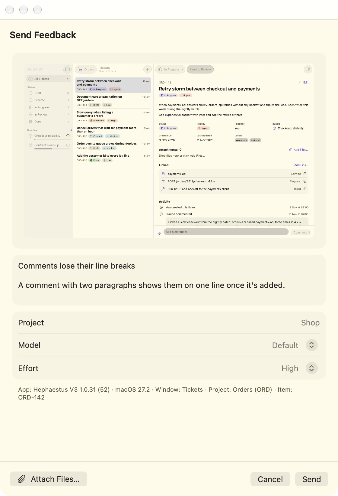
*Send Feedback over the Tickets window's screenshot: the comment, the feedback chat's model and effort, and the
line that says where the feedback comes from.*

V2's feedback, as V2 did it (the user's request, 17 November 2026): the ladybug of every window's
[status bar](navigation.md#status-bar), or Help ▸ Send Feedback… (⇧⌘B), starts a **feedback chat** about that
window in the feedback project chosen in [Settings ▸ General](navigation.md#settings--general). Its first
message calls the internal skill `report-feedback` ([System Prompts](system-prompts.md)) with the comment, the
context, the screenshot and the files added. What Claude does with it is the skill's to say: the user writes it.
V2's prompts don't come over; nor does its permission mode menu (V3's chats have none).

**Flow.**

1. Start: the ladybug of a window, or Help ▸ Send Feedback… for the key window. Nothing while the window
   shows a sheet or its feedback is already open.
2. Capture: the window is rendered into a PNG ([Screenshot](#screenshot)), saved as `screenshot.png` in a new
   temporary folder, `HephaestusV3-Feedback-<UUID>`.
3. Sheet: the **Send Feedback** sheet opens on that window, after the capture, so it is never in the
   screenshot.
4. Send: the feedback chat is created and its first message sent ([The feedback chat](#the-feedback-chat)); the
   sheet closes, its temporary folder is deleted, and the feedback project's Chat tab shows the chat (the user's
   choice): a route, which a window already showing that project's chats takes, and which becomes a tab when
   [new windows open as tabs](navigation.md#tabs).
5. Claude runs `report-feedback` in that chat, as the user wrote it; a change it makes, such as
   `create_ticket`, asks first as Settings ▸ Chat says ([Approval cards](#approval-cards)).

**The sheet** (`feedback.sheet`), 520 pt wide, 600 pt high at least and 700 pt by default, on `canvas`:

| Part          | Identifier                                              | Contents                                                                                                                                                                                                                                                                                                                                                                                     |
|---------------|---------------------------------------------------------|----------------------------------------------------------------------------------------------------------------------------------------------------------------------------------------------------------------------------------------------------------------------------------------------------------------------------------------------------------------------------------------------|
| Heading       | —                                                       | **Send Feedback** (`title3`, semibold), a heading for VoiceOver.                                                                                                                                                                                                                                                                                                                             |
| Screenshot    | `feedback.screenshot`                                   | The PNG scaled to fit 480 × 300 pt, centered; at 40 % opacity while left out. A click opens it in Quick Look. Its label is "Screenshot of the window".                                                                                                                                                                                                                                       |
| Eye           | `feedback.screenshot.toggle`                            | In the screenshot's top-right corner, 8 pt in: `eye`, white, on a 24 pt black circle at 55 % opacity, shown while the pointer is over the screenshot; `eye.slash` while the screenshot is left out, shown at all times. A click leaves the screenshot out or puts it back. Tooltip and label: "Exclude Screenshot", or "Include Screenshot". The screenshot is in each time the sheet opens. |
| No screenshot | `feedback.screenshot.missing`                           | When the window couldn't be captured: `eye.slash` and "The window could not be captured.", in `textSecondary`. Send then sends no screenshot.                                                                                                                                                                                                                                                |
| First group   | `feedback.comment`                                      | **Comment**, with "What happened, and what did you expect?" as placeholder, four lines high, growing to eight; required. Then the added files ([Added files](#added-files)).                                                                                                                                                                                                                 |
| Second group  | `feedback.project`, `feedback.model`, `feedback.effort` | **Project**: the feedback project's name, read-only. The chat's **Model** and **Effort**, as Settings ▸ Chat lists them, on Settings ▸ Chat's defaults each time the sheet opens; the choice sets only this chat. No priority and no draft switch: the skill decides them (the user's choice). Footer: the context, `caption`, `textSecondary`, selectable (`feedback.context`).             |
| Message       | `feedback.message`                                      | Why a file wasn't added, or why Send failed, in `danger`; otherwise why Send waits for the CLI, in `textSecondary`: "Checking the Claude CLI…", or "Claude CLI is not available: <reason>". Under the form.                                                                                                                                                                                  |
| Bottom bar    | `feedback.attach`, `feedback.cancel`, `feedback.send`   | Under a divider: **Attach Files…** (`paperclip`) at the leading edge; at the trailing edge a small progress indicator while sending, **Cancel** (Escape) and **Send** (⌘Return, as V2's; `borderedProminent`; help "Send (⌘↩)").                                                                                                                                                             |

- **Send** is enabled while the comment holds more than spaces and line breaks, the Claude CLI is available,
  and nothing is being sent. A screenshot left out, or none, doesn't stop it. While it runs, the form, Attach
  Files…, the files' remove buttons and Cancel are disabled.
- **Send fails**: nothing is created; the sheet stays with the reason in the message line, and what was typed,
  the screenshot's state, the files and the menus are kept.
- **Cancel** closes the sheet and deletes the screenshot; nothing is created.

### Added files

- **Attach Files…** opens an open panel for files, several at once. Files dropped anywhere on the sheet are
  added too. A file already added isn't added again.
- A folder adds nothing from its drop or choice, with "Folders cannot be attached."; a file larger than
  20 MB, with "<name> is larger than 20 MB." (the ticket attachments' limit, [Data](../data.md)). The next
  successful addition clears the message. Send fails when the screenshot and the files exceed 20 MB together:
  "The attachments of one request exceed 20 MB."
- Each added file is a chip in a row under the comment, which scrolls sideways: the file's icon, its name, its
  size and a remove button (`xmark`, "Remove <name>"). The chip is `feedback.file.<name>`.

### The feedback chat

`ChatSession.createFeedback` ([Data › Feedback chats](../data.md#feedback-chats)):

1. Checks the comment and the Claude CLI, then the files' sizes; any failure creates nothing.
2. Copies the screenshot, unless it is left out, then the added files, in order, into the chat's folder:
   `.hephaestus/chats/<chat id>/<UUID>-screenshot.png`, `<UUID>-<name>`, in the feedback project.
3. Writes the chat: kind `feedback`, without a ticket, named after the comment's first line (V2's Haiku names
   are left out), on the sheet's model and effort. It is listed with the project's other chats.
4. Sends its first message: `/hephaestus-skills:report-feedback`, the comment, then `Feedback context:` with
   the context, the stored screenshot's path and each stored file's path. The images among the stored files,
   the screenshot first, go before the text as images, so that Claude sees them; the paths let Claude attach
   the files to a ticket. The message keeps the stored files as its own, the screenshot first, and the
   transcript shows them under its text: the screenshot as a thumbnail that opens in Quick Look ([Message
   files](#message-files)).

```text
/hephaestus-skills:report-feedback
The ladybug hides behind the chat panel

Feedback context:
- App: Hephaestus V3 1.0.31 (52)
- macOS 27.2
- Window: Tickets
- Project: Orders (ORD)
- Item: ORD-142
- Screenshot: /Users/me/Developer/Shop/.hephaestus/chats/3F25…/1B4E…-screenshot.png
- Attachment: /Users/me/Developer/Shop/.hephaestus/chats/3F25…/8D0E…-app.log
```

- Every chat's CLI gets the skills chats call, `report-feedback` among them, as the plugin
  `hephaestus-skills` ([Data › Chat plugin](../data.md#chat-plugin)): the CLI runs the message as a call of
  the skill, the skill's text then the rest of the message as its arguments, the images still visible. The user
  can call it the same way in any chat.
- **The ticket.** The first ticket the chat's Claude creates with `create_ticket` lists the chat in its `chats`,
  and the chat records it as its `ticket` (V2's feedback link); later tickets from the same chat aren't linked
  ([MCP › create_ticket](../mcp.md#create_ticket)). A ticket created without a title is titled by
  `set-ticket-title` ([Tickets › Titles written by Claude](tickets.md#titles-written-by-claude)).

### Context

The lines that say where the feedback comes from, from the window at capture time (`FeedbackSource.context`):
the sheet's footer joins them with " · ", the first message lists them, each after `- `:

| Part    | Value                                                                                                                                                                                  |
|---------|----------------------------------------------------------------------------------------------------------------------------------------------------------------------------------------|
| App     | `App: Hephaestus V3 <CFBundleShortVersionString> (<CFBundleVersion>)`                                                                                                                  |
| macOS   | `macOS <major>.<minor>`, and `.<patch>` when it isn't 0                                                                                                                                |
| Window  | `Window: ` and the window's name: the tool's title, Projects, Project Settings or Virtual Machines                                                                                     |
| Project | `Project: <name> (<identifier>)`: the tool window's or Project Settings' project, or the one selected in the Projects window; absent for Virtual Machines and when nothing is selected |
| Item    | `Item: ` and the item the tool window has selected, as its chat panel names it (`ORD-142`, `payments-api`, `Run 1288`); absent when nothing is selected and in the other windows       |

Example, in the footer: `App: Hephaestus V3 1.0.19 (41) · macOS 27.2 · Window: Tickets · Project: Orders (ORD) · Item:
ORD-142`. V2's device line has no counterpart; V2's Section is the Window part (default chosen at design time).

### Screenshot

V2's capture, inside the app's process, without screen-capture APIs, so no screen recording permission is
needed:

1. The window's frame view (`contentView.superview`: title bar, toolbar and content) is rendered with
   `cacheDisplay` at the window's backing scale.
2. Views that blend with what is behind the window (`NSVisualEffectView` with `.behindWindow`) are filled,
   behind their pixels, with the window background color of their appearance, so they show opaque.
3. In full screen, the window holding the title bar and toolbar is drawn over the bitmap at its place, and so
   is each attached sheet, after its visible child windows.
4. A PNG over 5,000,000 bytes is rendered again at 1 pixel per point, to leave room for added files in the
   feedback's 20 MB (default chosen at design time).

- A sheet, the background of an alert sheet, or the toolbar window of a window in full screen, is captured as
  the window it belongs to. Other windows, menus, popovers and the pointer aren't in the screenshot. V2's step
  for web views is left out: V3 has none. A virtual machine's screen, drawn by Virtualization, may show blank.
- When no bitmap can be made, the sheet shows "The window could not be captured.", and Send sends no screenshot.

## Implement chats

The chats of [Tickets › Implement](tickets.md#implement), as V2's implement chats (the user's request, 20 November
2026). They are listed, opened and answered as any chat of their project; the Tickets window lists them on their
ticket or bundle ([Tickets › Chats](tickets.md#chats)). The rules are in [Data › Implement chats](../data.md#implement-chats).

| Chat                     | Kind                                               | Started by                                                        | First message                                        | Works in                                     |
|--------------------------|----------------------------------------------------|-------------------------------------------------------------------|------------------------------------------------------|----------------------------------------------|
| A ticket's               | `ticket`                                           | **Implement…**, or `implement_ticket` from another chat           | `/hephaestus-skills:implement-ticket ORD-142`        | The project's folder                         |
| A bundle's               | `bundle`                                           | **Implement All…**, or `implement_bundle`                         | `/hephaestus-skills:implement-bundle ORD-B3`         | The project's folder                         |
| A ticket's, for a bundle | `ticket`, with the bundle's chat as `orchestrator` | `implement_ticket` from the bundle's chat, for one of its tickets | `/hephaestus-skills:implement-ticket ORD-142 ORD-B3` | Its worktree, on the branch `ORD-B3/ORD-142` |
| A push's CI              | `ci`, with the chat that pushed as `orchestrator`  | `watch_ci`, from a ticket's or bundle's chat after its push       | `/hephaestus-skills:watch-ci <full commit hash>`     | The project's folder                         |

- **Title.** "Implement ORD-142: <ticket's title>", "Implement All ORD-B3: <bundle's title>", "CI of ORD-142:
  8e7ccf3" (the commit's first 7 characters), at most 80 characters (default chosen at design time; V2 had Haiku
  name them). The user renames them as any chat.
- **The message** shows as the user's, the call's line as typed; the skill's content isn't shown (as for
  [Feedback](#feedback)).
- **No questions until the user writes.** In a ticket's chat, `ask_questions` and the picker requests are refused
  until the user sends a message there: Claude decides what the ticket leaves open, and says so in its comment
  (V2's rule). The first message the user sends lifts it for good; Resume doesn't.
- **Reports.** Each time a turn of a ticket's chat for a bundle ends, the app sends the bundle's chat one message:
  "Chat of ORD-142 finished its turn:" and its last reply, "Chat of ORD-142 ended in error: <reason>", or "Chat of
  ORD-142 was stopped." (V2's texts). It shows in the bundle's chat as the user's message and starts a turn there,
  after the turn at work if one is; a closed bundle chat reopens. A turn that ends waiting for answers sends none.
- **Its own items.** Its Claude's changes to its own ticket, or to its bundle and the bundle's tickets, run
  without a card ([MCP › Permissions](../mcp.md#permissions)), and so does `watch_ci`.
- **CI chats**, as V2's (the user's request, 20 November 2026). In a project with a GitHub page, the chat that
  pushed an implementation, a ticket's or a bundle's, starts a CI chat with `watch_ci` and the pushed commit, then
  waits: the CI chat's Claude follows the commit's GitHub Actions runs with gh in its shell, as the `watch-ci`
  skill says, and replies "CI passed.", "CI failed." or "CI not checked." on its first line, with what failed. A
  ticket chat a bundle's chat started never pushes. The CI chat takes the settings of the chat that started it,
  and each of its turns is reported there, as a ticket chat's is to its bundle's chat: "CI chat finished its
  turn:" and its last reply, "CI chat ended in error: <reason>", or "CI chat was stopped." (V2's texts) ([Data ›
  CI chats](../data.md#ci-chats)).
- **After a failure** (a reply other than "CI passed." or "CI not checked.", an error or a stop), a ticket's chat
  in which the user hasn't written yet may still ask one set of questions, how to go on (V2's rule): as written
  by default, fix and check again, re-run the failed runs, or finish without green CI ([System Prompts ›
  Implement skills](system-prompts.md#implement-skills)).

## Notifications

V2's chat notifications, Dock badge and bounce. The chat session reports two events
([Data › Chat events](../data.md#chat-events)); `ChatNotifier` (ToolsScenes) turns them into macOS
notifications, as [Settings ▸ Notifications](navigation.md#settings--notifications) allows.

| Event         | When                                                                                                                                                | Detail without a summary                                                                                                     |
|---------------|-----------------------------------------------------------------------------------------------------------------------------------------------------|------------------------------------------------------------------------------------------------------------------------------|
| **Needs you** | A chat starts to wait for the user: a card (Waiting for your answer), questions or a picker request (Waiting for your answers), from another state. | The first line of Claude's last reply of the turn; without one, "Waiting for your permission" or "Waiting for your answers". |
| **Finished**  | A turn ends and the chat is idle, unless Stop ended it.                                                                                             | The first line of Claude's last reply of the turn; without one, "Claude finished replying".                                  |

- **No event** for a chat's first state (loading, a new chat), so a relaunch posts nothing for the chats
  that already wait; nor for the error state, nor a turn ended with Stop.
- **Orchestrated chats**, as V2's: a ticket chat a bundle's chat started, and a CI chat, post no **Finished**
  (their turns are reported to the chat that started them instead, [Implement chats](#implement-chats)), and that
  chat posts **Finished** only while none of the chats it started is at work. **Needs you** is posted for every
  chat.
- **The notification.** Title "<project identifier> · <chat title>", such as "ORD · Fix the totals"; body the
  detail, or the summary below; the default sound. Its identifier is `chat/<chat id>`: a chat has one
  notification at most, a newer one replaces it. It shows as a banner also while the app is in front, but
  is not posted while the app is active and its key window shows the chat (the Chat window's selected chat,
  or a panel's conversation).
- **Summary.** With **AI-generated summary** on, the app runs the internal skill `notification-summary`
  ([System Prompts](system-prompts.md)) on what happened, then posts its answer: at most 30 s, two runs at a
  time, the others waiting in order. Its message is "Claude's reply:" and the reply (finished), "Permission
  request:", "Tool: <name>", "Input: <the input as JSON, keys sorted>" (a card), "Questions:" and one
  "<label>: <question>" line each (questions), or V2's "Symbol request:", "Color request:", "Sound request:",
  "Shortcut request:", "Font request:" or "Animation request:" and the question (a picker request), each part cut
  at 4,000 characters. The answer is made one
  line: runs of white space become one space, a leading "Summary:" and surrounding quotes go, and it is cut
  at the last space before 150 characters. A failure, a timeout or an empty answer gives the detail. A
  finished turn without reply text runs nothing. The summary is dropped when, by its end, a newer event of
  the chat came, the chat was deleted, or a chat that needed you no longer waits. With the toggle off,
  nothing runs and the detail is posted at once (V2 ran the summary whatever the toggle said: here one Mac
  reads it, default chosen at design time).
- **Click.** Brings the app forward and opens the chat: its project's Chat window, on the chat
  (`.tool(.chat, project:, focus: <chat id>)`), as a route would ([navigation.md](navigation.md#routes)).
- **Removed** when a window opens the chat, and when a window showing it becomes the key window.
- **Dock.** While chats wait for the user, the Dock icon shows their number (nothing at 0). When a chat starts
  to wait while the app isn't active, the Dock icon bounces once (`requestUserAttention(.informationalRequest)`).
  Both happen whatever the toggles say, as in V2.
- **Permission.** At launch the app asks macOS for alerts, sounds and badges when it hasn't asked yet, or when
  its earlier answer didn't cover the badge. System Settings ▸ Notifications then changes the answers.
- **Development.** A process started with `HEPHAESTUS_DATA_DIR` neither asks nor posts: it shares the
  installed app's bundle identifier. Its Dock badge and bounce still work.
- The status bar counts the chats at work and waiting, and lists them in a popover
  ([navigation.md › Status bar](navigation.md#status-bar)).

## Settings ▸ Chat

The Settings window's **Chat** tab (`bubble.left.and.text.bubble.right`), at 520 × 440 pt; its form scrolls. It opens from the app menu's Settings item (⌘,); see [navigation.md](navigation.md).


*Settings ▸ Chat: the panel switch, the Claude CLI found with its version, and what Claude can do; the form scrolls to the model of new chats.*

| Section        | Control                                                                         | Default       | Behavior                                                                                                                                                                                                                                                                                                                                                            |
|----------------|---------------------------------------------------------------------------------|---------------|---------------------------------------------------------------------------------------------------------------------------------------------------------------------------------------------------------------------------------------------------------------------------------------------------------------------------------------------------------------------|
| (first)        | **Show the chat panel in tool windows**, switch                                 | On            | Off, no tool window offers the panel: the panel and its toolbar button disappear, and View ▸ Show Chat Panel is disabled (the user's choice). Each window still remembers whether its panel was open, and shows it again when the switch is turned back on. Footer: "Off, tool windows have no Chat button and no panel. The Chat window stays in the Window menu." |
| **Claude CLI** | **Status**                                                                      | —             | While the app looks: a small progress indicator and "Looking…". Found: `checkmark.circle.fill` in `success` and "Claude Code 2.1.322". Otherwise `exclamationmark.triangle.fill` in `danger` and why ([Data › The CLI](../data.md#the-cli)).                                                                                                                        |
|                | **Path**, text field in monospace                                               | Empty         | The CLI to run, absolute or from `~/`; its prompt is the path found, or "Found automatically". Return applies it. Stored as `claudePath` in `settings.yml`.                                                                                                                                                                                                         |
|                | **Look Again**, button                                                          | —             | Applies the path and looks for the CLI again, then reads its models. Disabled while looking. A path that can't be stored shows its reason beside it, in `danger`.                                                                                                                                                                                                   |
|                | Footer                                                                          | —             | "Chats run Claude Code from this Mac. Empty, the app finds it in ~/.local/bin, /opt/homebrew/bin, /usr/local/bin, or your shell's PATH."                                                                                                                                                                                                                            |
| **Claude Can** | **Read tickets, services, contracts, builds, machines and the project's files** | Always        | Fixed text.                                                                                                                                                                                                                                                                                                                                                         |
|                | **Edit the project's files**, pop-up: Never, Ask First, Always                  | Ask First     | Shared with the inspector; Claude's `Edit` and `Write` ([Files](#files)), stored as `chat.fileEdits`.                                                                                                                                                                                                                                                               |
|                | **Change tickets**, pop-up: Never, Ask First, Always                            | Ask First     | Shared with the Chat window's inspector; applied to every chat's calls.                                                                                                                                                                                                                                                                                             |
|                | **Change projects**, pop-up: Never, Ask First, Always                           | Ask First     | The same, for adding projects and changing or removing them.                                                                                                                                                                                                                                                                                                        |
|                | **Call APIs that change data**, pop-up: Never, Ask First, Always                | Ask First     | Claude's `api_call` with another method than `GET` or `HEAD`.                                                                                                                                                                                                                                                                                                       |
|                | **Operate deployments**, pop-up: Never, Ask First, Always                       | Ask First     | Claude's restarts, scales, Argo CD syncs and port forwards.                                                                                                                                                                                                                                                                                                         |
|                | **Operate virtual machines**, pop-up: Never, Ask First, Always                  | Ask First     | Claude's `vm_` tools that create, start, stop or act in a machine (`chat.machineChanges`).                                                                                                                                                                                                                                                                          |
|                | **Start builds**, pop-up: Never, Ask First                                      | Never         | Shared with the inspector; applied to Claude's re-runs and cancels of runs.                                                                                                                                                                                                                                                                                         |
|                | Footer                                                                          | —             | "Claude acts through each tool, as you would, and has Claude Code's own tools: files, commands, the web and agents. Outside the project's folder, and for a command, it asks first as the chat's permissions say."                                                                                                                                                  |
| **Replies**    | **Model**, **Effort**, pop-ups                                                  | Default, High | The model and effort of new chats, stored as `chatModel` and `chatEffort` in `settings.yml`. Footer: "New chats start with these. Each chat keeps its own, in the Chat window's inspector."                                                                                                                                                                         |

The switch is stored as `chat.showsPanel` in the user defaults.

## Accessibility

Identifiers are qualified by an id, never by a position in a list. An *item id* is the reference's id: `tool/project/focus`, plus `@environment` for an item the Service Map reported, such as `tickets/ORD/ORD-142` or `serviceMap/ORD/service:payments-api@Staging`. A *turn id* is stable for the conversation's life; the samples' read `chat-checkout.2`.

**Chat window**

| Element                              | Identifier                                | Label or notes                                                                          |
|--------------------------------------|-------------------------------------------|-----------------------------------------------------------------------------------------|
| New Chat                             | `chat.new`                                | "New Chat"                                                                              |
| Inspector button                     | `chat.inspectorToggle`                    | "Inspector"; help "Show Inspector" or "Hide Inspector"                                  |
| Conversation list                    | `chat.list`                               | —                                                                                       |
| Conversation row                     | `chat.list.row.<conversation id>`         | One element: title, date and origin                                                     |
| No Chats                             | `chat.list.empty`                         | "No Chats" and "Ask a question to start one."                                           |
| New-chat prompt                      | `chat.newChat`                            | A container; its title is a heading                                                     |
| Inspector sheet's Done               | `chat.inspector.done`                     | "Done", Return                                                                          |
| In This Chat row                     | `chat.inspector.reference.<item id>`      | A container: title and tool name as one element, then **Open**                          |
| In This Chat row's Open              | `chat.inspector.reference.<item id>.open` | "Open"; help "Open *item* in *Tool*"                                                    |
| Nothing in this chat                 | `chat.inspector.empty`                    | "Items Claude reads or you attach show here."                                           |
| Read (inspector)                     | `chat.inspector.permissions.reads`        | "Read tickets, services, contracts, builds, machines and the project's files", "Always" |
| Edit files (inspector)               | `chat.inspector.permissions.files`        | Pop-up button                                                                           |
| Change tickets (inspector)           | `chat.inspector.permissions.tickets`      | Pop-up button                                                                           |
| Call APIs (inspector)                | `chat.inspector.permissions.apiCalls`     | Pop-up button                                                                           |
| Start builds (inspector)             | `chat.inspector.permissions.builds`       | Pop-up button                                                                           |
| Change projects (inspector)          | `chat.inspector.permissions.projects`     | Pop-up button                                                                           |
| Operate deployments (inspector)      | `chat.inspector.permissions.clusters`     | Pop-up button                                                                           |
| Operate virtual machines (inspector) | `chat.inspector.permissions.machines`     | Pop-up button                                                                           |
| Model (inspector)                    | `chat.inspector.model`                    | Pop-up button; in previews "Model", "None connected"                                    |
| Effort (inspector)                   | `chat.inspector.effort`                   | Pop-up button                                                                           |

**Conversations, in the window and the panel**

| Element                        | Identifier                                                                                                                                                                                             | Label or notes                                                                                                                                |
|--------------------------------|--------------------------------------------------------------------------------------------------------------------------------------------------------------------------------------------------------|-----------------------------------------------------------------------------------------------------------------------------------------------|
| Turn                           | `chat.turn.<turn id>`                                                                                                                                                                                  | A container; the author's name is a heading                                                                                                   |
| Attachment of a turn           | `chat.attachment.<turn id>.<item id>`                                                                                                                                                                  | "*Tool*: *item*"                                                                                                                              |
| A call's row                   | `chat.toolCall.<turn id>.<item id or block id>`, its header `….header`, its result `chat.toolCall.<turn id>.result`, Show All `chat.toolCall.<turn id>.showAll`                                        | The header is one element: the action, the detail                                                                                             |
| Thinking                       | `chat.thinking`                                                                                                                                                                                        | A disclosure, "Thinking"                                                                                                                      |
| Copy a turn                    | `chat.turn.copy`                                                                                                                                                                                       | A button, "Copy"                                                                                                                              |
| Find                           | `chat.find`, `chat.find.previous`, `chat.find.next`                                                                                                                                                    | "2 of 5"; buttons                                                                                                                             |
| Jump to Latest                 | `chat.jumpToLatest`                                                                                                                                                                                    | A button                                                                                                                                      |
| File of a message              | `chat.file.<turn id>.<file id>`                                                                                                                                                                        | A button: the file's name, then its size when known                                                                                           |
| Questions card                 | `chat.questions`                                                                                                                                                                                       | A container over the composer                                                                                                                 |
| Its header, arrows, minimize   | `chat.questions.header`, `chat.questions.previous`, `chat.questions.next`, `chat.questions.minimize`                                                                                                   | "Question A (1 of 3)"; buttons                                                                                                                |
| Its question, options          | `chat.questions.text`, `chat.questions.option.<index>`                                                                                                                                                 | The option's label, tag and description; the chosen one has the selected trait                                                                |
| Answer another way             | `chat.questions.other`, `chat.questions.other.field`; `chat.questions.own.<index>`                                                                                                                     | The radio button and the field; a multiple question's fields                                                                                  |
| Skip, Next or Submit           | `chat.questions.skip`, `chat.questions.submit`                                                                                                                                                         | Buttons                                                                                                                                       |
| Minimized card                 | `chat.questions.expand`                                                                                                                                                                                | A button with the header's text                                                                                                               |
| Picker card                    | `chat.<kind>`: `chat.symbol`, `chat.color`, `chat.sound`, `chat.shortcut`, `chat.font`, `chat.animation`                                                                                               | A container over the composer                                                                                                                 |
| Its header, minimize, question | `chat.<kind>.header`, `chat.<kind>.minimize`, `chat.<kind>.text`                                                                                                                                       | "Symbol"…; a button; the Markdown                                                                                                             |
| Answer another way             | `chat.<kind>.other`, `chat.<kind>.other.field`                                                                                                                                                         | The radio button and the field                                                                                                                |
| Skip, Submit                   | `chat.<kind>.skip`, `chat.<kind>.submit`                                                                                                                                                               | Buttons                                                                                                                                       |
| Minimized picker card          | `chat.<kind>.expand`                                                                                                                                                                                   | A button with the title                                                                                                                       |
| Symbol card                    | `chat.symbol.search`, `chat.symbol.cell.<name>`, `chat.symbol.selected`                                                                                                                                | The field; a cell, labelled with the name, the chosen one selected; the chosen name                                                           |
| Color card                     | `chat.color.cell.<index>`, `chat.color.lightAndDark`, `chat.color.well`, `chat.color.hex`; `chat.color.row.light`, `chat.color.row.dark`, `chat.color.well.light`, `chat.color.hex.light` (and `dark`) | A swatch, labelled with its color or pair; the switch; the well and field of one color, or of each row                                        |
| Sound card                     | `chat.sound.search`, `chat.sound.row.<index>`                                                                                                                                                          | The field; a row, labelled with the sound's name                                                                                              |
| Shortcut card                  | `chat.shortcut.suggestion.<index>`, `chat.shortcut.recorder`, `chat.shortcut.warning.<index>`                                                                                                          | A suggestion, labelled with its shortcut; the recorder, a button labelled with its shortcut or "Record Shortcut"; a warning                   |
| Font card                      | `chat.font.search`, `chat.font.row.<index>`, `chat.font.family.<name>`, `chat.font.style.<style>`, `chat.font.weight`, `chat.font.size`, `chat.font.preview`                                           | The field; a suggestion, a family or a text style of the results; the menu, the field, the sample                                             |
| Animation card                 | `chat.animation.row.<index>`, `chat.animation.custom`, `chat.animation.preset`, `chat.animation.duration`, `chat.animation.bounce`, `chat.animation.extraBounce`, `chat.animation.playAll`             | A suggestion's row; the Custom row's button, its menu and sliders; Play All                                                                   |
| Transcript's picker card       | `chat.picker.<request id>`                                                                                                                                                                             | A container: title, question, suggestions, answer                                                                                             |
| Questions in the transcript    | `chat.questionSet.<set id>`                                                                                                                                                                            | A container: each question, its options and its answer                                                                                        |
| Add Files…                     | `chat.composer.addFiles`                                                                                                                                                                               | A button, "Add Files…"                                                                                                                        |
| A file waiting                 | `chat.composer.file.<name>`, its remove button `chat.composer.file.<name>.remove`                                                                                                                      | The file's name and size; "Remove *name*"                                                                                                     |
| List filter, menus             | `chat.list.closedFilter`, `chat.more`, `chat.list.noOpen`                                                                                                                                              | Buttons; a menu                                                                                                                               |
| Several selected               | `chat.severalSelected`, its Close `chat.closeSelected`                                                                                                                                                 | "3 Chats Selected"; a button                                                                                                                  |
| Closed chat                    | `chat.closed`, `chat.reopen`                                                                                                                                                                           | "This conversation is over"; a button                                                                                                         |
| Resume                         | `chat.resumeLine`, `chat.resume`                                                                                                                                                                       | "Claude stopped with an error"; a button                                                                                                      |
| Context indicator              | `chat.context`                                                                                                                                                                                         | Its tooltip's text                                                                                                                            |
| Pinned card                    | `chat.permission`, `chat.permission.message`, `chat.permission.deny`, `chat.permission.always`, `chat.permission.allow`, `chat.permission.diff`, `chat.permission.showAll`                             | The request's sentence is a heading; buttons                                                                                                  |
| Card in the transcript         | `chat.approval.<id>.decision` (`chat.approval.<id>.waiting` only in the card's previews)                                                                                                               | The answer; a card waiting is over the composer (`chat.permission`)                                                                           |
| Chat settings                  | `chat.inspector.permissionMode`, `chat.inspector.ultracode`, `chat.inspector.contextWindow`, `chat.panel.settings`, `chat.allowAll`                                                                    | Pickers, a toggle, a menu, a badge                                                                                                            |
| Skill list                     | `chat.composer.completions`                                                                                                                                                                            | A container, above the composer while it shows                                                                                                |
| Skill in the list              | `chat.composer.completion.<index>`                                                                                                                                                                     | A button: the skill's name and description; the selected one has the selected trait                                                           |
| Tool-call row                  | `chat.toolCall.<turn id>.<item id>`, or `.<block id>` for a call without an item                                                                                                                       | One element: label the action, value the detail; with an item, a button whose hint is "Open *item* in *Tool*" and whose action opens the item |
| Approval card                  | `chat.approval.<approval id>`                                                                                                                                                                          | A container; its title is a heading. The id is the request's (a UUID, or the CLI's request id); the sample's is `chat-checkout.comment`       |
| Allow                          | `chat.approval.<approval id>.allow`                                                                                                                                                                    | "Allow"                                                                                                                                       |
| Don't Allow                    | `chat.approval.<approval id>.deny`                                                                                                                                                                     | "Don't Allow"                                                                                                                                 |
| Answer                         | `chat.approval.<approval id>.decision`                                                                                                                                                                 | "Allowed" or "Not Allowed", with its symbol                                                                                                   |
| Activity                       | `chat.responding`                                                                                                                                                                                      | A container: "Claude", what it does, and **Stop**                                                                                             |
| Stop                           | `chat.stop`                                                                                                                                                                                            | "Stop", ⌘.                                                                                                                                    |
| Notice                         | `chat.notice`                                                                                                                                                                                          | Its text                                                                                                                                      |
| Not sent                       | `chat.failure`                                                                                                                                                                                         | The reason                                                                                                                                    |
| Suggestion                     | `chat.suggestion.<words>`                                                                                                                                                                              | The question's text. Qualified by its words, lowercased and joined by hyphens: `chat.suggestion.whats-left-before-ord-142-can-be-closed`      |
| Composer field                 | `chat.composer.field`                                                                                                                                                                                  | "Message"; prompt "Ask about *item*…"                                                                                                         |
| Send                           | `chat.composer.send`                                                                                                                                                                                   | "Send", icon only; help "Send (Return)"                                                                                                       |
| Project chip                   | `chat.composer.project`                                                                                                                                                                                | One element: the project's name                                                                                                               |
| Attached item's chip           | `chat.composer.attachment`                                                                                                                                                                             | A container: "*Tool*: *item*", then its remove button (panel only)                                                                            |
| Chip's remove button           | `chat.composer.attachment.remove`                                                                                                                                                                      | "Remove *item*", icon only                                                                                                                    |
| Attach *item*                  | `chat.composer.attach`                                                                                                                                                                                 | "Attach *item*" (panel only)                                                                                                                  |

**Chat panel**

| Element                     | Identifier                                                                    | Label or notes                                                                                                  |
|-----------------------------|-------------------------------------------------------------------------------|-----------------------------------------------------------------------------------------------------------------|
| Chat panel                  | `chat.panel`                                                                  | A container; its **Chat** label is a heading                                                                    |
| Chats pop-up                | `chat.panel.chats`                                                            | A menu, labeled with the open conversation's title or "New Chat"; its rows `chat.panel.chats.<conversation id>` |
| Open in New Window (pop-up) | `chat.panel.openNewWindow`                                                    | "Open in New Window"                                                                                            |
| Claude CLI line             | `chat.cliChecking`, `chat.cliUnavailable`, `chat.cliUnavailable.openSettings` | One element while checking; the reason, then **Open Settings**                                                  |
| Chat window                 | `chat.window`, `chat.window.loading`, `chat.window.notFound`                  | The window's content, and its two states                                                                        |
| Panel's New Chat            | `chat.panel.new`                                                              | "New Chat", icon only                                                                                           |
| Open in Chat Window         | `chat.panel.openWindow`                                                       | "Open in Chat Window", icon only                                                                                |
| Hide Chat                   | `chat.panel.hide`                                                             | "Hide Chat", icon only                                                                                          |
| Empty state                 | `chat.panel.empty`                                                            | A container; its title is a heading                                                                             |
| Chat panel toolbar button   | `toolbar.chatPanel`                                                           | "Chat"                                                                                                          |
| Chat tile (Projects window) | `projects.tool.chat.open`                                                     | "Open" in the tile labeled "Chat"                                                                               |

**Settings ▸ Chat**

| Element                  | Identifier                           | Label or notes                                                                          |
|--------------------------|--------------------------------------|-----------------------------------------------------------------------------------------|
| Panel switch             | `settings.chat.showsPanel`           | "Show the chat panel in tool windows"                                                   |
| Read                     | `settings.chat.permissions.reads`    | "Read tickets, services, contracts, builds, machines and the project's files", "Always" |
| Edit files               | `settings.chat.permissions.files`    | Pop-up button                                                                           |
| Change tickets           | `settings.chat.permissions.tickets`  | Pop-up button                                                                           |
| Start builds             | `settings.chat.permissions.builds`   | Pop-up button                                                                           |
| Change projects          | `settings.chat.permissions.projects` | Pop-up button                                                                           |
| Call APIs                | `settings.chat.permissions.apiCalls` | Pop-up button                                                                           |
| Operate deployments      | `settings.chat.permissions.clusters` | Pop-up button                                                                           |
| Operate virtual machines | `settings.chat.permissions.machines` | Pop-up button                                                                           |
| CLI status               | `settings.chat.cli.status`           | One element: "Status" and the CLI's version or why it can't run                         |
| CLI path                 | `settings.chat.cli.path`             | "Path"                                                                                  |
| Look Again               | `settings.chat.cli.lookAgain`        | "Look Again"                                                                            |
| Model                    | `settings.chat.model`                | Pop-up button                                                                           |
| Effort                   | `settings.chat.effort`               | Pop-up button                                                                           |

- Author badges and tool symbols are hidden from VoiceOver; the author's name and the item's title carry the meaning.
- Each turn is a container, so VoiceOver steps through its blocks. Authors' names, section headers, the new-chat prompt's and the panel's titles, and approval titles are headings.
- The chip's remove button reads "Remove *item*"; the put-back button reads "Attach *item*".
- An approval's answer shows a symbol and a word, never a color alone.
- The author badge scales with Dynamic Type. At the largest sizes the new-chat prompt and the panel's empty state scroll rather than clip.

## Sample data and limits

- **Chats.** The app's chats are the projects' `.hephaestus/chats/`. Chats of every kind are listed and shown; their items the app doesn't show (question pickers, images Claude showed) are skipped. They are renamed, closed, reopened and deleted from the window ([Managing chats](#managing-chats)).
- **Claude.** The CLI runs with no system prompt from the app, no hooks, no skills but the internal skills chats call, and all of its own tools but its question tool, as V2's chats had them ([Decisions › What Claude reads](../decisions.md#what-claude-reads), [Files](#files)); the user's own Claude Code settings and CLAUDE.md files apply as they do in a terminal.
- **Samples.** Previews and captures use five sample conversations, about Orders (three), Payments and Shop, and the sample engine. Their replies are written as if a model had answered, so they carry no **Sample reply** caption, and their reads are fixed text, not read live. Their Service Map reads were seen in Staging.

## Previews

Previews use the windows' models with the sample conversations, and with the sample engine, slowed down where a reply must stay on its way.

- `ChatRootView.swift`: "Chat" (Orders, 1240 × 800 pt), "Chat, Dark", "New Chat" (Tools, which has no chats, 1000 × 680 pt), "Grouped" (Shop and its sub projects), "Reading" (a reply on its way), "Approval Answered" (Not Allowed), "iPad" (820 pt), "iPhone" (the list, 420 pt), "iPhone, Conversation" (opened on `chat-checkout`), "iPhone, Dark", "Largest Text", "New Chat, Largest Text".
- `ChatPanel.swift`: "Panel, Ticket" (ORD-142 attached, 341 × 640 pt), "Panel, Checking the CLI", "Panel, CLI Not Found", "Panel, No Subject" (the Dashboard), "Panel, Subject Taken Off", "Panel, Conversation", "Panel, Conversation, Dark", "Panel, Approval Answered" (Allowed), "Panel, Reading", "Panel, iPhone" (420 pt), "Panel, Largest Text", "Panel, Conversation, Largest Text".
- `ChatWindowView.swift`: "Chat Window" (`chat-checkout`, 720 × 820 pt), "Chat Window, Dark" (`chat-release-notes`), "Chat Not Found".
- `ChatStatusViews.swift`: "Claude CLI Line, Checking", "Claude CLI Line, Not Found".
- `ChatTranscript.swift`: "Approval, Waiting", "Approval, Allowed", "Approval, Not Allowed, Dark", "Approval, Narrow, Largest Text" (the note and the answer stacked).
- `ChatPickerCard.swift`: "Picker Requests in the Transcript" (Symbol waiting, Color and Shortcut answered, 560 × 900 pt), "Picker Requests in the Transcript, Dark" (Font answered, Animation waiting).
- `ChatSymbolCard.swift`, `ChatColorCard.swift`, `ChatSoundCard.swift`, `ChatShortcutCard.swift`, `ChatFontCard.swift`, `ChatAnimationCard.swift`: each card waiting ("Symbol Card, Waiting"…), dark ("Symbol Card, Dark", "Color Card, One Color, Dark", "Shortcut Card, Warning, Dark"…) and "…, Narrow, Largest Text" (340 to 360 pt), on the requests of `PickerItem.preview(_:)` and the Mac's catalogues (`PickerCatalogAccess.samples`).
- `ChatSettingsView.swift`: "Settings" (the CLI found, 520 × 440 pt), "Settings, CLI Not Found", "Settings, Looking", "Settings, Dark", "Settings, Largest Text".
- `FeedbackView.swift` (size that fits, on a `FeedbackModel` with a stand-in sender, the screenshot a gradient, the feedback project Shop): "Empty", "Filled, Dark" (a comment of two paragraphs), "Screenshot Left Out", "Not Captured", "No Claude CLI" (Send disabled, "Claude CLI is not available: Claude CLI not found.").

## Open issues

None.
