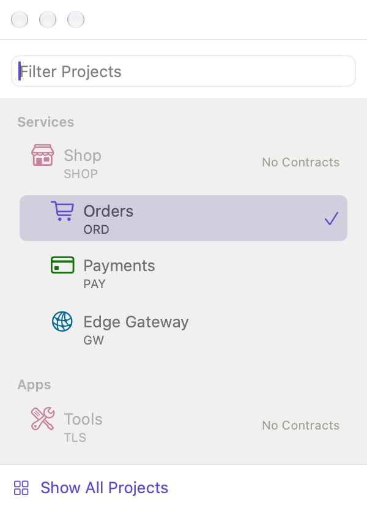

# Components

The pieces several windows share. Most live in `ToolsFoundation` (`Components.swift`, `ToolLayout.swift`,
`ChatVocabulary.swift`). The project switcher lives in `ProjectsKit`. Following the workspace rules, each
is a style, a modifier or a small view that takes values, bindings and closures, and moves into AZDesign
once a second app needs it.

## Project switcher

*The popover of a Contracts window: projects without a contract are greyed out.*

The first toolbar item of every tool window (`ProjectSwitcher`).

- **Label.** The project's icon in its tint, then its name, with the toolbar's label padding.
- **Click.** Opens a popover, 300 × 380 pt at the default text size, larger with larger text:
  - a **Filter Projects** field;
  - the projects as in the Projects window's sidebar: by kind (Services, Apps, Libraries), each sub project
    indented 16 pt per level under its parent, and listed in its top-level project's section;
  - **Show All Projects**, at the bottom.
- **Filtering.** Matches names and ids, and lists the matches flat, each in its own kind's section. When
  nothing matches, the list shows **No Matching Projects** with one sentence.
- **Keyboard.** As in the menu bar panel: the popover opens with the window's project highlighted
  (`highlight` color), ↑ and ↓ move the highlight and skip disabled rows, and Return picks the highlighted
  project. The pointer highlights the row it rests on, and the list scrolls to keep the highlight in view.
  Each opening starts afresh: an empty filter, the window's project highlighted.
- **Rows.** The current project has a checkmark. A project without the window's tool is disabled and says
  "No <Tool>", such as "No Contracts". VoiceOver reads the highlighted row as selected.
- **Picking a project.** Moves this window to it and clears the window's selection. No new window opens.
  Picking the project the window already shows changes nothing: the popover closes and the tool keeps its
  selection.
- **Show All Projects.** Opens the Projects window on the window's project.
- **Identifiers:** `toolbar.projectSwitcher`, `projectSwitcher.filter`, `projectSwitcher.row.<id>`,
  `projectSwitcher.noMatches`, `projectSwitcher.showAll`.

## Project icon

`ProjectIcon(project)`: the project's SF Symbol in its tint, hidden from VoiceOver because the name always
follows it.

## Status dot

`StatusDot(color)`: a filled circle, 8 pt, scaled with Dynamic Type (`@ScaledMetric`), hidden from VoiceOver.
It marks a health or a state beside a name, and is always paired with words.

## Badge

`.labelStyle(.badge(color))`: a capsule for a status, a priority, an HTTP method or a health.

| Part | Look |
| --- | --- |
| Icon | In the badge's color |
| Title | `textPrimary`, caption, one line |
| Capsule | The badge's color at 16% opacity; 7 pt × 2 pt padding |
| On a selected row | Icon, title and fill give way to the system's styles, so the selection keeps its contrast |

The same selection rule is available on its own as `.foreground(color, onSelection:)`.

## Figure

`Figure(value, caption:)`: a figure for the summaries at the top of a window. The value is `title2`
semibold with monospaced digits, and the caption is a caption in `textSecondary` under it. VoiceOver reads
them as one element.

## Toolbar label padding

`.toolbarLabelPadding()`: 6 pt on each side of a toolbar control's text. The system leaves text about 6 pt
from a toolbar capsule's rounded ends, which reads as cramped next to segmented controls (the user asked for
more padding). Every text label in a toolbar uses it: the project switcher, environment menus, Edit and
Done, a ticket's next step.

## Empty states

`ContentUnavailableView`, the system's, with a symbol, a title and one sentence, filling the pane on the
`canvas` color. Titles follow one pattern: "No <Item> Selected" for a selection, "No <Items>" for an empty
list.

## Phone stack

`PhoneStack(selection:opensSelection:list:page:)`: the iPhone layout's one pane at a time.

- **Showing.** The list first. Picking an item pushes its page over the list, with a Back button in the
  toolbar.
- **Going back** clears the selection, so picking the same item again opens its page again.
- **`opensSelection`** starts on the selected item's page. Tools pass it when a route opened the window on
  an item. Without it the list starts with nothing selected, so every row opens its page.
- **A route into an open window** selects its item, which pushes that item's page.
- **A window that narrows** from a regular width to a compact one keeps its selection and opens on that
  item's page, as an iPad's split view keeps its selection when it collapses
  (`collapsedFromRegularWidth`). A window that opens at compact width starts on its list.
- **Used by** Tickets, Contracts, Builds, the Chat window, the Projects window and the Virtual Machines
  window. The Service Map uses a stack of its own: the map, then the details page.

## Chat panel button

`ChatPanelToolbarItem()`, the button that shows or hides the chat panel.

- **Where.** Each tool puts it **last** in its own toolbar, so it sits at the right end, where a Mac app keeps
  the button of a panel on the right (the user's choice).
- **Look.** `sidebar.right`, labeled "Chat". Its help reads "Show the Chat Panel (⌃⌘C)" or "Hide the Chat
  Panel (⌃⌘C)".
- **Action.** Toggles the panel with AZDesign's `panel` motion: it slides in from the window's right edge, or
  fades with Reduce Motion on ([Motion](foundations.md#motion)). Hiding the panel keeps its conversation and
  draft for when it shows again ([Chat](chat.md)).
- **When it shows nothing.** When the window has no panel: the Chat window, Settings ▸ Chat turned off, or a
  pane whose window already shows the button, such as Tickets' list column.
- **Tickets.** Its toolbar items start at the left of the ticket column, so it passes
  `pushesToTrailingEdge: true` to put a flexible space before the button.
- **Identifier:** `toolbar.chatPanel`.

## Glass overlays

Controls floating over content, such as the Service Map's summary, zoom controls and legend, use
`.glassEffect()` in a capsule.

- They stay on **one line** (`.lineLimit(1)`, `.fixedSize()`).
- When there isn't room, `ViewThatFits` picks a shorter variant. For example the legend drops "No calls", then
  Degraded and Down.

See [Service Map](service-map.md).
