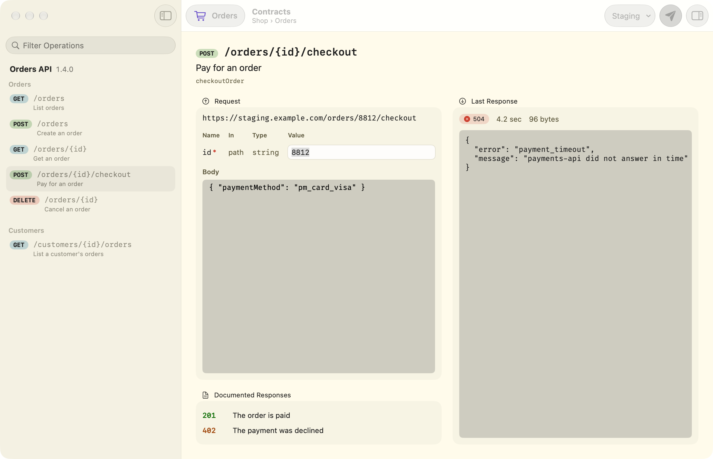
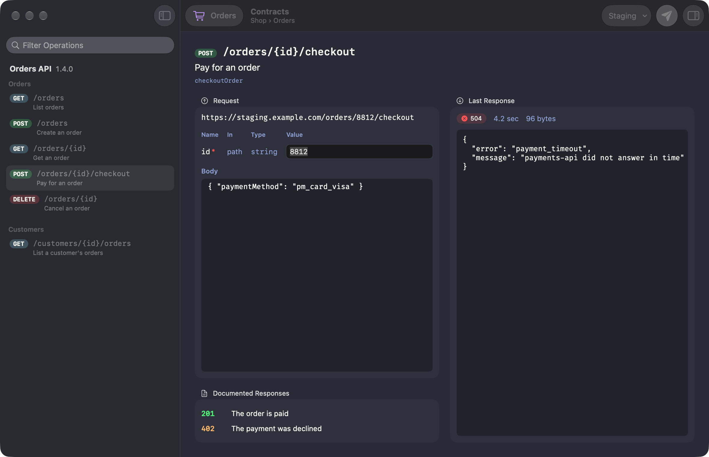
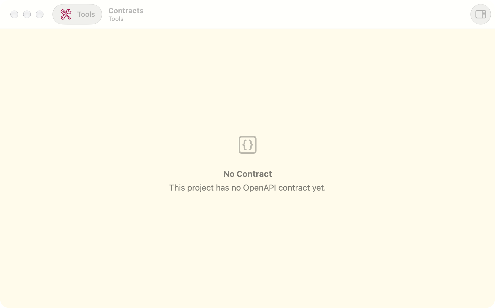
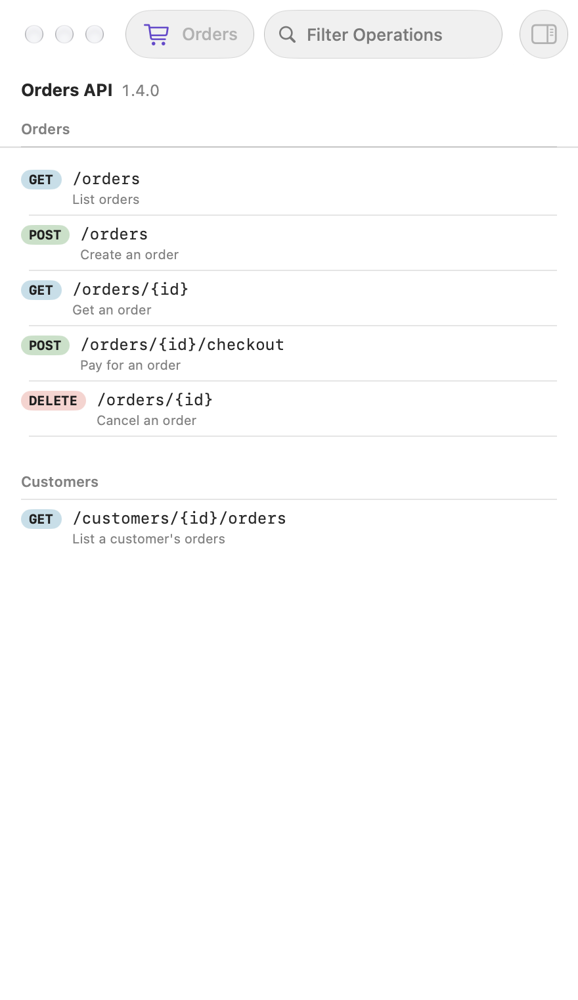
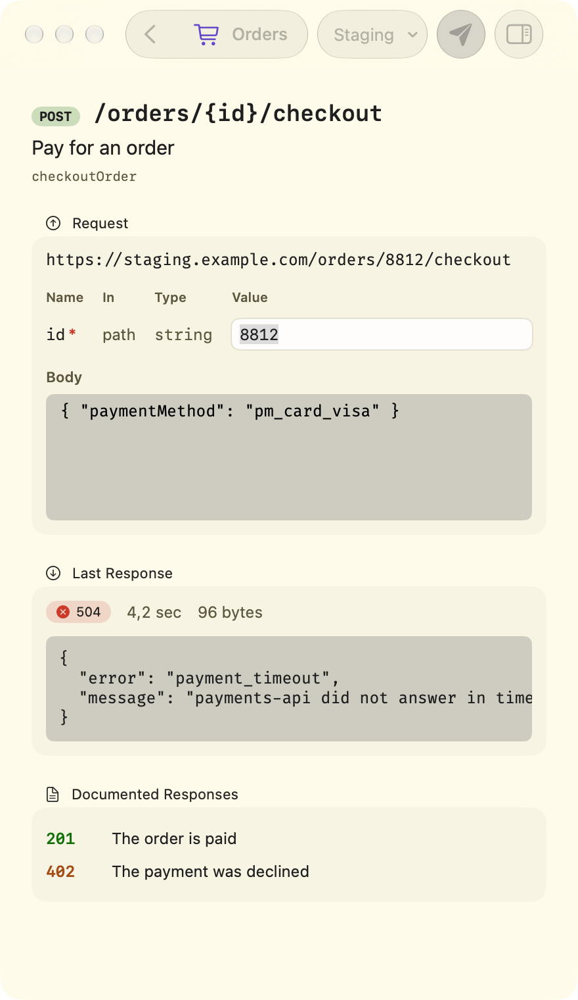

# Contracts

The Contracts window shows one service's OpenAPI contract: the `openapi/contract.yaml` of its folder, read with
its `$ref` pointers resolved ([Data › Contracts](../data.md#contracts)). At the left, the contract's operations, grouped by
tag. At the right, the operation picked: what the contract says about it, a request to fill in for one of
the service's environments, the response of its last call, and the responses the contract documents.

*Orders API 1.4.0 with `POST /orders/{id}/checkout` selected. Its last call answered 504 after 4.2 seconds.*

*The same operation in dark mode.*

## Opening it

Contracts exists only for a service that has a contract: a service whose folder holds
`openapi/contract.yaml` when the projects are read. In the samples these are Orders, Payments and Edge
Gateway. Shop, a service without a contract, and the apps and libraries have no
Contracts window ([Tools per project](navigation.md#tools-per-project)).

- **Projects window.** The **Contracts** tile (`curlybraces.square`) reads "Version 1.4.0, 6 operations".
  Its **Open** button (`projects.tool.contracts.open`) opens the window.
- **Window ▸ Contracts (⌘4).** Opens Contracts for the key window's project. Disabled when that project has
  no contract.
- **Menu bar panel.** The `curlybraces.square` button in the highlighted project's row, or ⌘4
  ([Menu bar](menu-bar.md)).
- **Project switcher.** In a Contracts window, projects without a contract are listed but can't be picked.
  Picking another project keeps the window and selects the first operation of that project's contract.
- **Links from other tools.** Each asks for the route `.tool(.contracts, project:, focus:)`, whose focus is
  an `operationId` ([Routes](navigation.md#routes)).

| From | Control | Focus |
| --- | --- | --- |
| Tickets | A contract link in a ticket, such as "GET /orders" | The operation, `listOrders` |
| Service Map | **Open Contract** in the details of the project's own service | None |
| Projects | A Contracts event in the Activity list, such as "Contract 1.4.0 adds order cancellation" | `cancelOrder`. Other contract events have none. |
| Chat | **Open** on a tool call or a referenced operation | The operation |

Without a focus the window selects the contract's first operation. With one it selects that operation; at
iPhone width it starts on the operation's page. An `operationId` the contract doesn't have opens the window
on its first operation, with the list showing at iPhone width.

A route for a project whose Contracts window is already open brings that window forward, un-minimized, and
selects the route's operation there ([Window reuse](navigation.md#window-reuse)), even when it was selected
before and the user has picked another since. At iPhone width its page opens. The window doesn't start
afresh:

- the environment stays;
- the values typed for the operation stay when it is already selected; another operation starts from the
  contract's examples, as a click on it does;
- the filter stays when it shows the operation, and is cleared when it hides it, so its row shows;
- an `operationId` the contract doesn't have changes nothing.

The window opens at 1120 × 740 pt.

## Anatomy

| Region | Contents |
| --- | --- |
| **Toolbar** | Project switcher, **Environment** menu, **Send**, the chat panel's button. |
| **Operations column** | **Filter Operations** field, the contract's title and version, the operations grouped by tag. |
| **Operation pane** | The operation's header, then the **Request**, **Last Response** and **Documented Responses** boxes. |
| **Chat panel** | Optional, at the window's right edge. See [Chat](chat.md). |

The window is a split view (`NavigationSplitView`). The operations column sits at the left, 260 to 380 pt
wide (300 pt ideal). The operation pane fills the rest, on the `canvas` color. The chat panel, when shown,
sits at the right edge.

## Toolbar

| Item | Control | Symbol | Shortcut | Behavior | Layouts |
| --- | --- | --- | --- | --- | --- |
| Project switcher | Button with a popover | The project's icon | — | Moves the window to another project. See [Project switcher](components.md#project-switcher). | Mac, iPad, iPhone |
| Sidebar | The split view's own button | `sidebar.left` | — | Shows or hides the operations column. | Mac, iPad |
| Back | The stack's own button | — | — | Returns to the operations and clears the selection. | iPhone, on an operation's page |
| **Filter Operations** | Search field | — | — | Filters the operations. See [Operations list](#operations-list). | iPhone, on the list, in the toolbar's middle. On a Mac and an iPad it sits at the top of the operations column. |
| **Environment** | Pull-down menu, labeled with the environment's name | — | — | Picks the environment the request goes to: one of the project's environments, or of the project it takes its settings from (see [Projects](projects.md)). Help: "Environment the requests go to". Absent when the project has no environments. | Mac, iPad; iPhone on an operation's page |
| **Credentials and Headers** | Button | `key` | — | Opens the sheet of the contract's credentials and the headers added to every request (see [Credentials and headers](#credentials-and-headers)). Help: "Credentials and headers of the requests". Absent for the samples. | Mac, iPad; iPhone on an operation's page |
| **Send** | Prominent button | `paperplane.fill` | ⌘Return | Sends the request. Disabled when no operation is selected, the project has no environments, or a request is on its way. Help: "Send the request". | Mac, iPad; iPhone on an operation's page |
| **Chat** | `ChatPanelToolbarItem` | `sidebar.right` | ⌃⌘C | Shows or hides the chat panel. Always the last item (the user's choice). See [Chat panel button](components.md#chat-panel-button). | Mac, iPad, iPhone |

In the **No Contract** state the toolbar holds only the project switcher and the chat panel's button.

The window's title, "Contracts", and its subtitle, the project's path such as "Shop › Orders", show from
760 pt wide.

## Operations list

**Filter field.** **Filter Operations** keeps the operations whose path, summary or `operationId` contains
the text, ignoring case, diacritics and the spaces around it. A tag whose operations all fail to match
loses its section. The selection stays as it is: an operation the filter hides from the list stays in the
operation pane.

**No Results.** When the filter matches no operation, the list shows the empty state "No Matching Operations"
(`magnifyingglass`): "No path, summary or operation id contains “invoice”.", with the filter's text. The
contract's header stays above it.

**Contract header.** Above the list, pinned while it scrolls: the contract's title in `headline`, such as
"Orders API", and its version in `callout` with monospaced digits, in the secondary color. 16 pt horizontal
and 8 pt vertical padding.

**Sections.** One per tag, titled with the tag, in the order in which each tag first appears in the
contract. An operation joins its tag's section wherever it appears: Payments lists `listCharges` under
Charges, above Refunds. Section titles have the header trait.

**Rows.** Each row shows:

- The **method badge**: the HTTP method in `caption` monospaced bold, on a capsule of the method's color at
  22% opacity. The text stays `textPrimary`, and the system's primary color on a selected row, so it stays
  readable.
- The **path** in `callout` monospaced, on one line, truncated in the middle.
- The **summary** in `caption`, secondary, on one line.

VoiceOver reads a row as one element: the method, the path, then the summary.

| Method | Badge color |
| --- | --- |
| GET | `info` |
| POST | `success` |
| PUT | `warning` |
| PATCH | `accentSecondary` |
| DELETE | `danger` |

**Selection.** One operation at a time. A click or the arrow keys select it. The operation pane shows it,
and the chat panel takes it as its subject. There are no context menus and no drag and drop.

## Operation

### Header

- The method badge, at `callout` size, and the path in `title2` monospaced semibold. The path is selectable
  and has the header trait.
- The summary in `title3`, such as "Pay for an order".
- The `operationId` in `caption` monospaced, `textSecondary`, such as `checkoutOrder`.

### Request

A box labeled **Request** (`arrow.up.circle`).

- **URL.** The environment's URL followed by the operation's path: the request as it will be sent, so in the
  code font (Fira Code) at `callout` size. On one line, truncated in the middle and selectable. Path
  parameters replace their `{name}` placeholders, and query parameters with a value follow as
  `?name=value&…`. Header parameters don't appear. The URL follows each keystroke and each change of
  environment. Absent when the project has no environments.
- **Parameters.** A grid with the columns **Name**, **In**, **Type** and **Value**, in `caption` semibold,
  `textSecondary`:
  - **Name** in `callout` monospaced. A required parameter has a red asterisk (`danger`).
  - **In**: `path`, `query` or `header`, secondary.
  - **Type** in `callout` monospaced, secondary, such as `string` or `integer`.
  - **Value**: a rounded text field in `callout` monospaced, filled with the contract's example. The
    parameter's name is its placeholder when it is empty.

  Absent for an operation without parameters. At an accessibility text size the grid gives way to one block
  per parameter, so the fields don't squeeze: the name and its asterisk, then "path · string" in `callout`
  monospaced, secondary, then the field, full width. The column headings are not repeated.
- **Body.** For an operation that takes one: the heading **Body** in `subheadline` semibold, secondary, over
  a text editor in the code font (Fira Code) at `callout` size, on the `surfaceSunken` color. It holds the
  contract's example body, is at least 96 pt tall, and takes the box's free height in the wide arrangement.

The values hold what the user types while the operation stays selected, a route to it included. Picking
another operation and coming back restores the examples.

### Last Response

A box labeled **Last Response** (`arrow.down.circle`).

- **Summary line**, in `callout`, secondary:
  - A badge with the status code: `checkmark.circle.fill` below 400, `xmark.circle.fill` from 400. Its
    color follows the status (below).
  - The duration, in the user's locale: in milliseconds below a second, such as "84 ms", and in seconds
    with one decimal from a second, such as "4.2 sec".
  - The size, as a file size: "96 bytes", "18 kB", "Zero kB" for an empty body.

  At an accessibility text size the three stand one under the other.
- **Body** in the code font (Fira Code) at `callout` size, selectable, on the `surfaceSunken` color. It
  scrolls both ways and starts at its top-left corner. In the wide arrangement it fills the box. In the
  stacked one it is as tall as the body.
- "No body." in place of the body when the response has none, such as the 204 of `cancelOrder`.

| Status | Color |
| --- | --- |
| Below 400 | `success` |
| 400 to 499 | `warning` |
| 500 and above | `danger` |

### Documented Responses

A box labeled **Documented Responses** (`doc.text`). One row per response the contract documents: the
status code in `callout` monospaced semibold, in the status color, then its description in `callout`. The
status column is 40 pt wide at the default text size and grows with Dynamic Type, so three digits always
fit.

### Arrangement

The operation pane picks one of two arrangements from its own size and the text size, in every layout.

| Arrangement | When | What shows |
| --- | --- | --- |
| **Wide** | The pane is at least 760 pt wide and 500 pt tall, and the text is not at an accessibility size. | The header, then two columns 18 pt apart, as tall as the pane. Left: **Request** over **Documented Responses**. When the operation takes a body, **Request** takes the column's free height; otherwise **Documented Responses** does. Right: **Last Response**, full height. 24 pt padding, 20 pt under the header. |
| **Stacked** | Narrower or shorter, or the text at an accessibility size, where the boxes side by side would clip. | One scrolling column: the header, **Request**, **Last Response**, **Documented Responses**, 22 pt apart, with 24 pt padding. |

## Environment and Send

**Environment.** A pull-down menu labeled with the current environment's name, such as "Staging". It lists
the project's environments, with a check mark on the current one. The window starts on the project's current
environment (for a sample, Staging when it has one, otherwise its first environment). Picking another makes
it the project's current environment. Changing it changes the URL in **Request**; the values
stay. The menu is absent when the project has no environments. VoiceOver reads it as "Environment", with
the environment's name as its value. Identifier: `contracts.environment`.

**Send** (`paperplane.fill`, ⌘Return). A prominent button that sends the request, built by the app's rules with the
stored credentials and headers ([Data › Sending a request](../data.md#sending-a-request)), from this Mac. The
answer shows in **Last Response**, and stays while the app runs; a request without answer shows "The request
failed." with the error's description (`contracts.response.failure`). Before a first call, **Last Response**
reads "Not Sent Yet" (`contracts.response.none`). Disabled when no operation is selected, the project has no
environments, or a request is on its way. Identifier: `contracts.send`. The samples send nothing.

### Credentials and headers

A sheet (`contracts.access.sheet`, at least 420 × 360 pt), opened by **Credentials and Headers**: one section
per security scheme of the contract, titled with its name, its description under it: an API key's field
labeled with its name and place (`X-API-Key (header)`), **Username** and **Password** (secure) for HTTP basic,
**Token** (secure) for a bearer. Then **Headers**: rows of **Name** and **Value** fields with a remove button
(`minus.circle`), and **Add Header** (`contracts.access.addHeader`); footer "Added to every request of this
contract. Kept on this Mac, with the credentials." **Cancel** (Escape) and **Save** (Return,
`contracts.access.save`). Saved in `openapi-requests.json` ([Data › Stored values](../data.md#stored-values)).
The values typed in the request stay while the operation is selected, as before; they aren't stored.

## States

| State | When | What shows |
| --- | --- | --- |
| **Loaded** | The project has a contract and an operation is selected. | The operations column and the operation. |
| **Reading** | The contract file is being read. | "Reading the contract…" with a spinner (`contracts.loading`). |
| **Can't Read the Contract** | The file isn't an OpenAPI 3 contract. | `exclamationmark.triangle`, "Can't Read the Contract", and the reason in the code font, selectable (`contracts.unreadable`). |
| **No Contract** | The window shows a project without a contract, as the **No Contract** preview does. | The empty state "No Contract" (`curlybraces.square`): "This project has no OpenAPI contract yet." It fills the window on the `canvas` color. The toolbar keeps the project switcher and the chat panel's button. |
| **No Operation Selected** | No operation is selected, on a Mac or an iPad. | In the operation pane: "No Operation Selected" (`curlybraces.square`): "Pick an operation to read it and call it." **Send** is disabled. |
| **No Results** | The filter matches no operation, as the **No Results** preview does. | Under the contract's header, the empty state "No Matching Operations" (`magnifyingglass`): "No path, summary or operation id contains “invoice”." The operation pane keeps the selected operation. |
| **No Environments** | The project has no environments. | No **Environment** menu and no URL. **Send** is disabled. Every sample service has environments; the **No Environments** preview shows Orders without them. |
| **Error Response** | The last call answered 400 or above, as `checkoutOrder`'s 504 in the **Error Response** preview. | The status badge with `xmark.circle.fill`, in `warning` or `danger`. |
| **Empty Response** | The last call returned no body, as `cancelOrder`'s 204 in the **Empty Response** preview. | "No body.", and the size "Zero kB". |

*Tools, an app, has no contract: the window shows "No Contract".*

## Layouts

See [Layout system](foundations.md#layout-system). Contracts' Mac width is 760 pt.

| Layout | When | What changes |
| --- | --- | --- |
| **Mac** | At least 760 pt wide, or 1101 pt with the chat panel open. | The operations column beside the operation pane. The chat panel sits beside the tool, which narrows to make room. |
| **iPad** | From 640 pt to the Mac width. | The operations column folds behind the sidebar button, as an iPad's split view does when it lacks the room, and the operation fills the window; the button shows the operations again, with **Filter Operations**. The chat panel slides over the content, with a shadow. The operation pane stacks when it is narrower than 760 pt. |
| **iPhone** | Narrower than 640 pt. | One pane at a time (the user's choice), with [`PhoneStack`](components.md#phone-stack). First the operations: the contract's header and the sections, with **Filter Operations** in the toolbar's middle and the chat panel's button. Picking an operation pushes its page, stacked and scrolling, with Back, **Environment**, **Send** and the chat panel's button. A window opened on an operation starts on its page (the user's choice), and a later route to the window opens its operation's page. The chat panel becomes a full page. A window that narrows to this width keeps its selection and shows that item's page, as a collapsing split view does ([Foundations › Layout system](foundations.md#layout-system)). |

*At iPhone width: the operations, with the filter field in the toolbar.*

*`checkoutOrder`'s page: the stacked arrangement, with the environment menu and Send in the toolbar.*

## Chat panel

The selected operation is the chat panel's subject. It reports it as a reference titled with its
`operationId`, such as `checkoutOrder`. The composer reads "Ask about checkoutOrder…" and the next message
carries the operation as a chip.

- **Suggestions**, which `ContractsReader` words for the operation as it stands:
  - when its last call failed: "Why did checkoutOrder answer 504?" and "Show an example request for
    checkoutOrder";
  - otherwise: "Show an example request for createOrder" and "What does createOrder return?".
- **What Claude reads:** through `ContractsReader`, "Read operation checkoutOrder", with the detail
  "Pay for an order: POST /orders/{id}/checkout, in Orders API 1.4.0. Its last call answered 504 after
  4.2 sec." Its two sentences are one localized string, with the duration in the user's locale.
- **No selection**, such as after Back at iPhone width: the panel asks about the project, with the
  suggestions "What changed this week?" and "What needs my attention?".

See [Chat](chat.md).

## Accessibility

| Element | Identifier | Label or notes |
| --- | --- | --- |
| Project switcher | `toolbar.projectSwitcher` | See [Components](components.md#project-switcher). |
| Contract header | `contracts.title` | Title and version read as one element, with the header trait. |
| Section title | `contracts.section.<tag>`, such as `contracts.section.Orders` | The tag, with the header trait. |
| Operation row | `contracts.row.<operationId>`, such as `contracts.row.checkoutOrder` | One element: the method, such as "POST", then the path and the summary. |
| Filter field | — | The system's search field, prompt "Filter Operations". |
| No Matching Operations | `contracts.noResults` | The empty state's title and sentence. |
| Environment menu | `contracts.environment` | "Environment", with the environment's name as its value. Help: "Environment the requests go to". |
| Send | `contracts.send` | "Send". Help: "Send the request". |
| Operation header | `contracts.operation.header` | A group: the method, the path with the header trait, the summary, the `operationId`. |
| Request box | `contracts.request` | A group. Its title, "Request", has the header trait. |
| URL | `contracts.request.url` | "URL", with the URL as its value. Selectable text. |
| Parameter name | — | The name and, for a required parameter, "Required", read as one element. |
| Parameter field | `contracts.parameter.<in>.<name>`, such as `contracts.parameter.path.id` | Labeled with the parameter's name. Hint: where it goes and its type, such as "path parameter, string". |
| Body editor | `contracts.request.body` | "Body". The visible heading is hidden from VoiceOver, which reads it as the editor's label. |
| Last response box | `contracts.response` | A group. Its title, "Last Response", has the header trait. |
| Status badge | `contracts.response.status` | "Status 504": the code in words, not only its color and symbol. |
| Response body | `contracts.response.body` | The body's text, or "No body.". |
| Documented responses box | `contracts.documentedResponses` | A group. Its title, "Documented Responses", has the header trait. |
| Documented response | `contracts.documentedResponse.<status>`, such as `contracts.documentedResponse.402` | One element: the status, then its description. |
| No Contract | `contracts.noContract` | The empty state's title and sentence. |
| No Operation Selected | `contracts.noSelection` | The empty state's title and sentence. |
| Chat panel button | `toolbar.chatPanel` | See [Components](components.md#chat-panel-button). |

## Sample data and limits

- **Live contracts.** The app reads each project's `openapi/contract.yaml` (`LiveContractStore`), sends the
  requests from this Mac, and keeps the credentials and headers in `openapi-requests.json`.
- **Sample contracts.** Previews and captures read sample contracts (`SampleContractStore`):

  | Project | Contract | Operations | Tags |
  | --- | --- | --- | --- |
  | Orders | Orders API 1.4.0 | 6 | Orders, Customers |
  | Payments | Payments API 2.1.0 | 4 | Charges, Refunds |
  | Edge Gateway | Edge Gateway 1.0.2 | 3 | Operations, Routing |

- **A sample's Last Response** is a fixed value per operation, and its Send shows that the samples send
  nothing. `checkoutOrder` answers 504 and `refundCharge` answers 500.
- **Values aren't kept.** Edited parameters and bodies return to the examples when another operation is
  picked, after Back at iPhone width, or when the window moves to another project. A route to the operation
  already selected keeps them.

## Previews

In `ContractsKit/ContractsRootView.swift`, the whole window on the sample contracts:

| Preview | Shows | Size |
| --- | --- | --- |
| **Loaded** | Orders, on its first operation. | 1100 × 720 pt |
| **Loaded, Dark** | Orders, on `createOrder`, in dark mode. | 1100 × 720 pt |
| **Error Response** | Orders, on `checkoutOrder` (504). | 1100 × 720 pt |
| **Empty Response** | Orders, on `cancelOrder` (204, no body). | 1100 × 720 pt |
| **No Operation Selected** | Orders, with nothing selected. | 1100 × 720 pt |
| **No Results** | Orders, filtered on "invoice". | 1100 × 720 pt |
| **No Environments** | Orders without its environments, on `getOrder`. | 1100 × 720 pt |
| **No Contract** | Tools. | 900 × 600 pt |
| **Largest Text** | Orders, on `createOrder`, at the largest Dynamic Type size. | 1100 × 720 pt |
| **iPad** | Orders, on `checkoutOrder`, in the iPad layout. | 760 × 900 pt |
| **iPhone, Operations** | Orders' operations in the iPhone layout. | 420 × 800 pt |
| **iPhone, Operation** | `checkoutOrder`'s page in the iPhone layout. | 420 × 800 pt |
| **iPhone, Dark** | `createOrder`'s page in the iPhone layout, in dark mode. | 420 × 800 pt |
| **iPhone, Largest Text** | `createOrder`'s page in the iPhone layout, at the largest Dynamic Type size. | 420 × 800 pt |

In `ContractsKit/OperationView.swift`, the operation pane alone:

| Preview | Shows | Size |
| --- | --- | --- |
| **Request With Body** | `createOrder`, wide, on Staging. | 820 × 640 pt |
| **Stacked** | `checkoutOrder`, stacked. | 520 × 800 pt |
| **No Environment** | `listOrders`, without a URL. | 820 × 640 pt |
| **Largest Text** | `createOrder` at the largest Dynamic Type size: stacked, one block per parameter. | 520 × 900 pt |

## Open issues

None.
