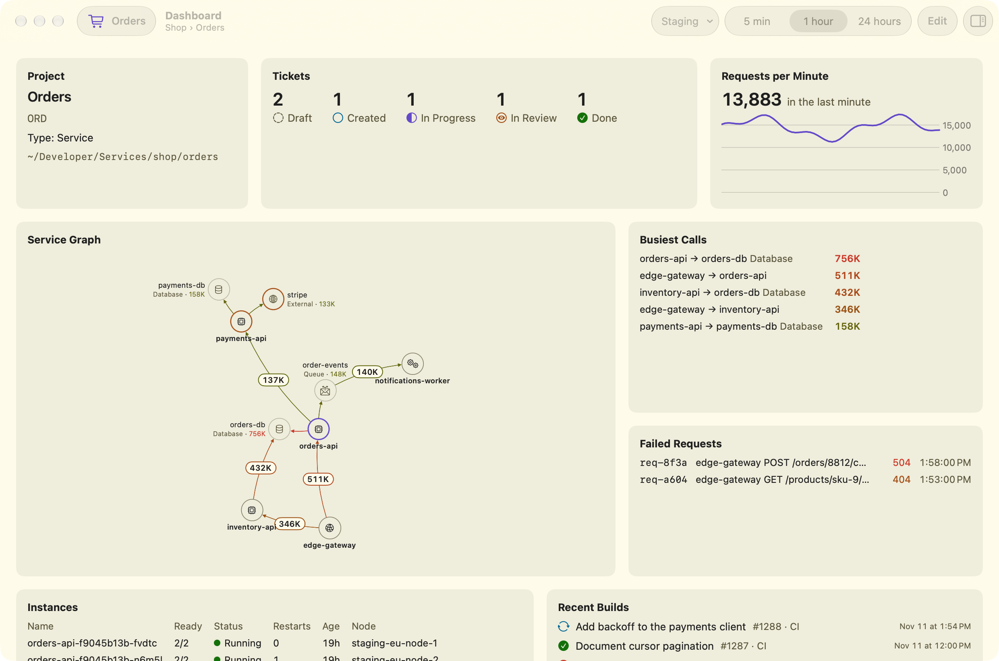
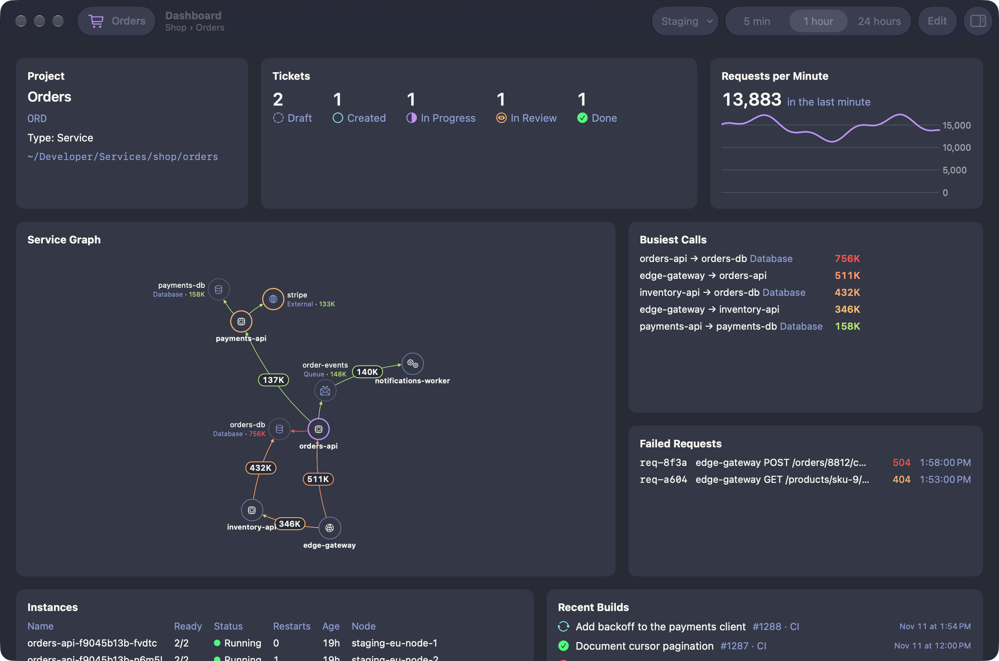
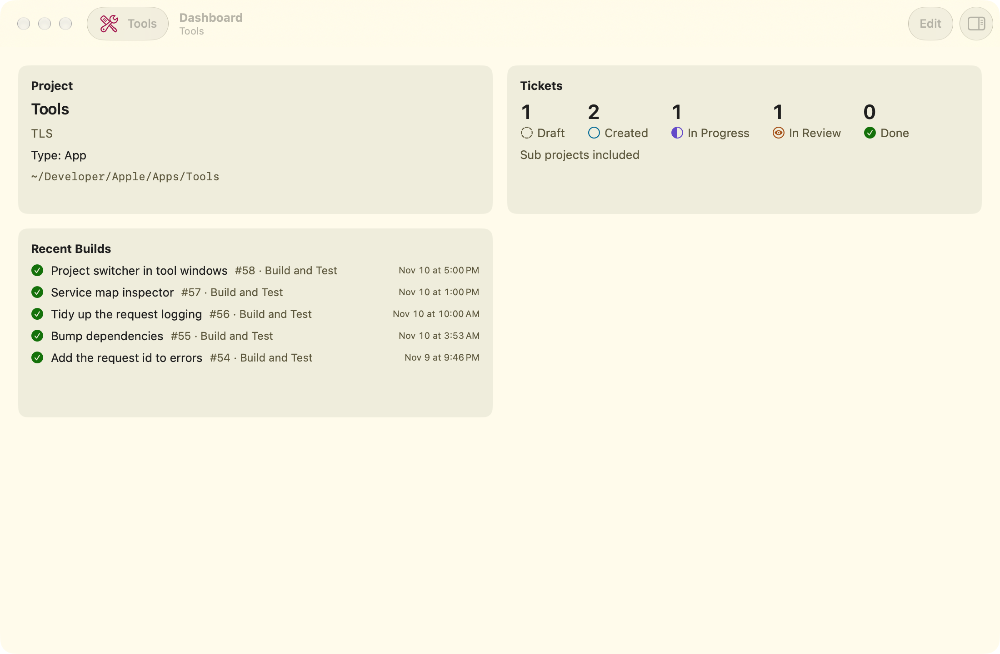
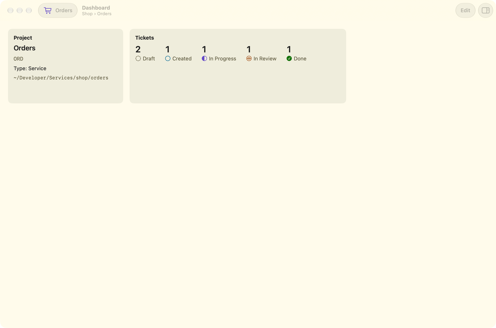
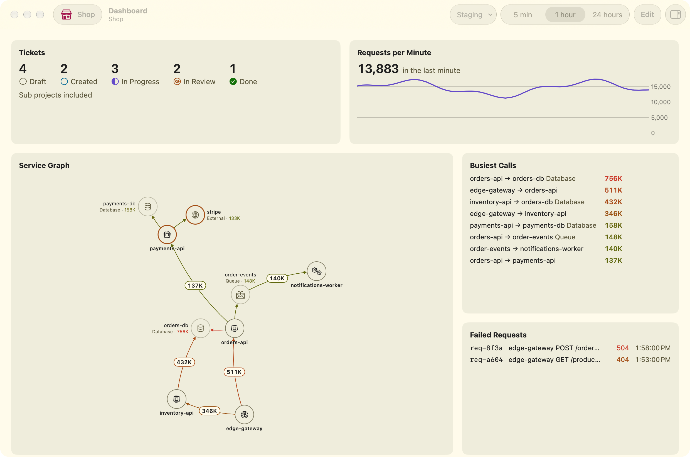
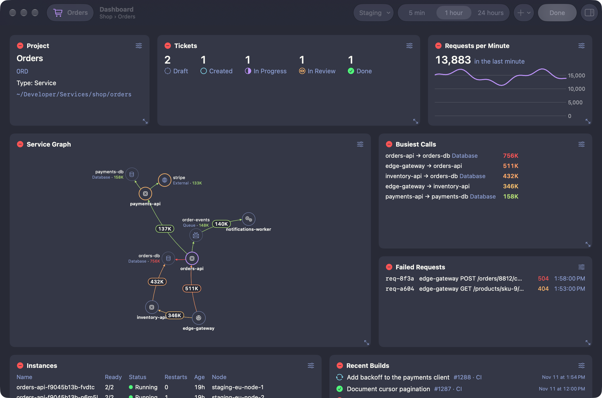
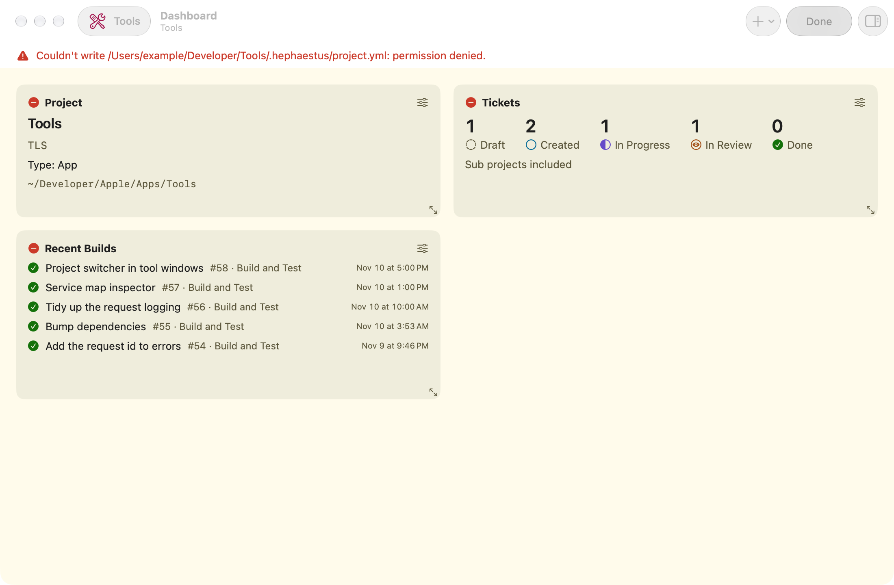
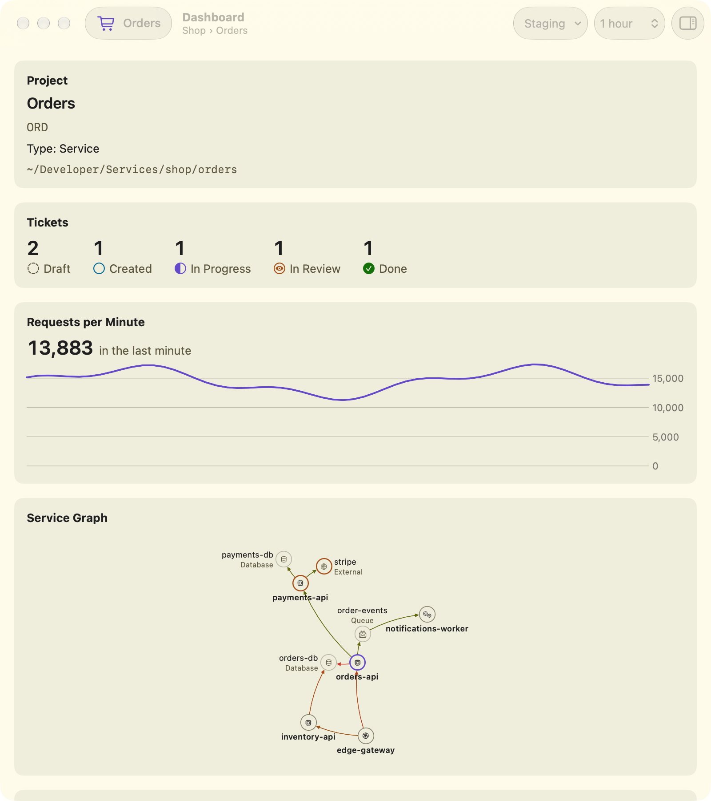
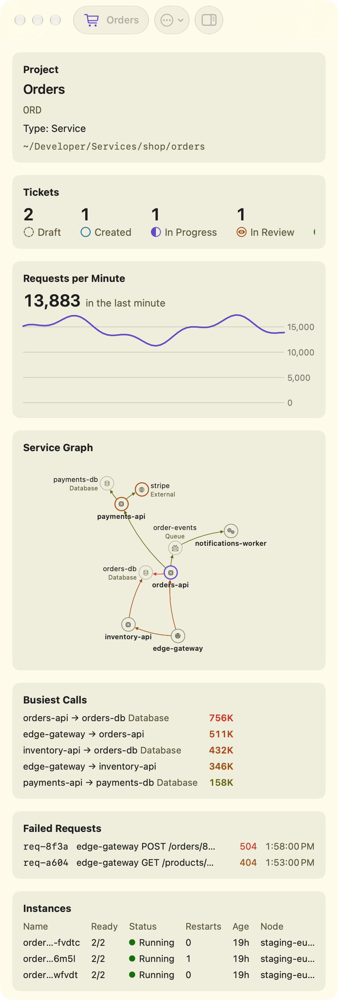

# Dashboard

The Dashboard shows one project on one screen, in widgets the user arranges. Each widget shows one thing
from one tool: what the project is, how many tickets it has in each status, its recent builds, the pods
where it runs, and, for a service whose Service Map can be read, the map of its services, the busiest
calls, the failed requests and the requests per minute. The widgets sit on an invisible grid of 24 columns
of square cells, as in Grafana, and float up. In edit mode the user adds, removes, moves, resizes and sets
up the widgets. Each project keeps its own Dashboard in its project file, as V2 did ([Saving](#saving)), and a
widget shows once the tool whose data it shows has come over from V2 ([Which widgets show](#which-widgets-show)).

*The Orders Dashboard in light appearance: its sample layout, read from the Staging environment over the
last hour.*

## Opening it

| From | How |
| --- | --- |
| Projects window | The **Dashboard** tile in the project's **Tools** section, then **Open** (`projects.tool.dashboard.open`). The tile reads "Tickets, builds and services in widgets you arrange" for a project whose Service Map can be read, and "Tickets and builds in widgets you arrange" otherwise. |
| Window menu | **Window ▸ Dashboard** (⌘1) opens the Dashboard of the key window's project. The item is disabled while the key window has no project. |
| Menu bar item | In the project launcher, highlight a project and press ⌘1. |
| Project switcher | In a Dashboard window, picking another project in the toolbar's switcher keeps the window and shows that project's Dashboard ([components.md](components.md), `ProjectSwitcher`). |
| Route | `Route.tool(.dashboard, project: <project id>)`. The Dashboard takes no focus and ignores one. No other tool links to the Dashboard. |

Every project kind (service, app, library) has a Dashboard; it is the first tool in each project's list.
A route or a menu item brings forward, and un-minimizes, the window that already shows the project's
Dashboard instead of opening a second one ([navigation.md](navigation.md)). A new Dashboard window opens at
1240 × 820 points.

## Anatomy

| Region | Contents |
| --- | --- |
| Toolbar | The project switcher, the title **Dashboard** with the project's path as subtitle (for example `Shop › Orders`), the environment menu, the time window, **Edit** (or **Add Widget** and **Done** in edit mode) and the chat panel button. |
| Widget area | The widgets on the grid, on the `.canvas` background, with a margin of 20 points on each side. It scrolls vertically when the widgets are taller than the window. |
| Widget | A title row over the widget's content, on the `.surface` background, in a rounded rectangle concentric with the window (corner radius at least 10 points). Padding 14 points; 8 points between the title row and the content. |
| Title row | The widget's title in the headline font, one line. In edit mode: the remove button at its start and the settings button at its end. |
| Content | What the widget shows, drawn by the tool whose data it is ([Widgets](#widgets)). |
| Resize handle | Edit mode only: at the widget's bottom-right corner. |
| Context menu | Edit mode only: the widget's moves and sizes one cell at a time, **Widget Settings…** and **Remove Widget** ([Edit mode](#edit-mode)). |
| Placeholder | While a widget is moved or resized: an accent-colored outline on the cells where it will land. |
| Chat panel | Optional, at the window's right edge ([Chat panel](#chat-panel)). |

The toolbar spans the window. Under it the widget area fills the rest of the window, or the room left of
the chat panel in the Mac layout. Below 900 points the widget area becomes a list of widgets, one per row
([One widget per row](#one-widget-per-row)).

*The same Dashboard in dark appearance.*

## Toolbar

| Item | Control | Symbol | Shortcut | Behavior | Layouts |
| --- | --- | --- | --- | --- | --- |
| Project switcher | Button with a popover | The project's icon | — | Switches the window's project ([components.md](components.md)). | Mac, iPad, iPhone |
| **Dashboard** and subtitle | Window title | — | — | The tool's name and the project's path. Dropped below a window width of 760 points. | Mac, iPad |
| Environment | Menu, labeled with the current environment's name | — | — | Lists the project's environments with a check mark on the current one. Choosing one applies it at once and saves it. Shown while the project has environments and a shown widget reads one: an Instances widget or a service widget. Tooltip "Environment the Instances and service widgets read". | Mac, iPad |
| **Time Window** | Segmented control on the Mac, pop-up menu on the iPad | — | — | **5 min**, **1 hour**, **24 hours**. Applies at once and is saved. Shown while a service widget shows. Tooltip "Time window of the service widgets". | Mac, iPad |
| **Dashboard Settings** | Menu | `ellipsis.circle` | — | Holds the **Environment** and **Time Window** pickers, each shown under the same conditions as above. The menu shows when at least one of them does. Tooltip "Environment and time window". | iPhone |
| **Add Widget** | Menu | `plus` | — | Edit mode only. Lists the widget kinds the project can show; the chosen one is added ([Edit mode](#edit-mode)). Tooltip "Add Widget". | Mac, iPad (grid only) |
| **Done** | Button, glass prominent style | — | — | Edit mode only. Ends edit mode. Tooltip "Finish editing the widgets". | Mac, iPad (grid only) |
| **Edit** | Button | — | — | Enters edit mode. Tooltip "Add, remove, move, resize and set up the widgets". Not shown in the list. | Mac, iPad (grid only) |
| **Chat** | Button | `sidebar.right` | ⌃⌘C | Shows or hides the chat panel ([components.md](components.md), `ChatPanelToolbarItem`). Absent when Settings ▸ Chat turns the panel off. | Mac, iPad, iPhone |

The switcher sits at the leading end. The environment and time window come first among the trailing items,
then **Edit** (or **Add Widget** and **Done**), then **Chat**, last.

## Grid

The widget area is an invisible grid of 24 columns of square cells, 16 points apart, whose cells scale with
the width (the user's choice). The grid is never drawn, in or out of edit mode.

- **Width.** The widget area is the Dashboard's width less a margin of 20 points on each side. When macOS
  always shows scroll bars, it is also less the width of a scroll bar, whether the bar shows or not, so a
  bar that appears does not shrink the cells. The width follows the system's scroll bar setting when it
  changes.
- **Cells.** A cell is (widget area width − 23 × 16) / 24 points wide, and as tall as it is wide.
- **Widgets.** A widget covers whole cells: a column from 0 to 23, a row from 0 down, a width of 1 to 24
  columns that ends at column 24 at the latest, and a height of 1 or more rows. Its frame starts
  column × (cell + 16) points from the left and row × (cell + 16) points from the top, and is
  width × cell + (width − 1) × 16 points wide and height × cell + (height − 1) × 16 points tall. Neighboring
  widgets are therefore 16 points apart.
- **Scaling.** Every width shows the same arrangement, larger or smaller. The widget area is as tall as its
  lowest widget.

The grid code, the placement and the edit gestures are the previous app's, kept as they were.

## Placement

A widget's stored position is its column, row, width and height. The Dashboard places the widgets it shows
freely and floats them up (the user's choice), with this rule:

1. It takes the widgets in order of row, then of column. Widgets with the same row and column keep their
   list order.
2. Each widget, in that order, moves down below any widget placed before it that it overlaps, then rises as
   far as it can without overlapping one, up to row 0.

- No empty row stays above a widget, and overlapping stored positions are resolved: the later widget in the
  order moves down.
- The rule changes what the Dashboard shows, not what is stored. A widget keeps its stored position until a
  change in edit mode stores another.
- Service widgets hidden because the project's Service Map cannot be read take no room: the other widgets
  rise into their space ([States](#states)).
- A stored position outside the grid is brought inside it: a width of 1 to 24, a column that keeps the
  widget within the 24 columns, and a row and a height up to 100,000. A widget with only some of the four
  values counts as a widget without position.

## Lists without positions

A widget without stored position is placed in list order, two per row (the user's choice):

- The first of a pair is at column 0 and the second at column 12, each 12 columns wide and as many rows tall
  as its content needs at the window's cell size: the fewest rows that hold its title row, its content at
  that width and its padding.
- The first pair starts under every widget that has a stored position, and each pair under the previous
  one. Then the placement rule applies, so a widget under a short one rises.
- For this count, a Service Graph widget counts a map 260 points tall and a Requests per Minute widget a
  chart 120 points tall.
- A widget without position stays invisible until the rows it needs are known, then appears in place.
- The first move, resize, addition or removal stores the positions and sizes the Dashboard shows, with that
  change.

*Tools, an app project, with the default list and no stored positions: Project and Tickets on the first row,
Recent Builds under Project. No service widget shows, so the toolbar has no environment or time window.*

## Content

The title row stays at the top of the widget; the content has the space under it.

- The content is laid out at the widget's width. Text that does not fit is truncated or wraps.
- Content taller than the space scrolls vertically inside the widget. Content that cannot be as narrow as
  the widget scrolls horizontally. These are never truncated or wrapped: the Tickets counts, the numbers of
  Busiest Calls, the status and the time of a failed request, the start time of a build and the number of
  Requests per Minute.
- The Service Graph's map and the Requests per Minute chart fill the space, whatever its size.
- Nothing is drawn outside a widget. A widget smaller than its title row and padding shows the part that
  fits.
- A scroll over a widget whose content does not scroll in that direction scrolls the Dashboard.
- In edit mode the content takes no click and no scroll, so a drag can start anywhere on the widget.

## Widgets

Each widget's content comes from the tool whose data it shows: Project from the Dashboard, Tickets from
Tickets, Recent Builds from Builds, and Instances and the service widgets from the Service Map. A list can
hold any kind any number of times, each widget with its own settings. A widget's title is its **Title**
setting when that is not empty, otherwise the kind's title. The symbol shows in the **Add Widget** menu.

| Kind | Symbol | Shows | Click (out of edit mode) | Settings |
| --- | --- | --- | --- | --- |
| **Project** | `folder` | The fields checked in its settings, in this order: the project's name (title 2, semibold); its identifier (monospaced, secondary); `Type: Service`, `App` or `Library`; its folder (callout, monospaced, secondary, one line truncated in the middle, selectable). | None | Title, Fields |
| **Tickets** | `checklist` | One count per checked status, side by side in workflow order: the number (title, semibold) above the status's symbol in its color and its name. With **Include sub projects** checked and a project that has sub projects, the counts cover the project and all its descendants, under the caption "Sub projects included". | None | Title, Statuses, Include sub projects |
| **Recent Builds** | `hammer` | The newest runs of the project's repository, as the Builds window lists them, at most **Number**: the run's status symbol in its color, its title, `#<number> · <workflow>` (one localized string), and its start date and time (for example `11 Nov at 13:54`). "No builds yet." when there is none. | Opens the run in Builds (focus: the run number). Tooltip "Open the run in Builds". | Title, Number |
| **Instances** | `shippingbox` | The pods of the project's service in the Dashboard's environment ([Instances widget](#instances-widget)). | None | Title |
| **Service Graph** | `point.3.connected.trianglepath.dotted` | The environment's whole service map, laid out and drawn as the Service Map draws it, with the project's own service as its focus. Fitted to the widget at 150% at most; it cannot be zoomed or panned. Its arrows count the calls in the time window: colored by that count, and labeled in compact form (`360K`) from 50% zoom, as the previous app's widget did. | Opens the Service Map. Tooltip "Open the Service Map". The widget reads as one button. | Title |
| **Busiest Calls** | `arrow.right.arrow.left` | The arrows with at least one call in the time window, most calls first, ties in graph order, at most **Number**: `<from> → <to>` (one localized string), the target's kind in secondary color when it is not a service, and the number of calls in compact form (`756K`) in the arrow's color on the Service Map. "No calls in the window." when there is none. | None | Title, Number |
| **Failed Requests** | `exclamationmark.triangle` | The requests of the time window answered 400 or above, newest first, at most **Number**: the request id (monospaced), its first service with its method and path, its status (`.warning` for 4xx, `.danger` for 5xx) and its start time with seconds. "No failed requests in the window." when there is none. | Opens the request in the Service Map (focus `request:<id>`). Tooltip "Open the request in the Service Map". | Title, Number |
| **Requests per Minute** | `chart.xyaxis.line` | The requests of the last minute in a large number with the caption "in the last minute" and, filling the widget under them, a line chart in the accent color, one point per minute of the time window, its vertical axis starting at 0 and no horizontal axis. | None | Title |

Ticket statuses, in workflow order:

| Status | Symbol | Color |
| --- | --- | --- |
| Draft | `circle.dashed` | `.textSecondary` |
| Created | `circle` | `.info` |
| In Progress | `circle.lefthalf.filled` | `.accent` |
| In Review | `eye.circle` | `.warning` |
| Done | `checkmark.circle.fill` | `.success` |

Recent Builds takes the place of the previous app's Recent Chats and Cost widgets (a porting decision, not
the user's). The Tickets widget counts the app's tickets, those the Tickets windows show, and changes with
them.

### Which widgets show

A widget shows once the tool whose data it shows is available in the app ([Navigation › Available
tools](navigation.md#available-tools)); until then it is hidden (default chosen at design time):

| Kind | Shows when |
| --- | --- |
| Project | Always. |
| Tickets | Tickets is available: today. |
| Recent Builds | Builds is available (Phase 6). |
| Instances | The Service Map is available (Phase 8). |
| Service Graph, Busiest Calls, Failed Requests, Requests per Minute | The Service Map is available and the project's Service Map can be read: it is a service with environments. |
| Recent Chats, Cost | Never: V2's widgets, kept in the project file with their settings. |

A hidden widget takes no place: the widgets under it rise into its space. It keeps its stored position, in
and out of edit mode, and isn't offered in **Add Widget**; when its tool comes, it takes its place again and
the widgets that had risen move down ([Placement](#placement)).

*Orders with only the Dashboard and Tickets available, as in the app today: Project and Tickets show, and
Requests per Minute, the service widgets, Instances and Recent Builds are hidden, keeping their places.*

### Default list and sample layouts

A project without a stored list shows the default list: Project, Tickets and Recent Builds, then Service Graph
for a project whose Service Map can be read; default settings, empty titles, no stored positions, and the ids
`00000000-0000-0000-0000-00000000000<n>`. Instances is not in it. V2's default list was Project, Tickets,
Recent Chats and Cost: a project file without `dashboardWidgets` shows V3's.

Sample layouts exist only in the previews and the screenshots, for two sample projects; a project of the app
never shows one, whatever its identifier:

- **Orders (`ORD`):** Project, Tickets and Requests per Minute on the first row; Service Graph, with Busiest
  Calls and Failed Requests stacked beside it; Instances and Recent Builds at the bottom.
- **Shop (`SHOP`):** Tickets and Requests per Minute; Service Graph, with Busiest Calls (Number 8) and Failed
  Requests beside it; a Recent Builds widget titled "Chart Builds" at the bottom.

*Shop, a parent project, with its sample layout: its Tickets counts include the sub projects' tickets, and
Busiest Calls lists 8 rows. The Recent Builds widget is below the visible area.*

### Instances widget

A table with the column headers of `kubectl get pods -o wide`, in their order, one row per pod, in the
callout font, each cell on one line:

| Column | Value |
| --- | --- |
| Name | The pod's name, truncated in the middle. |
| Ready | `<ready containers>/<containers>`, for example `2/2`. |
| Status | A status dot, then kubectl's STATUS, for example `Running` or `CrashLoopBackOff`. |
| Restarts | The number of restarts. |
| Age | kubectl's age, for example `19h`. |
| Node | The node; empty while the pod is not scheduled. |

| Dot color | When |
| --- | --- |
| `.success` | `Running` with every container ready. |
| `.warning` | The pod starts or stops: `Pending`, `ContainerCreating`, `PodInitializing`, `Init:<n>/<m>`, `Terminating`, or `Running` with a container not ready. |
| `.danger` | The pod fails: `Failed`, `Error`, `CrashLoopBackOff`, `ImagePullBackOff`, `ErrImagePull`, `CreateContainerConfigError`, `OOMKilled`, `Evicted`, or `Init:` followed by one of these. |
| `.textSecondary` | Any other status. |

A click on a row does nothing. "Environment “<name>” has no deployment." shows when the environment has no
deployment of the project's service, and "This project has no environments." when the project has none.

## Environment and time window

- **Environment.** Read by Instances and the four service widgets. It is the project's current environment,
  one of its environments as they apply ([Data › Resolution](../data.md#resolution)), as V2's widgets read it;
  without one, the first that is not healthy, or else the first. Choosing another one in the toolbar makes it
  the project's current environment (`current-environments.yml`), for every window of the project. The
  toolbar shows it while the project has environments and a shown widget reads one.
- **Time window.** **5 min**, **1 hour** or **24 hours**; **1 hour** by default. The Service Graph, Busiest
  Calls, Failed Requests and Requests per Minute count over it. It is stored in the project file
  (`dashboardGraphWindow`), so every Dashboard window of the project shows it. V2's **Last 7 days** (`week`)
  comes with the Service Map: until then a stored `week` is kept and the last hour shows. The toolbar shows the
  time window while a service widget shows.

## Edit mode

**Edit** enters edit mode on the grid. The toolbar then shows **Add Widget** and **Done**; **Done** ends
edit mode. Out of edit mode the widgets show no buttons, no handle and no context menu, and cannot be moved
or resized.

Edit mode belongs to the window. It ends with **Done**, when the Dashboard switches to the list, when the
window switches project, and when the window closes. Leaving edit mode closes an open settings popover. A
drag in progress ends, and a settings popover closes, when edit mode ends or when its widget leaves the list.

*Edit mode in dark appearance: a remove button, a settings button and a resize handle on each widget, and
**Add Widget** and **Done** in the toolbar.*

- **Remove.** The remove button, `minus.circle.fill` in `.danger` at the start of the title row (tooltip
  "Remove Widget"), removes the widget at once, without confirmation. The other widgets keep the places the
  Dashboard shows, and those under it rise.
- **Settings.** The settings button, `slider.horizontal.3` in `.textSecondary` at the end of the title row
  (tooltip "Widget Settings"), opens the widget's settings in a popover below the button
  ([Settings](#settings)). The title row is as tall with its buttons as without them, so entering edit mode
  moves nothing.
- **Move.** A drag of at least 4 points that starts anywhere on the widget, other than its resize handle,
  moves it. The widget follows the pointer above the other widgets, which it hides, and the placeholder, a
  2-point outline in `.accent` in the widget's shape, shows the cells where it will land. The Dashboard takes
  the cells nearest to the widget's top-left corner, kept within the 24 columns and at row 0 or below, and
  applies the placement rule to the arrangement it showed when the drag started, with this widget placed
  before the others that start on its row. The other widgets make room live. Releasing the widget applies
  the arrangement.
- **Resize.** The resize handle, `arrow.up.left.and.arrow.down.right` in the caption font and
  `.textSecondary`, takes the drag in an 18-point square at the widget's bottom-right corner (tooltip
  "Resize Widget"). The pointer is the diagonal resize pointer over it and during the resize. Dragging it
  changes the width and the height together: the widget keeps its top-left corner, its bottom-right corner
  follows the pointer, and the placeholder shows the nearest whole cells. The width never goes past column
  24. The other widgets make room live, and releasing the handle applies the arrangement.
- **Smallest size.** A widget cannot be made smaller than its title row: the columns that hold the title row
  at full width, with both buttons, the whole title and the padding, at most 24, and the rows that hold its
  height with the padding. Column 24 comes first: a widget whose title row needs more columns than remain
  up to column 24 takes only those. A stored widget already smaller, for example after the window narrowed,
  keeps its size until it is resized, and its title is truncated.
- **Scrolling.** While a widget is moved or resized with the pointer within 40 points of the top or bottom
  edge of the visible area, or beyond it, the Dashboard scrolls that way: faster the nearer the edge, at 600
  points per second at the edge and beyond. The widget stays under the pointer.
- **Add Widget.** The menu lists, in this order, with their symbols: **Project**, **Tickets**, **Recent
  Builds**; **Instances** for a service project; then **Service Graph**, **Busiest Calls**, **Failed
  Requests** and **Requests per Minute** when the project's Service Map can be read. The chosen widget is
  appended to the list with default settings and a new id, at column 0 under every widget, 12 columns wide
  and as many rows tall as its content needs at that width; then it rises by the placement rule.

### Moving and resizing without the pointer

The keyboard and VoiceOver move a widget and change its size one cell at a time, with eight **steps**. Each
place that offers them offers only the steps that change something, and none while a drag is in progress.

| Where | What it offers |
| --- | --- |
| Settings popover | Under the widget's settings: **Position**, with a **Move Left**, **Move Right**, **Move Up** and **Move Down** button, and the **Width** and **Height** steppers ([Settings](#settings)). With Keyboard navigation on (System Settings ▸ Keyboard), Tab reaches the settings button and Space opens the popover. |
| Context menu | A secondary click on a widget in edit mode: **Move Left**, **Move Right**, **Move Up**, **Move Down**; **Make Wider**, **Make Narrower**, **Make Taller**, **Make Shorter**; **Widget Settings…** and **Remove Widget**. A step that changes nothing is disabled. |
| VoiceOver actions | On the widget: its steps, **Widget Settings**, which opens the popover, and **Remove Widget**. On the resize handle: the four size steps. |

A step asks for cells as a drag would, and the placement rule applies to the arrangement the Dashboard
shows, as when a drag ends:

| Step | Cells it asks for |
| --- | --- |
| **Move Left**, **Move Right** | The next column, within the 24 columns. A widget it then overlaps on its row moves down. |
| **Move Up** | The nearest row above from which the widget ends higher: it is placed before the widget above it, which moves down under it. Not offered at row 0. |
| **Move Down** | The nearest row below from which the widget ends lower: it is placed after the widget under it. Not offered when no widget is under it. |
| **Make Wider**, **Make Narrower**, **Make Taller**, **Make Shorter** | One column or row more or less, keeping the top-left corner, never smaller than the smallest size and never past column 24, as the resize handle does. A widget smaller than its smallest size grows to it at the first step. |

There is no pointer to follow, so the widgets move to their new places with AZDesign's `layout` motion, a
short cross-fade with Reduce Motion. The steps have no keyboard shortcuts.

### Applying changes

Every change applies at once and is saved; there is no Cancel. A move, a resize, a step, an addition and a
removal store the position and size the Dashboard shows for every shown widget; a change of settings stores
no position. A widget released where it was, or at the size it had, changes nothing. The first change of a
project with nothing saved saves its whole list with that change.

A change shows at once and is written to the project file in the background, one change after the other in
the order they were made. When a write fails, its message shows under the toolbar, in `.danger` with
`exclamationmark.triangle.fill`, until the next change; the Dashboard shows the stored list again, and the
changes made after the failed one, which were made on top of it, are dropped (V2: the engine's message in red
under the bar).

*Tools in edit mode after a change that couldn't be written: the message stays under the toolbar until the
next change.*

## Settings

The settings popover lists the settings of the widget's kind, labels right-aligned before their controls,
with a 16-point padding. Each change applies at once; the popover has no Cancel or Save button.

| Setting | Widgets | Control | Default | Effect |
| --- | --- | --- | --- | --- |
| **Title** | Every widget | Text field, 220 points wide, with the kind's title as placeholder | Empty | The widget's title; empty means the kind's title. |
| **Fields** | Project | Checkboxes **Name**, **Identifier**, **Type**, **Folder** | All checked | The fields the widget shows, always in this order. |
| **Statuses** | Tickets | Checkboxes **Draft**, **Created**, **In Progress**, **In Review**, **Done** | All checked | The counts the widget shows. |
| **Include sub projects** | Tickets | Checkbox | Checked | Checked: the counts cover the project and its sub projects, with the caption "Sub projects included". |
| **Number** | Recent Builds, Busiest Calls, Failed Requests | The number, then a stepper from 1 to 20 | 5 | The most rows the widget lists. |

- Instances, Service Graph and Requests per Minute have the **Title** setting only.
- **Title** applies on Return, when the field loses focus and when the popover closes, once the user has
  changed its text. It is trimmed, and must be one line of at most 100 characters: otherwise "Enter a title
  of at most 100 characters." shows under the field in `.danger`, and nothing applies. A title changed
  elsewhere replaces the field's text unless the user has changed it.
- The last checked box of **Fields** or **Statuses** is disabled: a group keeps at least one checked box.
- Each click on a checkbox or the stepper applies to the newest value, so quick clicks all count. The
  stepper's arrows stop at 1 and 20.

Under a divider, every widget's popover shows where the widget is, as the Dashboard shows it, and follows
each change. These rows change the arrangement, not a setting ([Moving and resizing without the
pointer](#moving-and-resizing-without-the-pointer)).

| Row | Control | Effect |
| --- | --- | --- |
| **Position** | The column and row of the widget's top-left cell, counted from 1 ("Column 7, row 1"), then four buttons in a group: `arrow.left`, `arrow.right`, `arrow.up`, `arrow.down`, with the tooltips **Move Left**, **Move Right**, **Move Up**, **Move Down** | Moves the widget one step. A button whose step changes nothing is disabled. |
| **Width** | The width in columns ("11 columns"), then a stepper | Up: **Make Wider**; down: **Make Narrower**. An arrow whose step changes nothing is disabled. |
| **Height** | The height in rows ("4 rows"), then a stepper | Up: **Make Taller**; down: **Make Shorter**. Same. |

## One widget per row

Below 900 points of the Dashboard's own width, and at iPhone width, the Dashboard lists its widgets one per
row, with no edit mode (the user's choice):

- Each widget is full width and as tall as its content, with the same title row and background as on the
  grid. Rows are 16 points apart, with a 16-point margin.
- The order is the grid's: by row, then by column.
- Each widget is as wide as the list, whatever its content. Content that can't be as narrow, such as the
  Tickets counts, which never truncate, scrolls sideways inside its widget; text that can truncate does.
  The Service Graph's map is 260 points tall and the Requests per Minute chart 120 points.
- Clicks work as on the grid.
- There is no **Edit** button. Edit mode in progress ends when the Dashboard becomes a list, and **Edit**
  returns on a wider window (the user's choice).

*The Orders Dashboard at 800 points: one widget per row, no Edit button, and the time window as a pop-up
menu.*

*At iPhone width: the list, with the environment and the time window in the Dashboard Settings menu.*

## Saving

Each project's Dashboard is in its project file, as V2 kept it: the widget list with positions and settings in
`dashboardWidgets`, the time window in `dashboardGraphWindow` ([Data › Dashboard widget](../data.md#dashboard-widget)).
The environment is the project's current environment, in the data folder's `current-environments.yml`.
`LiveDashboardStore` (DashboardsKit) reads them from the project session and writes them through
`ProjectSession.update` and `setCurrentEnvironment`.

- A change shows at once in every Dashboard window of the project, and in V2's Dashboard of a clone of the
  folder once committed (except V3's additions, which V2 refuses: the Recent Builds kind and the Draft status).
- A change written by another program, or by git, shows when the project file is read again, within two
  seconds ([Data › Outside changes](../data.md#outside-changes)).
- Each widget is written with the keys V3 doesn't show as they were: V2's Recent Chats and Cost widgets and
  their settings, and unknown keys.
- A project without a stored list shows the default list, its current environment and **1 hour**; nothing is
  written until the first change.

Values written by hand are read as the format allows ([Data › Dashboard widget](../data.md#dashboard-widget)): a
**Number** outside 1–20 lists 1 or 20 rows, positions are brought inside the grid ([Placement](#placement)), and
widgets that share an id are all shown. A value the format refuses, such as an unknown kind, makes the project
file invalid: the project keeps the version loaded before ([Data › Outside changes](../data.md#outside-changes)).

## States

| State | When | What shows |
| --- | --- | --- |
| Grid | The Dashboard is 900 points wide or more, and not at iPhone width. | The widgets on the grid; **Edit** in the toolbar. |
| List | Below 900 points, or at iPhone width. | One widget per row; no **Edit**. |
| Edit mode | After **Edit**. | Remove and settings buttons, resize handles, a context menu on each widget, **Add Widget** and **Done**; content takes no click. |
| Moving or resizing | During a drag in edit mode. | The widget under the pointer, the placeholder, the others making room; scrolling near the edges. |
| No widgets | No widget shows: the list is empty, or holds only hidden widgets. | "No Widgets" with `square.grid.2x2` and "Click Edit to add widgets.", "Add a widget from the toolbar." in edit mode, or "Widen the window to edit the Dashboard." in the list. |
| Widgets hidden | Their tool hasn't come over yet, the project's Service Map cannot be read (service widgets), or they are V2's Recent Chats and Cost ([Which widgets show](#which-widgets-show)). | Hidden in and out of edit mode, taking no place, not offered in **Add Widget**, and kept in the list with their positions. |
| Default list | No stored list. | Project, Tickets, Recent Builds (and Service Graph), two per row; today Project and Tickets show. |
| Change failed | Writing a change failed. | The message under the toolbar until the next change; the stored list ([Applying changes](#applying-changes)). |
| Widget being measured | A widget without position, before its height is known. | The widget is invisible, then appears in place. |
| Content overflow | Content larger than the space under the title row. | The content scrolls inside the widget. |
| Empty content | No data for a widget. | "No builds yet.", "No calls in the window." or "No failed requests in the window." in secondary text. |
| No deployment | The environment has no deployment of the project's service. | Instances: "Environment “<name>” has no deployment." |
| No environments | An Instances widget of a service project without environments. | "This project has no environments." |
| Invalid title | The **Title** field holds more than 100 characters or a line break. | "Enter a title of at most 100 characters." under the field. |

## Layouts

| Layout | When | What changes |
| --- | --- | --- |
| Mac | The window is 900 points wide or more, or 1241 points or more with the chat panel open. | The grid with edit mode. The environment menu and the time window as a segmented control. The chat panel sits beside the grid, which keeps at least 900 points. |
| iPad | From 640 to 899 points, or from 900 to 1240 points with the chat panel open. | Below 900 points of Dashboard width, the list without **Edit**. With the chat panel open on a window 900 points or wider, the grid with edit mode stays at full width and the panel slides over it, as in every iPad layout. The time window is a pop-up menu. |
| iPhone | Below 640 points. | The list without **Edit**. The environment and the time window move into the **Dashboard Settings** menu. The chat panel fills the window. |

Below 760 points the toolbar drops the window title. See [foundations.md › Layout system](foundations.md)
for the layouts and [navigation.md](navigation.md) for the window.

## Chat panel

The Dashboard reports no subject to the chat panel, so the panel asks about the project: its prompt reads
"Ask about <project name>…", the composer carries the project chip, and the empty state reads "Claude reads
it through Dashboard, and asks before it changes anything." The suggestions are "What changed this week?"
and "What needs my attention?".

## Accessibility

| Element | Identifier | Label or notes |
| --- | --- | --- |
| Project switcher | `toolbar.projectSwitcher` | Tooltip "Switch Project". |
| Environment menu | `dashboard.environment` | Shows the environment's name. VoiceOver reads "Environment" and the name as its value. |
| Time window | `dashboard.timeWindow` | "Time Window". |
| Failure message | `dashboard.failure` | VoiceOver reads "The change failed: <message>". |
| Dashboard Settings menu | `dashboard.settingsMenu` | "Dashboard Settings" (iPhone). |
| **Edit** | `dashboard.edit` | |
| **Done** | `dashboard.done` | Tooltip "Finish editing the widgets". |
| **Add Widget** | `dashboard.addWidget` | "Add Widget". |
| Add Widget item | `dashboard.add.<kind>` | `<kind>`: `project`, `tickets`, `recentBuilds`, `instances`, `serviceGraph`, `busiestCalls`, `failedRequests`, `requestsPerMinute`. |
| Chat button | `toolbar.chatPanel` | "Chat". |
| Widget | `dashboard.widget.<widget id>` | A container of its title row and content, on the grid and in the list, labeled with the widget's title. In edit mode its value is its place and size, such as "Column 7, row 1, 11 columns wide, 4 rows tall", and it has VoiceOver actions ([Moving and resizing without the pointer](#moving-and-resizing-without-the-pointer)). |
| Widget title | — | A heading. |
| Remove button | `dashboard.widget.remove.<widget id>` | "Remove Widget". |
| Settings button | `dashboard.widget.settings.<widget id>` | "Widget Settings". |
| Resize handle | `dashboard.widget.resize.<widget id>` | "Resize Widget", with the four size steps as actions. |
| Context menu item | `dashboard.widgetMenu.<step>`, `dashboard.widgetMenu.settings`, `dashboard.widgetMenu.remove` | `<step>`: `moveLeft`, `moveRight`, `moveUp`, `moveDown`, `wider`, `narrower`, `taller`, `shorter`. |
| Title field | `dashboard.settings.title` | "Title". |
| Title error | `dashboard.settings.titleError` | |
| Fields checkbox | `dashboard.settings.field.<field>` | `<field>`: `name`, `identifier`, `type`, `folder`. |
| Statuses checkbox | `dashboard.settings.status.<status>` | `<status>`: `draft`, `created`, `inProgress`, `inReview`, `done`. |
| Include sub projects | `dashboard.settings.includeSubprojects` | |
| Number stepper | `dashboard.settings.count` | "Number", with the number as its value. |
| Position buttons | `dashboard.settings.<step>` | `<step>`: `moveLeft`, `moveRight`, `moveUp`, `moveDown`. |
| Width, Height steppers | `dashboard.settings.width`, `dashboard.settings.height` | "Width" and "Height", with the columns or rows as their value. |
| Ticket count | `dashboard.tickets.<status>` | Number and status read as one element; the status symbol is hidden. `<status>`: `draft`, `created`, `inProgress`, `inReview`, `done`. |
| "Sub projects included" caption | `dashboard.tickets.subprojects` | |
| Build row | `dashboard.build.<run number>` | The status symbol reads its status name. |
| "No builds yet." | `dashboard.builds.empty` | |
| Service Graph | `dashboard.serviceGraph` | "Open the Service Map". |
| Failed request row | `dashboard.failedRequest.<request id>` | |
| Project content | `dashboard.project.<widget id>` | Its fields read as one element. |
| No Widgets | `dashboard.empty` | |
| Instances table, row | `dashboard.instances`, `dashboard.instance.<pod name>` | A row reads as one element: the pod's name, then for example "2 of 2 containers ready, Running, 1 restart, age 19h, on staging-eu-node-1". The header row is hidden. |
| Busiest Calls list, row | `dashboard.busiestCalls`, `dashboard.busiestCall.<from>.<to>` | A row reads "orders-api to orders-db, Database", with the calls as its value: "756,000 calls". |
| Requests per Minute, last minute | `dashboard.requestsPerMinute.lastMinute` | The number and its caption read as one element. |
| Requests per Minute chart | `dashboard.requestsPerMinute.chart` | "Requests per minute over the window". |

The identifiers inside a widget's content are unique within the widget. Two widgets of the same kind repeat
them, and the widget's own identifier, `dashboard.widget.<widget id>`, tells them apart.

`<widget id>` is the widget's id, such as `D0000000-0000-0000-0000-000000000004` for the Service Graph of
the Orders sample. A list edited by hand can repeat an id: the later widgets with that id add their rank,
from 2, such as `<id>-2`.

Colors are AZDesign semantic colors only. Statuses pair their color with a symbol or a text. A drag moves the
widgets live without animation, as the previous app's does; the keyboard's and VoiceOver's steps use
AZDesign's `layout` motion.

## Sample data and limits

- In the app, the widgets that show read the app's data: the project, and the tickets. The other widgets come
  with their tools.
- In the previews and screenshots everything is sample data: ticket counts from the sample tickets, runs from
  the sample builds, and the map, calls, requests and pods from the Service Map's sample map of each
  environment, counted from the sample clock (11 November 2026, 14:00). Pods follow the map's ready and total
  pods; a pod that is not ready shows `CrashLoopBackOff`.
- Only Orders and Shop have sample layouts, in the previews. In previews, only the Project widget draws its content; the other
  widgets show their kind's title.
- Edits have no undo, and **Remove** asks for no confirmation.

## Previews

Previews keep their Dashboards in memory: nothing they change is saved.

| Preview | Size | Shows |
| --- | --- | --- |
| "Orders", "Orders, Dark" | 1240 × 820 | The Orders Dashboard on the grid. |
| "Editing, Dark" | 1240 × 820 | Orders in edit mode, dark appearance. |
| "Editing, Largest Text" | 1240 × 820 | Orders in edit mode at the largest Dynamic Type size. |
| "Default List" | 1000 × 640 | Tools with the default list. |
| "No Widgets" | 1000 × 640 | Orders with an empty list. |
| "Tools Not Yet Brought Over" | 1000 × 640 | Orders with only Dashboard and Tickets available: Project and Tickets show, the others are hidden. |
| "Change Failed" | 1000 × 640 | Gateway in edit mode, with a write's failure under the toolbar. |
| "List, iPad", "List, Largest Text" | 760 × 900 | Orders as a list in an iPad layout, at the default and the largest text size. |
| "iPhone", "iPhone, Dark" | 420 × 800 | Orders as a list in an iPhone layout. |
| "Settings, Project", "Settings, Tickets" | — | The settings popover of a Project and a Tickets widget of Orders. |
| "Settings, Recent Builds, Dark" | — | The popover of a Recent Builds widget, dark appearance. |
| "Settings, Largest Text" | — | The popover of a Busiest Calls widget at the largest text size. |

The widgets' content has previews of its own, in the tool that draws it:

| Tool | Previews |
| --- | --- |
| Tickets (`TicketsDashboardWidget`) | "Loaded", "Sub Projects", "Two Statuses, Dark", "No Statuses", "Largest Text" |
| Builds (`BuildsDashboardWidget`) | "Recent Builds", "Recent Builds, Dark", "No Builds" |
| Service Map (`ServiceMapDashboardWidget`), 520 × 300 | "Service Graph", "Service Graph, 24 Hours, Dark", "Busiest Calls", "Failed Requests", "No Failed Requests", "Requests per Minute", "Instances", "Instances, Largest Text", "No Deployment", "No Environments" |

## Open issues

None.
