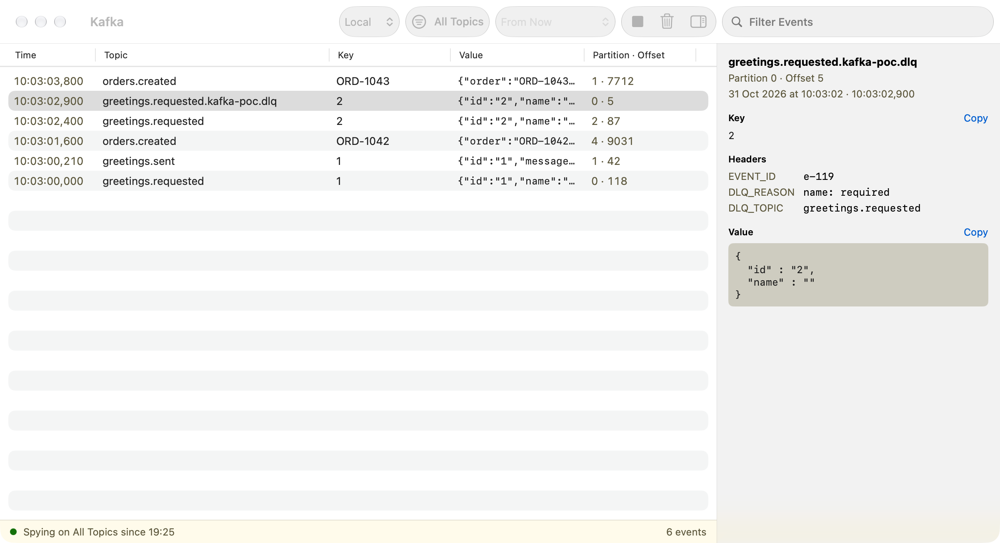
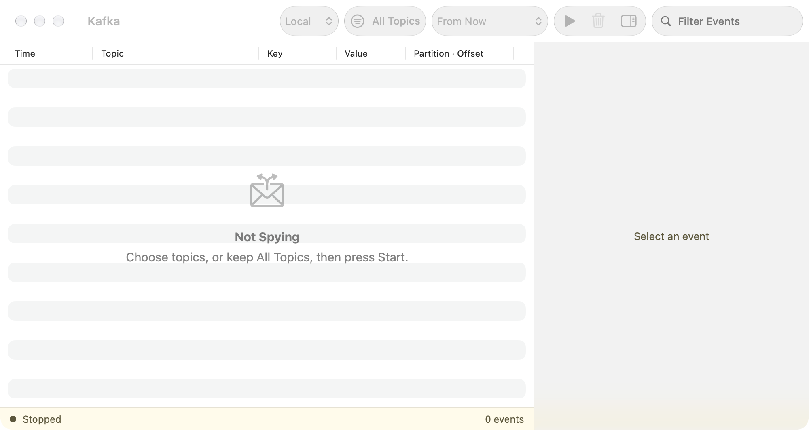

# Kafka

The Kafka tool shows the events an environment's Kafka topics receive, as they arrive: every topic at once, or
the topics chosen (the user's request, 22 November 2026). It reads with kcat, Kafka's command-line client, on this
Mac (the user's choice), from the brokers set for the environment in [Project Settings](project-settings.md); Claude
reads the same events with `list_kafka_topics` and `read_kafka_events` ([MCP › list_kafka_topics](../mcp.md#list_kafka_topics)).

*Spying on every topic of Orders' Local Kafka: the events newest first, the selected one's key, headers and value,
indented as JSON, in the inspector.*

## Opening it

A tool's tab, like Builds ([Navigation › Tabs](navigation.md#tabs)), for a project with an environment that has
Kafka brokers: **Window ▸ Kafka** (⌘8), its tile in Projects, its button in the menu bar panel. Its tab reads
"Kafka – <project>", with `envelope.arrow.triangle.branch`. Its chat panel button is last in its toolbar.

## Anatomy

| Part                 | Identifier                  | Contents                                                                                                                                                                                                                                                                                                                                                                                                                                                                                                                                                                                                                   |
|----------------------|-----------------------------|----------------------------------------------------------------------------------------------------------------------------------------------------------------------------------------------------------------------------------------------------------------------------------------------------------------------------------------------------------------------------------------------------------------------------------------------------------------------------------------------------------------------------------------------------------------------------------------------------------------------------|
| **Environment**      | `kafka.environment`         | A pop-up of the project's environments with brokers, in the project's order, shown when there are two or more. The first is chosen at first. Another one stops the spy, clears the events and reads its topics.                                                                                                                                                                                                                                                                                                                                                                                                            |
| **Topics**           | `kafka.topics`              | A button reading **All Topics**, the one topic chosen, or "<n> Topics", which opens a popover: **All Topics** ("Every topic but Kafka's own, those created later included", `kafka.topics.all`), a **Filter Topics** field, **Refresh** (`kafka.topics.refresh`), then each topic with a checkbox and, once it got events, how many (`kafka.topic.<name>`); Kafka's own topics, whose names start with `_`, last and grey. Checking a topic leaves All Topics; checking All Topics again takes it back. A change while a spy runs restarts it at once, the events kept. A failed listing shows kcat's message in `danger`. |
| **From**             | `kafka.from`                | **From Now** (the default) or **From the Beginning**: where the spy starts in each partition. Disabled while a spy runs.                                                                                                                                                                                                                                                                                                                                                                                                                                                                                                   |
| **Start** / **Stop** | `kafka.start`, `kafka.stop` | `play.fill`, ⌘R, help "Start Spying (⌘R)", disabled until topics are chosen and kcat is found; while a spy runs, `stop.fill`, ⌘., help "Stop Spying (⌘.)".                                                                                                                                                                                                                                                                                                                                                                                                                                                                 |
| **Clear**            | `kafka.clear`               | `trash`, ⌘K: the events go; the spy goes on.                                                                                                                                                                                                                                                                                                                                                                                                                                                                                                                                                                               |
| **Inspector**        | `kafka.inspector`           | Shows or hides the event's inspector.                                                                                                                                                                                                                                                                                                                                                                                                                                                                                                                                                                                      |
| **Filter Events**    |                             | The toolbar's search field: keeps the events whose topic, key, value or a header's name or value holds the text, letter case ignored.                                                                                                                                                                                                                                                                                                                                                                                                                                                                                      |
| **Events**           | `kafka.events`              | A table, newest first: **Time** (`14:03:00.123`, the Mac's time zone), **Topic**, **Key** ("—" without one), **Value** on one line, monospaced, at most 300 characters ("null" without one), **Partition · Offset**. Selecting an event shows it in the inspector and makes it the chat panel's subject, `<topic> #<offset>`. Its context menu: Copy Value, Copy Key, Copy Topic.                                                                                                                                                                                                                                          |
| **Inspector**        | `kafka.event`               | The event's topic, partition and offset, its date and time; **Key**, **Headers** in their order, a name and its value ("null" for none), and **Value**, indented when it is a JSON object or array, keys sorted, on `surfaceSunken`; Copy for the key and the value. "Select an event" without one (`kafka.noEvent`).                                                                                                                                                                                                                                                                                                      |
| **Status bar**       | `kafka.status`              | A dot and "Spying on <topics> since <time>" (`success`), "Joining <topics>…" with a spinner, "Stopped", or kcat's message (`danger`) when the spy ended on an error; then, in `warning`, the last error kcat reports while it retries, such as a broker it can't reach, cleared by the next event (`kafka.problem`); then "<n> events", and "(the oldest <n> dropped)" past the limit.                                                                                                                                                                                                                                     |

*Before a spy: "Not Spying — Choose topics, or keep All Topics, then press Start."*

## Spying

- **Start** runs kcat as a consumer of a group of its own, `hephaestus-spy-<8 hexadecimal characters>`, that commits
  nothing, so no service's offsets move and the group is gone once it ends ([Data › Kafka](../data.md#kafka)).
  All Topics subscribes to the pattern `^[^_].*`: every topic but Kafka's own, those created while it runs
  included.
- The events show 100 ms after they arrive, together, newest first. The table keeps 5,000 events: past that the
  oldest go (keep RAM low).
- The spy runs while the tab lives, also behind another tab; closing the tab, switching its project, choosing
  another environment, or quitting the app ends it. Stop keeps the events.
- kcat retries what fails, such as a broker that doesn't answer: its last error shows in the status bar while the
  spy waits. An error kcat can't get past ends the spy; the status bar says so, and Start tries again.

## Empty states

| State                                                    | Identifier      | Shows                                                                                                                                                                                                             |
|----------------------------------------------------------|-----------------|-------------------------------------------------------------------------------------------------------------------------------------------------------------------------------------------------------------------|
| kcat not found (after the login shell's `PATH` was read) | `kafka.noKcat`  | "kcat Isn't Installed", "The Kafka tool reads topics with kcat. Install it with Homebrew, brew install kcat, then look again." and **Look Again** (`kafka.lookAgain`), which reads the login shell's tools again. |
| No environment with brokers                              | `kafka.noKafka` | "No Kafka", "Give an environment its Kafka brokers in Project Settings." and **Project Settings…** (`kafka.projectSettings`).                                                                                     |
| No events, no spy                                        |                 | "Not Spying", "Choose topics, or keep All Topics, then press Start."                                                                                                                                              |
| No events, a spy running                                 |                 | "Waiting for Events", "Events show here as <topics> receive them."                                                                                                                                                |
| No events, the spy ended on an error                     |                 | "The Spy Stopped" and kcat's message.                                                                                                                                                                             |
| No event matches the filter                              |                 | The search's "No Results".                                                                                                                                                                                        |

## Previews

`KafkaRootView` on `KafkaModel` over `SampleKafkaStore` (Orders with Local and Staging, four topics, six events):
"Spying", "Not Spying", "No Kafka".
