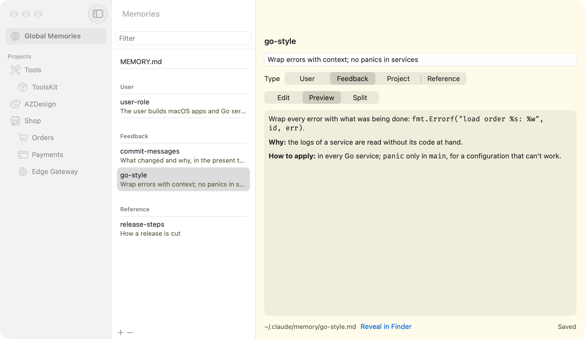
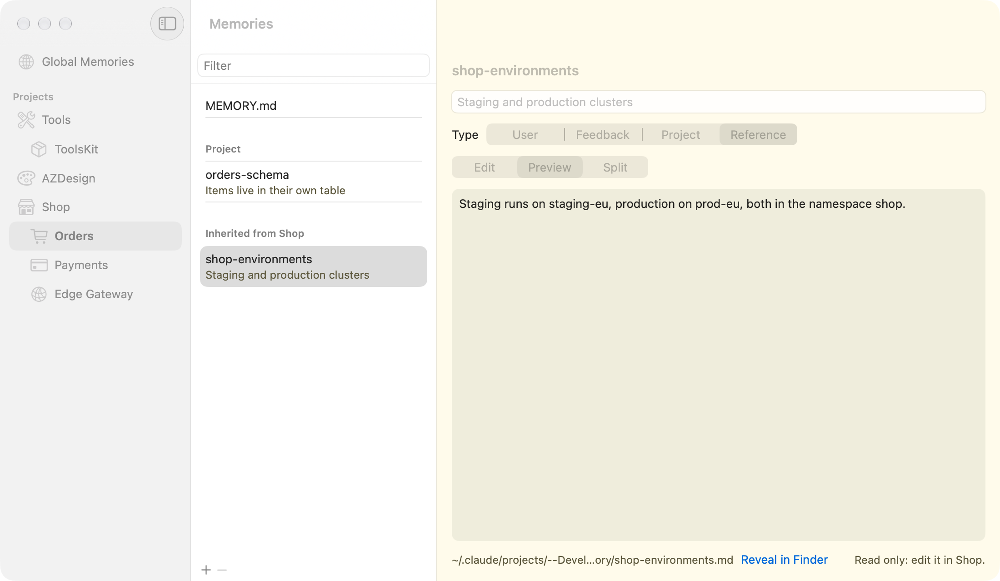

# Memories

Memories is where the user reads and edits what Claude remembers: the memories the Claude CLI saves for each
project, and the global memories every chat of every project gets. V2's Memories section and Global Memories view,
brought over (the user's request, 22 November 2026) in V3's way: one tab for both, and a change saved by itself, as
[System Prompts](system-prompts.md) saves. The files are the CLI's ([Data › Memories](../data.md#memories)): Claude
keeps writing them with its own file tools, and no MCP tool reads or writes them.

*The global memories, `go-style` selected: its name, description and type, its body in Preview, its file under the
home folder.*

## Opening it

| From                                    | Does                                                                                                       |
|-----------------------------------------|------------------------------------------------------------------------------------------------------------|
| **Window ▸ Memories** (⌘9)              | Selects the Memories tab, or opens it, on the key window's project; on the global memories without one.    |
| **Window ▸ Global Memories** (⇧⌘M)      | The same, on the global memories.                                                                          |
| A route, `.memories(scope:)`            | The same, on the scope it names: `global` or a project's id ([Navigation › Routes](navigation.md#routes)). |

It is a tab, one in the whole app, like System Prompts: it has the window's chat panel beside it and the chat
panel button last in its toolbar. Its tab reads "Memories", with `brain`. The shortcuts are V2's.

## Anatomy

Three columns (`NavigationSplitView`):

- **Scopes** (180–300 pt, `memories.scopes`): **Global Memories** (`globe`, `memories.scope.global`), then the
  section **Projects**: every project in tree order with its symbol, a sub project under its parent, indented 14 pt
  per level (`memories.scope.<id>`). Selecting one shows its memories; the shown memory's change is saved first.
- **List** (220–400 pt, `memories.list`): a **Filter** field at the top (`memories.filter`), which keeps the rows
  whose name or description holds its text, letter case ignored, `MEMORY.md` by its name. Then the row
  **MEMORY.md** when the file exists (`memories.row.index`); the memories under the headings **User**,
  **Feedback**, **Project**, **Reference** and **Other** (a missing or unknown type), a heading without rows
  hidden, each row its name and, under it, its description on one line (`memories.row.<file>`); then, for a sub
  project, one group per folder it inherits, nearest parent first, headed **Inherited from <parent's name>**, its
  memories read-only (`memories.row.<project id>/<file>`). Rows are sorted by name, then by file name. A filter
  without a match shows the search's "No Results". The bar at the bottom has **+** (New Memory…, `memories.new`)
  and **−** (Move to Trash…, `memories.delete`), disabled unless a memory of the shown folder is selected.
- **Editor**: the selected row, else "Select a memory" (`memories.nothing`).

*Orders, a sub project of Shop: its own memory, and Shop's, inherited and read-only.*

## Editor

| Part                   | Content                                                                                                                                                                                                         |
|------------------------|-----------------------------------------------------------------------------------------------------------------------------------------------------------------------------------------------------------------|
| Name                   | A plain field in `title3` semibold (`memories.name`); its message under it, in `danger`, when the name can't be given                                                                                           |
| Description            | A field that grows to four lines (`memories.description`); "A description is required." under it when emptied                                                                                                   |
| Type                   | A segmented picker: **User**, **Feedback**, **Project**, **Reference** (`memories.type`); none selected for an Other memory until the user picks one                                                            |
| Other Front Matter     | When the file has other keys: read-only, monospaced, the keys in YAML sorted by key (`memories.otherFrontMatter`)                                                                                               |
| Mode                   | A segmented picker: **Edit**, **Preview**, **Split** (`memories.mode`); it starts in Preview, stays as chosen while the tab lives, and New Memory sets Edit                                                     |
| Body                   | Edit: a monospaced text editor on `surfaceSunken` (`memories.body`); Preview: the body as Markdown, as a ticket's description draws it, markers included (`memories.preview`); Split: both side by side         |
| Footer                 | The file's path, the home folder written `~`, cut in the middle (`memories.path`); **Reveal in Finder** (`memories.reveal`); the status, last (`memories.status`)                                               |

`MEMORY.md` shows its title in place of the fields, and its whole text as the body, with the same modes and footer.

**Saving**, as System Prompts saves (V3's way; V2 had Save and Revert):

- The description and the body are saved a second after the last keystroke; the type at once; every change when
  another row or scope is selected and when the tab goes away. The status reads "Saved", "Editing…", or "Not
  saved: <reason>" in `danger`.
- The name is given on Return, or when its field loses the focus: the memory is renamed, its file with it, its
  links in `MEMORY.md` and `[[name]]` in the folder's other memories ([Data › Memories](../data.md#memories)); the
  row stays selected. A name outside 1–64 lowercase letters, digits and single hyphens shows "Use 1–64 lowercase
  letters, digits and single hyphens."; a name another memory has, "A memory named “<name>” already exists."; the
  field keeps what was typed, and the other changes still save.
- While the folder changes elsewhere (a chat saving a memory, another app), the list follows within a second; the
  shown memory is read again unless it has a change waiting, which then saves over it.
- A shown file gone shows "Memory <name> was not found." (or "File MEMORY.md was not found.") with **Try Again**.
- An inherited memory is read-only: its fields dimmed, its body in Preview, its status "Read only: edit it in
  <parent's name>."; it is edited in its own project's memories.

## New Memory

**+**, or **New Memory…** in the empty state, saves the shown change, then opens a sheet: **Name**
(`memories.newName`, its message under it while typing), **Description** (two to five lines,
`memories.newDescription`), **Type** (segmented, none chosen at first, `memories.newType`). **Cancel** (Escape) and
**Create** (⌘Return, Return in the Name field, `memories.create`), enabled once the name is valid and free, the
description isn't blank and a type is chosen. Create writes the file and its `MEMORY.md` line, making the folder
when missing, then selects the memory with its body in Edit; a failure shows in `danger` under the fields and the
sheet stays.

## Move to Trash

**−**, or ⌫ in the list, with a memory of the shown folder selected: "Move “<name>” to the Trash?" with **Move to
Trash** (destructive) and **Cancel**. It removes the memory's lines from `MEMORY.md`, moves the file to the Trash
and clears the selection; a failure shows "Move to Trash failed" with the reason. `[[name]]` links in other
memories stay, as V2's. `MEMORY.md` and inherited memories can't be moved to the Trash here.

## Empty and failed states

- **Nothing to show** (no memory, no `MEMORY.md`, nothing inherited): in place of the list, `brain` and **No
  Memories** with "Claude saves what it learns about you and this project in <folder>." for a project, **No Global
  Memories** with "Claude saves here what it learns that holds for every project." for the global ones; and **New
  Memory…** (`memories.empty`, `memories.empty.new`).
- **The folder can't be read**: "Memories Unavailable" with the reason, in place of the list.

## Previews

`MemoriesView` on `MemoriesSamples.model(…)`, which writes sample memories in a home folder of its own under the
temporary folder, 1100 × 640 pt: "Global, a Memory", "Orders, Inherited", "Global, Edit" (Split, dark).
