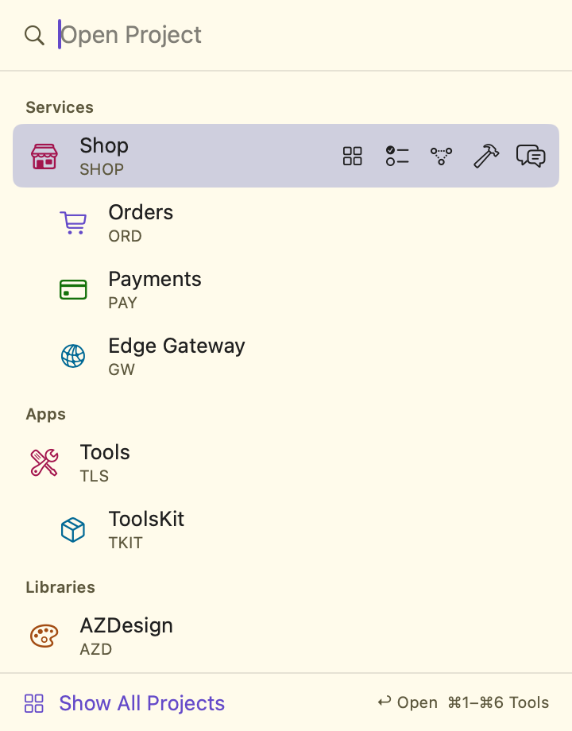
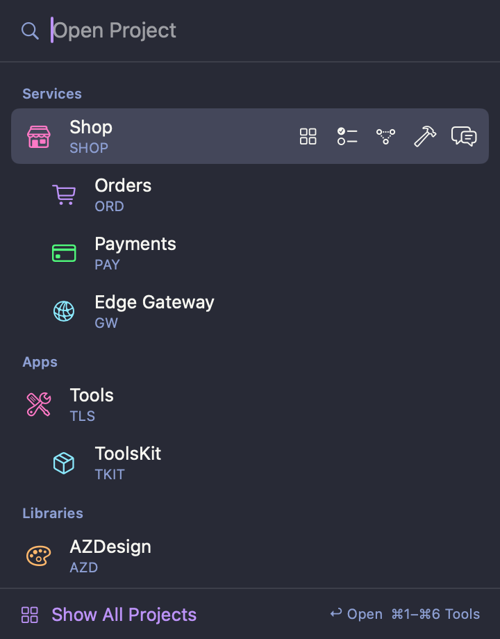

# Menu bar

Hephaestus V3 puts an item in the menu bar, the `wrench.and.screwdriver` symbol, so you can open a project
quickly from any app (the user's choice). Its panel, **Open Project**, lists every project. Type a few
letters, then press Return to bring the project's window forward, or press ⌘1–⌘6 to open one of its tools.
The pointer works too. The panel only asks for routes; the app decides whether a window already shows what
you picked, and brings that window forward instead of opening a duplicate.

*The Open Project panel: the filter field, the projects by kind, Shop highlighted with its tool buttons, and the footer.*

## Opening it

- **Menu bar item.** A click on the `wrench.and.screwdriver` symbol opens the panel under it. The item's
  title, "Open Project", names it.
- **Always there.** The item is in the menu bar while Hephaestus V3 runs. No setting hides it.
- **No shortcut.** No keyboard shortcut opens the panel.
- **On opening.** Each opening starts afresh: the filter field is empty and has the keyboard focus, and the
  first row is highlighted. The panel starts afresh whenever its window becomes key or stops being key,
  and after each action, so it never reopens on the last filter or highlight, even when the menu bar
  extra keeps its view between openings.

The panel is a `MenuBarExtra` in the window style (`ToolsScenes`), so it is a panel, not a menu.
[Navigation](navigation.md#windows) lists it with the app's windows.

## Anatomy

| Region | Contents |
| --- | --- |
| **Filter field** | `magnifyingglass` and a plain text field, "Open Project", in `title3`. |
| **Project list** | The projects by kind, as a tree. The highlighted row shows its tool buttons. |
| **Footer** | **Show All Projects** and a reminder of the keys. |

The panel is 360 × 460 pt on the `canvas` color at the default text size, and grows with a larger text
size (`@ScaledMetric`). Its three regions are stacked top to bottom, separated by dividers. The list
scrolls; the filter field and the footer stay in place.

*The same panel in the dark appearance.*

## Filter field

The field matches a project's name or identifier, ignoring case and diacritics
(`localizedStandardContains`). Spaces around the text are ignored, so spaces alone don't filter. It has
the keyboard focus when the panel opens. Each change of its text moves the highlight to the first match.

## Project list

**Sections.** Without a filter, the list has one section per kind: **Services**, **Apps** and
**Libraries**. A section shows only when it has a project. Each section title is in `caption` semibold and
`textSecondary`, with the header trait.

**Tree.** The list follows the same tree as the Projects window's sidebar, without disclosure triangles:

- each top-level project is followed by its sub projects, at any depth;
- a sub project is indented 18 pt per level;
- a sub project stays in its top-level project's section, whatever its own kind: ToolsKit, a library, is
  listed under **Apps**.

**Filtering.** While the field holds text, the list shows the matches alone, flat and without indentation.
They are grouped by their own kind, without section titles.

**Rows.** Each row shows:

- the project's icon in its tint, in `title3`, in a frame 24 pt wide that grows with the text size;
- its name in `textPrimary`;
- its identifier under the name, in `caption` and `textSecondary`.

A click on a row opens the project's window (see [What opening does](#what-opening-does)). Its help tag is
"Bring its window forward".

**Highlight.** One row is highlighted at a time:

- It starts on the first row, and moves to the first match while you filter.
- The arrow keys move it, and so does the pointer: the row under the pointer becomes the highlighted one.
- The list scrolls to keep it visible.
- The highlighted row has the `highlight` background, with concentric corners of at least 6 pt.
- VoiceOver reads the highlighted row as selected, and moving the VoiceOver cursor onto a row highlights
  it, so Return and ⌘1–⌘6 act on the row VoiceOver is on.

**Tool buttons.** The highlighted row shows one button per available tool of its project
([Navigation › Available tools](navigation.md#available-tools)), at its trailing edge; a tool that isn't
available has no button and no ⌘ shortcut:

- They come in menu order: Dashboard, Tickets, Service Map, Contracts, Builds, Chat. A service without a
  contract has no Contracts button, and an app or a library has only Dashboard, Tickets, Builds and Chat.
- Each button is the tool's symbol alone, in a 24 × 24 pt frame that grows with the text size, in
  `textPrimary`.
- Each help tag names the tool and its shortcut, such as "Builds (⌘5)". A shortcut belongs to its tool,
  not to the button's position: Shop's fourth button is Builds, ⌘5.
- A click opens that tool's window for the project.
- Every row, highlighted or not, also offers its tools as VoiceOver actions, such as "Open Tickets".

## Keyboard

| Key | Action | Notes |
| --- | --- | --- |
| Typing | Filters the list; the highlight moves to the first match. | The field has the focus when the panel opens. |
| ↓ | Moves the highlight one row down. | Stops at the last row. With no highlight, goes to the first row. |
| ↑ | Moves the highlight one row up. | Stops at the first row. With no highlight, goes to the last row. |
| Return | Opens the highlighted project's window and closes the panel. | Does nothing when no row matches. |
| ⌘1 | Opens the highlighted project's **Dashboard**. | Each ⌘ shortcut is disabled when the project doesn't have that tool. |
| ⌘2 | Opens its **Tickets**. | |
| ⌘3 | Opens its **Service Map**. | |
| ⌘4 | Opens its **Contracts**. | Only a service with a contract has it. |
| ⌘5 | Opens its **Builds**. | |
| ⌘6 | Opens its **Chat**. | |

The arrow keys and Return act while the filter field has the focus. The project switcher's popover uses
the same keys ([Projects › Project switcher](projects.md#project-switcher)). The ⌘ shortcuts are the same keys as
the Window menu's ([Navigation › Menus and shortcuts](navigation.md#menus-and-shortcuts)). Here they act on
the highlighted project instead of the key window's.

## Footer

- **Show All Projects** (`square.grid.2x2`, borderless) opens the Projects window with the highlighted
  project selected, and closes the panel. With no highlighted row, it selects the first project of the
  list it was given, Orders in the samples. See [Projects](projects.md).
- **"↩ Open  ⌘1–⌘6 Tools"**, in `caption` and `textSecondary`, reminds you of the keys.

## What opening does

Every action closes the panel and clears its filter. Each one asks for a route, and the app comes to the
front even when another app was active. A window that already shows what you asked for comes forward, un-minimized, instead of a
second one opening (the user's choice). See [Navigation › Window reuse](navigation.md#window-reuse).

| Action | Route | Result |
| --- | --- | --- |
| A click on a project, or Return | `.projectWindow(id)` | The frontmost window that shows the project comes forward, un-minimized: one of its tool windows, or the Projects window when the project is selected there. Minimized windows count after the others. When no window shows the project, the Projects window opens, or comes forward, with the project selected. |
| A tool button, or ⌘1–⌘6 | `.tool(tool, project:)` | The window of that tool for that project comes forward, un-minimized, or a new one opens. |
| **Show All Projects** | `.project(id)` | The Projects window comes forward, or opens, with the project selected. |

## States

| State | When | What shows |
| --- | --- | --- |
| **Default** | The filter is empty. | All projects by kind, with section titles, as a tree. The first row, Shop, is highlighted with its tool buttons. |
| **Filtering** | The filter holds text. | The matches alone, flat, grouped by kind without titles. The first match is highlighted. |
| **No matches** | The filter matches no project. | "No Matching Projects" in `textSecondary`, 40 pt below the field. No row is highlighted, and Return and ⌘1–⌘6 do nothing. |
| **Project without a tool** | The highlighted project lacks a tool. | No button for that tool, and its ⌘ shortcut is disabled. |

## Layouts

The panel has one layout on every screen: 360 × 460 pt at the default text size, larger with a larger text
size, along with its icon and tool button frames. It isn't a tool window and doesn't read `windowLayout`
([Foundations › Layout system](foundations.md#layout-system)).

## Accessibility

| Element | Identifier | Label or notes |
| --- | --- | --- |
| Menu bar item | None | `wrench.and.screwdriver`, titled "Open Project". |
| Filter field | `launcher.filter` | Placeholder "Open Project". The magnifying glass is hidden. |
| Project row | `launcher.row.<id>` | A button with the project's name and identifier; help "Bring its window forward". The icon is hidden. The highlighted row has the selected trait. Each row has one action per tool, "Open <Tool>". |
| Tool button | `launcher.row.<id>.<tool>` | Labeled with the tool's name; help "<Tool> (⌘n)". `<tool>` is `dashboard`, `tickets`, `serviceMap`, `contracts`, `builds` or `chat`. |
| **Show All Projects** | `launcher.showAll` | |
| Keys reminder | None | Hidden from VoiceOver. |
| ⌘1–⌘6 | None | Invisible buttons that carry the shortcuts; hidden from VoiceOver and from the pointer. |
| Section titles | `launcher.section.<kind>` | Header trait. `<kind>` is `service`, `app` or `library`. |
| "No Matching Projects" | `launcher.noMatches` | |

## Sample data and limits

- The panel lists the app's projects ([Projects](projects.md)); its previews and screenshots list the seven
  sample projects (`Project.samples`), described in [Projects › Sample data and limits](projects.md#sample-data-and-limits).
- Every control is wired: each opens a route.

## Previews

- `ProjectLauncher`: "Launcher", "Launcher, Dark".
- `ProjectLauncherPanel`, the panel's content: "Filtering" ("pa"), "No Matches", "Largest Text".

## Open issues

None.
