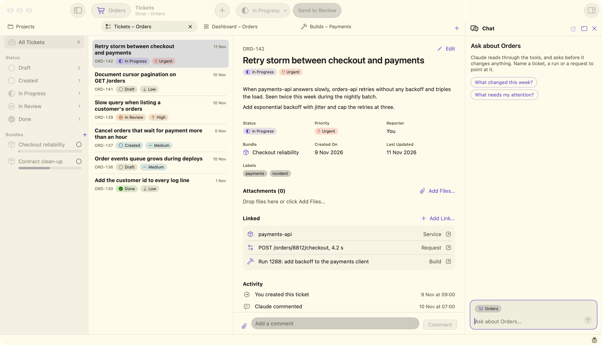
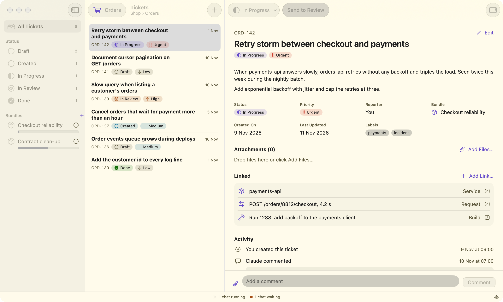
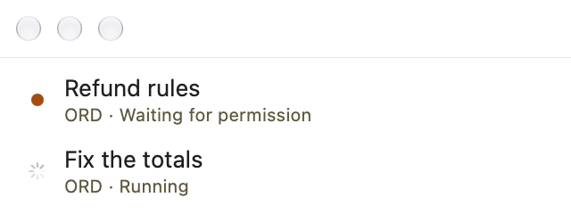
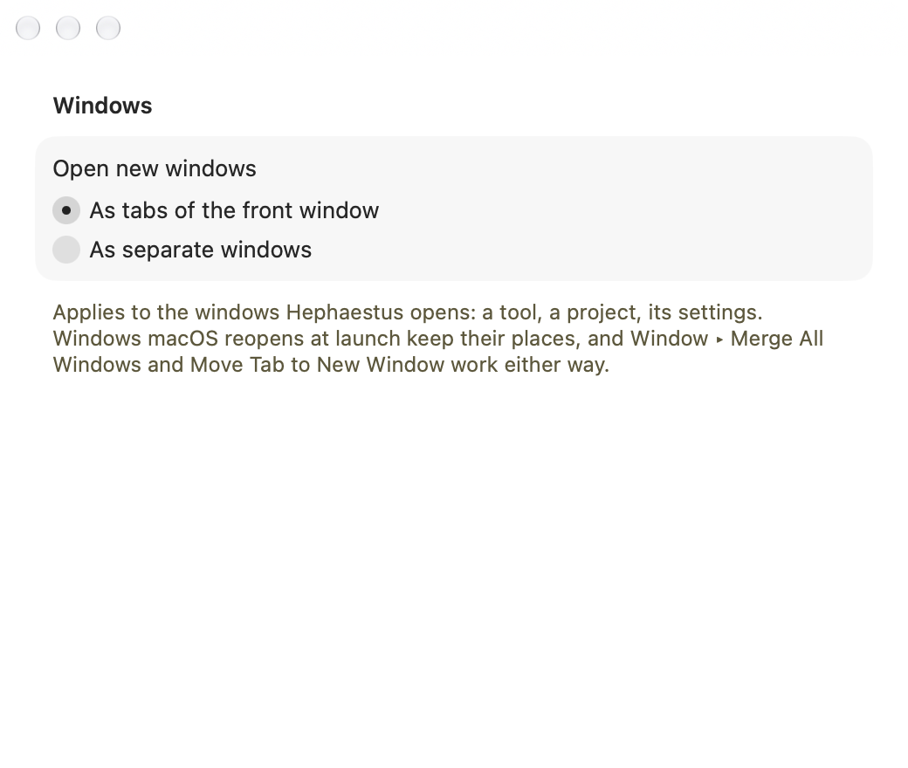
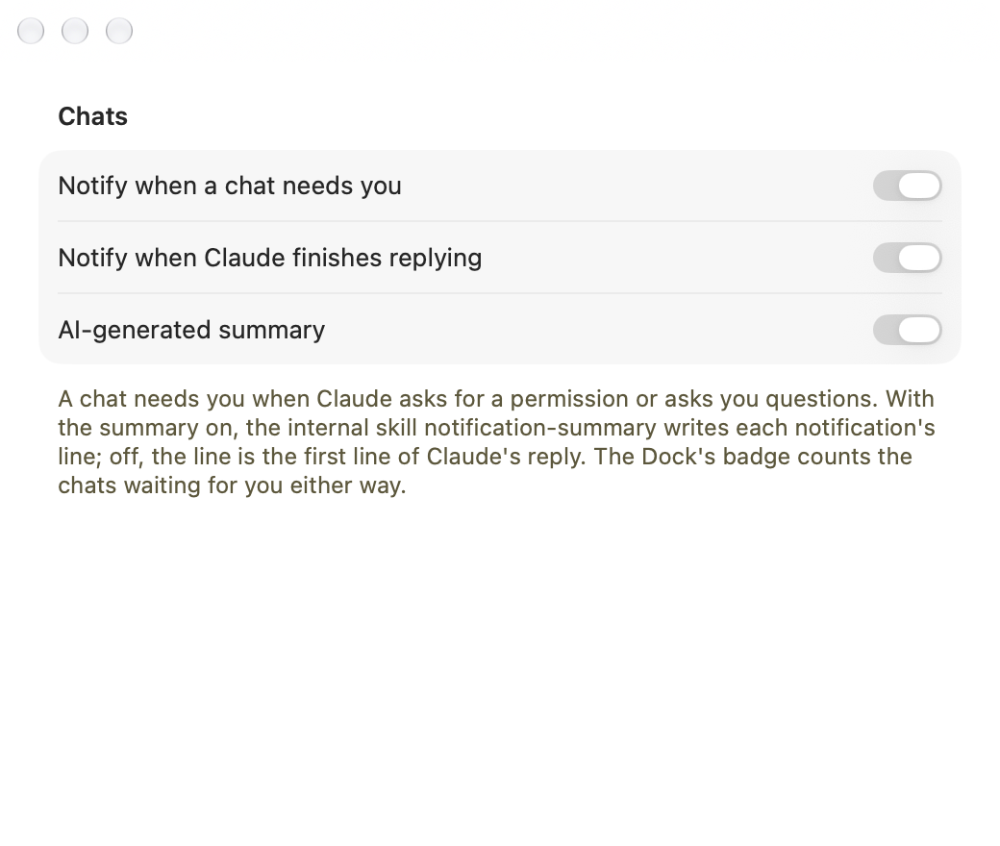

# Navigation

How Hephaestus V3 is put together: its windows and their tabs, how one tab opens another, how an open tab is
reused, and the menus and shortcuts that reach them.

## Windows

The app has one kind of window, which holds **tabs** that the app draws itself (the user's choice): each tab
shows Projects, one tool for one project, a project's settings, Virtual Machines, or System Prompts. The windows' pages call a
tab by its old window's name, "the Tickets window", meaning the tab.

| Tab | How many | Opens | Page |
| --- | --- | --- | --- |
| **Projects** | One in the app | At launch; ⌘0 | [Projects](projects.md) |
| **Dashboard** | One per project for routes; more with ⌘T, + or ⌘N | ⌘1, a tile, the menu bar panel, a link | [Dashboard](dashboard.md) |
| **Tickets** | Same | ⌘2, a tile, the menu bar panel, a link | [Tickets](tickets.md) |
| **Service Map** | Same | ⌘3, a tile, the menu bar panel, a link | [Service Map](service-map.md) |
| **Contracts** | Same | ⌘4, a tile, the menu bar panel, a link | [Contracts](contracts.md) |
| **Builds** | Same | ⌘5, a tile, the menu bar panel, a link | [Builds](builds.md) |
| **Chat** | Same | ⌘6, a tile, the menu bar panel, the chat panel | [Chat](chat.md) |
| **Virtual Machines** | One in the app | ⌘7 (Window menu) | [Virtual Machines](virtual-machines.md) |
| **Project Settings** | One per project | ⇧⌘, (File menu), Projects' More menu | [Project Settings](project-settings.md) |
| **System Prompts** | One in the app | ⌥⌘, (App menu) | [System Prompts](system-prompts.md) |

| Other window | Kind | Opens | Size | Page |
| --- | --- | --- | --- | --- |
| **Settings** | One window | ⌘, | 520 × 440 pt | Tabs: [General](#settings--general), [Projects](projects.md#settings--projects), [MCP](../mcp.md#settings--mcp), [Virtual Machines](virtual-machines.md#settings--virtual-machines), [Chat](chat.md#settings--chat) |
| **Menu bar panel** | Menu bar item | The `wrench.and.screwdriver` icon | 360 × 460 pt | [Menu bar](menu-bar.md) |

- A new window is 1320 × 840 pt. The first window, at launch, shows Projects; macOS restores the windows open
  when the app quit, with their tabs, each tab's selected item and the selected tab.
- Every window gets no narrower than 390 pt and no lower than 420 pt, and adapts its layout to its size
  ([Layout system](foundations.md#layout-system)).

## Available tools

A tool that isn't available is hidden in the running app, so that no tab shows sample data next to the
real projects: its tab doesn't open, and its tile, its Window menu item, its menu bar buttons and ⌘ shortcuts,
and its Settings tab don't show. `AppData.availableTools` lists the
available tools; ToolsScenes gives it to every window as the `availableTools` environment value, and the
menus read it directly.
`AppData.machinesAvailable` does the same for Virtual Machines.

| Feature | Tools and windows | Available |
| --- | --- | --- |
| Projects | The Projects window, Project Settings, Settings ▸ Projects, the menu bar panel | Yes |
| Dashboard | The Dashboard window, its tile, Window ▸ Dashboard (⌘1), its menu bar button; its widgets show as their tools come ([Dashboard › Which widgets show](dashboard.md#which-widgets-show)) | Yes |
| Tickets | The Tickets window, its tile, Window ▸ Tickets (⌘2), its menu bar button | Yes |
| Chat | The Chat window, its tile, Window ▸ Chat (⌘6), its menu bar button, the chat panel of the available tools' windows, Settings ▸ Chat and Settings ▸ Notifications | Yes |
| Builds | The Builds window, its tile, Window ▸ Builds (⌘5), its menu bar button, the Dashboard's Recent Builds widget | Yes |
| Contracts | The Contracts window, its tile, Window ▸ Contracts (⌘4), its menu bar button, for a service whose folder holds `openapi/contract.yaml` | Yes |
| Service Map | The Service Map window, its tile, Window ▸ Service Map (⌘3), its menu bar button, the Dashboard's service widgets | Yes |
| Virtual Machines | Its window, Window ▸ Virtual Machines (⌘7), Settings ▸ Virtual Machines | Yes |

Previews and the screenshots of the spec show every tool: the environment value's default is all of them.

## Tools per project

What a project is decides which tools apply to it (`Project.tools`). Projects shows a tile for each, the
Window menu enables only those, and the project switcher greys out the projects without the tab's tool.

| Project kind | Tools, in menu order |
| --- | --- |
| Service with a contract | Dashboard, Tickets, Service Map, Contracts, Builds, Chat |
| Service without a contract | Dashboard, Tickets, Service Map, Builds, Chat |
| App, Library, Other | Dashboard, Tickets, Builds, Chat |

## Anatomy of a window

*A window: the toolbar, then the tab bar over the tab area; the Tickets tab's sidebar is inside the tab, and the
chat panel is on the right, outside the tabs; the status bar runs under both.*

| Part | Contents |
| --- | --- |
| **Toolbar** | The selected tab's: for a tool, the project switcher, the title and subtitle, the tool's own items, and the chat panel button at the far right. |
| **Project switcher** | A tool's tab's first toolbar item: the project's icon and name. A click opens a popover listing every project as a tree; picking one moves this tab to that project, where the tool starts afresh on its default selection; picking the project it already shows changes nothing. See [Components › Project switcher](components.md#project-switcher). |
| **Title and subtitle** | The tool's name, and the project's path from its top-level project, such as "Shop › Orders". Hidden below 760 pt of tab width. |
| **The tool's toolbar items** | Defined by the tool, as each tool's page lists them. |
| **Chat panel button** | The last toolbar item, `sidebar.right`: shows or hides the chat panel. Absent in Chat's tab, and everywhere when Settings ▸ Chat turns the panel off. See [Chat](chat.md). |
| **Tab bar** | Under the toolbar, across the tab area, with two tabs or more: one tab per tab of the window, then + ([Tabs](#tabs)). |
| **Tab** | The selected tab's content, sidebar included, laid out as a Mac, an iPad or an iPhone would, depending on the window's width. |
| **Chat panel** | On the right, outside the tabs, beside them on a Mac, over them on an iPad, the whole window on an iPhone. See [Chat](chat.md). |
| **Status bar** | Under the tabs and the chat panel, across the window, while a feedback project is set ([Status bar](#status-bar)). |

## Status bar

V2's status bar, with its ladybug and its chat counts (the user's choices; V2's other items, the device, the
MCP port, the version, updates, usage and costs, stay out): a bar across the bottom of every window but
Settings and the menu bar panel, under the tabs and the chat panel ([Anatomy of a window](#anatomy-of-a-window)).
Its feedback is about the selected tab.

- **Shown** while Settings ▸ General has a feedback project that is loaded
  ([Settings ▸ General](#settings--general)), or while chats are counted; otherwise no window has the bar,
  and the tabs take its room (the user's choice for the ladybug; the counts showing it too is a default
  chosen at design time).
- **Look.** 26 points high, under a hairline (`Divider`), on `canvas`, in every layout. Its texts are
  `caption`, in `textSecondary`, on one line.
- **Running chats** (`statusBar.runningChats`), in the middle: a mini spinner and "1 chat running" or
  "<n> chats running", the chats starting or at work. Shown when the count isn't 0. A click opens the chats
  popover.
- **Waiting chats** (`statusBar.waitingChats`), after it: a 7-point dot in `warning` and "1 chat waiting" or
  "<n> chats waiting", the chats waiting for a card's answer or for answers to questions. Shown when the
  count isn't 0. A click opens the chats popover.
- **Chats popover** (`statusBar.chats`), under the bar's middle: the counted chats, waiting first, then at work,
  each group the latest updated first. A row (`statusBar.chats.<chat id>`): the dot or the spinner, the
  chat's title, then "<project identifier> · <state>" in `caption` and `textSecondary`, the state being
  Starting, Running, Waiting for permission or Waiting for answers. A click closes the popover and opens the
  chat in its project's Chat window. The popover closes when no chat is counted any more. 260 to 360 points
  wide.

  
- **Ladybug** (`statusBar.feedback`), 10 points from the right edge, while there is a feedback project: a
  borderless button with `ladybug` in `textSecondary`, the tooltip "Send Feedback (⇧⌘B)" and the label "Send
  Feedback". A click captures the window, then opens the Send Feedback sheet on it
  ([Chat › Feedback](chat.md#feedback)). It does nothing while the window shows a sheet, or while its
  feedback is open.
- The counts are those of every project: the session's chats, whatever the window shows (V2 counted the
  chats of the window's Mac). The Dock badge counts the waiting ones ([Chat › Notifications](chat.md#notifications)).
- The bar is one element, `statusBar`. Previews: "Status Bar", "Status Bar, Dark", "Status Bar, Chats",
  "Status Bar, Chats Without Feedback", "Chats Popover".

## Routes

A view never opens a tab itself. It asks for a **route** (`Route` in `ToolsFoundation/Routing.swift`), and one
place in the app (`RouteHost` in `ToolsScenes`) opens it. Links between tools, Projects' tiles, the menu bar
panel and the chat's **Open** buttons all use routes.

| Route | Opens |
| --- | --- |
| `.project(id)` | Projects, with the project selected. |
| `.projectWindow(id)` | The tab already showing the project in the frontmost window that has one (its selected tab when that shows the project), or Projects with it selected when none does. Used by the menu bar panel. |
| `.tool(tool, project:, focus:)` | The tool's tab for the project. The focus is selected in it. |
| `.machine(id)` | Virtual Machines, with the machine selected. |
| `.projectSettings(id)` | The project's Project Settings tab. |
| `.chatWindow(chat:)` | The chat's own window ([Chat › Chat windows](chat.md#chat-windows)): the one already showing it, un-minimized and brought forward, or a new one. Not a tab: chat windows are a scene of their own, never merged into the others. |
| `.settings(pane)` | The Settings window, on that tab (`SettingsPane`: `general`, `projects`, `mcp`, `machines`, `chat`, `notifications`). The tab is stored as `settings.pane` in the user defaults, so Settings also opens on the last tab shown. Used by the chat's **Open Settings**. |

**Focus formats**, the item a tool selects when a route opens it:

| Tool | Focus | Example |
| --- | --- | --- |
| Tickets | Ticket id | `ORD-142` |
| Service Map | `service:<name>` or `request:<id>` | `service:payments-api`, `request:req-8f3a` |
| Contracts | Operation id | `checkoutOrder` |
| Builds | Run number, or `release:` and a tag | `1288`, `release:v1.4.0` |
| Chat | Conversation id | `chat-checkout` |

## Window reuse

A route never opens a second tab for what a tab already shows (the user's choice). `WindowDirectory` keeps
every window with its tabs.

- **A route** finds the first tab that shows what it asks for, in the frontmost window that has one, minimized
  windows last. It selects the tab, un-minimizes the window, brings it to the front and activates the app, and
  the tool selects the route's focus there without starting afresh: its filters, modes and scroll positions
  stay. A second route to the same item selects it again, even after the user picked another.
- **Otherwise** the route opens a new tab, which starts on the focus: a tab of the frontmost window, or a window
  of its own, as [Settings ▸ General](#settings--general) says.
- **Projects, Virtual Machines, System Prompts and each project's Project Settings** are one tab each in the
  app. A route to them
  selects that tab, and selects its project or machine there.
- **The Window menu's items** follow the same rules.
- **File ▸ New Window (⌘N), New Tab (⌘T) and the tab bar's +** are the ways to get a second tab of a tool and
  project. Routes keep selecting the first one.

**Switching project.** The project switcher moves a tab to another project: the tool starts afresh on it,
without the old selection; the chat panel shows that project's conversation. Picking the project the tab
already shows changes nothing.

## Tabs

The app draws its own tabs (the user's choice, 17 November 2026): macOS's window tabs put a sidebar beside the
tab bar and can't share one chat panel across tabs. macOS's tabbing is off, and so are its tab items.

**Tab bar.** Under the toolbar, across the tab area (not over the chat panel), 36 pt high on `canvas`, over a
hairline. It shows only while the window has two tabs or more (the user's choice): with one tab, the tab's
content goes up under the toolbar, its sidebar running the window's height, and New Tab (⌘T) makes the second
tab. Under the tab bar, the content starts right below the bar's hairline: nothing of the toolbar covers it, no
blur over its first rows and no toolbar-high band at the top of its columns.

- **Tabs** share the bar's width, 120 to 240 pt each, 4 pt apart, 8 pt in from the edges; past that the bar
  scrolls sideways. Each shows its symbol and title, in `callout`: `textPrimary` and a `surface` capsule when
  selected, `textSecondary` otherwise, with a faint capsule under the pointer. A click selects it.
- **Titles.** A tool's tab reads the tool, then its project's name ("Tickets – Orders"); Project Settings reads
  "Project Settings – Orders"; then "Projects" and "Virtual Machines". Symbols: the tool's, `folder`,
  `gearshape`, `desktopcomputer`. Long titles are cut in the middle.
- **Close button** (`xmark`) at a tab's right end, on the selected tab and under the pointer. Closing a window's
  last tab closes the window.
- **+** at the bar's right end (`tabs.new`, "New Tab (⌘T)"): a new tab of the selected tab's tool and project,
  after it. Absent while Projects, Project Settings or Virtual Machines is selected: they open once each.
- **Context menu** of a tab: Close Tab, Close Other Tabs, Move Tab to New Window (the last two with two tabs or
  more).
- **Dragging** a tab sideways moves it among the others. Dragged more than 48 pt up or down out of the bar, it
  goes into a window of its own, as Move Tab to New Window (with two tabs or more). Tabs don't move between
  windows by dragging: Window ▸ Merge All Windows gathers them.
- **Window ▸ Merge All Windows** puts every other window's tabs after the key window's, in window order, and
  closes those windows. **Move Tab to New Window** gives the selected tab a window of its own.
- **Show Previous Tab** (⌃⇧⇥) and **Show Next Tab** (⌃⇥) select the tab before or after, wrapping around.

**What a tab keeps.** Only the selected tab is drawn. A tool's tab keeps its tool's model while another tab is
in front, so its selection, filters, modes and drafts are there when it comes back; its scroll positions and
open popovers start afresh (default chosen at design time). Projects and Project Settings start from the
project data each time. A tab moved to another window, or merged, starts afresh on its selected item.

**Chat panel.** One per window, on the right, outside the tabs (the user's choice). It shows the conversation
of the selected tab's project, one conversation per project in the window, so switching tabs loses none; its
item chip follows the selected tab's selection (the user's choice). In Projects it is the selected project's;
in a tab without a project (Virtual Machines), the last project the window showed; with none, "No Project",
"Select a project to chat about it." (`chatPanel.noProject`). Chat's own tab has no panel. It shows when the
window opens, and the toolbar button or ⌃⌘C hides it for that window (the user's choice). See
[Chat › Chat panel](chat.md).

**New tabs** go into the frontmost window, or into a window of their own, as [Settings ▸ General](#settings--general)
says; the frontmost window by default (the user's choice). This covers every tab the app opens when asked: a
route (a tile, a link, the menu bar panel, `open_in_app`), Project Settings…, the Window menu's items. The new
tab comes after the selected one and is selected. With no window open, a window opens. New Tab and + always
make a tab, and New Window a window.

### Settings ▸ General

The first tab of Settings (`gearshape`), a grouped form with two sections. **Windows**:

| Element | Identifier | Content |
| --- | --- | --- |
| **Open new windows** | `settings.general.newWindows` | Radio buttons: **As tabs of the front window** (`settings.general.newWindows.tabs`, the default) or **As separate windows** (`settings.general.newWindows.windows`), for what routes open ([Tabs](#tabs)). A choice is written to `settings.yml`'s `newWindows` ([Data › Settings file](../data.md#settings-file)) and applies to the next tab. |
| Message | `settings.general.message` | When `settings.yml` can't be written: the storage error, in `danger`, under the buttons; the choice still holds until the app quits. Cleared by the next choice that is stored. |
| Footer | — | "Applies to what Hephaestus opens: a tool, a project, its settings. Window ▸ Merge All Windows and Move Tab to New Window work either way." In `textSecondary`. |

**Feedback**:

| Element | Identifier | Content |
| --- | --- | --- |
| **Feedback project** | `settings.general.feedbackProject` | A menu: **None** (the default), then every loaded project, top-level and sub projects in tree order, each named by its path ("Shop › Orders"). A project the setting names that isn't loaded shows as "<identifier> (not loaded)". A choice is written to `settings.yml`'s `feedbackProjectID` ([Data › Settings file](../data.md#settings-file)); None removes the key. |
| Message | `settings.general.feedbackMessage` | When `settings.yml` can't be written: the storage error, in `danger`; the choice still holds until the app quits. |
| Footer | — | "The ladybug at the bottom of every window, and Help ▸ Send Feedback… (⇧⌘B), start a chat in this project about the window, with its screenshot, which calls the internal skill report-feedback. With None, neither shows." |

- While the chosen project is loaded, every window shows its [status bar](#status-bar) and the Help menu
  its Send Feedback… item. With None, or while the project isn't loaded, neither shows (the user's choice).
- To send feedback about Hephaestus itself, add its folder as a project (File ▸ Add Existing Folder…) and
  pick it here, as V2's feedback went to its own project.

Previews: **Tabs**, **Separate Windows, Feedback to Orders, Dark**, **Feedback Project Not Loaded**, **Not
Stored**.

### Settings ▸ Notifications

The last tab of Settings (`bell.badge`), after Chat, shown while the Chat tool is: a grouped form with one
section, **Chats**. The toggles choose the chats' notifications ([Chat › Notifications](chat.md#notifications)).

| Element | Identifier | Content |
| --- | --- | --- |
| **Notify when a chat needs you** | `settings.notifications.needsYou` | On by default. Off, no "needs you" notification. Stored as `notifyNeedsYou`. |
| **Notify when Claude finishes replying** | `settings.notifications.finished` | On by default. Off, no "finished" notification. Stored as `notifyFinished`. |
| **AI-generated summary** | `settings.notifications.aiSummary` | On by default. Off, each notification is posted at once with its detail, and `notification-summary` doesn't run. Stored as `notifyAISummary`. |
| Message | `settings.notifications.message` | When `settings.yml` can't be written: the storage error, in `danger`; the choice still holds until the app quits. |
| Footer | — | "A chat needs you when Claude asks for a permission or asks you questions. With the summary on, the internal skill notification-summary writes each notification's line; off, the line is the first line of Claude's reply. The Dock's badge counts the chats waiting for you either way." |

A toggle writes the three keys of `settings.yml` ([Data › Settings file](../data.md#settings-file)). The Dock
badge and bounce don't depend on them.

Previews: **All On**, **Summary Off, Dark**, **Not Stored**.

## Menus and shortcuts

**File menu**, as in any Mac app (the user's choice): ⌘N opens a window, ⌘T a tab, ⇧⌘N creates an item, ⌘W
closes the tab and ⇧⌘W the window. These replace the items SwiftUI adds for the window, and its Close.

| Item | Shortcut | In | Does |
| --- | --- | --- | --- |
| **New Window** | ⌘N | A tool's tab | Opens a window with a new tab of the selected tab's tool, on its project and on no particular item: the tool starts on its default selection, such as the first ticket or the newest run. Disabled in Projects, Project Settings and Virtual Machines. |
| **New Tab** | ⌘T | A tool's tab | The same, as a new tab after the selected one, as the tab bar's + does. Disabled likewise. |
| **New Ticket…** | ⇧⌘N | Tickets | Opens the New Ticket sheet. |
| **New Chat** | ⇧⌘N | Chat | Starts a new chat. |
| **New Project…** | ⇧⌘N | Projects | Opens the [New Project](projects.md#new-project) sheet. |
| **New Machine…** | ⇧⌘N | Virtual Machines | Opens the [New Machine](virtual-machines.md#new-machine) sheet. |
| **New Item** | ⇧⌘N | Any other tab | Disabled: the tab creates nothing. |
| **Add Existing Folder…** | ⌘O | Projects | Opens a folder panel ([Add Existing Folder](projects.md#add-existing-folder)). Disabled in other tabs. |
| **Close Tab** | ⌘W | Any window | Closes the selected tab; a window's last tab, and Settings, close the window. |
| **Close Window** | ⇧⌘W | Any window | Closes the key window, with its tabs. |
| **Project Settings…** | ⇧⌘, | A tab with a project | Selects the selected tab's project's [Project Settings](project-settings.md) tab, or opens it. Disabled without a project. |

**Window menu**, above the list of open windows:

| Item | Shortcut | Enabled |
| --- | --- | --- |
| Projects | ⌘0 | Always |
| Dashboard | ⌘1 | When the selected tab's project has the tool |
| Tickets | ⌘2 | Same |
| Service Map | ⌘3 | Same |
| Contracts | ⌘4 | Same |
| Builds | ⌘5 | Same |
| Chat | ⌘6 | Same |
| Virtual Machines | ⌘7 | Always |

Only the available tools and windows are listed ([Available tools](#available-tools)): today, all of them.
The tool items act on the **selected tab's project**: the selection in Projects, or a tab's project.

The app's tab items follow Bring All to Front, under macOS's names and shortcuts ([Tabs](#tabs)):

| Item | Shortcut | Enabled |
| --- | --- | --- |
| Show Previous Tab | ⌃⇧⇥ | When the key window has two tabs or more |
| Show Next Tab | ⌃⇥ | Same |
| Move Tab to New Window | — | Same |
| Merge All Windows | — | When another window is open |

**View menu:**

| Item | Shortcut | Enabled |
| --- | --- | --- |
| Show Chat Panel / Hide Chat Panel | ⌃⌘C | While the window offers the panel: not in Chat's tab, nor with Settings ▸ Chat's switch off |

**App menu:** Settings… (⌘,) opens Settings, whose Chat pane is described in [Chat](chat.md). **System
Prompts…** (⌥⌘,), right after it, selects the [System Prompts](system-prompts.md) tab or opens it.

**Help menu:** **Send Feedback…** (⇧⌘B), after the Help search field, starts feedback about the key window,
as its ladybug does ([Chat › Feedback](chat.md#feedback)). It shows only while the key window has a
status bar: a feedback project is set and loaded, and the key window is one of the app's windows, not
Settings. Its feedback is about the selected tab.

**Menu bar panel:** ↑ ↓ move, Return opens the highlighted project's tab, ⌘1–⌘6 open its tools. See
[Menu bar](menu-bar.md).

**Within the tools:**

| Tab | Shortcut | Action |
| --- | --- | --- |
| Contracts | ⌘Return | Send the request (not wired yet) |
| Service Map | ⌘[ | Back to the graph's view before |
| Tickets | ⌘Return | Add the comment (not wired yet) |
| Tickets | ⇧⌘Return | Move the ticket to its next step (not wired yet) |
| Tickets | ⌃⌘1 – ⌃⌘5 | Set the selected ticket's status: Draft, Created, In Progress, In Review, Done (not wired yet) |
| Chat, chat panel | Return | Send the message |
| Chat, chat panel | ⌥Return | New line in the message |
| New Ticket sheet | Esc, Return | Cancel, Create |
