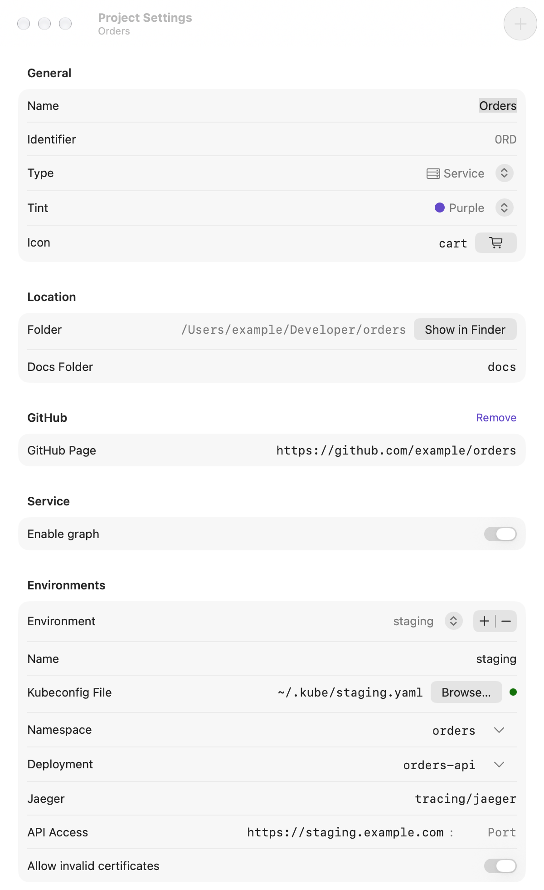
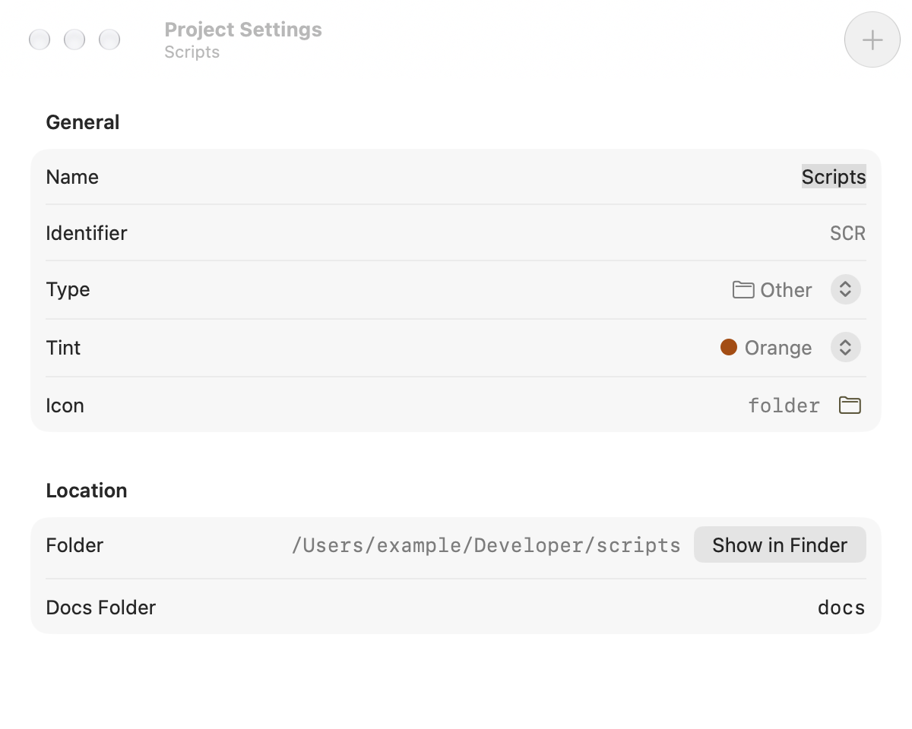
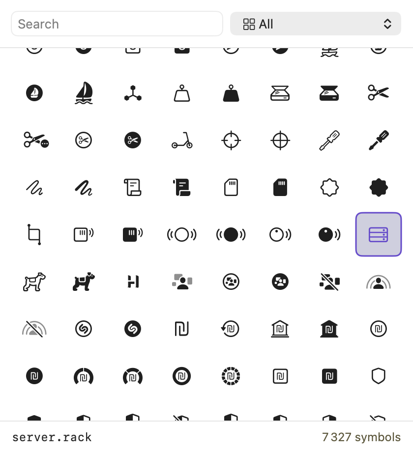
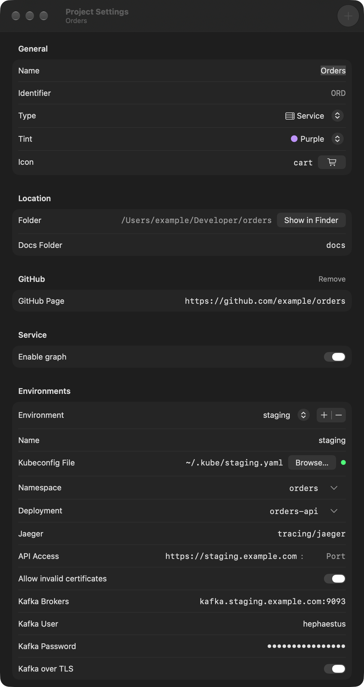

# Project Settings

The Project Settings window shows and changes one project's settings: its name, type, tint and icon, its
folder and parent, its GitHub page, its graph and its environments. Each field applies on its own, as soon as
it changes; the window has no Save or Cancel button and never holds unsaved changes. It applies the rules of
[Data › Changes](../data.md#changes), and every change writes the project's `.hephaestus/project.yml`.

A sub project takes every value it leaves empty from its parent, field by field: an empty field shows the
parent's value greyed, as its placeholder, and typing replaces it ([Data › Resolution](../data.md#resolution)).
The GitHub, Service and Environments sections show when the project's type uses them or the project sets a
value of its own in them; **`+`** in the toolbar adds the others, whatever the project's type, and **Remove**
takes away those the type doesn't use.

*Orders, a service, with its staging environment selected: kubectl reaches the cluster (the green dot), and
the namespace and deployment fields offer the cluster's names. 600 × 980 points, Light Mode.*

## Opening it

| Way | What happens |
| --- | --- |
| **File ▸ Project Settings…** (⇧⌘,) | Opens the key window's project's settings: the selection of the Projects window, or a tool window's project. Disabled without one. |
| **More ▸ Project Settings…** in the Projects window | Opens the selected project's settings. |
| `.projectSettings(id)` route | Brings forward the window already showing the project's settings, un-minimized, or opens one. |

There is one window per project ([Navigation › Window reuse](navigation.md#window-reuse)): opening the settings
of a project whose settings show already brings that window forward. Default size 600 × 720 pt; at least
420 × 420 pt. The title is **Project Settings**, the subtitle the project's name. Windows don't open at
launch; macOS restores those open at quit.

## Anatomy

A grouped form (`Form`, `.formStyle(.grouped)`), scrolling vertically, in sections:

| Section | Rows | Shows |
| --- | --- | --- |
| **General** | Name, Identifier, Type, Tint, Icon | Always |
| **Location** | Folder, Parent and its note, Docs Folder | Always; Parent and its note for a sub project only |
| **GitHub** | GitHub Page | When the project has a typed page |
| **Service** | Enable graph, or for a sub project Graph | For a service (`goService`); for any other type when the project sets the graph |
| **Environments** | Environment with `+` and `−`, Name, Kubeconfig File, Namespace, Deployment, Jaeger, API Access, Allow invalid certificates | For a service; for any other type when the project has an environment of its own or a change to an inherited one |

Each of these three also shows once added with `+`. A value that only comes from the parent or from the origin
remote doesn't show a section: it still applies, to the tools as everywhere, and shows greyed in the section's
empty fields once the section is added.

### Adding and removing a section

The toolbar's **`+`** (`plus`, label "Add Settings", help "Add settings this project doesn’t show yet") is a
menu of the sections the form doesn't show, in this order: **GitHub** (`link`), **Service**
(`point.3.connected.trianglepath.dotted`), **Environments** (`server.rack`). Picking one shows it, empty, at
its place in the form. It stays while the window is open; when the window opens again, it shows if one of its
values is set, and otherwise goes back to the menu. With every section showing, `+` is disabled. A service
shows Service and Environments, so its menu offers GitHub at most.

**Remove** (a borderless, destructive button in `callout` at the trailing edge of the section's header, help
"Remove these settings from the project") shows on every one of the three sections the project's type doesn't
use: GitHub always, Service and Environments for any type but Service. When the section holds values of the
project's own, a confirmation asks first, titled "Remove the <GitHub | Service | Environments> settings?", with
**Remove** (destructive) and Cancel:

| Section | Message | What Remove deletes, in one change |
| --- | --- | --- |
| GitHub | "The GitHub page typed for “<name>” is removed. A page from its parent or its origin remote still applies." | `githubPage` |
| Service | "The graph setting of “<name>” is removed: its parent’s applies, else the graph is off." | `graphEnabled` |
| Environments | "The environments of “<name>” and its changes to inherited ones are removed. Its parent’s environments still apply." | `environments` and `environmentOverrides` (a chosen environment the project no longer has is forgotten) |

Then the section leaves the form and returns to the `+` menu. A section without values of the project's own
leaves at once. When the change fails, the section stays, with the message under its first row.

*Scripts, of type Other, with nothing set: only General and Location show, and `+` in the toolbar offers
GitHub, Service and Environments.*

## Fields

Text fields apply on Return and when they lose the keyboard focus, only when their value differs from the
stored one; a value that breaks its rule shows its message in red under the row and isn't applied, and so does
a change that fails. Pickers, toggles and buttons apply at once. The fields fill with the stored values when
the form appears, also when the window opened before the projects loaded (a window macOS restores at launch);
until then a text field applies nothing. A change made elsewhere (another window, the file changed outside the
app) shows in every field but the one being edited.

| Row | Control | Value | Rule and message |
| --- | --- | --- | --- |
| **Name** | Text field | `name` | One line, 1–100 characters once trimmed: "Enter a name of 1 to 100 characters." |
| **Identifier** | Read-only text, monospaced, selectable | `id` | Help: "The identifier is set at creation and cannot be changed." |
| **Type** | Pop-up: Service, App, Library, Other, each with its symbol | `type` | Changing it keeps every setting; it decides the project's tools, and which sections show without `+`. |
| **Tint** | Pop-up: Purple, Pink, Cyan, Green, Orange, each with a dot of its color: a 12-point circle drawn into an image that isn't a template (`TintSwatch`), since a menu draws symbols as templates in its own single color | `color`, written as the tint's name (`accent`, `accentSecondary`, `info`, `success`, `warning`) | A `#RRGGBB` color shows as the nearest tint until a tint is picked. |
| **Icon** | Text field, monospaced, the kind's symbol as placeholder, with symbol suggestions; then a button showing the icon (see [Choosing an icon](#choosing-an-icon)) | `icon` | An SF Symbol of this Mac: "<name> is not an SF Symbol of this Mac."; empty removes the icon. |
| **Folder** | The path, monospaced, middle-truncated, selectable, and **Show in Finder** | The project's folder | — |
| **Parent** | `<name> (<ID>)` | The parent | Sub projects only. Note under it: "Settings left empty take the values of “<parent>”, shown in grey." |
| **Docs Folder** | Text field, monospaced, placeholder `docs` | `docsPath` | A relative path, not `.hephaestus` or inside it: "Enter a folder path inside the project, for example docs." |
| **GitHub Page** | Text field, monospaced; placeholder: the page an empty field gives (`defaultGithubPage`: the nearest ancestor's typed page, else the origin's of the project or its nearest ancestor), else `https://github.com/owner/name` | `githubPage` | `https://github.com/<owner>/<name>`, trimmed, a trailing `/` removed: "Enter a GitHub page, for example https://github.com/owner/name."; empty removes it, and the placeholder's page applies. |
| **Enable graph** | Toggle, top-level projects | `graphEnabled` | Shows the graph as it applies. On writes `true`; off removes the key, which is off. While on, the project overview shows the Service Map's graph ([Projects › Graph](projects.md#graph)). |
| **Graph** | Pop-up, sub projects: "Same as “<parent>”: On" (or ": Off", the parent's graph as it applies), a separator, **On**, **Off** | `graphEnabled` | The first item removes the key, so the parent's graph applies; On and Off write `true` and `false`. |

## Choosing an icon

*The symbol picker: a search field and a category menu above the system's symbols, the selected one highlighted;
the name of the symbol under the pointer below. 420 × 460 points.*

- **Suggestions.** As the name is typed, a menu under the field lists up to 12 symbols that match it, each with
  its symbol, best first: the name itself, names starting with the text, names with a part starting with it,
  names containing it, then names with a keyword starting with it (AZDesign's `symbolSuggestions(for:)`).
  Nothing shows while the field is empty or holds a whole symbol name. Picking one puts its name in the field,
  which then applies like typed text: on Return or when the field loses the focus.
- **The button** after the field shows the icon (the kind's symbol while the field is empty or names no
  symbol), with the help "Choose Icon…". It opens AZDesign's `SymbolPicker` in a popover, 420 × 460 points,
  arrow at the bottom, on the project's icon (the kind's symbol when it has none). The picker searches the
  system's symbols by name and keyword, and shows a category (All, What’s New, Draw… Math); clicking a symbol
  closes the popover and applies it at once.
- On a system without the list of SF Symbols the picker says "No Symbols", and a name can still be typed.

## Environments

*Worker, a service, inherits Orders' environments and graph: on staging, its own deployment shows, and the
other fields show Orders' values greyed. It inherits Orders' GitHub page too; without a page of its own, its
GitHub section is in `+`.*

- **Environment**: a pop-up of the environments as they apply, the inherited ones first, then the project's
  own. It opens on the project's current environment; picking another one shows its values and doesn't change
  the current environment. Before it switches, the fields that hold a value not applied yet apply to the
  environment they showed. Disabled without environments; then the footer says "No environment yet. Add one
  with +." and the rows under the pop-up are hidden.
- **`+` and `−`** are one `ControlGroup` after the pop-up, icons only, at its natural size: one control of
  one height, as macOS draws an add and remove pair.
- **`+`** (help "Add Environment") adds an environment of the project's own named "New Environment", or the
  first free "New Environment 2", "New Environment 3"…, and selects it.
- **`−`** (help "Remove Environment") removes the selected environment at once; disabled for an inherited one.
  The first environment is selected after.
- **Name**: one line, 1–100 characters: "Enter a name of 1 to 100 characters."; no other environment, inherited
  ones included, has it: "An environment named “<name>” already exists." A renamed environment stays
  selected, and stays current when it was ([Data › Resolution](../data.md#resolution)).
- **Kubeconfig File**: a text field, monospaced, placeholder `~/.kube/config`, then **Browse…** (a file panel
  starting in `~/.kube`, hidden files shown) and the connection dot. An absolute path or one starting with
  `~/`: "Enter an absolute path or a path starting with ~/."; empty removes it.
- **The connection dot** shows while the environment has a kubeconfig file: a spinner while kubectl lists the
  cluster's namespaces with that file (and its current context), then a green dot ("kubectl reaches the
  cluster"), or a red one with kubectl's message under the row. Without kubectl the message is "kubectl
  wasn’t found in your login shell’s PATH." It checks again when another environment, kubeconfig file or
  namespace is chosen.
- **Namespace** and **Deployment**: text fields, monospaced, each with a `chevron.down` menu of suggestions:
  the cluster's namespaces, and the deployments of the environment's namespace (or of the context's), read
  once the dot is green. Any name can be typed; a picked name applies at once.
- **Jaeger**: text field, monospaced, placeholder `jaeger/jaeger`: `<namespace>/<name>`: "Enter a Service as
  <namespace>/<name>, for example jaeger/jaeger."
- **API Access**: the URL field, a `:`, and the port field (64 pt wide, placeholder "Port"). URL: an absolute
  `http` or `https` URL: "Enter an http or https URL."; port: 1–65535: "Enter a port from 1 to 65535.";
  empty removes either.
- **Allow invalid certificates**: toggle, applied at once.
- **Inherited environments.** A sub project's pop-up lists its parent's environments first, whatever the
  two projects' types. While one is selected, a note says "Inherited from “<parent>”: fields left empty keep
  its values, shown in grey.", `−` is disabled and Name is disabled with the parent's name. Kubeconfig File,
  Namespace, Deployment, Jaeger, URL and Port show the project's change, empty when it has none, with the
  parent's values as placeholders. They write `environmentOverrides`: an empty field gives back the parent's
  value, and a change that sets nothing is removed. The certificates toggle shows the value that applies and
  is stored only while it differs from the parent's. The dot and the suggestions use the kubeconfig file and
  namespace that apply.
- The Argo CD application has no field; a stored one is kept by every change.

## States

| State | When | What shows |
| --- | --- | --- |
| **Service** | The project is a service. | Every section; GitHub when the project has a typed page, else in `+`. |
| **Sub project** | The project has a parent. | Parent and its note; in the sections that show, its parent's values greyed in its empty fields; the Graph pop-up; the inherited environments first. |
| **App, library or other** | Not a service. | General and Location; GitHub, Service and Environments when the project sets values in them, each with Remove, else in `+`. |
| **Nothing set** | Not a service, and the project sets no page, graph or environment. | General and Location only; `+` offers the three others. |
| **No environments** | A service without environments. | The pop-up and `−` disabled, the footer's sentence. |
| **Cluster reached / not reached** | The selected environment has a kubeconfig file. | The green or red dot; the suggestions, or kubectl's message. |
| **Project not found** | The project left the list (removed, or its file deleted). | `ContentUnavailableView`: `folder.badge.questionmark`, "Project Not Found", "The project is no longer in the list." |

*An app with a typed GitHub page, which Remove can take away; Service and Environments are in `+`.*

*The dark appearance.*

## Layouts

The form is a single column that fills the window at every width, down to 420 pt: rows keep their label on the
left and their control on the right, and long paths truncate in the middle. It has no iPad or iPhone layout
of its own: a form already reads as one column.

## Accessibility

| Element | Identifier |
| --- | --- |
| The form | `projectSettings` |
| Rows | `projectSettings.name`, `.identifier`, `.type`, `.tint`, `.icon`, `.icon.choose`, `.folder`, `.showInFinder`, `.parent`, `.parent.note`, `.docsPath`, `.githubPage`, `.graph` |
| `+` | `projectSettings.addSection`; its items `projectSettings.addSection.github`, `.service`, `.environments` |
| Remove | `projectSettings.removeSection.github`, `.service`, `.environments`; the confirmation's button `projectSettings.removeSection.confirm` |
| Environments | `projectSettings.environment`, `.environment.add`, `.environment.remove`, `.environment.inherited`, `.environmentName`, `.kubeconfig`, `.namespace`, `.deployment`, `.jaeger`, `.url`, `.port`, `.certificates` |
| Messages | `projectSettings.<row>.message`, `projectSettings.connection.message` |
| Not found | `projectSettings.notFound` |

The connection dot is labeled "Checking the cluster", "kubectl reaches the cluster" or "kubectl can’t reach
the cluster". The icon button's VoiceOver label is "Choose Icon…". The picker's identifiers start with
`projectSettings.icon.picker` (`.search`, `.category`, `.symbol.<name>`).

## Previews

`ProjectSettingsWindow` on a fixed snapshot whose kubectl answers from fixed lists: "Service", "Service,
Dark", "Sub Project, Inherited", "App", "Other, Nothing Set", "Not Found", "Largest Text".

## Open issues

None.
