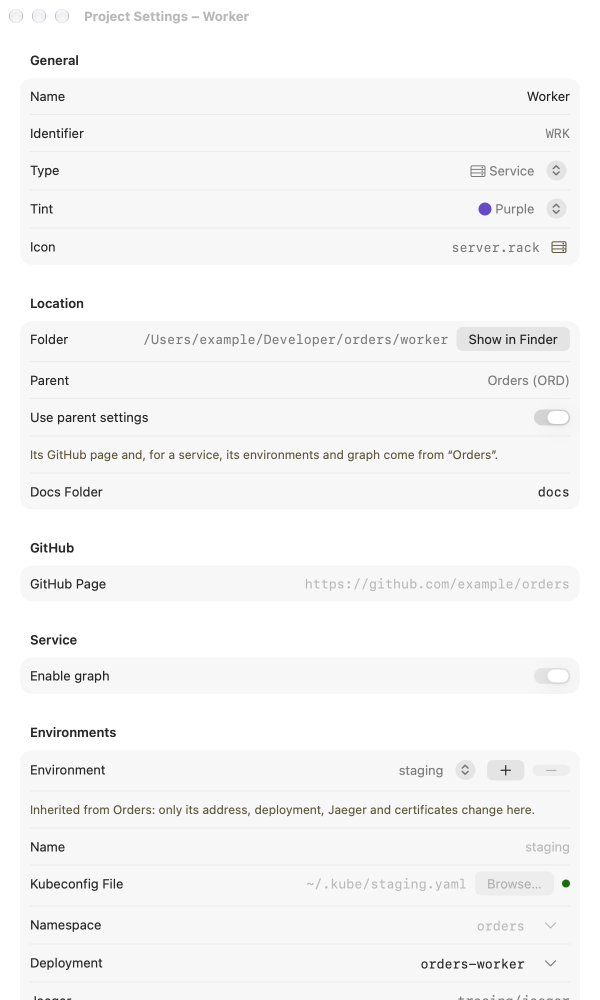
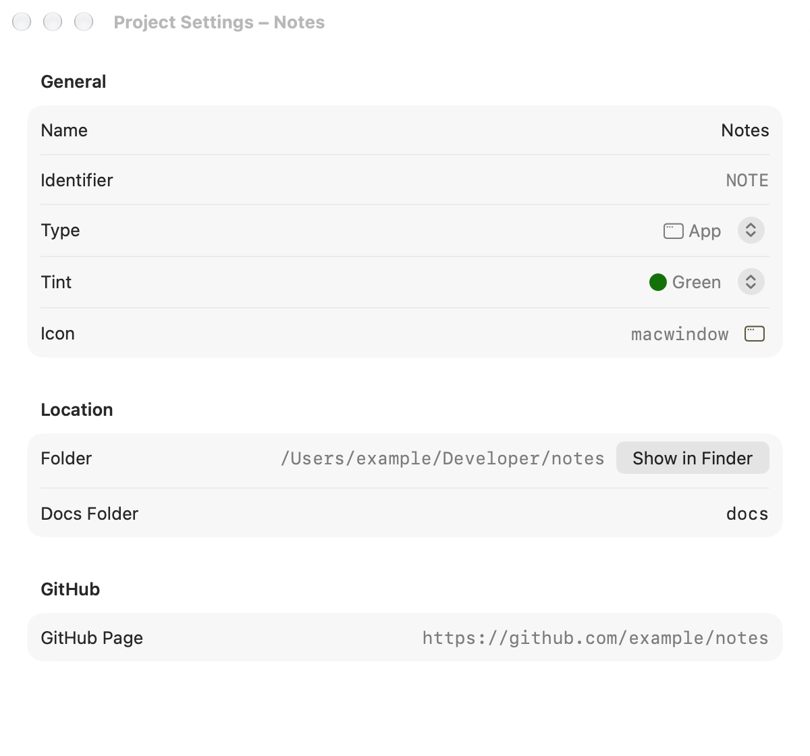

# Project Settings

The Project Settings window shows and changes one project's settings: its name, type, tint and icon, its
folder and parent, its GitHub page, and a service's graph and environments. Each field applies on its own, as
soon as it changes; the window has no Save or Cancel button and never holds unsaved changes. The rules are
HephaestusV2's ([Data › Changes](../data.md#changes)), and every change writes the project's
`.hephaestus/project.yml`.

*Orders, a service, with its staging environment selected: kubectl reaches the cluster (the green dot), and
the namespace and deployment fields offer the cluster's names. 600 × 980 points, Light Mode.*

## Opening it

| Way | What happens |
| --- | --- |
| **File ▸ Project Settings…** (⇧⌘,) | Opens the key window's project's settings: the selection of the Projects window, or a tool window's project. Disabled without one. |
| **More ▸ Project Settings…** in the Projects window | Opens the selected project's settings. |
| `.projectSettings(id)` route | Brings forward the window already showing the project's settings, un-minimized, or opens one. |

There is one window per project ([Navigation › Window reuse](navigation.md#window-reuse)): opening the settings
of a project whose settings show already brings that window forward. Default size 600 × 720 pt; at least
420 × 420 pt. The title is **Project Settings**, the subtitle the project's name. Windows don't open at
launch; macOS restores those open at quit.

## Anatomy

A grouped form (`Form`, `.formStyle(.grouped)`), scrolling vertically, in sections:

| Section | Rows | Shows for |
| --- | --- | --- |
| **General** | Name, Identifier, Type, Tint, Icon | Every project |
| **Location** | Folder, Parent, Use parent settings and its note, Docs Folder | Parent rows for a sub project only |
| **GitHub** | GitHub Page | Every project |
| **Service** | Enable graph | A service (`goService`) |
| **Environments** | Environment with `+` and `−`, Name, Kubeconfig File, Namespace, Deployment, Jaeger, API Access, Allow invalid certificates | A service |

## Fields

Text fields apply on Return and when they lose the keyboard focus, only when their value differs from the
stored one; a value that breaks its rule shows its message in red under the row and isn't applied, and so does
a change that fails. Pickers, toggles and buttons apply at once. A change made elsewhere (another window, the
file changed outside the app) shows in every field but the one being edited.

| Row | Control | Value | Rule and message |
| --- | --- | --- | --- |
| **Name** | Text field | `name` | One line, 1–100 characters once trimmed: "Enter a name of 1 to 100 characters." |
| **Identifier** | Read-only text, monospaced, selectable | `id` | Help: "The identifier is set at creation and cannot be changed." |
| **Type** | Pop-up: Service, App, Library, Other, each with its symbol | `type` | Changing it keeps the environments in the file; only a service shows them. |
| **Tint** | Pop-up: Purple, Pink, Cyan, Green, Orange, each with a dot of its color | `color`, written as the tint's name (`accent`, `accentSecondary`, `info`, `success`, `warning`) | A V2 color shows as the nearest tint until a tint is picked. |
| **Icon** | Text field, monospaced, then the symbol it names; the kind's symbol as placeholder | `icon` | An SF Symbol of this Mac: "<name> is not an SF Symbol of this Mac."; empty removes the icon. |
| **Folder** | The path, monospaced, middle-truncated, selectable, and **Show in Finder** | The project's folder | — |
| **Parent** | `<name> (<ID>)` | The parent | Sub projects only. |
| **Use parent settings** | Toggle | `useParentSettings` | Sub projects only. Note under it: "Its GitHub page and, for a service, its environments and graph come from “<parent>”." |
| **Docs Folder** | Text field, monospaced, placeholder `docs` | `docsPath` | A relative path, not `.hephaestus` or inside it: "Enter a folder path inside the project, for example docs." |
| **GitHub Page** | Text field, monospaced; placeholder: the origin's page, else `https://github.com/owner/name` | `githubPage` | `https://github.com/<owner>/<name>`, trimmed, a trailing `/` removed: "Enter a GitHub page, for example https://github.com/owner/name."; empty removes it. While the project uses its parent's settings, the field is disabled and shows the parent's page. |
| **Enable graph** | Toggle | `graphEnabled` | Shows the graph as it applies; disabled, with the parent's value, while the project uses its parent's settings. |

## Environments

*Worker inherits Orders' environments: on staging, only its address, deployment, Jaeger and certificates
change, the parent's values as placeholders.*

- **Environment**: a pop-up of the environments as they apply, the inherited ones first, then the project's
  own. It opens on the project's current environment; picking another one shows its values and doesn't change
  the current environment. Before it switches, the fields that hold a value not applied yet apply to the
  environment they showed. Disabled without environments; then the footer says "No environment yet. Add one
  with +." and the rows under the pop-up are hidden.
- **`+`** (help "Add Environment") adds an environment of the project's own named "New Environment", or the
  first free "New Environment 2", "New Environment 3"…, and selects it.
- **`−`** (help "Remove Environment") removes the selected environment at once; disabled for an inherited one.
  The first environment is selected after.
- **Name**: one line, 1–100 characters: "Enter a name of 1 to 100 characters."; no other environment, inherited
  ones included, has it: "An environment named “<name>” already exists." A renamed environment stays
  selected, and stays current when it was ([Data › Resolution](../data.md#resolution)).
- **Kubeconfig File**: a text field, monospaced, placeholder `~/.kube/config`, then **Browse…** (a file panel
  starting in `~/.kube`, hidden files shown) and the connection dot. An absolute path or one starting with
  `~/`: "Enter an absolute path or a path starting with ~/."; empty removes it.
- **The connection dot** shows while the environment has a kubeconfig file: a spinner while kubectl lists the
  cluster's namespaces with that file (and its current context), then a green dot ("kubectl reaches the
  cluster"), or a red one with kubectl's message under the row. Without kubectl the message is "kubectl
  wasn’t found in your login shell’s PATH." It checks again when another environment, kubeconfig file or
  namespace is chosen.
- **Namespace** and **Deployment**: text fields, monospaced, each with a `chevron.down` menu of suggestions:
  the cluster's namespaces, and the deployments of the environment's namespace (or of the context's), read
  once the dot is green. Any name can be typed; a picked name applies at once.
- **Jaeger**: text field, monospaced, placeholder `jaeger/jaeger`: `<namespace>/<name>`: "Enter a Service as
  <namespace>/<name>, for example jaeger/jaeger."
- **API Access**: the URL field, a `:`, and the port field (64 pt wide, placeholder "Port"). URL: an absolute
  `http` or `https` URL: "Enter an http or https URL."; port: 1–65535: "Enter a port from 1 to 65535.";
  empty removes either.
- **Allow invalid certificates**: toggle, applied at once.
- **Inherited environments.** While an inherited environment is selected, a note says "Inherited from
  <parent>: only its address, deployment, Jaeger and certificates change here.", `−` is disabled, Name,
  Kubeconfig File, Namespace and **Browse…** are disabled with the parent's values, and Deployment, Jaeger,
  URL and Port show the project's change, empty when it has none, with the parent's values as placeholders.
  They write `environmentOverrides`: an empty field gives back the parent's value, and a change that sets
  nothing is removed. The certificates toggle shows the value that applies and is stored only while it
  differs from the parent's. The dot and the suggestions use the parent's kubeconfig file and namespace.
- The Argo CD application has no field; a stored one is kept by every change.

## States

| State | When | What shows |
| --- | --- | --- |
| **Service** | The project is a service. | Every section. |
| **Sub project** | The project has a parent. | Parent, Use parent settings and its note; while on, the GitHub page and the graph are the parent's, disabled, and the inherited environments come first. |
| **App, library or other** | Not a service. | General, Location and GitHub only. |
| **No environments** | A service without environments. | The pop-up and `−` disabled, the footer's sentence. |
| **Cluster reached / not reached** | The selected environment has a kubeconfig file. | The green or red dot; the suggestions, or kubectl's message. |
| **Project not found** | The project left the list (removed, or its file deleted). | `ContentUnavailableView`: `folder.badge.questionmark`, "Project Not Found", "The project is no longer in the list." |

*An app: no Service or Environments section.*

*The dark appearance.*

## Layouts

The form is a single column that fills the window at every width, down to 420 pt: rows keep their label on the
left and their control on the right, and long paths truncate in the middle. It has no iPad or iPhone layout
of its own: a form already reads as one column.

## Accessibility

| Element | Identifier |
| --- | --- |
| The form | `projectSettings` |
| Rows | `projectSettings.name`, `.identifier`, `.type`, `.tint`, `.icon`, `.folder`, `.showInFinder`, `.parent`, `.useParentSettings`, `.docsPath`, `.githubPage`, `.graph` |
| Environments | `projectSettings.environment`, `.environment.add`, `.environment.remove`, `.environment.inherited`, `.environmentName`, `.kubeconfig`, `.namespace`, `.deployment`, `.jaeger`, `.url`, `.port`, `.certificates` |
| Messages | `projectSettings.<row>.message`, `projectSettings.connection.message` |
| Not found | `projectSettings.notFound` |

The connection dot is labeled "Checking the cluster", "kubectl reaches the cluster" or "kubectl can’t reach
the cluster"; the icon's symbol is hidden from VoiceOver.

## Previews

`ProjectSettingsWindow` on a fixed snapshot whose kubectl answers from fixed lists: "Service", "Service,
Dark", "Sub Project, Inherited", "App", "Not Found", "Largest Text".

## Open issues

None.
