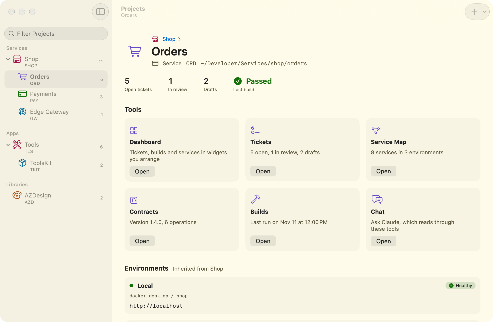
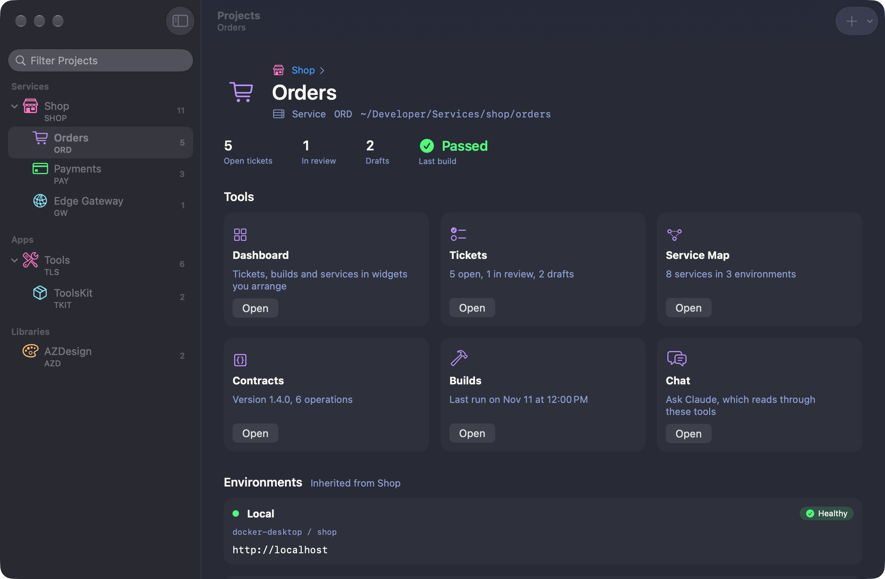
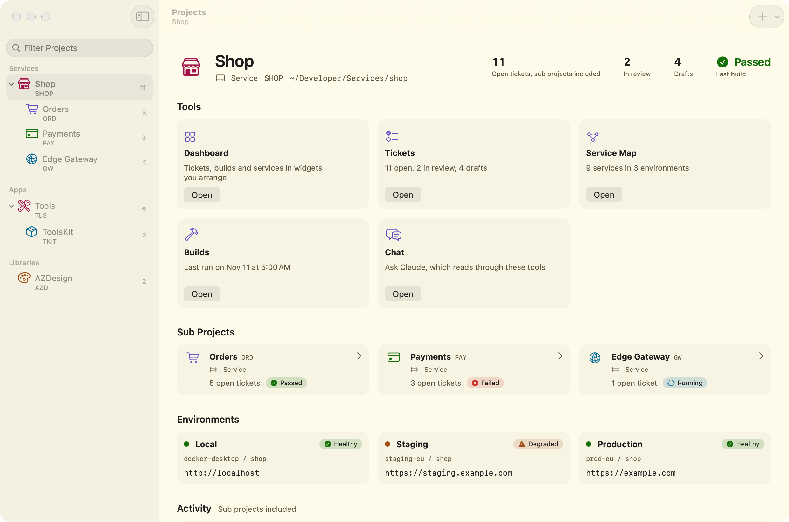
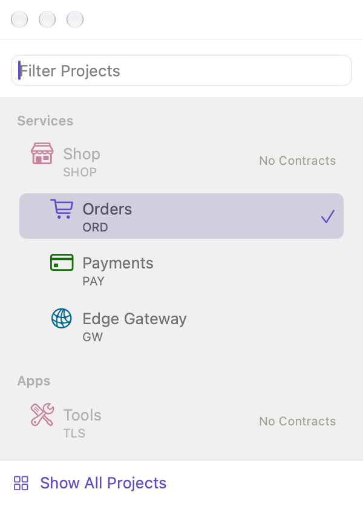
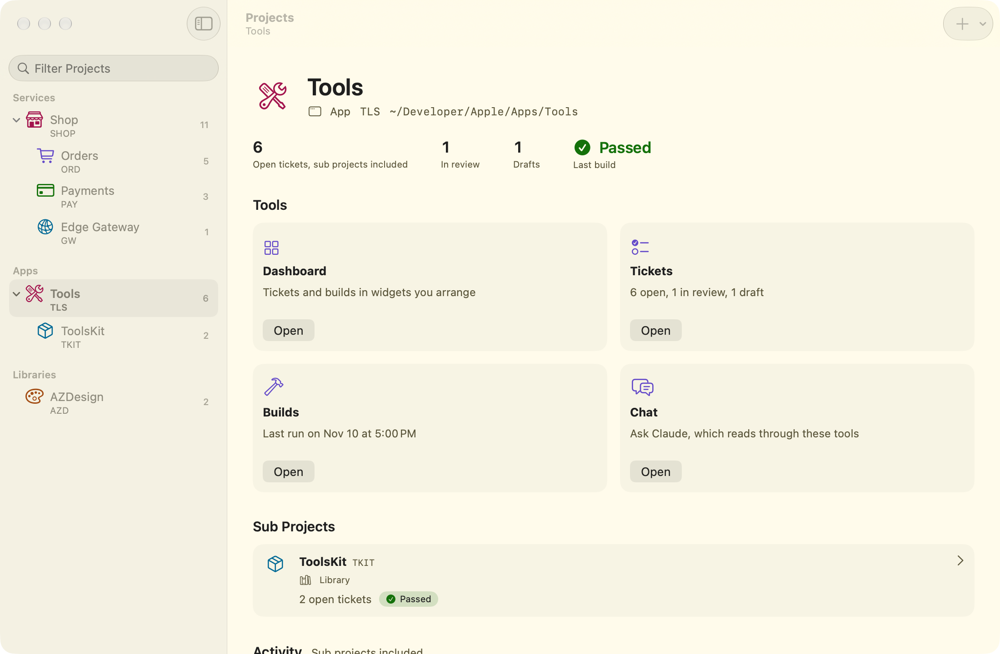
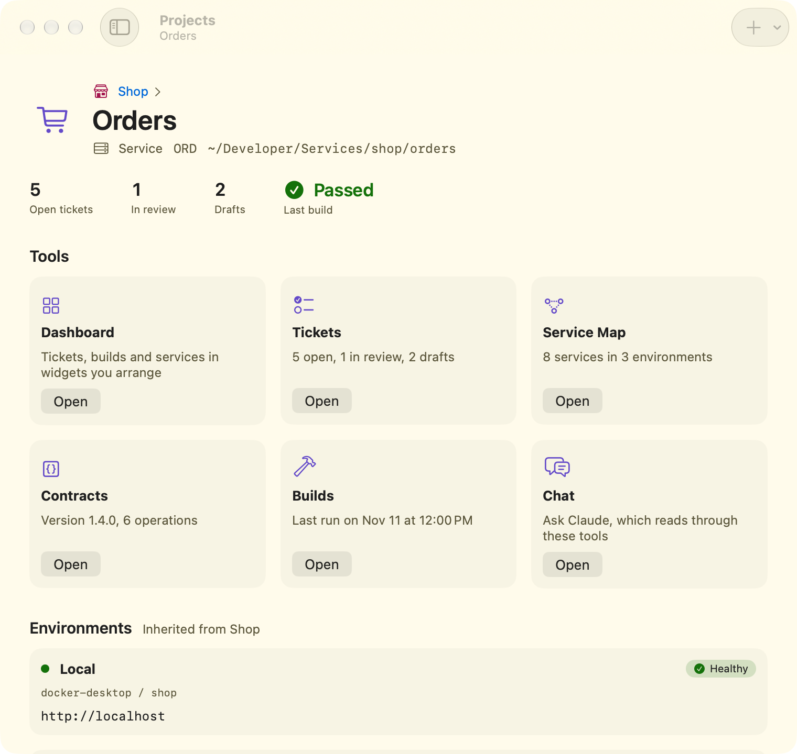
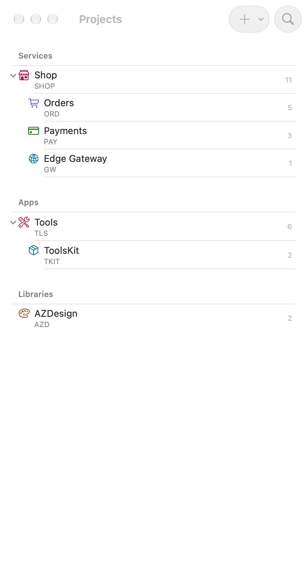

# Projects

The Projects window is the project selector. You pick a project in a tree of projects and sub projects,
see where it stands, and open its tools. It is a picker, not a hub: each tool opens in its own window. The
overview of a project shows its path, its ticket and build figures, a tile per tool, its sub projects, its
environments and its recent activity. The same projects are listed in the **project switcher**, the
popover in every tool window's toolbar, which is described at the end of this page.

*The Projects window on Orders, a sub project of Shop: the sidebar tree, the path, the figures, six tool tiles and the environments.*

## Opening it

| Way | What happens |
| --- | --- |
| **Launch** | The window opens at launch with Orders (`ORD`), the first sample project, selected. Default size 1040 × 680 pt. |
| **Window › Projects** (⌘0) | Brings the open Projects window forward, un-minimized, or opens it. The selection doesn't change. |
| **Show All Projects** in the project switcher | Opens the Projects window with the tool window's project selected. |
| **Show All Projects** in the menu bar panel | Opens the Projects window with the highlighted project selected. See [Menu bar](menu-bar.md). |
| A project in the menu bar panel | Opens the Projects window with that project selected, but only when no other window already shows the project. See [Menu bar](menu-bar.md). |
| **Project** link in Virtual Machines | A machine's project link (`machines.detail.project`) opens the Projects window with that project selected. |

The window is single. Routes reach it in two ways (see [Navigation › Routes](navigation.md#routes)):

- `.project(id)` selects the project, then brings the open Projects window forward or opens it.
- `.projectWindow(id)` brings forward the frontmost window that already shows the project, and falls back
  to `.project(id)` when none does.

Neither route carries a focus. Opening or bringing the window forward also activates the app.

## Anatomy

| Region | Contents |
| --- | --- |
| **Toolbar** | The system's sidebar button, the title **Projects** with the selected project's name as subtitle, and the **Add Project** menu. |
| **Sidebar** | The **Filter Projects** field, then the projects by kind (Services, Apps, Libraries), each top-level project with its sub projects under a disclosure triangle. |
| **Overview** | The selected project: header and figures, **Tools**, **Sub Projects**, **Environments** and **Activity**, top to bottom. |

The window is a split view. The sidebar sits on the left, 220 to 320 pt wide (250 pt ideal). The overview
fills the rest and scrolls vertically on the `canvas` color. It has 28 pt of padding, and its sections are
28 pt apart.

*The same window in the dark appearance.*

## Toolbar

| Item | Control | Symbol | Shortcut | Behavior | Layouts |
| --- | --- | --- | --- | --- | --- |
| Sidebar button | The split view's own button | System | None | Shows or hides the sidebar. Folded at first in the iPad layout. | Mac, iPad |
| **Projects** | Window title and subtitle | None | None | The subtitle is the selected project's name. | Mac, iPad, iPhone |
| **Add Project** | Pull-down menu, help "Add Project" | `plus` | ⇧⌘N for **New Project…** (File ▸ New Project…) | **New Project…**: Not wired yet. **New Sub Project…**: Not wired yet; an action of its own, which gets the selected project as the parent; disabled when no project is selected. **Add Existing Folder…**: Not wired yet. | Mac, iPad, iPhone |
| **Filter Projects** | Search field at the top of the sidebar; in the toolbar of the projects' page on iPhone | System | None | Filters the projects (see below). | Mac, iPad (sidebar), iPhone |

The Projects window has no chat panel and no chat panel button. While it is the key window, **View › Show
Chat Panel** is disabled.

## Sidebar

**Sections.** One section per kind, in this order: **Services**, **Apps**, **Libraries**. A section shows
only when it has a project. Each section lists its top-level projects in their sample order.

**Sub projects.** A sub project is listed under its parent, behind a disclosure triangle, at any depth. It
stays in its top-level project's section whatever its own kind: ToolsKit, a library, is listed under Tools
in **Apps**. Every triangle starts unfolded. Folding lasts while the window is open and isn't saved.
Selecting a sub project from outside the sidebar (a path link, a sub project card, or a route such as
**Show All Projects**) unfolds its parents, so its row shows.

**Rows.** Each row shows:

- the project's icon in its tint (`ProjectIcon`);
- its name;
- its identifier under the name, in `caption` and `textSecondary`;
- a badge with the number of open tickets of the project and all its sub projects, as its Tickets window
  lists them (the user's choice).

**Selection.** A click selects the project and shows its overview. The sidebar is a selectable list, so the
arrow keys move the selection. While the Projects window is key, the Window menu's ⌘1–⌘6 open the selected
project's tools ([Navigation › Menus and shortcuts](navigation.md#menus-and-shortcuts)).

**Filtering.** The **Filter Projects** field matches a project's name or identifier, ignoring case and
diacritics (`localizedStandardContains`). Spaces around the text are ignored, so spaces alone don't
filter. While it holds text:

- the sidebar lists the matches alone, flat, without triangles or indentation;
- each match sits in its own kind's section, so ToolsKit then shows under **Libraries**;
- the selection and the overview don't change, even when the selected project doesn't match;
- when nothing matches, the sidebar shows "No Matching Projects" (`magnifyingglass`) and the sentence
  "No project’s name or identifier contains “<text>”."

There are no context menus and no drag and drop in the sidebar.

## Overview

### Header and figures

**Header.** From left to right:

- **Icon.** The project's icon in `largeTitle`, at least 44 pt wide.
- **Path.** For a sub project, a line of links above the name: each ancestor's icon and name, top-level
  project first, each followed by `chevron.forward`. A link selects that ancestor in the sidebar.
- **Name.** In `largeTitle` semibold.
- **Details.** One line in `callout` and `textSecondary`: the kind with its symbol (`server.rack` Service,
  `macwindow` App, `books.vertical` Library), the identifier, and the folder path. The identifier and path
  are monospaced. The path truncates in the middle.

**Figures.** Four figures (`Figure`, see [Components › Figure](components.md#figure)), in one row when it
fits, otherwise two by two, otherwise one under the other:

| Figure | Value | Caption |
| --- | --- | --- |
| Open tickets | Open tickets of the project and all its sub projects | "Open tickets", or "Open tickets, sub projects included" when the project has sub projects |
| In review | Tickets in review, sub projects included | "In review" |
| Drafts | Draft tickets, sub projects included | "Drafts" |
| Last build | The project's own last build: **Passed** `checkmark.circle.fill` in `success`, **Failed** `xmark.circle.fill` in `danger`, or **Running** `arrow.triangle.2.circlepath` in `info` | "Last build" |

A parent's ticket figures include its sub projects' tickets (the user's choice). The last build is the
project's own.

### Tools

One tile per tool of the project, in menu order. A service with a contract has six tools. A service
without one has five, with no Contracts. An app or a library has four: Dashboard, Tickets, Builds and Chat
([Navigation › Tools per project](navigation.md#tools-per-project)).

Each tile is a group box with:

- the tool's symbol in `accent`, in a row 26 pt high that follows Dynamic Type (`@ScaledMetric`), so the
  titles of a row line up;
- the tool's name in `headline`;
- a status line in `callout` and `textSecondary`, which always reserves two lines;
- an **Open** button, which VoiceOver names after the tool, such as "Open Tickets".

**Open** opens the tool's window for this project (`.tool(tool, project:)`, without a focus). If a window
already shows that tool for this project, that window comes forward, un-minimized, instead of a second one
opening (the user's choice).

Counts in the status lines agree with their number ("1 environment", "2 environments").

| Tool | Symbol | Status line |
| --- | --- | --- |
| Dashboard | `square.grid.2x2` | "Tickets, builds and services in widgets you arrange" for a service with a Service Map and environments; otherwise "Tickets and builds in widgets you arrange" |
| Tickets | `checklist` | "5 open, 1 in review, 2 drafts": the figures above, sub projects included |
| Service Map | `point.3.connected.trianglepath.dotted` | "8 services in 3 environments": the environments are those the **Environments** section lists |
| Contracts | `curlybraces.square` | "Version 1.4.0, 6 operations". The tile shows only for a service with a contract, so its other text, "No contract yet", doesn't appear. |
| Builds | `hammer` | "Last run on 11 Nov at 12:00": day, short month, hour and minute |
| Chat | `bubble.left.and.text.bubble.right` | "Ask Claude, which reads through these tools" |

### Sub Projects

*Shop, a parent project: ticket figures with its sub projects included, five tools in three plus two columns, its three sub projects and its environments.*

The section shows when the project has sub projects. It lists the **direct** sub projects only; theirs show
in their own overview.

A sub project's folder lies inside its parent's folder. It has its own identifier and tickets, and sub
projects may nest. These rules follow HephaestusV2 (the user's choice).

Each card is one button showing:

- the sub project's icon in `title2`;
- its name in `headline` and its identifier, monospaced, in `caption`;
- its kind with the kind's symbol, and "N sub projects" when it has any, counted at every depth;
- "N open tickets", its sub projects included;
- its last build as a badge ([Components › Badge](components.md#badge));
- `chevron.forward` at the trailing edge.

Clicking a card selects that sub project in the sidebar and shows its overview.

### Environments

The section lists the environments of the project whose settings apply, and shows when there are any.
Only services have environments. Each card shows:

- a status dot in the health's color, and the environment's name in `headline`;
- a health badge at the trailing edge: **Healthy** `checkmark.circle.fill` in `success`, **Degraded**
  `exclamationmark.triangle.fill` in `warning`, or **Down** `xmark.octagon.fill` in `danger`;
- the cluster and the namespace, as `cluster / namespace`, monospaced, in `caption`;
- the URL, monospaced, on one line that truncates in the middle. You can select and copy it.

**Inherited from <parent>.** A sub project can take its parent's settings, its environments among them.
This is V2's **Use parent settings**, on by default (`usesParentSettings`). When a sub project does, the
section lists its parent's environments, and the title carries the note "Inherited from Shop" (the user's
choice). The parent may itself use its own parent's settings: the environments, and the name in the note,
come from the first project up the tree that has settings of its own (`ProjectTree.settingsSource(of:)`).
A sub project with settings of its own lists its own environments, without a note.

The tools follow the same rule (the user's choice): the Dashboard, the Service Map and Contracts read the
environments the overview lists, so Orders' Service Map offers Shop's environments, and Orders' requests in
Contracts go to Shop's URLs.

Orders, Payments and Edge Gateway use Shop's settings, so each lists Shop's three environments under
"Inherited from Shop". ToolsKit uses the settings of Tools, an app without environments, so it shows no
section.

### Activity

What happened lately in the project's tools, newest first, at most 40 events. For a project with sub
projects, the list includes their events, and the title carries the note "Sub projects included".

The list sits in one group box, with a divider between events. Each event is a row of:

| Column | Contents |
| --- | --- |
| Project | Only for a project with sub projects: the event's project icon and identifier, in `caption` monospaced. Its help tag is the project's name. |
| Tool | The tool's symbol, colored by tone: `textSecondary`, `info`, `success`, `warning` or `danger`. Its help tag is the tool's name. |
| Event | What happened, on one line, filling the remaining width. |
| Subject | What the event is about, as its tool names it: a ticket, a run number, a version, a service. In `caption` monospaced. |
| Date | Day, short month, hour and minute, aligned to the trailing edge. |

VoiceOver reads each event as one button, such as "Builds: Run started: add backoff to the payments client,
#1288, 11 Nov at 13:54", with the project's name first when the row shows it.

**Clicking an event** opens its tool for the project it happened in, with the event's focus selected
(`.tool(tool, project:, focus:)`). Examples: `1288` for a run, `ORD-142` for a ticket, `service:payments-api`
or `request:req-8f3a` for the Service Map, `cancelOrder` for an operation. Events without a focus open the
tool without a selection. An open window of that tool and project comes forward, with the focus selected
in it, instead of a second window opening (the user's choice).

## Project switcher

*The switcher's popover in a Contracts window on Orders. Projects without Contracts are dimmed and can't be picked.*

The project switcher is the first toolbar item of every tool window, in every layout. It names the
window's project and moves the window to another one. [Components › Project switcher](components.md#project-switcher)
describes it as a component. Below 760 pt the toolbar drops the window's title, and the switcher is what
names the project.

**Label.** The project's icon in its tint and its name, with the toolbar's label padding. Its help tag is
"Switch Project". A click opens a popover below it, and a second click closes it. No shortcut opens it.

**Popover.** 300 × 380 pt at the default text size, larger with a larger text size (`@ScaledMetric`). From
top to bottom:

- a **Filter Projects** field with a rounded border, which has the keyboard focus when the popover opens;
- the projects, in a sidebar-style list;
- a divider;
- **Show All Projects** (`square.grid.2x2`).

Each opening starts afresh: the field is empty and the window's project is highlighted.

**List.** The same tree as the Projects window's sidebar, without triangles. Projects are grouped in
**Services**, **Apps** and **Libraries**. Sub projects are indented 16 pt per level under their parent, in
their top-level project's section. Each row shows the project's icon, name and identifier. At the trailing
edge:

- the current project has a `checkmark` in `accent`;
- a project without the window's tool says "No <Tool>", such as "No Contracts", and is disabled.

**Highlight.** One row is highlighted at a time, as in the menu bar panel
([Menu bar › Keyboard](menu-bar.md#keyboard)). It has the `highlight` background, with concentric corners
of at least 6 pt, and the list scrolls to keep it visible. Disabled rows are never highlighted.

**Filtering.** The field matches names and identifiers, as the sidebar does. While it holds text, the list
shows the matches alone, flat, each in its own kind's section, and the highlight moves to the first match
that can be picked. When nothing matches, the list shows "No Matching Projects" and the sentence "No
project’s name or identifier contains “<text>”."

**Keyboard and pointer:**

| Key | Action |
| --- | --- |
| Typing | Filters the list; the highlight moves to the first match that can be picked. |
| ↓ ↑ | Move the highlight to the next or previous row that can be picked, stopping at the first and last. |
| Return | Picks the highlighted project. Does nothing when no row can be picked. |
| Esc | Closes the popover. |

The row under the pointer becomes the highlighted one, unless it is disabled. A click picks it.

**Picking a project** closes the popover and shows that project in this window:

- The window keeps its place and size. The tool starts afresh, without the old selection or focus.
- Other windows don't change, so two windows of the same tool can show two projects.
- The window registers its new project, so a later route for that project and tool brings this window
  forward ([Navigation › Window reuse](navigation.md#window-reuse)).

**Picking the current project** only closes the popover. The window keeps its tool and its selection, so a
window opened on an item still shows it.

**Show All Projects** closes the popover and opens the Projects window with this window's project selected
(`.project`).

## States

| State | When | What shows |
| --- | --- | --- |
| **Project selected** | A project is selected. | Its overview. |
| **No selection** | Nothing is selected, or the selection names no project. | `ContentUnavailableView`: `folder`, "No Project Selected", "Pick a project to see where it stands and open its tools.", on `canvas`. |
| **Filtering** | The filter holds text. | The matches alone, flat, by their own kind. The overview doesn't change. |
| **No matches** | The filter matches no project. | "No Matching Projects", `magnifyingglass`, "No project’s name or identifier contains “<text>”.", over the empty sidebar. The overview doesn't change. |
| **Parent project** | The project has sub projects. | **Sub Projects** section; "Open tickets, sub projects included"; the activity's note and project column. |
| **Sub project** | The project has a parent. | The path links above the name. When it uses its parent's settings, its parent's environments under "Inherited from <parent>". |
| **App or library** | The project is not a service. | Four tools; the Dashboard tile names tickets and builds only; no **Environments** section. |
| **Service without a contract** | No contract version. | No Contracts tile (Shop). |
| **No activity** | The project and its sub projects have no events. | "Nothing happened in this project yet." in the activity box. |

*Tools, an app project: four tools in two columns, no environments, and ToolsKit as its sub project.*

## Layouts

| Layout | When | What changes |
| --- | --- | --- |
| **Mac** | 900 pt and wider | The sidebar beside the overview. |
| **iPad** | 640 to 899 pt | The sidebar folds behind the sidebar button, as an iPad's split view does when it lacks the room, and the overview fills the window. The button shows it again. |
| **iPhone** | Narrower than 640 pt (compact width) | One pane at a time ([`PhoneStack`](components.md#phone-stack)): the projects, with **Filter Projects** in the toolbar, then the picked project's overview as a page with Back. A window that narrows to this width shows the selected project's overview; one that opens at it starts on the projects. |

The window measures its own size and sets the system's size classes, as every window does
([Foundations › Layout system](foundations.md#layout-system)).

*At 760 pt, an iPad's layout: the sidebar folded behind its button, Orders' overview filling the window.*

*At 420 pt, opened at that width: the projects, with Filter Projects in the toolbar.*

**Minimum size.** The window, the overview and the "No Project Selected" view are at least 390 × 420 pt, the
minimum of a tool window.

**In every layout**, nothing in the overview has a fixed or capped width, and its grids fill the window as it
grows (the user's choice):

- **Header and figures.** They sit side by side when both fit on one line. Otherwise the figures move under
  the header, in one row when it fits, then two by two, then one under the other. Nothing overflows the
  overview.
- **Grids.** The Tools, Sub Projects and Environments grids pick their column count from the overview's
  width. The width is the overview's minus its 28 pt padding on each side, and columns are 14 pt apart.
  - A grid takes as many equal columns as fit, choosing a count that divides its number of items, so no
    row is left half empty.
  - When only one column would divide it, a grid of four or more items takes the count that leaves the
    fewest empty places instead.
- **Activity.** The list takes the full width. The event text takes the room left by the other columns.

| Grid | Minimum column width | Column counts, widest first |
| --- | --- | --- |
| Tools | 220 pt | 6 tools: 6, 3, 2, 1. 5 tools: 5, 3, 2, 1. 4 tools: 4, 2, 1. |
| Sub Projects | 240 pt | 3 sub projects: 3, then 1. |
| Environments | 300 pt | 3 environments: 3, then 1. |

## Accessibility

| Element | Identifier | Label or notes |
| --- | --- | --- |
| **Add Project** menu | `projects.add` | Label and help "Add Project". |
| Its items | `projects.add.newProject`, `projects.add.newSubProject`, `projects.add.existingFolder` | |
| **Filter Projects** field | None | The prompt "Filter Projects". It is the system's search field (`.searchable`), which takes no identifier; UI tests find it as the window's only search field (the user's choice: the system field stays). |
| Sidebar row | `projects.row.<id>` | Name, identifier and badge. The icon is hidden. |
| "No Matching Projects" | `projects.noMatches` | Title and sentence. |
| "No Project Selected" | `projects.noSelection` | Title and sentence. |
| Header | `projects.header` | The name has the header trait. The icon is hidden. |
| Path link | `projects.path.<id>` | The ancestor's name. The chevron is hidden. |
| Figures | `projects.figure.open`, `.inReview`, `.drafts`, `.lastBuild` | Each figure is read as one element, such as "5, Open tickets". The last build is combined too. |
| Section titles | `projects.section.tools`, `.subProjects`, `.environments`, `.activity` | Header trait. A title's note, such as "Inherited from Shop", is `projects.section.<section>.note`. |
| Tool tile | `projects.tool.<tool>` | A container labeled with the tool's name, whose children stay reachable. The symbol is hidden. `<tool>` is `dashboard`, `tickets`, `serviceMap`, `contracts`, `builds` or `chat`. |
| Tool tile's **Open** | `projects.tool.<tool>.open` | "Open <Tool>", such as "Open Tickets". |
| Sub project card | `projects.subproject.<id>` | One element with the button trait. The chevron is hidden. |
| Environment card | `projects.environment.<name>` | One element, such as `projects.environment.Staging`. The dot is hidden; the health is also a word. |
| Activity list | `projects.activity` | |
| Activity event | `projects.activity.<projectID>.<tool>.<subject>` | One button per event, such as `projects.activity.ORD.builds.1288` or `projects.activity.PAY.tickets.PAY-58`. The project is the event's own, also for a project without sub projects; a run's `#` is dropped. Labeled with the tool, the text, the subject and the date (see [Activity](#activity)); the other cells of the row are hidden. |
| "Nothing happened in this project yet." | `projects.activity.empty` | |
| Project switcher | `toolbar.projectSwitcher` | The project's name; help "Switch Project". The icon is hidden. |
| Switcher filter | `projectSwitcher.filter` | Placeholder "Filter Projects". |
| Switcher row | `projectSwitcher.row.<id>` | The checkmark is labeled "Current". A disabled row reads "No <Tool>". The highlighted row has the selected trait. |
| Switcher's "No Matching Projects" | `projectSwitcher.noMatches` | |
| Switcher's **Show All Projects** | `projectSwitcher.showAll` | |

Status colors always come with a symbol or a word: the health badges, the last build and the activity's
tool symbols.

## Sample data and limits

- **Projects.** The seven projects are sample values (`Project.samples`):
  - Shop (`SHOP`, service), with Orders (`ORD`), Payments (`PAY`) and Edge Gateway (`GW`);
  - Tools (`TLS`, app), with ToolsKit (`TKIT`, library);
  - AZDesign (`AZD`, library).
- **Figures, environments and activity** are sample values too, fixed around 11 November 2026 at 14:00.
  Each project's activity is a list of recent events, followed by up to 24 older runs and closed tickets,
  numbered below the runs and tickets the recent events name, so no number shows twice. The code notes
  that each tool will report its own events through a shared protocol.
- **Unused environments:** Orders, Payments and Edge Gateway have environments of their own in the sample
  data, but they use Shop's settings, so the overview and every tool list Shop's.
- **Not wired yet:** **New Project…**, **New Sub Project…** and **Add Existing Folder…**. Each has its own
  action; New Sub Project…'s gets the parent's identifier.
- **Not saved:** the selection starts on Orders at each launch, and the sidebar's folding lasts while the
  window is open.
- **Data only:** no control sets a sub project's **Use parent settings**; it comes from the data.

## Previews

- `ProjectsRootView` (1000 × 660 pt unless noted): "Loaded", "Loaded, Dark", "Parent Project" (Shop),
  "App Project", "Filtered" ("kit"), "No Matches", "No Selection", "Narrow" (640 pt, the overview at its
  minimum width), "Largest Text" (Shop).
- `ProjectSwitcherList`: "Switcher List" (a Contracts window), "Switcher List, Dark", "Switcher Filtered",
  "Switcher No Matches", "Switcher List, Largest Text".

## Open issues

None.
