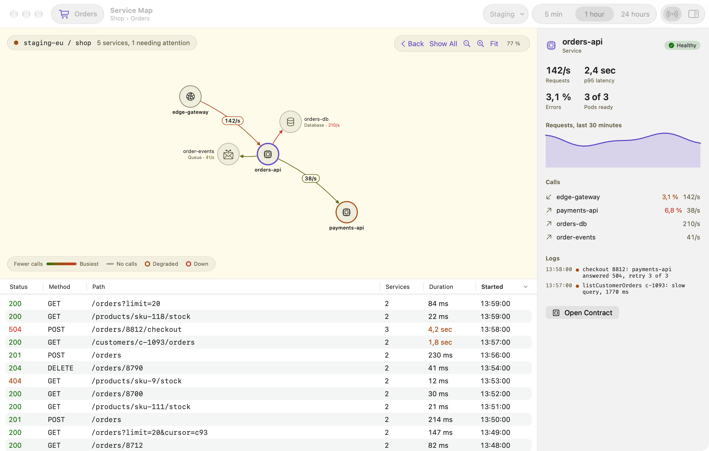
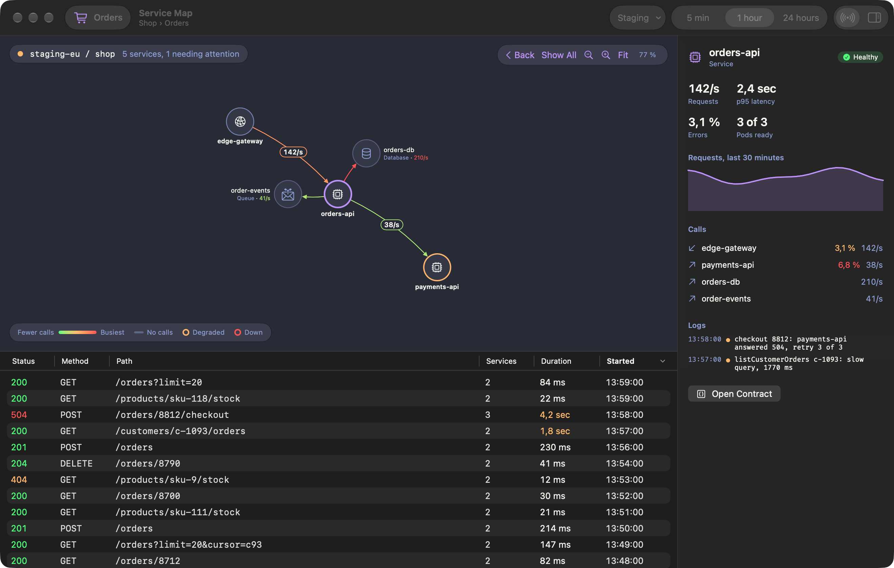
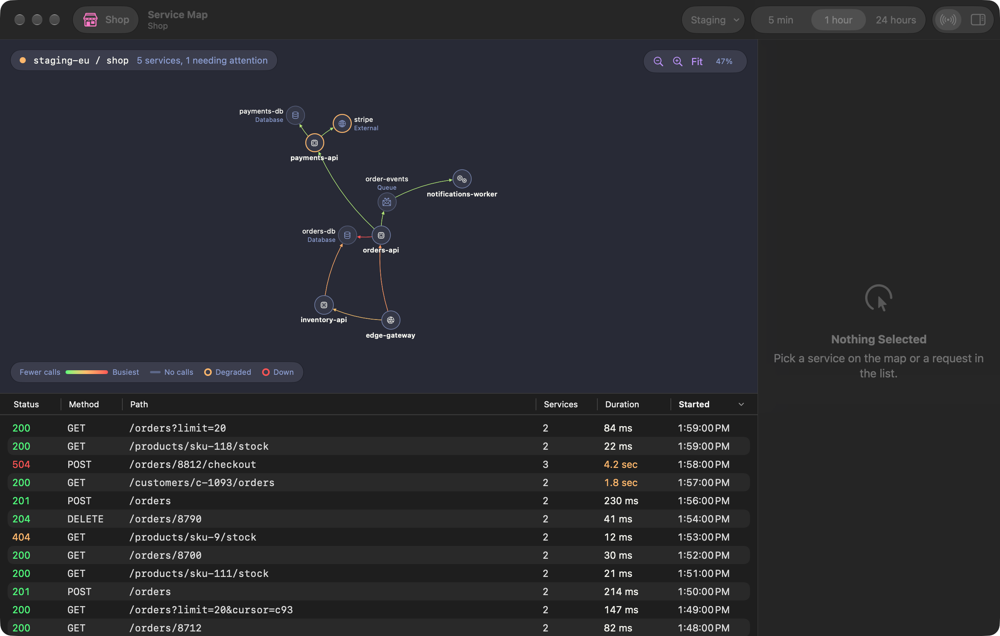
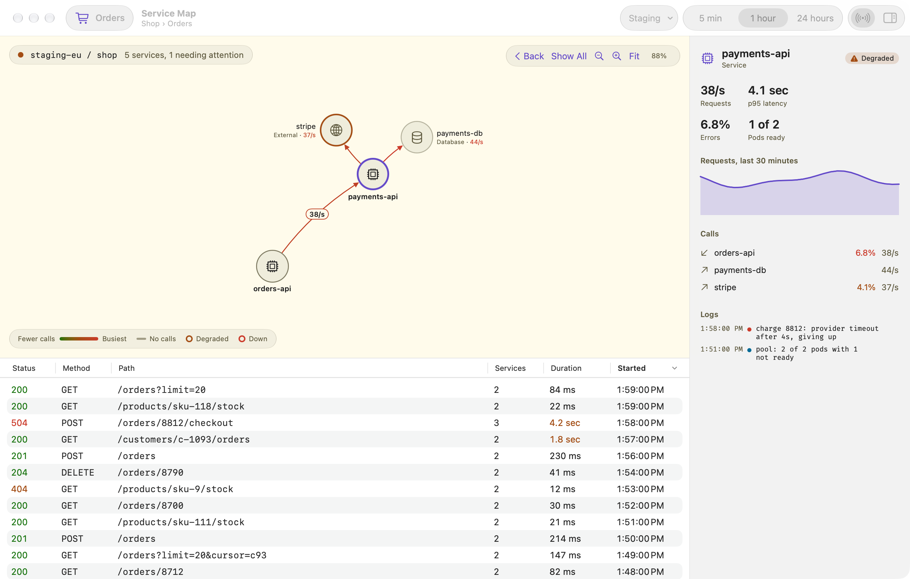
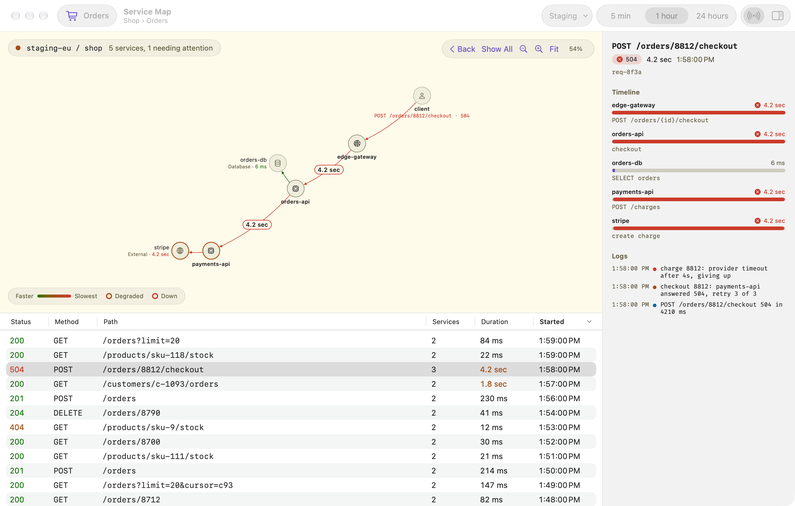
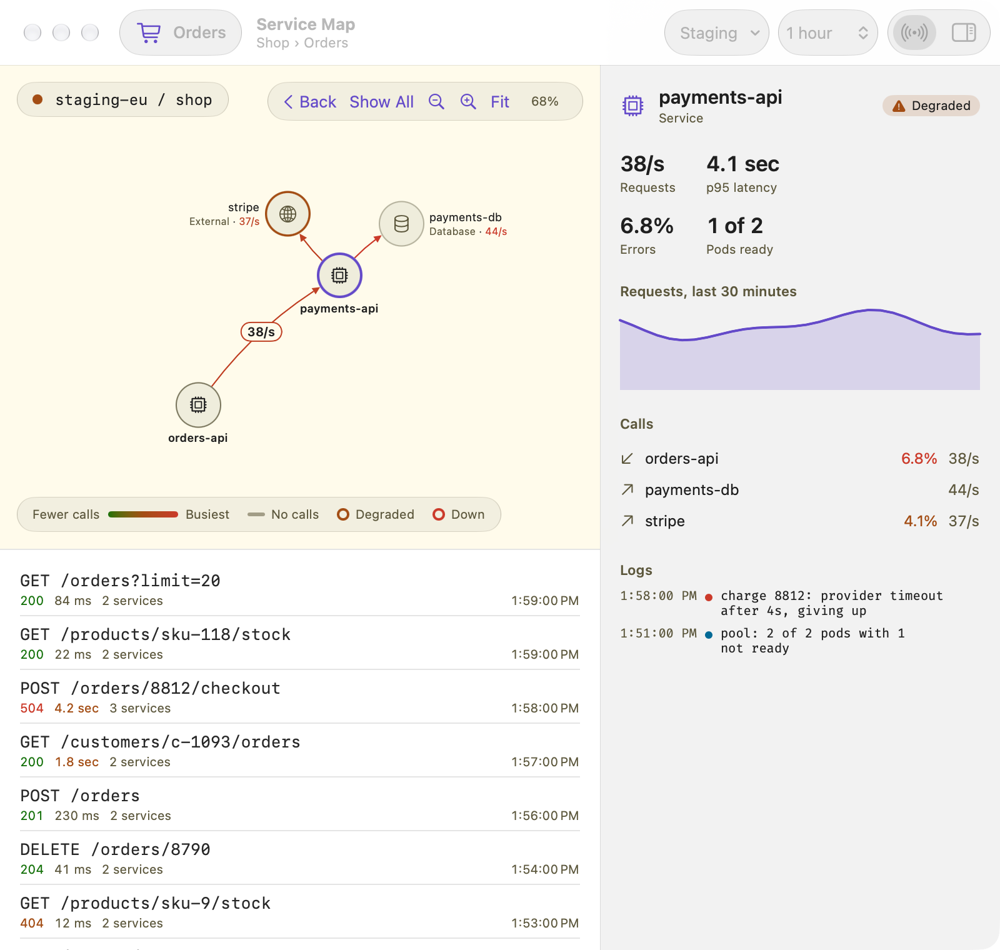
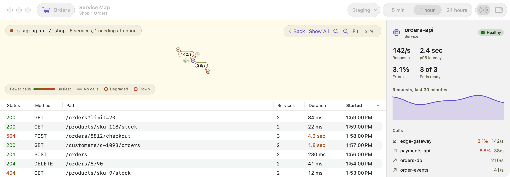
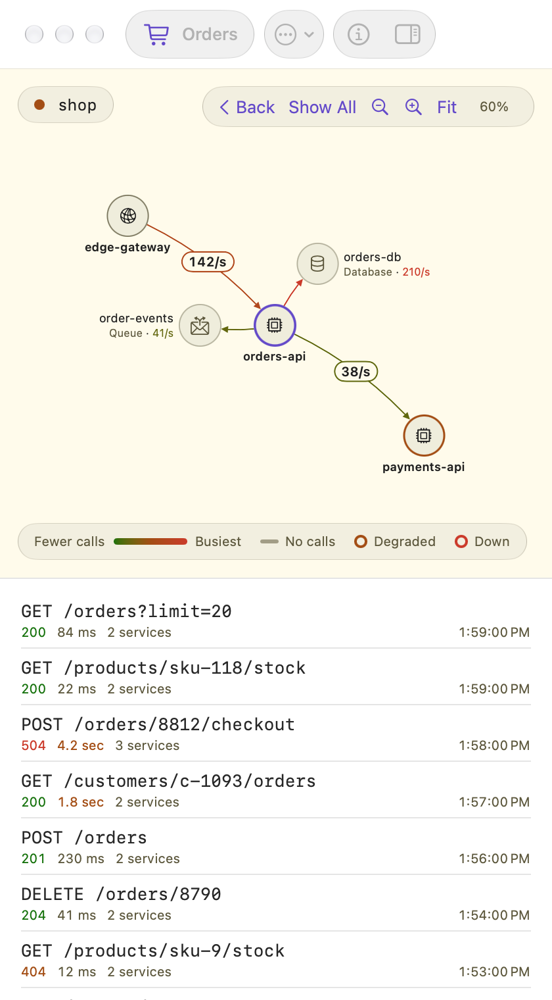

# Service Map

The Service Map shows the services of a project's namespace and how they call each other, after the service map of AWS X-Ray. Round nodes stand for the services and for the databases, queues and external services they call; curved arrows stand for the calls, colored by their traffic. Under the graph, a table lists the namespace's recent requests, newest first. Beside both, the details show the service in focus or the request selected. A click on a service focuses the graph on it. A request shows only its path, from a Client node. A right-click, **Back** or ⌘[ goes back to the view before. All data is sample data (see [Sample data and limits](#sample-data-and-limits)).

*Orders in Staging, opened on its own service, orders-api. The summary, zoom controls and legend float over the graph. The recent requests are under the graph, and the details of orders-api are on the right.*

## Opening it

| From | How |
| --- | --- |
| Window menu | **Service Map**, ⌘3, opens the tool for the key window's project. The item is disabled when the project has no Service Map. Only service projects have one; apps and libraries don't. |
| Projects window | The **Service Map** tile in the project's Tools section. Its status line reads "*n* services in *m* environments". |
| Menu bar panel | On the highlighted project's row, the `point.3.connected.trianglepath.dotted` button (tooltip "Service Map (⌘3)"), or ⌘3. |
| Project switcher | Switches an open Service Map window to another project. The window stays, and the map starts afresh for that project. See [components.md](components.md) › ProjectSwitcher. |
| Tickets | A ticket's **Service** link opens `service:<name>`. A **Request** link opens `request:<id>`. |
| Dashboard | A click on the **Service Graph** widget opens the map with no focus. A row of the **Failed Requests** widget opens `request:<id>`. Neither works while the Dashboard is being edited. |
| Projects window, Activity | A Service Map event opens its focus, for example `service:payments-api` or `request:req-8f3a`. Events without a focus open the map with none. |
| Chat | A reference to a service or request in a conversation opens its focus. |

The route is `.tool(.serviceMap, project:, focus:)`. The focus is `service:<name>` or `request:<id>`, and any other focus opens the whole namespace. If a Service Map window already shows the project, a route brings that window forward, out of the Dock if it was minimized, and shows its focus there without starting the map afresh. The environment stays as the user left it, and the view shown goes into the history, so **Back** returns to it. A route to an item the user has since left shows it again. Any other focus goes to the whole namespace, as **Show All** does. See [navigation.md](navigation.md) › Window reuse.

The window opens at 1,320 × 840 points and can't be made smaller than 390 × 420 points. Its title is **Service Map**, and its subtitle is the project's path, for example "Shop › Orders".

**First view.** A window opened with a focus shows that view. A sub project opened with no focus shows its own service in focus, with the whole namespace behind it. Going back or **Show All** reaches the whole namespace (the previous app's rule). Any other project opens on the whole namespace. In the sample data, Orders opens on `orders-api`, Payments on `payments-api` and Edge Gateway on `edge-gateway`. Shop, their parent, opens on the whole namespace.

*Orders opens on orders-api in dark appearance, with the whole namespace behind it. Back and Show All mark the way back.*

**First environment.** The first of the project's environments that isn't Healthy, or else its first environment. The sub projects use Shop's settings, so they read Shop's environments ([Projects](projects.md)): Orders, Payments, Edge Gateway and Shop all open on Staging, which is Degraded.

## Anatomy

| Region | Contents |
| --- | --- |
| Toolbar | Project switcher, title and subtitle, Environment, Time Window, Live, and the chat panel's button. On iPhone, the Map Settings menu and the Details button. |
| Graph | The nodes and arrows of the current view on the canvas background. |
| Namespace summary | Overlay at the top left. Shows the environment's health, cluster and namespace, and counts. |
| Zoom controls | Overlay at the top right. In a focus or a request: **Back** and **Show All**. Always: **Zoom Out**, **Zoom In**, **Fit** and the zoom level. |
| Legend | Overlay at the bottom left. Explains the arrow color scale and the node borders. |
| Requests table | The namespace's recent requests, newest first, sortable by column. Selecting one shows its view on the graph. On iPhone, a list. |
| Details | An inspector column for the service in focus or the request selected. |
| Chat panel | Optional, beside the window. See [Chat panel](#chat-panel). |

The graph sits over the requests table in a vertical split view whose divider can be dragged. The graph is at least 320 points tall and takes any height the window gains. The table is 140 to 320 points tall, 240 points ideally. In a short window (compact height, below 500 points) they share less: the graph is at least 160 points tall, and the requests 100 to 200 points, 140 ideally. The details column runs the full height on the right of both, and it is always open (the user's choice). The three overlays float over the graph, 14 points from its edges.

## Toolbar

| Item | Control | Symbol | Shortcut | Behavior | Layouts |
| --- | --- | --- | --- | --- | --- |
| Project switcher | ProjectSwitcher, at the leading edge | The project's symbol | — | Switches the window's project and starts the map afresh. See [components.md](components.md). | Mac, iPad, iPhone |
| **Service Map** and project path | Window title and subtitle | — | — | Dropped when the window is narrower than 760 points. | Mac, iPad from 760 points |
| **Environment** | Menu with an inline picker. The label is the current environment's name, for example **Staging**. | — | — | Picks one of the project's environments, or of the project it takes its settings from (see [Projects](projects.md)): **Local**, **Staging** or **Production** in the samples. The graph, summary, requests, details and the chat panel's subject follow the choice. The view stays: a service or request the new environment lacks shows as not found (see [States](#states)). Tooltip "Environment". | Mac, iPad |
| **Time Window** | Segmented control on Mac, pop-up menu on iPad: **5 min**, **1 hour** (default), **24 hours** | — | — | Tooltip "Time Window". Not wired yet: every window shows the same sample map. | Mac, iPad |
| **Live** | Toggle button, on by default | `dot.radiowaves.left.and.right` | — | Tooltip "Follow new requests as they arrive". Not wired yet. | Mac, iPad |
| **Map Settings** | Menu | `ellipsis.circle` | — | Holds the Environment picker, the Time Window picker and the **Live** toggle. Tooltip "Environment, time window and Live". | iPhone |
| **Details** | Button | `info.circle` | — | Pushes the details page over the map. Tooltip "Details of the service or request". | iPhone |
| **Chat** | `ChatPanelToolbarItem` | `sidebar.right` | ⌃⌘C | Shows or hides the chat panel. It is the last item (the user's choice). It is absent when Settings › Chat turns the panel off. Tooltip "Show the Chat Panel (⌃⌘C)" or "Hide the Chat Panel (⌃⌘C)". | Mac, iPad, iPhone |

## The graph

The graph reuses the previous app's graph code: its layout, geometry and numbers. It keeps that app's X-Ray look and must not be redesigned (the user's choice). Hephaestus V3 changes three things. Colors come from AZDesign, mapped to success → warning → danger (a porting adaptation). A node's border shows its health, as in X-Ray. An arrow is labeled with calls per second, or with a duration in a request view. VoiceOver support sits on top of the drawing and changes nothing on screen (see [Accessibility](#accessibility)).

### Nodes

Each node is a circle 54 points across at 100% zoom, filled with the surface color, with the symbol of its kind in the middle.

| Kind | Symbol | Is a service | Placement | Name |
| --- | --- | --- | --- | --- |
| Gateway | `network` | Yes | By the layout's forces | Below the node |
| Service | `cpu` | Yes | By the layout's forces | Below the node |
| Worker | `gearshape.2` | Yes | By the layout's forces | Below the node |
| Database | `cylinder.split.1x2` | No | On the ring of the first service that calls it | On the outer side, with the kind under it |
| Queue | `envelope.arrow.triangle.branch` | No | On the ring of the first service that calls it | On the outer side, with the kind under it |
| External | `globe` | No | On the ring of the first service that calls it | On the outer side, with the kind under it |
| Client | `person` | No | In a request view only, before the first service | Below the node, named `client`, with the request's route under it |

- **Symbol.** 20 points at 100% zoom. It uses the primary text color for services and the secondary text color for other nodes.
- **Border.** The border shows the node's health, unless the node is in focus:

  | Node | Border |
  | --- | --- |
  | In focus, or the project's own service on the whole namespace | Accent, 3 points |
  | Degraded | Warning, 2.5 points |
  | Down | Danger, 2.5 points |
  | Healthy service | Secondary text color at 80% opacity, 1.5 points |
  | Healthy database, queue, external service or Client | Secondary text color at 40% opacity, 1.5 points |

  Border widths follow the zoom but never go below half their size.
- **Name.** The node's id, 12 points at 100% zoom and never smaller than 9 points. It is semibold for services and the Client, regular for other nodes. Names are hidden below 30% zoom, where the nodes are too close for them. Hovering a node always shows a tooltip with its name. For a database, queue or external service, the tooltip adds its kind, for example "orders-db, Database".
- **Kind line.** A database, queue or external service shows its kind under its name ("Database"), in the secondary color, at 10 points (never below 8). When arrow labels are shown, the label of the arrow from its service follows the kind in that arrow's color, for example "Database · 210/s". That arrow is too short to carry its own label.
- **Name side.** A node on a ring puts its name on the side away from its service. The name goes on the right or left when the node is mostly to that side of its service, and above or below otherwise.
- **Client route.** Under the Client's name, in monospaced type and in the color of the Client's arrow: `<METHOD> <path> · <status>`, for example `POST /orders/8812/checkout · 504`.

### Arrows

- Each arrow is a gentle curve, bent to its left by 12% of its length. A call each way between two nodes draws two separate curves.
- An arrow starts on the edge of the circle it leaves. The tip of its head touches the edge of the circle it enters. The line stops at the middle of the head's base.
- The line is 1.6 points wide at 100% zoom, and each side of the head is 10 points. Both follow the zoom but never go below half their size. All heads are drawn over all lines, and the labels over both. Two nodes whose circles touch get no arrow.
- **Label.** The label sits at the middle of the arrow, in a capsule filled with the canvas color and outlined in the arrow's color. The text uses the bold monospaced-digit `caption2` style. On the whole namespace, labels appear from 50% zoom. In a focus or a request view, every label is shown at any zoom. An arrow into a node on a ring shows its label after that node's kind, and the Client's arrow shows the route under the Client.
- **Label text.** On the whole namespace and in a focus: calls per second with at most one decimal, for example `142/s`. In a request view: the call's duration, from Foundation's formatter: milliseconds below one second (`6 ms`), then seconds with one decimal (`4.2 sec` in English).

### Colors

An arrow's color weighs its calls per second, or its duration in a request view, against the heaviest arrow on screen:

| Weight | Color |
| --- | --- |
| The heaviest arrow shown | Danger (red) |
| Up to half the heaviest | Success mixed toward warning, in proportion |
| From half the heaviest | Warning mixed toward danger, in proportion |
| No calls | Opaque grey: the secondary text color mixed 45% with the canvas, so two crossing grey arrows show no darker spot |

The scale is relative to the arrows shown. A focus therefore colors its arrows against its own busiest arrow. In a request view, the Client's arrow carries the whole request's duration, so it is drawn in danger red. The scale uses AZDesign's semantic colors, so it follows the app's palette and High Contrast. See [foundations.md](foundations.md) › Colors.

### Layout

Node positions come from the previous app's algorithm, unchanged:

- **Rings.** A database, queue or external service that a service calls sits on the ring of the first service that calls it, 95 points from that service's center. A crowded ring grows so that two of its nodes stay 110 points apart. Each ring node goes into the widest gap left by its service's arrows and by the ring nodes already placed. The gaps are searched every 5 degrees, starting straight up. Ring nodes go above or beside their service, never below, where the service's name hangs, unless the ring has no room left there. A ring with no room for its nodes one by one is spread evenly around its service.
- **Groups.** Services linked by calls in either direction form a group, together with their rings. An arrow to or from a ring node counts as its service's arrow. A node that nothing links to stands alone as its own group.
- **Forces.** Each group is laid out on its own by a force-directed layout (Fruchterman and Reingold): services push each other away, a call pulls its two services together, and a weak pull toward the group's center keeps them close. There are no columns: a service is placed by its calls, not by its depth in the call chain. Nodes are then pushed apart until no two are closer than 130 points, except a ring node and its service. A service with a ring keeps the ring's room free.
- **Arrangement.** The group with the most services goes in the middle. Each other group goes as close to its center as it can, with at least 200 points between the rectangles around the groups' nodes.
- **Stable.** The layout always starts from the same place, so the same nodes and arrows always get the same positions. Changing the environment keeps the layout and the zoom when the same nodes and arrows show, as between Local and Staging. Production's larger namespace is laid out again.

*Shop, the parent project, opens on the whole namespace. No service is inspected, so the details read "Nothing Selected". Below 50% zoom, the arrows carry no labels.*

## Navigating the graph

### Zoom and pan

| Action | Result |
| --- | --- |
| Pinch | Zooms around the point where the pinch started, which stays under the pointer. |
| Drag the background | Pans the graph. The drag starts after 3 points of movement. A drag that starts on a database, queue, external service or the Client pans too. |
| **Zoom Out** (`minus.magnifyingglass`) / **Zoom In** (`plus.magnifyingglass`) | Zoom out or in by 25% around the center of the graph. The buttons are icon-only, with tooltips "Zoom Out" and "Zoom In". |
| **Fit** | Shows every node with its name, at 150% at most, clear of the overlays (58 points at the top, 54 at the bottom). Tooltip "Show every node". |

- Zoom ranges from 10% to 300%. The current level follows **Fit**, for example "77%".
- The graph opens fitted. Each change of view (a focus, a request, back, **Show All**) lays the graph out again and fits it. Changes are immediate, without animation.
- Until the zoom or the position is changed by hand, the graph fits again whenever its size changes, whether through the window or the split view's divider.

### Views

| View | The graph shows | Reached by | The details show |
| --- | --- | --- | --- |
| Whole namespace | Every node and arrow of the environment | Opening a top-level project, **Show All**, or going back past the first view | The project's own service, with the accent border on the graph, or **Nothing Selected** when the project has none |
| Service in focus | The service, the nodes it calls, the services that call it, and the arrows to and from it | A click on a service node, a row of the details' **Calls** or **Timeline**, a `service:` route, or opening a sub project | That service |
| Request | A Client node and the nodes the request went through, with only the calls it made | Selecting a row of the requests table, or a `request:` route | That request |

- **Click.** A click on a gateway, service or worker focuses on it. A click on a database, queue, external service or the Client does nothing, and so does a click on the background (the previous app's rule). Such a node can still be focused from the details' **Calls** and **Timeline** rows and from a `service:` route, such as the Activity entry `service:stripe`.
- **Request view.** The Client's arrow goes into the request's first service. Each later service is called by the closest earlier service whose span contains its own. Each caller and callee pair gets one arrow. Arrow labels and colors are durations, and the legend reads **Faster** to **Slowest**.
- **Back.** A right-click anywhere on the graph, **Back** in the zoom controls, or ⌘[ goes back to the view before. Every new view keeps the one it replaced, so going back walks the views in reverse order and ends at the whole namespace. A request replaces the request shown instead of stacking on it: after moving from request to request, by clicking rows or with the arrow keys, going back returns to the view the first request was opened from. A right-click opens no context menu.
- **Show All.** Goes straight to the whole namespace and forgets the views before it.
- **Back and Show All.** In a focus or a request, **Back** (`chevron.backward`) and **Show All** show to the left of the zoom buttons. Tooltips: "Back to the view before (⌘[ or a right-click on the graph)" and "Show the whole namespace".
- **Keyboard.** ⌘[ goes back while **Back** shows. The graph has no other keyboard shortcuts, and no context menus or drag and drop. VoiceOver reaches every node and arrow (see [Accessibility](#accessibility)).
- **Not in the map.** A `service:` focus the environment's map doesn't have, or a request id that isn't among its recent requests, shows the whole namespace with **Back** and **Show All**, and the details say so (see [Not found](#not-found)).

*payments-api in focus, with the service that calls it and the database and external service on its ring. Every arrow carries its label at any zoom. The accent border marks the focus, and stripe's orange border shows that it is degraded. The details badge shows that payments-api is degraded too.*

*The view of the failed checkout req-8f3a. The Client's arrow enters edge-gateway, with the route and status under the Client. Arrows carry durations, and the legend reads Faster to Slowest.*

## Overlays

The three overlays sit on Liquid Glass (see [foundations.md](foundations.md) › Liquid Glass). Each stays on one line at any width: when the room runs out, it drops its least useful parts (a fix made after the user's screenshot).

| Overlay | Full content | Drops first | Drops next |
| --- | --- | --- | --- |
| Namespace summary | A status dot in the environment's health color, then `cluster / namespace` in monospaced type, then the counts in the secondary color: "*n* services, *m* needing attention", or "*n* services, all healthy" | The counts | The cluster, leaving the namespace |
| Zoom controls | **Back** and **Show All** (focus and request only), **Zoom Out**, **Zoom In**, **Fit**, the zoom level | The zoom level | **Back**'s title, leaving its symbol |
| Legend | A 56 × 5-point capsule from success through warning to danger, between **Fewer calls** and **Busiest** (**Faster** and **Slowest** in a request view); a grey line, **No calls** (not in a request view); an orange ring, **Degraded**; a red ring, **Down** | **No calls** | **Degraded** and **Down** |

- The summary and the zoom controls share the top row: the summary on the left, the controls on the right, at least 8 points apart. The controls have priority, so the summary drops its parts first. The two never overlap.
- The summary's tooltip always gives the full `cluster / namespace` and the environment's health, for example "staging-eu / shop, Degraded". Its counts cover the environment's whole map, whatever the view.
- The counts are services only: gateways, services and workers. Databases, queues and external services aren't counted. A service needs attention when its health isn't Healthy. Staging reads "5 services, 1 needing attention": payments-api. stripe is degraded too, but it is an external service. The word "service" agrees with the count.
- The summary uses the `callout` text style. The zoom level and the legend use `caption` in the secondary color.

*An 800-point-wide window, in the iPad layout: the time window is a menu, the summary keeps only the namespace, and the zoom controls, legend and details are whole.*

## Requests table

The table lists the namespace's recent requests, one per row, with single selection.

| Column | Width | Content |
| --- | --- | --- |
| **Status** | 56 | The HTTP status in monospaced digits. Success color below 400, warning from 400 to 499, danger from 500. |
| **Method** | 64 | The HTTP method, monospaced. |
| **Path** | Flexible, at least 160 | The path, monospaced. |
| **Services** | 64 | The services the request went through, each once: gateways, services and workers. Databases, queues and external services aren't counted. |
| **Duration** | 80 | Milliseconds below one second (`84 ms`), then seconds with one decimal (`4.2 sec` in English), from Foundation's formatter. Warning color from one second. |
| **Started** | 90 | The start time, hours, minutes and seconds. |

- **Order.** The rows start newest first, by **Started**. A click on a column's header sorts by that column, and a second click reverses the order. Requests that tie keep the sample data's order.
- **Selection.** Selecting a row shows that request's view on the graph and its details. Selecting another row moves to that request, replacing the one shown (see [Views](#views) › Back).
- The selection follows the view: the row is selected while its request is shown. Going back or choosing **Show All** clears the selection. Deselecting the row goes back.
- On a selected row, the status and duration colors give way to the system's, so they keep their contrast.
- **Narrow strips.** The table needs 600 points for its fixed columns and a readable path. When the strip under
  the map is narrower, as on an iPhone and in most iPad widths, the requests show as the two-line list
  instead, in the same order.
- The table has no context menu or drag and drop.

## Details

The details column is always open beside the map. There is no button to hide it (the user's choice). It is 320 points wide by default, and its edge can be dragged between 280 and 440 points. Its content scrolls, with 16 points of padding.

### Service

- **Header.** The kind's symbol in the accent color, the node's name (`title3`, semibold), its kind under it, and a health badge at the trailing edge: **Healthy** (`checkmark.circle.fill`), **Degraded** (`exclamationmark.triangle.fill`) or **Down** (`xmark.octagon.fill`), in the health's color.
- **Figures.** **Requests** (for example `142/s`), **p95 latency** (`95 ms`, `4.1 sec`), **Errors** (a percentage with one decimal), and **Pods ready** ("3 of 3"). External services have no **Pods ready**.
- **Requests, last 30 minutes.** An area and line chart in the accent color, 64 points tall, without axes.
- **Calls.** One row for each call to or from the node: `arrow.up.right` for a call it makes, `arrow.down.left` for a call it receives. Then the node at the other end, its error rate when 1% or more (warning color from 1%, danger from 5%), and its calls per second. A click on a row focuses on the node at the other end, whatever its kind (see [Navigating the graph](#navigating-the-graph) › Click).
- **Logs.** The node's log lines: time, a 6-point dot in the level's color (info, warning or danger), and the message, in the code font (Fira Code), selectable. Without lines: "No log lines in this time window."
- **Open Contract** (`curlybraces.square`). Shown for the project's own service, when the project has a contract. Opens Contracts for the project. Tooltip "Open the service's contract in Contracts".

### Request

- **Header.** `<METHOD> <path>` in a monospaced headline, selectable. Under it, a status badge (`xmark.circle.fill` from 400, `checkmark.circle.fill` below) in the status color, then the duration and the start time. Then the request id, monospaced and selectable.
- **Timeline.** One row per span, in the request's order: the service, the span's duration, a bar placed on the request's duration (accent, or danger for a failed span, at least 4 points wide, on a sunken track), and the operation in monospaced type. A failed span shows `xmark.circle.fill` in the danger color before its duration, which is in danger too. A click on a row focuses on that span's service.
- **Logs.** The request's log lines, as for a service.

### Not found

A focus the environment's map doesn't have shows `ContentUnavailableView` with `questionmark.circle` and a **Show All** button:

| Focus | Title | Description |
| --- | --- | --- |
| `service:<name>` | **Service Not Found** | "*Environment* has no service named “*name*”." |
| `request:<id>` | **Request Not Found** | "*Environment* has no recent request “*id*”." |

This happens with a Production-only service after switching to Staging, or with an unknown name or id in a route. Switching back to an environment that has the item shows it again.

### Nothing selected

On the whole namespace of a project without its own service, the column shows **Nothing Selected** (`cursorarrow.click`): "Pick a service on the map or a request in the list."

## States

| State | When | What shows |
| --- | --- | --- |
| No environments | The project runs nowhere | **No Environments** with the Service Map's symbol: "A service map shows a project that runs in a cluster." Only the project switcher and the chat panel's button stay in the toolbar. No sample project with a Service Map is in this state; the "No Environments" preview shows it. |
| Whole namespace, own service | A sub project after **Show All** | Every node, with the own service's border in the accent color. The details show that service. |
| Whole namespace, no own service | Shop, the parent project | Every node, and **Nothing Selected** in the details. |
| Service in focus | A click on a service, or a `service:` focus | The service's neighborhood, **Back** and **Show All**, and the service's details. |
| Request | A selected row, or a `request:` focus | The Client and the request's path, **Back** and **Show All**, the selected row, and the request's details. |
| Zoomed out | Below 50% zoom on the whole namespace, or below 30% in any view | Below 50% on the whole namespace, arrow labels hide. Below 30%, in any view, node names hide too; hovering a node shows its name. |
| No log lines | The service or request has none | "No log lines in this time window." |
| Focus not in the map | A service absent from the current environment, or an unknown request id | The whole namespace, with **Back** and **Show All**, and **Service Not Found** or **Request Not Found** in the details. The chat panel gets no subject. |
| No project | The window has no project | **No Project**. See [navigation.md](navigation.md). |

## Layouts

The window measures its width and picks a layout. The Service Map's Mac layout needs 880 points, plus 341 points while the chat panel is open. See [foundations.md](foundations.md) › Layout system.

| Layout | When | What changes |
| --- | --- | --- |
| Mac | 880 points and wider (1,221 with the chat panel open) | Everything side by side. **Time Window** is a segmented control. The chat panel pushes the tool over. |
| iPad | From 640 points up to the Mac's width | **Time Window** becomes a pop-up menu. The details stay open beside the map: there is no inspector button (the user's choice). The requests show as the two-line list while their strip is narrower than 600 points, which is most of this range. The chat panel slides over the content with a shadow. |
| iPhone | Narrower than 640 points | The map over its requests, in a navigation stack. The requests become a list of two-line rows (see below). Environment, Time Window and Live move into **Map Settings** (`ellipsis.circle`). **Details** (`info.circle`) pushes the details as a page with Back. Selecting a request changes the graph but doesn't open the page. The chat panel fills the window. |

*A window 460 points high, compact height: the graph and the requests share less height, and both stay.*

In every layout, the toolbar drops the window title below 760 points, and the overlays drop their parts as described in [Overlays](#overlays).

**iPhone requests list.** Each request takes two lines, so nothing runs off the window's edge. The first line is `<METHOD> <path>`, monospaced, truncated in the middle when it is too long. The second, in `caption` and the secondary color, holds the status (in its color), the duration (warning from one second), "*n* services" and, at the trailing edge, the start time. The list keeps the order the table was last sorted in, newest first by default. It has no column headers, so it can't be sorted itself. Selection works as in the table.

*The iPhone layout at 420 points. Map Settings and Details replace the toolbar controls. The summary keeps only the namespace.*

## Chat panel

The window reports the item its details show as the chat panel's subject, with the environment on screen. In a focus, it is the service (titled with its name, focus `service:<name>`). With a request shown, it is the request (titled with its id, focus `request:<id>`). On the whole namespace, it is the project's own service. Shop's whole namespace, and a focus the map doesn't have, report no subject. Changing the environment reports the subject again, with the new environment.

Claude reads an item through the Service Map's own reader, as any client of the tool would, in the environment the subject carries. Without one, the reader uses the first environment that isn't healthy. Each reading is one sentence:

| Item | Action | Detail, for example |
| --- | --- | --- |
| Service | "Read service *name*" | "payments-api is degraded in Staging: p95 latency 4.1 sec, error rate 6.8%, 1 of 2 pods ready." An external service leaves out the pods. |
| Request | "Read request *id*" | "In Staging, POST /orders/8812/checkout answered 504 after 4.2 sec, through 3 services." The services are counted as in the requests table. |

The reader also words the questions worth asking about the item in its state, the most pressing first, at most three, for the chat panel to offer (see [chat.md](chat.md)):

| Item | When | Question |
| --- | --- | --- |
| Service | Degraded or Down | "Why is *name* degraded?" or "Why is *name* down?" |
| Service | p95 latency of one second or more | "Why is *name* slow?" |
| Service | Error rate of 1% or more | "What are *name*'s errors?" |
| Service | Not every pod ready | "Why aren't all pods of *name* ready?" |
| Service | Always | "What calls *name*?" |
| Service | A gateway, service or worker, while there is room | "What does *name* call?" |
| Request | Status 400 or above | "Why did *id* fail?" |
| Request | One second or more | "Which service made *id* slow?" |
| Request | Always | "Which services handled *id*?" |

For payments-api in Staging, the questions are "Why is payments-api degraded?", "Why is payments-api slow?" and "What are payments-api's errors?". For a quick, successful request, only "Which services handled *id*?".

## Accessibility

| Element | Identifier | Label or notes |
| --- | --- | --- |
| Graph | `serviceMap.graph` | A container labeled "Service Map": the nodes first, then the arrows. |
| Node | `serviceMap.node.<id>` | Labeled with its name at any zoom. Its value is its kind and health, for example "Service, Degraded"; for the Client, its kind and the request's route. The node with the accent border has the Selected trait. A gateway, service or worker is a button, with the hint "Focuses the map on this service."; other nodes are not buttons. |
| Arrow | `serviceMap.arrow.<from>.<to>` | One element at the arrow's middle, labeled "orders-api to payments-api", with its label in words as its value: "38 calls per second", or "4.2 seconds" in a request view. Nothing shows on screen. |
| Namespace summary | `serviceMap.summary` | One combined element. Its value is the environment's health, which the dot shows by color. |
| Back | `serviceMap.back` | "Back", ⌘[. |
| Show All | `serviceMap.showAll` | "Show All". |
| Zoom Out, Zoom In | `serviceMap.zoomOut`, `serviceMap.zoomIn` | Icon-only buttons labeled "Zoom Out" and "Zoom In". |
| Fit | `serviceMap.fit` | "Fit". |
| Zoom level | `serviceMap.zoomLevel` | "Zoom", with the level as its value. |
| Legend | `serviceMap.legend` | One combined element. The color marks are hidden. |
| Requests table, iPhone list | `serviceMap.requests` | |
| Request row | `serviceMap.request.<id>` | On the **Path** cell in the table. In the iPhone list, on the row, which reads as one element. |
| Service details | `serviceMap.inspector.service` | The service name (`serviceMap.inspector.name`) and each section title are headers. The kind symbol and call direction arrows are hidden. |
| Health badge | `serviceMap.inspector.health` | |
| Figures | `serviceMap.inspector.requests`, `.latency`, `.errors`, `.pods` | Each reads as one element. **Requests** and **p95 latency** read their values in words: "142 calls per second", "4.1 seconds". |
| Requests chart | `serviceMap.inspector.chart` | |
| Call row | `serviceMap.inspector.call.<name>` | A button labeled as one sentence: "Calls payments-api, 38 calls per second, error rate 6.8%", or "Called by edge-gateway, 142 calls per second". |
| Open Contract | `serviceMap.inspector.openContract` | |
| Request details | `serviceMap.inspector.request` | The method and path are a header (`serviceMap.inspector.route`). The status badge (`serviceMap.inspector.status`) reads "Status 504, failed" or "Status 200, succeeded". The request id is `serviceMap.inspector.requestID`. Durations read in words. |
| Timeline row | `serviceMap.inspector.span.` | A button. Its contents are combined into one element; a failed span reads "Failed". |
| Log line | `serviceMap.inspector.log.<line id>` | One element. The level dot is labeled "Info", "Warning" or "Error". |
| Not found | `serviceMap.inspector.missing` | Its **Show All** is `serviceMap.inspector.showAll`. |
| Nothing selected | `serviceMap.inspector.nothing` | |
| No environments | `serviceMap.noEnvironments` | |
| Environment | `serviceMap.environment` | Labeled "Environment", with the environment's name as its value. Tooltip "Environment". |
| Time Window | `serviceMap.timeWindow` | Also used inside Map Settings. |
| Live | `serviceMap.live` | "Live". |
| Map Settings | `serviceMap.settingsMenu` | iPhone only. |
| Details | `serviceMap.details` | iPhone only. |
| Chat | `toolbar.chatPanel` | See [components.md](components.md). |

Text comes from the Service Map's own String Catalog. Counts agree with their number ("1 service", "5 services"), and units come from Foundation's formatters or sit inside one localized string with their number (`142/s`). Names, ids, paths and log messages show as they are.

## Sample data and limits

- The map is sample data: the `shop` namespace as each environment would show it. Local scales the traffic down to 5%. Staging has a slow payment provider, so `payments-api` and `stripe` are degraded and checkouts time out. Production triples the traffic and adds 28 more nodes of the whole shop, some in groups that never call the others.
- The requests table holds 31 sample requests: seven that the samples are about, such as the failed checkout `req-8f3a`, plus 24 routine ones. There are nine log lines. Every time is relative to a fixed sample clock, to the minute, so requests of the same minute keep the samples' order.
- Each project's own service is a fixed sample mapping: Orders to `orders-api`, Payments to `payments-api`, Edge Gateway to `edge-gateway`.
- **Time Window** and **Live** are not wired yet. The chart in the details always covers the last 30 minutes.
- No sample call has zero traffic, so grey **No calls** arrows never appear.

## Previews

- "Staging"
- "Staging, Dark"
- "Request Selected"
- "Whole Namespace" (Shop, Nothing Selected)
- "Production"
- "Service Not Found"
- "Largest Text"
- "iPad" (760 points)
- "iPhone" (420 points)
- "iPhone, Dark" (a request selected)
- "No Environments"

## Open issues

None.
