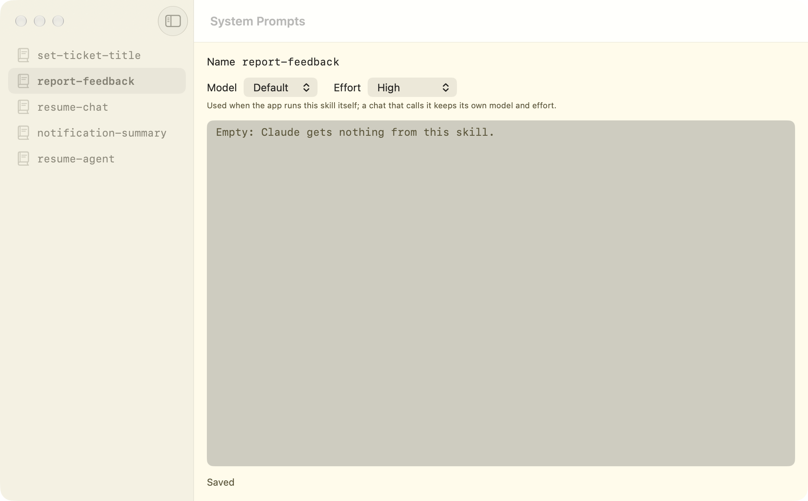

# System Prompts

System Prompts is where the user writes what the app's own Claude skills say (the user's request, 17 November
2026). The app's code defines these **internal skills**, each with a name; the user edits their content, and
the model and effort the app runs each with when no chat calls it. The list holds the internal skills only: not
the user's or the projects' own Claude skills.

*System Prompts with `set-ticket-title` selected: Haiku at a low effort, empty.*

## Opening it

| From                                                       | Does                                                                                   |
|------------------------------------------------------------|----------------------------------------------------------------------------------------|
| **Hephaestus V3 ▸ System Prompts…** (⌥⌘,), after Settings… | Selects the System Prompts tab, or opens it ([Navigation › Tabs](navigation.md#tabs)). |

It is a tab, one in the whole app, like Projects and Virtual Machines (the user's choice): it has the window's
chat panel beside it, on the last project the window showed, and the chat panel button last in its toolbar.
Its tab reads "System Prompts", with `text.book.closed`.

## Anatomy

*`report-feedback` selected: a skill chats call shows as any other.*

A `NavigationSplitView`, inside the tab:

| Part                     | Identifier                                    | Contents                                                                                                                                                                                                                                                                                                                                                                                                                                                                      |
|--------------------------|-----------------------------------------------|-------------------------------------------------------------------------------------------------------------------------------------------------------------------------------------------------------------------------------------------------------------------------------------------------------------------------------------------------------------------------------------------------------------------------------------------------------------------------------|
| **List**                 | `systemPrompts.list`                          | Every internal skill, in the code's order: `text.book.closed` and the name in the monospaced font (`systemPrompts.skill.<name>`). The first is selected when the tab opens. 200 to 360 pt wide, 240 by default.                                                                                                                                                                                                                                                               |
| **Name**                 | `systemPrompts.name`                          | "Name" and the selected skill's name, monospaced, selectable, not editable. Help: "The app defines this skill and its name."                                                                                                                                                                                                                                                                                                                                                  |
| **Model** and **Effort** | `systemPrompts.model`, `systemPrompts.effort` | Settings ▸ Chat's pickers, side by side: the CLI's models (its fallback list until the CLI has answered), then the selected model's effort levels (none for a model without effort). They set the model and effort the app uses when it runs the skill itself; a chat that calls the skill keeps its own (the user's request). Under them, in `caption` and `textSecondary`: "Used when the app runs this skill itself; a chat that calls it keeps its own model and effort." |
| **Content**              | `systemPrompts.content`                       | A `TextEditor` in the monospaced body font, on `surfaceSunken`, filling the rest. While empty: "Empty: Claude gets nothing from this skill." in `textSecondary`. Its VoiceOver label is "Content".                                                                                                                                                                                                                                                                            |
| **Status**               | `systemPrompts.status`                        | Under the content, in `callout`: "Saved" or "Editing…" in `textSecondary`; after a failed save, `exclamationmark.triangle.fill` and "Not saved: <reason>" in `danger`.                                                                                                                                                                                                                                                                                                        |
| **Nothing selected**     | `systemPrompts.nothing`                       | "No Skill Selected", "Select an internal skill to edit its content."                                                                                                                                                                                                                                                                                                                                                                                                          |

The window's title is "System Prompts". In narrow windows the list folds behind the sidebar button, as every
split view does.

## Saving

- A change of content shows at once and is saved one second after the last keystroke (default chosen at design
  time), to `skills/<name>/SKILL.md` in the data folder ([Data › Internal skills](../data.md#internal-skills)).
  A change of model or effort is saved at once, with the content as shown.
- Selecting another skill, or leaving the tab, saves every change at once.
- A save that fails keeps the text, shows "Not saved: <reason>", and is tried again at the next change; the
  next save that works clears the message.
- The file is read when the tab opens: a change made to it outside the app shows the next time.

## Internal skills

**Running a skill.** The app runs a skill as the Claude CLI in print mode, once, without a chat: the skill's
model and effort, its content as the system prompt (left out while it is blank), the input as the message, in an
empty folder, without a saved session or the CLI's own tools. Every run has the app's MCP server (the user's
request), as a chat has, with a token that only reads ([MCP › Permissions](../mcp.md#permissions)). The item a
run is for is linked as a chat's message links the item of its chip, with an `Attached:` line such as
`Attached: ticket HEPH-3 of project HEPH`: Claude reads the ticket with `get_ticket` and its files with
`get_attachment`. Claude's answer is taken as it comes ([Data › Internal skills](../data.md#internal-skills)).
So until the content says how to answer, the answer is what the model makes of the message and of what it
reads.

| Name               | Default content | Default model and effort                                          | Used by                                                                                                                                                                                                                                                                                                                                                                                                                                                                              |
|--------------------|-----------------|-------------------------------------------------------------------|--------------------------------------------------------------------------------------------------------------------------------------------------------------------------------------------------------------------------------------------------------------------------------------------------------------------------------------------------------------------------------------------------------------------------------------------------------------------------------------|
| `set-ticket-title` | Empty           | Haiku, Low: a short answer (default chosen at design time)        | A ticket created without a title (Claude's `create_ticket`, a feedback chat's for instance), and **Generate Title**, in New Ticket and in the ticket editor ([Tickets › Titles written by Claude](tickets.md#titles-written-by-claude)). Its message is the ticket's `Attached:` line, Claude reading the ticket whole (the user's request); in the editor, after the description being edited while it isn't saved; in New Ticket, before the ticket exists, the description alone. |
| `report-feedback`  | Empty           | `default`, High (a chat's defaults; the app never runs it itself) | The first message of a [feedback chat](chat.md#feedback), `/hephaestus-skills:report-feedback` then the comment and the feedback's context, screenshot and files (the user's request, as V2's `feedback` skill). What Claude does with the feedback, such as which ticket to create and its priority, is this skill's to say.                                                                                                                                                        |
| `resume-chat` | V3's own text: "Your last turn in this chat stopped with an error before it was finished. Look at what was already done, then finish what is left of the user's last request. Don't redo what is done." | `default`, High (a chat's defaults; the app never runs it itself) | **Resume**, after a chat stopped with an error ([Chat › Resume](chat.md#resume)): the message `/hephaestus-skills:resume-chat`. V2 sent a fixed sentence; the user asked for every text Claude acts on to be an internal skill (17 November 2026). |
| `notification-summary` | V3's own text: "The message tells what just happened in a chat between the user and Claude: Claude's last reply, or what Claude waits for the user to answer. Write the line of a notification about it: one plain sentence of at most 150 characters that says what it is about. Answer with the sentence alone, without quotes or Markdown." | Haiku, Low: a short answer, as V2's summary call (default chosen at design time) | A chat notification's line, while Settings ▸ Notifications ▸ **AI-generated summary** is on ([Chat › Notifications](chat.md#notifications)): the app runs it on Claude's reply, the card's request or the questions, at most 30 s. V2's internal skill of the same name; V3 writes its own text (no V2 prompt). |
| `resume-agent` | V3's own text: "One of your agents in this chat stopped before it was finished. The arguments name it, with its agent id in parentheses. Resume that agent with SendMessage, telling it to go on from where it stopped." | `default`, High (a chat's defaults; the app never runs it itself) | **Resume** in a sub-agent's view ([Chat › Agents](chat.md#agents)): `/hephaestus-skills:resume-agent <title> (agent id <id>)`. V2 sent a fixed sentence. |

**Called skills.** `report-feedback`, `resume-chat` and `resume-agent` are called from chats (V2's called skills); `set-ticket-title` and
`notification-summary` the app runs itself. Every chat's CLI gets the called skills as the plugin `hephaestus-skills` ([Data › Chat
plugin](../data.md#chat-plugin)), so a message starting with `/hephaestus-skills:<name>` calls one: Claude gets
the skill's content, then the rest of the message. A chat that calls a skill keeps its own model and effort. The
skills the app runs itself aren't in the plugin: no chat sees them. The page shows a called skill as any other:
it never shows the `/hephaestus-skills:<name>` line that calls it (the user's rule, 17 November 2026).

A skill the code adds without its own defaults runs on the CLI's `default` model at High effort, as a new chat
does.

The names are in Claude's skill name format: lowercase letters, digits and hyphens, 1 to 64 characters, no
hyphen at either end or twice in a row. The user doesn't add, rename or remove internal skills (the user's
choice): the code does, and each feature that uses one names it.

## Previews

`SystemPromptsView` on a `SystemPromptsModel` over `SampleInternalSkillStore`, 900 × 560 pt: "Empty", "Written,
Dark", "Not Saved".
