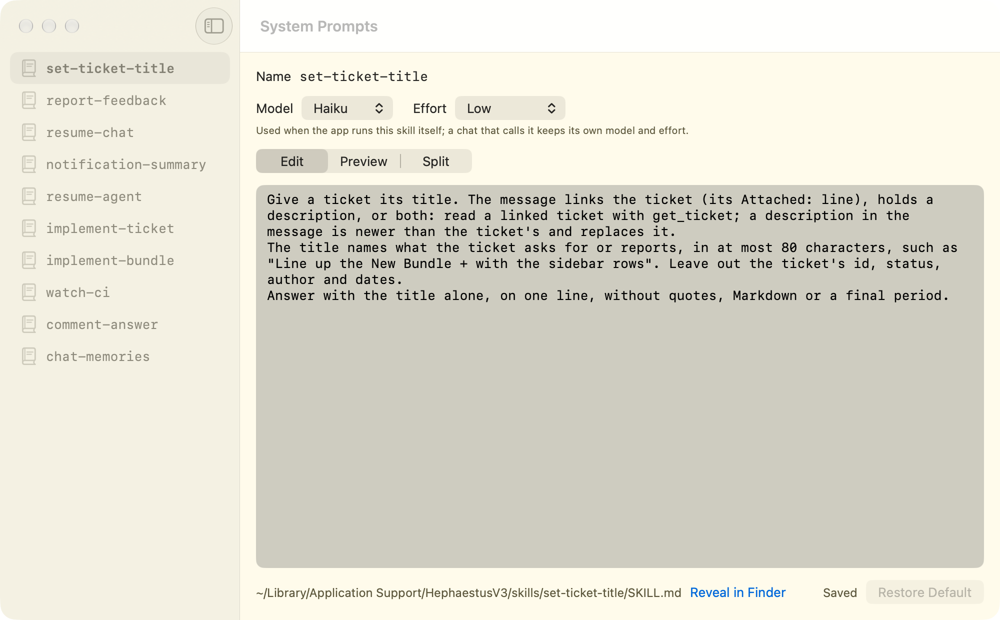
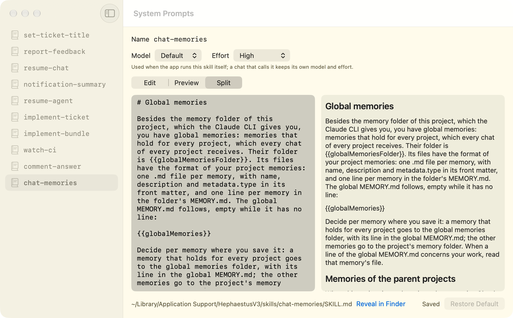

# System Prompts

System Prompts is where the user writes what the app's own Claude skills say (the user's request, 17 November
2026). The app's code defines these **internal skills**, each with a name; the user edits their content, and
the model and effort the app runs each with when no chat calls it. The list holds the internal skills only: not
the user's or the projects' own Claude skills.


*System Prompts with `set-ticket-title` selected: Haiku at a low effort, V3's own text.*

## Opening it

| From                                                       | Does                                                                                   |
|------------------------------------------------------------|----------------------------------------------------------------------------------------|
| **Hephaestus V3 ▸ System Prompts…** (⌥⌘,), after Settings… | Selects the System Prompts tab, or opens it ([Navigation › Tabs](navigation.md#tabs)). |

It is a tab, one in the whole app, like Projects and Virtual Machines (the user's choice): it has the window's
chat panel beside it, on the last project the window showed, and the chat panel button last in its toolbar.
Its tab reads "System Prompts", with `text.book.closed`.

## Anatomy


*`report-feedback` selected: a skill chats call shows as any other.*

A `NavigationSplitView`, inside the tab:


*`chat-memories` in Split, the path of its `SKILL.md` under it.*


| Part                     | Identifier                                       | Contents                                                                                                                                                                                                                                                                                                                                                                                                                                                                      |
|--------------------------|--------------------------------------------------|-------------------------------------------------------------------------------------------------------------------------------------------------------------------------------------------------------------------------------------------------------------------------------------------------------------------------------------------------------------------------------------------------------------------------------------------------------------------------------|
| **List**                 | `systemPrompts.list`                             | Every internal skill, in the code's order: `text.book.closed` and the name in the monospaced font (`systemPrompts.skill.<name>`). The first is selected when the tab opens; a tab that comes back to the front keeps the skill it had and what was typed, as V2's window did. 200 to 360 pt wide, 240 by default.                                                                                                                                                             |
| **Name**                 | `systemPrompts.name`                             | "Name" and the selected skill's name, monospaced, selectable, not editable. Help: "The app defines this skill and its name."                                                                                                                                                                                                                                                                                                                                                  |
| **Model** and **Effort** | `systemPrompts.model`, `systemPrompts.effort`    | Settings ▸ Chat's pickers, side by side: the CLI's models (its fallback list until the CLI has answered), then the selected model's effort levels (none for a model without effort). They set the model and effort the app uses when it runs the skill itself; a chat that calls the skill keeps its own (the user's request). Under them, in `caption` and `textSecondary`: "Used when the app runs this skill itself; a chat that calls it keeps its own model and effort." |
| **Mode**                 | `systemPrompts.mode`                             | V2's skill editor modes, a segmented picker above the content: **Edit**, **Preview**, **Split**. It starts in Edit (V2 started in Preview; here the content is what the page is for) and stays as chosen while the tab lives.                                                                                                                                                                                                                                                 |
| **Content**              | `systemPrompts.content`, `systemPrompts.preview` | Edit: a `TextEditor` in the monospaced body font, on `surfaceSunken`, filling the rest. While empty: "Empty: Claude gets nothing from this skill." in `textSecondary`. Its VoiceOver label is "Content". Preview: the content as Markdown, as a ticket's description draws it, on `surface`. Split: both side by side.                                                                                                                                                        |
| **Other Front Matter**   | `systemPrompts.otherFrontMatter`                 | When the file has front matter lines besides `name`, `model` and `effort`: "Other Front Matter" and the lines as written, monospaced, read-only, as V2 showed them.                                                                                                                                                                                                                                                                                                           |
| **Path**                 | `systemPrompts.path`, `systemPrompts.reveal`     | Under the content: the skill's `SKILL.md`, the home folder written `~`, cut in the middle, and **Reveal in Finder**, which selects the file, or its `skills/` folder until it is saved (V2's footer).                                                                                                                                                                                                                                                                         |
| **Status**               | `systemPrompts.status`                           | After the path, in `callout`: "Saved" or "Editing…" in `textSecondary`; after a failed save, `exclamationmark.triangle.fill` and "Not saved: <reason>" in `danger`.                                                                                                                                                                                                                                                                                                           |
| **Restore Default**      | `systemPrompts.restoreDefault`                   | Last on the path's line: a button, dimmed while the content, model and effort are the skill's defaults. It asks first, "Restore the default content, model and effort of <name>?", "What you wrote in this skill is replaced by the app's own text.", **Restore Default** (destructive) and Cancel. Help: "Gives this skill the app's content, model and effort back."                                                                                                        |
| **Nothing selected**     | `systemPrompts.nothing`                          | "No Skill Selected", "Select an internal skill to edit its content."                                                                                                                                                                                                                                                                                                                                                                                                          |

The window's title is "System Prompts". In narrow windows the list folds behind the sidebar button, as every
split view does.

## Saving

- A change of content shows at once and is saved one second after the last keystroke (default chosen at design
  time), to `skills/<name>/SKILL.md` in the data folder ([Data › Internal skills](../data.md#internal-skills)).
  A change of model or effort is saved at once, with the content as shown.
- Selecting another skill, or leaving the tab, saves every change at once.
- A save that fails keeps the text, shows "Not saved: <reason>", and is tried again at the next change; the
  next save that works clears the message.
- The file is read when the tab opens: a change made to it outside the app shows the next time.
- **Restore Default** gives the skill its content, model and effort from the code and saves them at once, the
  file's other front matter lines kept: a saved file replaces the defaults even when its content is empty, so
  this is the way back to them (HEPH-9).

## Internal skills

**Running a skill.** The app runs a skill as the Claude CLI in print mode, once, without a chat: the skill's
model and effort, its content as the system prompt (left out while it is blank), the input as the message, in an
empty folder, without a saved session or the CLI's own tools (`comment-answer`: in the project's folder, with
Read, Grep and Glob). Every run has the app's MCP server (the user's request), as a chat has, with a token that
only reads, but a `comment-answer` run's changes to its own ticket ([MCP › Permissions](../mcp.md#permissions)).
The item a run is for is linked as a chat's message links the item of its chip, with an `Attached:` line such as
`Attached: ticket HEPH-3 of project HEPH`: Claude reads the ticket with `get_ticket` and its files with
`get_attachment`. Claude's answer is taken as it comes ([Data › Internal skills](../data.md#internal-skills)).
So until the content says how to answer, the answer is what the model makes of the message and of what it
reads.

| Name                   | Default content                                                                                                                                                                                                                                                                                                                                                                                                                                                                                                               | Default model and effort                                                         | Used by                                                                                                                                                                                                                                                                                                                                                                                                                                                                              |
|------------------------|-------------------------------------------------------------------------------------------------------------------------------------------------------------------------------------------------------------------------------------------------------------------------------------------------------------------------------------------------------------------------------------------------------------------------------------------------------------------------------------------------------------------------------|----------------------------------------------------------------------------------|--------------------------------------------------------------------------------------------------------------------------------------------------------------------------------------------------------------------------------------------------------------------------------------------------------------------------------------------------------------------------------------------------------------------------------------------------------------------------------------|
| `set-ticket-title`     | V3's own text: "Give a ticket its title. The message links the ticket (its Attached: line), holds a description, or both: read a linked ticket with get_ticket; a description in the message is newer than the ticket's and replaces it. The title names what the ticket asks for or reports, in at most 80 characters, such as “Line up the New Bundle + with the sidebar rows”. Leave out the ticket's id, status, author and dates. Answer with the title alone, on one line, without quotes, Markdown or a final period." | Haiku, Low: a short answer (default chosen at design time)                       | A ticket created without a title (Claude's `create_ticket`, a feedback chat's for instance), and **Generate Title**, in New Ticket and in the ticket editor ([Tickets › Titles written by Claude](tickets.md#titles-written-by-claude)). Its message is the ticket's `Attached:` line, Claude reading the ticket whole (the user's request); in the editor, after the description being edited while it isn't saved; in New Ticket, before the ticket exists, the description alone. |
| `report-feedback`      | Empty                                                                                                                                                                                                                                                                                                                                                                                                                                                                                                                         | `default`, High (a chat's defaults; the app never runs it itself)                | The first message of a [feedback chat](chat.md#feedback), `/hephaestus-skills:report-feedback` then the comment and the feedback's context, screenshot and files (the user's request, as V2's `feedback` skill). What Claude does with the feedback, such as which ticket to create and its priority, is this skill's to say.                                                                                                                                                        |
| `resume-chat`          | V3's own text: "Your last turn in this chat stopped with an error before it was finished. Look at what was already done, then finish what is left of the user's last request. Don't redo what is done."                                                                                                                                                                                                                                                                                                                       | `default`, High (a chat's defaults; the app never runs it itself)                | **Resume**, after a chat stopped with an error ([Chat › Resume](chat.md#resume)): the message `/hephaestus-skills:resume-chat`. V2 sent a fixed sentence; the user asked for every text Claude acts on to be an internal skill (17 November 2026).                                                                                                                                                                                                                                   |
| `notification-summary` | V3's own text: "The message tells what just happened in a chat between the user and Claude: Claude's last reply, or what Claude waits for the user to answer. Write the line of a notification about it: one plain sentence of at most 150 characters that says what it is about. Answer with the sentence alone, without quotes or Markdown."                                                                                                                                                                                | Haiku, Low: a short answer, as V2's summary call (default chosen at design time) | A chat notification's line, while Settings ▸ Notifications ▸ **AI-generated summary** is on ([Chat › Notifications](chat.md#notifications)): the app runs it on Claude's reply, the card's request or the questions, at most 30 s. V2's internal skill of the same name; V3 writes its own text (no V2 prompt).                                                                                                                                                                      |
| `resume-agent`         | V3's own text: "One of your agents in this chat stopped before it was finished. The arguments name it, with its agent id in parentheses. Resume that agent with SendMessage, telling it to go on from where it stopped."                                                                                                                                                                                                                                                                                                      | `default`, High (a chat's defaults; the app never runs it itself)                | **Resume** in a sub-agent's view ([Chat › Agents](chat.md#agents)): `/hephaestus-skills:resume-agent <title> (agent id <id>)`. V2 sent a fixed sentence.                                                                                                                                                                                                                                                                                                                             |
| `implement-ticket`     | V3's own text, [below](#implement-skills)                                                                                                                                                                                                                                                                                                                                                                                                                                                                                     | `default`, High (a chat's defaults; the app never runs it itself)                | **Implement…** and `implement_ticket` ([Tickets › Implement](tickets.md#implement)): the first message of a ticket's chat, `/hephaestus-skills:implement-ticket <ticket id>`, with the bundle's id after it for a chat a bundle's chat started. V2's skill of the same name; V3 writes its own text (no V2 prompt).                                                                                                                                                                  |
| `implement-bundle`     | V3's own text, [below](#implement-skills)                                                                                                                                                                                                                                                                                                                                                                                                                                                                                     | `default`, High (a chat's defaults; the app never runs it itself)                | **Implement All…** and `implement_bundle`: the first message of a bundle's chat, `/hephaestus-skills:implement-bundle <bundle id>`. V2's skill of the same name; V3 writes its own text.                                                                                                                                                                                                                                                                                             |
| `watch-ci`             | V3's own text, [below](#ci-skill)                                                                                                                                                                                                                                                                                                                                                                                                                                                                                             | `default`, High (a chat's defaults; the app never runs it itself)                | A CI chat's first message, `/hephaestus-skills:watch-ci <commit>` with its project attached, which `watch_ci` starts after a push ([Chat › Implement chats](chat.md#implement-chats)). V2's CI chats had a skill as their system prompt; V3 calls one, as its other chats do, with its own text (no V2 prompt).                                                                                                                                                                      |
| `comment-answer`       | Adapted from V2's, [below](#comment-answer-skill)                                                                                                                                                                                                                                                                                                                                                                                                                                                                             | `default`, High (default chosen at design time)                                  | A comment of the user that mentions Claude ([Tickets › Comment answers](tickets.md#comment-answers)): the app runs it in the project's folder, with the CLI's Read, Grep and Glob, at most 5 minutes, and posts its answer as Claude's comment. V2's internal skill of the same name; V3 adapts V2's text.                                                                                                                                                                           |
| `chat-memories`        | V3's own text, [below](#memories-skill)                                                                                                                                                                                                                                                                                                                                                                                                                                                                                       | `default`, High (unused: the app never runs it)                                  | Every chat, at each launch of its CLI: its content, with `{{globalMemoriesFolder}}`, `{{globalMemories}}` and `{{parentMemories}}` filled, is appended to the CLI's system prompt; blank, nothing is ([Data › Memories › In chats](../data.md#in-chats)). V2's common skill said it; V3 has no common skill, so this one holds V2's memory rules alone.                                                                                                                              |

**Called skills.** `report-feedback`, `resume-chat`, `resume-agent`, `implement-ticket`, `implement-bundle` and `watch-ci` are called from chats (V2's called skills); `set-ticket-title`,
`notification-summary` and `comment-answer` the app runs itself; `chat-memories` ends every chat's system prompt. Every chat's CLI gets the called skills as the plugin `hephaestus-skills` ([Data › Chat
plugin](../data.md#chat-plugin)), so a message starting with `/hephaestus-skills:<name>` calls one: Claude gets
the skill's content, then the rest of the message. A chat that calls a skill keeps its own model and effort. The
skills the app runs itself aren't in the plugin: no chat sees them. The page shows a called skill as any other:
it never shows the `/hephaestus-skills:<name>` line that calls it (the user's rule, 17 November 2026).

A skill the code adds without its own defaults runs on the CLI's `default` model at High effort, as a new chat
does.

The names are in Claude's skill name format: lowercase letters, digits and hyphens, 1 to 64 characters, no
hyphen at either end or twice in a row. The user doesn't add, rename or remove internal skills (the user's
choice): the code does, and each feature that uses one names it.

### Implement skills

Their default content, V3's own (the user edits it here): Implement needs it to say how a bundle's chat uses
`implement_ticket` and the app's reports ([Data › Implement chats](../data.md#implement-chats)), and how the chat
that pushed follows the CI with `watch_ci` ([Data › CI chats](../data.md#ci-chats)). As V2's: a ticket's chat, or a
bundle's after merging, pushes; in a project with a GitHub page it then waits for the CI chat's report before it
sets the status or closes, and after a failure asks the user whether to fix and check again, re-run the failed
runs (`rerun_run`, which Settings ▸ Chat › Start builds allows or not) or finish without green CI. A ticket chat a
bundle's chat started doesn't push.

`implement-ticket`:

```text
Implement the ticket the arguments name. When a second id follows it, a bundle's, that bundle's chat started you: you work in a git worktree, on your own branch.

1. Read the ticket with get_ticket, and its files with get_attachment. Set its status to in_progress with set_ticket_status.
2. Make the change the ticket asks for: the project's docs first when it keeps a specification, then the code. Build it and run its tests until they pass.
3. Commit the change. When a bundle's chat started you, commit on your branch, don't push or merge, and skip step 5: that chat merges the branches, pushes and follows the CI. Otherwise, push the commit.
4. Comment on the ticket with add_comment: what changed, the commit, the tests you ran and their results, and each choice you made where the ticket left one open.
5. When you pushed and the project has a GitHub page (githubPage in get_project), follow the CI of the pushed commit as below before you go on.
6. Set the status to review.
7. Close the CI chats you started with close_chat, then reply with what changed, the commit, the tests and how the CI went.

Until the user writes in this chat, ask no questions: decide what the ticket leaves open, and list those decisions in your comment.

Following the CI:
- Call watch_ci with the full hash of the pushed commit, then end your turn. The app starts a CI chat that watches the commit's workflow runs, and sends you its report when its turn ends: "CI chat finished its turn:" with its reply, whose first line is "CI passed.", "CI failed." or "CI not checked.", or "CI chat ended in error: <reason>", or "CI chat was stopped.".
- Until that report, don't set the status and don't close this chat.
- After "CI passed." or "CI not checked.", go on. When the CI wasn't checked, say why in your reply.
- After "CI failed.", an error or a stop, ask the user how to go on with ask_questions, even when they haven't written in this chat yet: the app lets you post this one question set. Offer these answers:
  - Fix and check again: fix the cause, build and test, commit the fix and push it, add it to your comment with update_comment, then call watch_ci with the new commit.
  - Re-run the failed runs: re-run each failed run with rerun_run and failedOnly, then call watch_ci with the same commit. If the app refuses rerun_run, say so in your reply and stop there.
  - Finish without green CI: name the failed runs in your comment with update_comment, then go on.
- When the push or watch_ci fails, don't wait: say in your comment and your reply that the CI wasn't followed, and why.
```

`implement-bundle`:

```text
Implement the bundle the arguments name, by running one chat per ticket.

1. Read the bundle with get_bundle and each of its tickets with get_ticket. Leave out the tickets that are done.
2. Start a chat for each ticket that waits for no other ticket, with implement_ticket. A ticket waits for the tickets of the bundle it depends on that aren't done. Each chat works on its own branch, <bundle id>/<ticket id>, in a git worktree the app makes from the current commit, and commits there.
3. The app sends you a message each time one of these chats ends a turn: "Chat of <ticket id> finished its turn:" with its last reply, "Chat of <ticket id> ended in error: <reason>", or "Chat of <ticket id> was stopped.". Once every ticket a waiting ticket depends on has reported, merge their branches into the project's current branch, then start the waiting ticket's chat.
4. After an error or a stop, ask the user with ask_questions whether to retry the ticket on a fresh branch (implement_ticket again), skip it with the tickets that depend on it, or stop. The other chats keep running.
5. Once every ticket has reported or was skipped, merge the remaining branches into the current branch in the bundle's order, one commit per ticket, resolving the conflicts. Build and run the tests once on the result; when they fail, fix them or ask the user.
6. Update each ticket's comment with its commit on the current branch, then remove the merged worktrees and branches (git worktree remove, git branch -d).
7. Push the current branch. When the project has a GitHub page (githubPage in get_project), follow the CI of the pushed commit as below.
8. Close the chats you started with close_chat, the CI chats too, then reply with each ticket and its commit, or why it was skipped, the conflicts you resolved, and how the CI went.

Following the CI:
- Call watch_ci with the full hash of the pushed commit, then end your turn. The app starts a CI chat that watches the commit's workflow runs, and sends you its report when its turn ends: "CI chat finished its turn:" with its reply, whose first line is "CI passed.", "CI failed." or "CI not checked.", or "CI chat ended in error: <reason>", or "CI chat was stopped.".
- After "CI passed." or "CI not checked.", go on. When the CI wasn't checked, say why in your reply.
- After "CI failed.", an error or a stop, ask the user how to go on with ask_questions. Offer these answers:
  - Fix and check again: fix the cause yourself, build and test, commit the fix naming the ticket whose change caused it, push it, add it to that ticket's comment with update_comment, then call watch_ci with the new commit.
  - Re-run the failed runs: re-run each failed run with rerun_run and failedOnly, then call watch_ci with the same commit. If the app refuses rerun_run, say so in your reply and stop there.
  - Finish without green CI: name the failed runs in the tickets' comments with update_comment, then go on.
- When the push or watch_ci fails, don't wait: say in your reply that the CI wasn't followed, and why.
```

### CI skill

`watch-ci`'s default content, V3's own: the CI chat's Claude follows the runs with gh in its shell, as V2's did
(the user's choice), and its reply's first line is the one the app reads to tell a failure ([Data › CI
chats](../data.md#ci-chats)): a reply that doesn't start with "CI passed." or "CI not checked." counts as one.

```text
Follow the GitHub Actions runs of the commit the arguments name, then report on them. The chat that pushed the commit started this one, and the app sends it your last reply when your turn ends: that chat decides what to do next.

1. Read the project the message attaches with get_project: its githubPage, https://github.com/<owner>/<name>, is the repository.
2. List the commit's workflow runs with the gh CLI in your shell: gh run list --repo <owner>/<name> --commit <commit> --json databaseId,workflowName,status,conclusion. Runs can take a minute to show after a push: look again for two minutes before you decide there are none.
3. Wait for each run to end, in the foreground: gh run watch <run id> --repo <owner>/<name> --exit-status. When the shell moves a command that runs too long to the background, stop that task and watch again. Once every run has ended, list the runs again, in case a new one started.
4. End your turn with a reply whose first line is "CI passed.", "CI failed." or "CI not checked.", with nothing else on that line:
   - "CI passed." when every run succeeded.
   - "CI failed." when a run failed or was cancelled. Under it, for each such run: its workflow, its id, its failed jobs, and the cause, read with gh run view <run id> --repo <owner>/<name> --log-failed.
   - "CI not checked." when you couldn't follow the runs. Under it, why: the commit has no workflow run, gh is missing or not logged in, or the project has no GitHub page.

Change no file, make no commit and ask no questions. Keep this turn going until you can reply: the app reports to the other chat as soon as it ends.
```

### Comment answer skill

`comment-answer`'s default content, adapted from V2's skill of the same name: Claude answers the comment, may change
only the ticket the comment is on, and asks its questions in its answer ([Tickets › Comment
answers](tickets.md#comment-answers)).

```text
You are Claude, inside Hephaestus V3, a macOS app that coordinates the work on many projects. The user mentioned you in a comment of a ticket. The message gives the project, the ticket and the comment to answer, and links the ticket (its Attached: line): read it with get_ticket. Your working directory is the project's folder.
Your reply is posted as a new comment by Claude at the end of the ticket's comments: write it for the user who wrote the comment, in Markdown and in the language of the comment. Answer the comment, and do what it asks when these rules allow it.

What you may do:
- Read the project's docs and code with Read, Grep and Glob, and the attachments of the ticket and of its comments.
- Read the app's data with the hephaestus tools that read.
- When the comment asks for it, change this ticket: its title and description with update_ticket, its links with the links of update_ticket (list every link to keep), its status with set_ticket_status.
- Change nothing else: no docs, no code, no other file, ticket, comment or attachment. When the comment asks for such work, say that it needs a chat of the ticket, which the user starts with Implement or from the ticket's Chats.

Rules:
- Never invent a requirement, a behavior, a name or a value shown to users, a file format or a product decision: take them from the comment, the ticket with its comments and attachments, the docs or the code. Look there before you ask.
- Ask only true unknowns, in your reply: the user answers with a new comment that mentions you.
- Change a status only when the comment asks for it, and never the status of a done ticket: tell the user to do it.
- When the app answers forbidden or invalid, report its message in your reply and don't work around it.
- Report only what you did and checked, and name every change you made to the ticket.
```

### Memories skill

`chat-memories`' default content, V3's own from V2's common skill: where the global memories are and what goes
there, and the memories a sub project inherits, read-only. The app fills its placeholders at each launch: the
global memories folder, its `MEMORY.md`, and for each inherited folder `<name> (<id>), <folder>:` then its
`MEMORY.md` ([Memories](memories.md)).

```text
# Global memories

Besides the memory folder of this project, which the Claude CLI gives you, you have global memories: memories that hold for every project, which every chat of every project receives. Their folder is {{globalMemoriesFolder}}. Its files have the format of your project memories: one .md file per memory, with name, description and metadata.type in its front matter, and one line per memory in the folder's MEMORY.md. The global MEMORY.md follows, empty while it has no line:

{{globalMemories}}

Decide per memory where you save it: a memory that holds for every project goes to the global memories folder, with its line in the global MEMORY.md; the other memories go to the project's memory folder. When a line of the global MEMORY.md concerns your work, read that memory's file.

# Memories of the parent projects

When this project is a sub project, the memories Claude saved for its parent projects follow, nearest parent first: each parent's name, identifier and memory folder, then its MEMORY.md. Nothing follows for a top-level project. Read a memory file of these folders with your file tools when it is relevant, as you read your own memories. Never write in these folders: save every new memory in your own memory folder or, when it holds for every project, in the global memories folder.

{{parentMemories}}
```

## Previews

`SystemPromptsView` on a `SystemPromptsModel` over `SampleInternalSkillStore`, 900 × 560 pt: "Empty", "Written,
Dark", "Not Saved".
