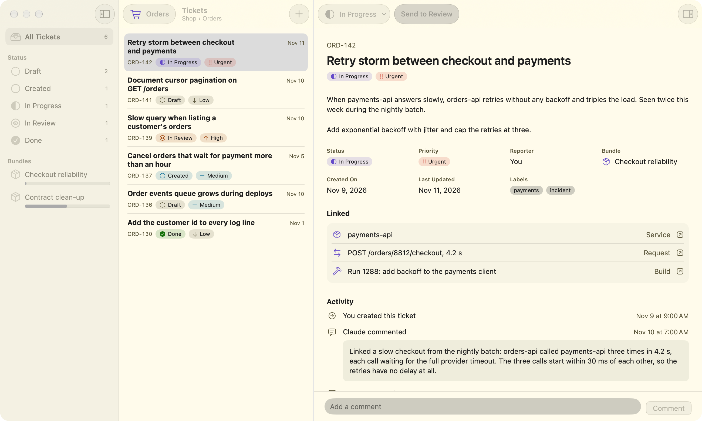
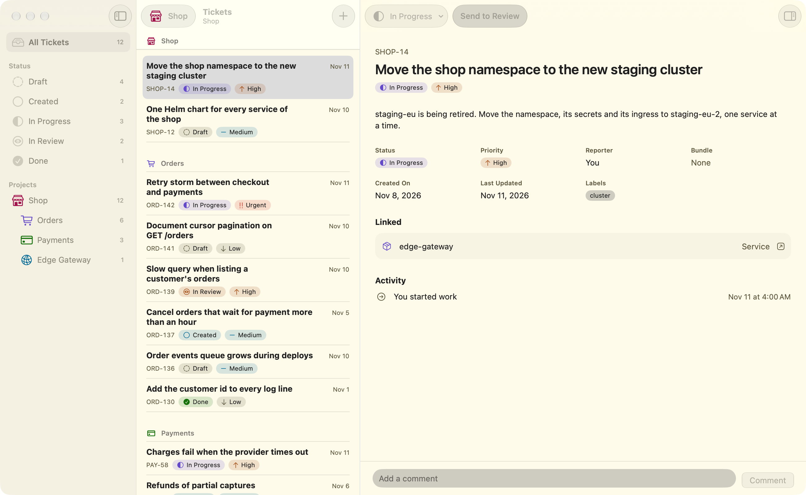
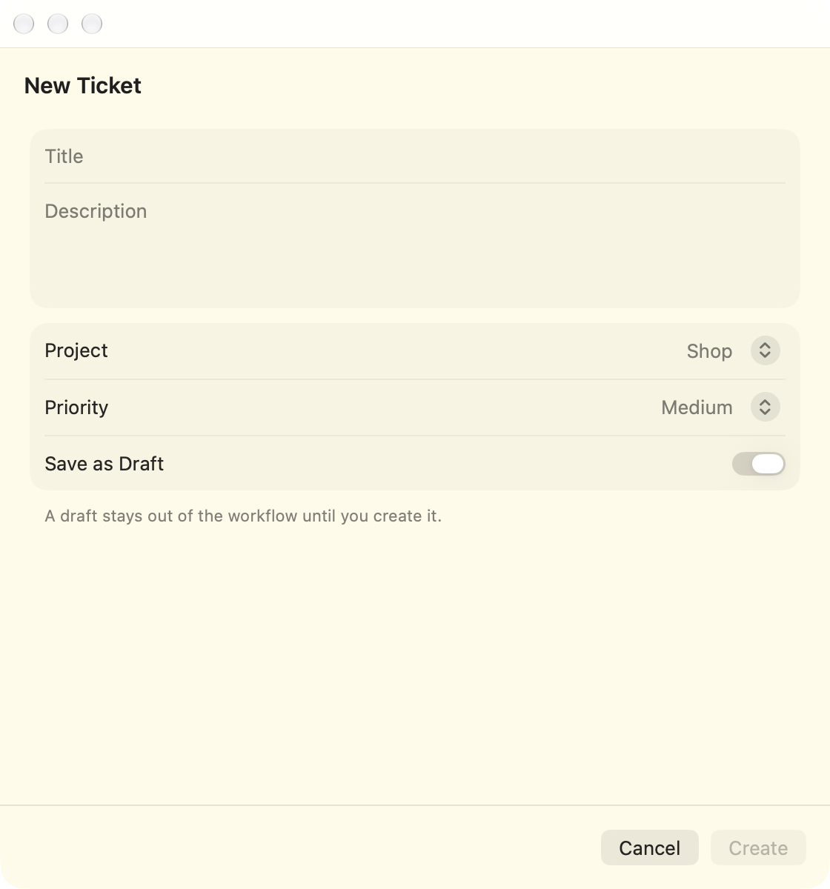
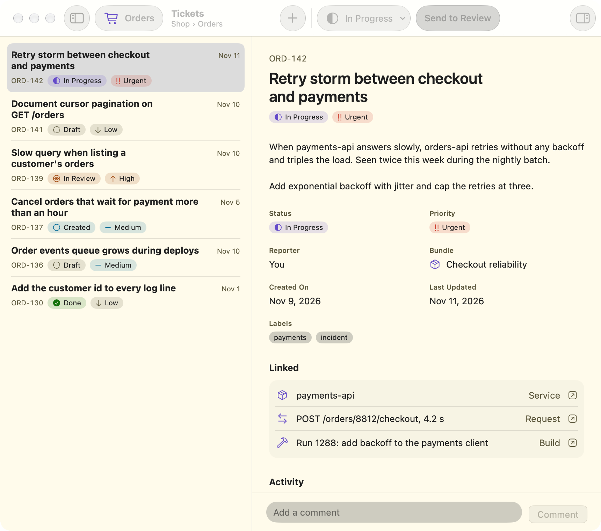
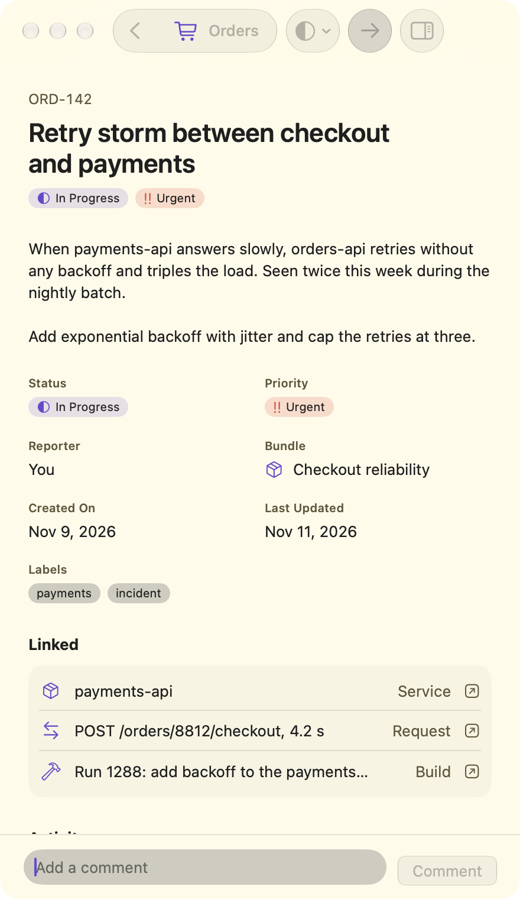

# Tickets

The Tickets window tracks the work on one project. The sidebar filters the tickets by status, by bundle or,
for a project with sub projects, by project. The middle column lists the tickets that the filter lets
through. The detail column shows the selected ticket: its header, description, properties, the items it
links to in other tools, and its activity with comments, above a comment field. The toolbar changes the
ticket's status and moves it to its next step, and a sheet writes a new ticket. A project with sub projects
lists their tickets too, grouped by project. All tickets and bundles are sample data.

*Tickets for Orders, a sub project of Shop. All Tickets is selected in the sidebar, and ORD-142 is open in the
detail column with its properties under the description. Light Mode.*

## Opening it

| Way in | What happens |
| --- | --- |
| **Window ▸ Tickets**, ⌘2 | Opens the Tickets window for the key window's project, or brings forward the one already showing it. Every kind of project has Tickets, so the item is enabled whenever the key window has a project. See [navigation.md › Menus and shortcuts](navigation.md#menus-and-shortcuts). |
| Projects window, **Tools** section | The **Tickets** tile reads "*n* open, *n* in review, *n* drafts" for the project and its sub projects, as this window lists them. Its **Open** button sends `.tool(.tickets, project:)`. |
| Projects window, **Activity** | A ticket event, such as "You started work on the retry storm between checkout and payments", opens the window on that ticket. The older events, such as "You closed the ticket about the flaky timeout test", name no ticket and open the window without a focus. |
| Menu bar panel | The highlighted project's row has a **Tickets** button, and ⌘2 opens Tickets for the highlighted project. |
| Project switcher | In any Tickets window, picking another project moves this window to it. The selection and filter start afresh. See [components.md › Project switcher](components.md#project-switcher). |
| Chat | The **Open** button of a "Read ticket ORD-142" row, or of a ticket in the Chat window's references, opens the window on that ticket. Such a row appears when a message attaches a ticket or names an existing ticket's id, such as ORD-142. |

- **Route.** `.tool(.tickets, project: <project id>, focus: <ticket id>)`. The focus is the ticket id, for
  example `ORD-142`. A route without a focus selects the first ticket of the list.
- **The ticket's own project.** Links to a ticket name the ticket's own project. A link to ORD-142 opens or
  brings forward the Orders window, even when a Shop window also lists ORD-142.
- **Window reuse.** A route brings forward the Tickets window already showing the project, un-minimized, and
  selects the focus there, without starting the window afresh. It selects the ticket even when it is the one
  the window was opened on and the user has picked another since. The filter stays, unless it hides the
  ticket: then the sidebar goes back to **All Tickets**, so the ticket's row shows. Only when no such window is
  open does a new one open. See [navigation.md › Window reuse](navigation.md#window-reuse).
- **Opened on a ticket.** In the iPhone layout, a window opened on a ticket starts on the ticket's page. A
  later route to a ticket opens its page too.
- **Unknown ticket.** A focus that names none of the window's tickets selects nothing in the list, and the
  detail column, or the page on iPhone, shows **Ticket Not Found** (see [States](#states)). No caller sends
  such a route yet.
- **Size.** A new window is 1180 × 760 pt. It does not open at launch.

## Anatomy

| Region | Contents |
| --- | --- |
| Toolbar | The project switcher, the title **Tickets** with the project's path as subtitle, **New Ticket**, the status menu, the next-step button, and the chat panel's button. |
| Sidebar | **All Tickets**, then the **Status**, **Projects** and **Bundles** sections. 190 to 280 pt wide, 220 by default. |
| Ticket list | The tickets that the sidebar's choice lets through. Grouped by project for a project with sub projects. While the sidebar is hidden, a filter bar above the list shows the filter that applies. 300 to 480 pt wide, 360 by default. |
| Ticket detail | The selected ticket: header, description, properties, **Linked**, **Activity**. It takes the rest of the width. |
| Comment composer | A comment field and **Comment**, pinned to the bottom of the ticket. |
| Chat panel | When shown: beside the window's content, over it, or as a full page, depending on the layout. See [Chat panel](#chat-panel). |

In the Mac layout the window is a three-column `NavigationSplitView`: sidebar, list and detail side by side,
each running the full height. The toolbar is split along the same columns. The sidebar column holds the
sidebar button. The list column holds the project switcher, the title and **New Ticket**. The detail column
holds the status menu and the next-step button at its leading edge, and the chat panel's button at its
trailing edge. The window and every column use the `canvas` background.

*The same window and ticket in Dark Mode.*

## Toolbar

The items are listed from left to right. In the iPhone layout the list and the ticket's page each have their
own toolbar (see [Layouts](#layouts)).

| Item | Control | Symbol | Shortcut | Behavior | Layouts |
| --- | --- | --- | --- | --- | --- |
| Sidebar | Button provided by `NavigationSplitView` | `sidebar.left` | None set by the window | Shows or hides the sidebar. | Mac, iPad |
| Project switcher | Button with a popover | The project's own symbol, in its tint | None | Shows the window's project. Picking another moves this window to it and clears the selection. Help: "Switch Project". | Mac, iPad, iPhone |
| Title | Window title and subtitle | None | None | **Tickets**, with the project's path as subtitle, for example "Shop › Orders". Hidden when the window is narrower than 760 pt. | Mac, iPad |
| **Filter** | Menu with an inline picker | `line.3.horizontal.decrease.circle`; `line.3.horizontal.decrease.circle.fill` while a filter applies | None | The sidebar's choices. See [Filter menu](#filter-menu-iphone). Help: "Filter Tickets". | iPhone (list) |
| **New Ticket** | Button | `plus` | ⇧⌘N (File ▸ New Ticket…) | Opens the [New Ticket sheet](#new-ticket-sheet). Help: "New Ticket (⇧⌘N)". | Mac, iPad (list column); iPhone (list) |
| Status | Menu | The ticket's status symbol, or `circle.dashed` | Its items: ⌃⌘1 to ⌃⌘5 | Shows the selected ticket's status, and lists the statuses to change it to. Not wired yet. Help: "Change Status". See [Status and next step](#status-and-next-step). | Mac, iPad: symbol and name; iPhone (page): symbol only |
| Next step | Button, `borderedProminent` | None; `arrow.right` on iPhone | ⇧⌘Return | Moves the ticket one step forward: its label is the step's name, such as **Send to Review**. Not wired yet. Help: the step's name and its shortcut, such as "Send to Review (⇧⌘↩)". | Mac, iPad: name; iPhone (page): symbol only |
| Chat | Button | `sidebar.right` | ⌃⌘C | Shows or hides the chat panel. It is the last item, at the right edge of the toolbar (the user's choice). Absent when Settings ▸ Chat turns the panel off. See [components.md › Chat panel button](components.md#chat-panel-button). | Mac, iPad, iPhone |

- **Steady toolbar.** The status menu and the next-step button stay in the toolbar when no ticket is selected,
  disabled, so the toolbar never shifts.
- **Right edge.** On Mac and iPad the detail column's items start at the column's left edge. A flexible
  space before the chat panel's button takes it to the right edge (`pushesToTrailingEdge: true`).
- **One chat button.** The list column's own chat button is turned off on Mac and iPad, so the window shows
  the button once, in the detail column. In the iPhone layout, the list and the page each show it last.
- **Label padding.** The project switcher, the status menu's name and the next step's name have 6 pt of
  padding on each side (`toolbarLabelPadding()`).

## Sidebar

A single-selection `List`. The selection is the window's filter. It starts on **All Tickets**. When nothing
is selected, the list shows all tickets.

| Row | Symbol | Badge | Lets through |
| --- | --- | --- | --- |
| **All Tickets** | `tray.full` | All the window's tickets | Every ticket. |
| **Status** section: one row per status, in workflow order | The status symbol (see [Status and next step](#status-and-next-step)) | The tickets in that status | The tickets in that status. |
| **Projects** section: the window's project, then its sub projects | The project's icon, in its tint | The tickets of that project and of its own sub projects | The tickets of that project and its own sub projects. |
| **Bundles** section: one row per bundle | `shippingbox` | None; a progress bar instead | The tickets in the bundle. |

- **Counts.** Badges count the tickets the window holds, before any filter.
- **Projects section.** It appears only for a project with sub projects. The rows follow the project tree,
  depth first. Each level below the window's project is indented 14 pt. For Shop, the rows are Shop, then
  Orders, Payments and Edge Gateway, indented. Selecting the window's own project row lets through the
  same tickets as **All Tickets**.
- **Bundles section.** It appears only when the window's project has bundles. Bundles stay per project: a
  parent's window lists only its own bundles, never its sub projects' (the user's choice). Each row shows the
  bundle's title on one line, with a mini linear progress bar under it: the share of the bundle's tickets
  that are **Done**.
- **Order.** **All Tickets**, **Status**, **Projects**, **Bundles**. The iPhone's **Filter** menu lists its
  sections in the same order.
- **Headings.** The section titles are headings for VoiceOver.
- **Keyboard.** The arrow keys move the selection when the sidebar has the keyboard focus.
- No context menus and no drag and drop.

## Ticket list

The tickets that the sidebar's choice lets through, in a single-selection `List` on the `canvas` background.
The tickets keep the order of the data. No sort is applied, and there is no search.

**Row.** Each row has two lines, with 4 pt of padding above and below:

- **First line:** the ticket's title (`headline`, `textPrimary`, at most two lines). The last-updated date
  (`caption`, `textSecondary`, day and abbreviated month, such as "11 Nov") is at the trailing edge.
- **Second line:** the ticket id (`caption`, `textSecondary`, monospaced digits), the status badge and the
  priority badge. Badges are capsules tinted with the value's color. See
  [components.md › Badge](components.md#badge).
- **Selected row.** The colors give way to the system's selection styles, so the text keeps its contrast.

**A parent's tickets, grouped by project.** For a project with sub projects, the list shows their tickets
too, at any depth. They are grouped in sections, one per project: the window's own project first, then each
sub project in tree order (the user's choice). Each section header shows the project's icon and name. A
project with no ticket left after the filter has no section. The grouping holds for every filter, so a status
or a project filter keeps the sections.

*Tickets for Shop, a parent project. The sidebar adds a Projects section with each project's count. The list
groups the tickets under Shop, then Orders and Payments. Shop has no bundles of its own, so the sidebar has no
Bundles section.*

- **Selection.** Clicking a row selects the ticket and shows it in the detail column. The selection survives
  a filter change: when the new filter hides the selected ticket, the detail column keeps showing it.
- **Keyboard.** The arrow keys move the selection when the list has the keyboard focus.
- **First selection.** A window opened without a focus selects the first row of the list. For Orders, that
  is ORD-142; for Shop, whose own tickets come first, SHOP-14.
- **No match.** When the filter lets no ticket through, the list says so and offers **Show All Tickets** (see
  [States](#states)).
- No context menus and no drag and drop.

**Filter bar.** While the sidebar is hidden, the list has no other way to show its filter. So whenever a
filter other than **All Tickets** applies, a bar above the list shows it:

- **When.** In the iPhone layout, and in the Mac and iPad layouts while the sidebar is folded away (the iPad
  layout folds it by default).
- **Look.** A capsule on `surfaceSunken`, 16 pt from the list's leading edge, with 8 pt above and below: the
  filter's symbol in `accent` (a status's symbol, a project's symbol, `shippingbox` for a bundle), its name
  on one line (`callout`, `textPrimary`), and `xmark.circle.fill` in `textSecondary`.
- **Click.** Shows all tickets again: the sidebar goes back to **All Tickets**. Help: "Show All Tickets".
- **VoiceOver.** One button: label "Filter", value the filter's name, hint "Shows all tickets."

## Ticket detail

Everything about the selected ticket, in a scroll view on the `canvas` background. The comment composer stays
at the bottom.

**Two arrangements.** The detail measures its own width:

| Width of the detail | Arrangement |
| --- | --- |
| 720 pt or more | Two columns. The left column holds the header, description, **Linked** and **Activity**, with 28 pt of padding and 26 pt between parts, and the composer at its bottom. A divider separates it from a 280 pt properties column on the right, on the `surface` background, with 20 pt of padding. The properties form a single column there. |
| Less than 720 pt | One column: header, description, properties, **Linked**, **Activity**, with 24 pt of padding and 26 pt between parts. The properties are laid out in as many columns of at least 150 pt as fit. The composer spans the width. |

At the default window size, the detail column is narrower than 720 pt, so the properties sit under the
description.

### Header

- **Ticket id** (`callout`, `textSecondary`, monospaced digits), such as ORD-142.
- **Title** (`title`, semibold, `textPrimary`). It can be selected and copied, and it is a heading for
  VoiceOver.
- **Status and priority badges.**

### Description

The ticket's text (`body`, `textPrimary`, 3 pt of line spacing), as written. It can be selected and copied.

### Properties

Each property shows its name (`caption`, semibold, `textSecondary`) above its value (`textPrimary`).

| Property | Value |
| --- | --- |
| **Status** | The status badge. |
| **Priority** | The priority badge. |
| **Reporter** | Who wrote the ticket: "You" or "Claude" in the sample data. |
| **Bundle** | The bundle's title after `shippingbox` in `accent`, or "None" in `textSecondary`. |
| **Created On** | Day, month and year, such as "9 Nov 2026". |
| **Last Updated** | Day, month and year. |
| **Labels** | One capsule per label (`caption`, on `surfaceSunken`). |

The Bundle property shows the bundle the ticket is in among its own project's bundles. In a parent's
window, a sub project's ticket shows its bundle too, though the sidebar lists only the parent's own bundles:
in the Shop window, ORD-142 reads Checkout reliability.

**Priorities**

| Priority | Symbol | Color |
| --- | --- | --- |
| Low | `arrow.down` | `textSecondary` |
| Medium | `minus` | `info` |
| High | `arrow.up` | `warning` |
| Urgent | `exclamationmark.2` | `danger` |

### Linked

The items in other tools that the ticket points to, under the heading **Linked**. The section appears only
when the ticket has links. The rows sit in a group box, separated by dividers. Each row shows the kind's
symbol in `accent`, the item's title on one line, the kind's name in `textSecondary`, and
`arrow.up.forward.app`. The whole row is one plain button. Clicking it opens the other tool's window on the
item, for the ticket's own project, through a route. That window is brought forward if it is already open.

| Kind | Symbol | Opens | Focus |
| --- | --- | --- | --- |
| Service | `shippingbox` | Service Map | `service:<name>`, such as `service:payments-api` |
| Request | `arrow.left.arrow.right` | Service Map | `request:<id>`, such as `request:req-8f3a` |
| Contract | `curlybraces.square` | Contracts | The operation id, such as `listOrders` |
| Build | `hammer` | Builds | The run number, such as `1288` |

### Activity

The ticket's history under the heading **Activity**, in the order of the data (oldest first in the samples),
14 pt apart. Each entry shows its symbol in `textSecondary`, its text in `textPrimary`, and its date and time
at the trailing edge (`callout`, `textSecondary`, such as "10 Nov at 07:00"). A comment's text follows under
the entry, in a rounded box on the `surface` color with 12 pt of padding. The text can be selected and
copied.

| Entry | Symbol | Example |
| --- | --- | --- |
| Drafted | `sparkles` | "Claude drafted this ticket" |
| Status changed | `arrow.right.circle` | "You started work" |
| Commented | `text.bubble` | "Claude commented", with the comment under it |

### Comment composer

A bar pinned to the bottom of the ticket, under a divider, on the `canvas` background, with 20 pt of padding
on the sides and 12 pt above and below. In the two-column arrangement it spans the left column only.

- **Comment field.** "Add a comment" as placeholder. A plain text field in a `surfaceSunken` capsule, with
  10 pt of padding on the sides and 7 pt above and below. It grows from one to six lines.
- **One draft per ticket.** What is typed belongs to the ticket. Selecting another ticket shows that
  ticket's own draft, empty at first, and going back to the first ticket shows its draft again. Drafts last
  until the window closes or moves to another project.
- **Comment.** A `glassProminent` button, disabled while the field is empty or holds only spaces and line
  breaks. Its shortcut is ⌘Return, and its help reads "Add the Comment (⌘↩)". Not wired yet: clicking it
  leaves the text in place.

## Status and next step

The status menu and the next-step button act on the selected ticket. Both are in the detail column's toolbar
on Mac and iPad, and in the page's toolbar on iPhone.

- **Status menu.** Its label shows the current status, with its symbol and name on Mac and iPad, and its
  symbol alone on iPhone. With no ticket selected it reads "Status" with `circle.dashed`, disabled. The menu
  lists the five statuses with their symbols and their shortcuts, ⌃⌘1 to ⌃⌘5 in workflow order. The current
  status is disabled, and so is its shortcut. Choosing one is not wired yet.
- **Next step.** A prominent button named after the step that follows the current status. Its shortcut is
  ⇧⌘Return, and its help names the step and the shortcut, such as "Send to Review (⇧⌘↩)". On iPhone it shows
  `arrow.right` alone, with the step's name as its VoiceOver label. It is disabled for a **Done** ticket and
  when no ticket is selected, and then reads "Next Step". Not wired yet.
- **Shortcuts.** They act on the selected ticket while the Tickets window is the key window, and do nothing
  while their control is disabled.

| Status | Symbol | Color | Shortcut | Next step |
| --- | --- | --- | --- | --- |
| Draft | `circle.dashed` | `textSecondary` | ⌃⌘1 | **Create Ticket** |
| Created | `circle` | `info` | ⌃⌘2 | **Start Work** |
| In Progress | `circle.lefthalf.filled` | `accent` | ⌃⌘3 | **Send to Review** |
| In Review | `eye.circle` | `warning` | ⌃⌘4 | **Mark as Done** |
| Done | `checkmark.circle.fill` | `success` | ⌃⌘5 | None: the button is disabled |

The statuses are shared with the Dashboard's Tickets widget, which counts tickets by status
(`TicketStatus`, in `ToolsFoundation/Vocabulary.swift`).

## New Ticket sheet

*The New Ticket sheet, empty. Priority is Medium and Save as Draft is on. Create stays disabled until the
ticket has a title.*

*In Shop's window the sheet adds **Project**: Shop or one of its sub projects.*

A sheet over the window, opened by **New Ticket** in the toolbar or by the **New Ticket** button of the empty
list, on the `canvas` background.

- **Size.** In the Mac and iPad layouts it is 460 to 480 pt wide. In the iPhone layout it takes the window's
  width less 12 pt on each side, up to 480 pt, so it fits the narrowest window: 366 pt in a 390 pt window. It
  is 360 pt high at least, 400 pt by default, or 440 pt with the Project field. The form scrolls when the
  sheet is shorter than its fields.

| Part | Contents |
| --- | --- |
| Heading | **New Ticket** (`title3`, semibold), a heading for VoiceOver. |
| First group | **Title**: a text field with "Title" as placeholder. **Description**: a text field with "Description" as placeholder, four lines high, growing to eight. |
| Second group | **Project**: a picker of the window's project and its sub projects, by name, in tree order. Only for a project with sub projects. **Priority**: a picker with Low, Medium, High and Urgent, set to Medium. **Save as Draft**: a switch, on. Footer: "A draft stays out of the workflow until you create it." |
| Bottom bar | Under a divider, at the trailing edge: **Cancel** and **Create**. |

- **Project.** In a parent's window, such as Shop, the Project field says where the ticket goes: Shop,
  Orders, Payments or Edge Gateway. It starts on the project picked in the sidebar's **Projects** section, or
  on the window's own project when the sidebar shows anything else. A window without sub projects has no
  Project field: the ticket goes to the window's project.
- **Cancel** closes the sheet. Its shortcut is Escape.
- **Create** closes the sheet. Its shortcut is Return. It is disabled while the title is empty or holds only
  spaces and line breaks.
- **Nothing is saved.** The fields hold what is typed and nothing else. Both buttons only close the sheet, and
  no ticket is created. Not wired yet.
- **Fresh each time.** The sheet opens empty every time, with the Project field on its starting project.

## States

| State | When | What shows |
| --- | --- | --- |
| Tickets listed | The filter lets tickets through | The list, with the selected ticket in the detail column. |
| Grouped | The window's project has sub projects | The list in sections per project, and the sidebar's **Projects** section. |
| Filtered | A filter other than **All Tickets** applies, and the sidebar is hidden | The [filter bar](#ticket-list) above the list, with the filter's name. On iPhone the **Filter** button's symbol is filled. |
| No tickets | The project has no tickets | **No Tickets** with `ticket`: "Tickets you create or draft show up here.", and a **New Ticket** button that opens the sheet. |
| No matching tickets | The project has tickets, but the filter lets none through | **No Matching Tickets** with `line.3.horizontal.decrease.circle`, one sentence that names the filter, and **Show All Tickets**, which puts the sidebar back on **All Tickets**. The sentences: "No ticket is a draft.", "No ticket is waiting to start." (Created), "No ticket is in progress.", "No ticket is in review.", "No ticket is done.", and for a project or a bundle, "*Name* has no tickets." |
| No selection | No ticket is selected (Mac and iPad) | **No Ticket Selected** with `ticket`: "Pick a ticket to see its details." The status menu reads "Status" and the next-step button "Next Step", both disabled. |
| Ticket not found | A route's focus names none of the window's tickets | **Ticket Not Found** with `ticket`: "*Project* has no ticket with the id *id*.", such as "Orders has no ticket with the id ORD-999.", in the detail column, or as the page on iPhone, with Back. No row is selected, and the status menu and the next step are disabled. Picking a ticket replaces it. |
| Done ticket | The ticket's status is Done | The next-step button reads "Next Step", disabled. **Done** is disabled in the status menu. |
| No links | The ticket links to nothing | No **Linked** section. |
| No bundle | The ticket is in none of the window's bundles | **Bundle** reads "None". |

*Orders' window opened on ORD-999, which it doesn't have: **Ticket Not Found** in the detail column.*
| Empty comment | The comment field is empty, or holds only spaces and line breaks | **Comment** is disabled. |
| Untitled new ticket | The sheet's title is empty, or holds only spaces and line breaks | **Create** is disabled. |
| Loading | Previews only | "Loading Tickets" with a progress indicator, in the list column. The window never shows it. |
| Error | Previews only | **Couldn't Load Tickets** with `exclamationmark.triangle`, the error's message as given, and **Try Again** (not wired yet). The window never shows it. |
| Chat panel off | Settings ▸ Chat turns the panel off | No chat button in the toolbar. |
| No project | The window's value names no project | **No Project** with `folder`: "Open this window from the Projects window." See [navigation.md](navigation.md). |
| Sample only | Always | Every ticket, bundle and event is sample data. |

## Layouts

Tickets needs 900 pt for its three columns (`macLayoutWidth`). The window picks its layout from its width
(see [foundations.md › Layout system](foundations.md#layout-system)), and Tickets adapts its panes to it (the
user's choice).

| Layout | When | What changes |
| --- | --- | --- |
| Mac | The window is at least 900 pt wide, or at least 1241 pt with the chat panel open | Sidebar, list and detail side by side. The chat panel sits beside them, and the columns make room for it. |
| iPad | From 640 pt up to the Mac width | The sidebar folds away behind the sidebar button (the user's choice). The list and the detail stay side by side, and the sidebar button shows the sidebar again. While the sidebar is folded, the filter bar shows the filter that applies. The toolbar keeps its items. The chat panel slides over the content, with a shadow. |
| iPhone | Narrower than 640 pt | One pane at a time (the user's choice). The list comes first, with the sidebar's choices in a **Filter** menu and the filter bar above it while a filter applies. The list starts with nothing selected, unless the window was opened on a ticket, which starts on its page. Picking a ticket pushes its page, with a Back button. The status menu and the next-step button become symbols. The New Ticket sheet narrows to fit the window. The chat panel fills the window. A window that narrows to this width keeps its selection and shows that item's page, as a collapsing split view does ([Foundations › Layout system](foundations.md#layout-system)). |

- **Sidebar on a layout change.** Entering the Mac layout shows the sidebar. Entering the iPad or iPhone
  layout folds it. Within a layout, the sidebar button's choice holds.
- **Chat panel at the default size.** The default window is 1180 pt wide, less than the 1241 pt the Mac
  layout needs with the panel open. Opening the chat panel at that size switches the window to the iPad
  layout: the sidebar folds and the panel slides over the ticket.
- **The detail's own width.** Independently of the layout, the detail switches between its two arrangements
  at 720 pt (see [Ticket detail](#ticket-detail)).
- **Smallest window.** 390 × 420 pt.

*At iPad width the sidebar folds behind its button. The toolbar keeps New Ticket, the status menu, the next
step and the chat panel's button, and the properties of ORD-142 take two columns.*

### Filter menu (iPhone)

The iPhone layout has no room for the sidebar. A **Filter** menu in the list's toolbar offers the same choices
as an inline picker, with a checkmark on the current one, in the sidebar's order:

- **All Tickets**;
- **Status**: the five statuses;
- **Projects**: the window's project and its sub projects, when it has any;
- **Bundles**: the window's bundles, when it has any.

The choices show names only, without symbols, counts or progress. The menu's symbol fills while a filter
other than **All Tickets** applies, VoiceOver reads the filter's name as the menu's value, and the filter
bar above the list names the filter.

### List then page (iPhone)

The list's toolbar holds the project switcher, **Filter**, **New Ticket** and the chat panel's button, in
that order. Picking a ticket pushes its page over the list (`PhoneStack`, see
[components.md › Phone stack](components.md#phone-stack)). The page's toolbar holds Back with the project
switcher, the status menu, the next step and the chat panel's button. Back returns to the list and clears the
selection, so picking the same ticket again opens its page again. A window opened on a ticket starts on its
page, and a later route to a ticket of the window opens that ticket's page.

*At iPhone width, the list. The toolbar holds the project switcher, Filter, New Ticket and the chat panel's
button.*

*ORD-142's page at iPhone width. Back sits with the project switcher. The status menu and the next step show
their symbols only, and the properties take two columns.*

## Chat panel

The window reports the selected ticket as the chat panel's subject (`TicketsReader.reference`): the ticket's
id as title and focus, with the ticket's own project. In a parent's window, a sub project's ticket keeps its
own project. When the selection changes, the subject follows. When nothing is selected, there is no subject,
and the panel asks about the window's project.

| Subject | Heading of a new chat | Suggestions |
| --- | --- | --- |
| A ticket, such as ORD-142 | "Ask about ORD-142" | The questions the Tickets tool words for the ticket's status (below) |
| None | "Ask about *project*", such as "Ask about Orders" | "What changed this week?", "What needs my attention?" |

In both cases the heading is followed by "Claude reads it through Tickets, and asks before it changes
anything."

- **Reading a ticket.** Claude reads a ticket through the Tickets tool's read function (`TicketsReader.read`),
  as any client of the tool would. The transcript shows "Read ticket ORD-142", with one sentence that gives
  the ticket's title, status and priority, such as "“Retry storm between checkout and payments” is in
  progress, with urgent priority." A done ticket reads "“…” is done. Its priority was low."
- **Suggestions.** The read also returns the questions worth asking about the ticket where it is in its
  life: first the question its status raises, then a summary. The chat offers them.

  | Status | Suggestions, for ORD-142 |
  | --- | --- |
  | Draft | "Is ORD-142 ready to create?", "Summarize ORD-142" |
  | Created | "Where should work on ORD-142 start?", "Summarize ORD-142" |
  | In Progress | "What's left before ORD-142 can go to review?", "Summarize ORD-142" |
  | In Review | "Is ORD-142 ready to be marked as done?", "Summarize ORD-142" |
  | Done | "What did ORD-142 change?", "Summarize ORD-142" |

- **Unknown ticket.** A read of an id that names no ticket returns nothing.
- **Changing a ticket.** Settings ▸ Chat ▸ **Change tickets** sets whether Claude may change tickets:
  **Never**, **Ask First** (the default) or **Always**.

See [Chat](chat.md) for the panel itself.

## Accessibility

| Element | Identifier | Label or notes |
| --- | --- | --- |
| **All Tickets** row | `tickets.sidebar.all` | Badge: the ticket count. |
| Status row | `tickets.sidebar.<status>`, for example `tickets.sidebar.inProgress` | Status raw values: `draft`, `created`, `inProgress`, `inReview`, `done`. |
| Project row | `tickets.sidebar.project.<project id>`, for example `tickets.sidebar.project.ORD` | The project's icon is hidden from accessibility. |
| Bundle row | `tickets.sidebar.bundle.<bundle id>`, for example `tickets.sidebar.bundle.ORD-B3` | The progress bar reads "*n* of *m* done". |
| **Status**, **Projects**, **Bundles** (sidebar and Filter menu) | None | Headings. |
| **Filter** menu | `tickets.filterMenu` | Label "Filter", value the filter's name. Help "Filter Tickets". iPhone only. |
| **Filter** menu's choices | `tickets.filterMenu.all`, `tickets.filterMenu.<status>`, `tickets.filterMenu.project.<project id>`, `tickets.filterMenu.bundle.<bundle id>` | The choice's name. |
| Filter bar | `tickets.filterBar` | One button: label "Filter", value the filter's name, hint "Shows all tickets." Help "Show All Tickets". |
| **New Ticket** (toolbar) | `tickets.list.new` | Help "New Ticket (⇧⌘N)". |
| **No Tickets** | `tickets.list.empty` | Contains its title, sentence and button. |
| **New Ticket** (empty list) | `tickets.list.empty.new` | None. |
| **No Matching Tickets** | `tickets.list.noMatch` | Contains its title, sentence and button. |
| **Show All Tickets** (no match) | `tickets.list.noMatch.showAll` | None. |
| Loading indicator | `tickets.list.loading` | "Loading Tickets". |
| **Couldn't Load Tickets** | `tickets.list.error` | Contains its title, the error's message and its button. |
| **Try Again** | `tickets.list.retry` | None. |
| Ticket row | `tickets.row.<ticket id>`, for example `tickets.row.ORD-142` | One element: title, date, id, status and priority. |
| Project group header | `tickets.group.<project id>`, for example `tickets.group.SHOP` | The project's name. Heading. |
| **No Ticket Selected** | `tickets.detail.empty` | Contains its title and sentence. |
| **Ticket Not Found** | `tickets.detail.notFound` | Contains its title and sentence. |
| Status menu | `ticket.status.menu` | Label: the status's name, or "Status". Help "Change Status". |
| Status menu's items | `ticket.status.<status>`, for example `ticket.status.done` | The status's name. Shortcuts ⌃⌘1 to ⌃⌘5. |
| Next step | `ticket.nextStep` | Label: the step's name, or "Next Step". Help: the step's name and "(⇧⌘↩)". On iPhone the symbol alone shows, and the label is still read. |
| Chat panel button | `toolbar.chatPanel` | Label "Chat". Help "Show the Chat Panel (⌃⌘C)" or "Hide the Chat Panel (⌃⌘C)". |
| Project switcher | `toolbar.projectSwitcher` | Help "Switch Project". |
| Ticket detail | `ticket.detail` | Contains every part of the ticket. |
| Ticket id | `ticket.number` | None. |
| Ticket title | `ticket.title` | Heading. |
| Description | `ticket.description` | None. |
| Properties | `ticket.properties` | Each property is one element: its name and its value. The Bundle property's symbol is hidden. |
| Link row | `ticket.link.<link id>`, for example `ticket.link.l1` | One button: title and kind. The kind's symbol and the trailing arrow are hidden from accessibility. Unique within the ticket shown. |
| **Linked**, **Activity** | None | Headings. |
| Activity entry | `ticket.activity.<event id>`, for example `ticket.activity.2` | One element: text, date and comment. The symbol is hidden from accessibility. Unique within the ticket shown. |
| Comment field | `ticket.comment` | Placeholder "Add a comment". |
| **Comment** | `ticket.comment.send` | Help "Add the Comment (⌘↩)". |
| New Ticket sheet | `newTicket.sheet` | Contains every field of the sheet. |
| New Ticket heading | None | Heading. |
| **Title** field | `newTicket.title` | Label "Title" (hidden visually). |
| **Description** field | `newTicket.description` | Label "Description" (hidden visually). |
| **Project** | `newTicket.project` | Only for a project with sub projects. |
| **Priority** | `newTicket.priority` | None. |
| **Save as Draft** | `newTicket.draft.toggle` | None. |
| **Cancel** | `newTicket.cancel` | Escape. |
| **Create** | `newTicket.create` | Return. |
| Dashboard's Tickets widget | `dashboard.tickets.<status>`, `dashboard.tickets.subprojects` | Each count is one element: the number and the status's name; the status symbol is hidden. |

- **Color with meaning.** Statuses and priorities always show a symbol and a name with their color.
- **Strings.** Labels, headings, sentences, status, priority and kind names come from TicketsKit's String
  Catalog, as whole sentences with the values inside them. Ticket titles, descriptions, ids, labels,
  reporters, comments, link titles, bundle and project names are shown verbatim. Dates use the system's
  formats.

## Sample data and limits

- **Sample tickets.** There are 18 (`Ticket.samples`), across seven projects:

  | Project | Tickets |
  | --- | --- |
  | Orders (`ORD`) | ORD-142, ORD-141, ORD-139, ORD-137, ORD-136, ORD-130 |
  | Payments (`PAY`) | PAY-58, PAY-57, PAY-55 |
  | Edge Gateway (`GW`) | GW-21 |
  | Tools (`TLS`) | TLS-12, TLS-11, TLS-9 |
  | AZDesign (`AZD`) | AZD-7 |
  | Shop (`SHOP`) | SHOP-14, SHOP-12 |
  | ToolsKit (`TKIT`) | TKIT-4, TKIT-3 |

  Shop is the parent of Orders, Payments and Edge Gateway, so its window lists 12 tickets. Tools is the
  parent of ToolsKit.
- **Sample bundles.** There are three (`TicketBundle.samples`): Checkout reliability (ORD-142, ORD-139,
  ORD-137) and Contract clean-up (ORD-141, ORD-130) in Orders, and Provider timeouts (PAY-58, PAY-55) in
  Payments.
- **Sample dates.** Dates are relative to the sample clock, 11 November 2026 at 14:00.
- **Not wired yet:**
  - the status menu's items;
  - the next-step button;
  - **Comment**;
  - **Create** and **Cancel** in the New Ticket sheet, which only close it;
  - **Try Again** in the error state.
- **Shortcuts of actions not wired yet.** ⌃⌘1 to ⌃⌘5, ⇧⌘Return and ⌘Return press their controls, whose
  actions are still empty.
- **What works:** filtering from the sidebar, the **Filter** menu or the filter bar, selection, routes to a
  ticket of an open window, the detail's two arrangements, the links to other tools, one comment draft per
  ticket, the New Ticket sheet's fields, the chat panel's subject and suggestions, and the three layouts.
- **Not shown by the window.** The loading and error states appear in previews only: the window always has
  its tickets.
- **Not there yet.** No sort, no search, no editing of a ticket's title, description or properties.
- **Other clients.** `TicketsReader.read` answers from the sample tickets. In the real suite it would answer
  from the tool's API.

## Previews

Every view's previews use the window's model or the sample tickets. Names are stable, so a preview can be
pointed at, such as "TicketsRootView, iPhone, Filtered".

`TicketsRootView`, with `TicketsModel` on the sample tickets:

| Preview | Traits and size | Shows |
| --- | --- | --- |
| "Loaded" | `.appChrome`, 1180 × 760 pt | Orders, All Tickets, ORD-142 selected. |
| "Loaded, Dark" | Same | The same, in Dark Mode. |
| "Parent Project" | Same | Shop: the Projects section, the list grouped by project, SHOP-14 selected. |
| "Bundle" | Same | Orders, the Checkout reliability bundle selected, ORD-139 selected. |
| "No Matching Tickets" | Same | Tools, Done selected in the sidebar. |
| "Ticket Not Found" | Same | Orders, opened on ORD-999. |
| "Empty" | Same | AZDesign with no tickets and no bundles. |
| "iPad" | `.padLayout`, 760 × 760 pt | Orders, ORD-142, the sidebar folded. |
| "iPad, Filtered" | Same | The same, In Progress selected: the filter bar above the list. |
| "iPhone" | `.phoneLayout`, 420 × 800 pt | Shop's list, grouped. |
| "iPhone, Filtered" | Same | Orders' list, the Checkout reliability bundle selected: the filter bar, and the **Filter** symbol filled. |
| "iPhone, Ticket" | Same | ORD-142's page. |
| "iPhone, Dark" | Same | Orders' list, in Dark Mode. |
| "Largest Text" | `.largestText`, 1180 × 760 pt | Orders at the largest Dynamic Type size. |
| "Largest Text, iPhone" | `.phoneLayout`, `.largestText`, 420 × 800 pt | ORD-142's page at the largest Dynamic Type size. |

`TicketListView` (360 × 620 pt unless noted):

- "Loaded", "Loaded, Dark": every sample ticket, ORD-142 selected.
- "Grouped": Shop's tickets grouped by project, SHOP-14 selected.
- "Largest Text": every sample ticket at the largest Dynamic Type size, 420 × 800 pt.
- "Loading", "Empty", "No Matching Tickets" (Tools, Done), "Error".
- "Row": one row, 340 pt wide.
- "Filter Bar": the filter bar for In Progress, 390 pt wide.

`TicketDetailView` (`.appChrome`, with its toolbar actions):

- "Loaded": ORD-142 at 980 × 760 pt, two columns.
- "Narrow": ORD-142 at 600 × 760 pt, one column.
- "Loaded, Dark": ORD-142 at 640 × 720 pt, in Dark Mode.
- "Draft": ORD-141 at 640 × 720 pt.
- "Done": ORD-130 at 640 × 720 pt.
- "Comment Draft": ORD-142 with a comment typed, **Comment** enabled.
- "iPhone": ORD-142 in the iPhone layout, 420 × 800 pt, with the compact actions.
- "Largest Text": ORD-142 at the largest Dynamic Type size, 640 × 800 pt.
- "Not Found": **Ticket Not Found** for ORD-999 in Orders, 640 × 480 pt.

`NewTicketView` (size that fits):

- "Empty": Orders, no Project field.
- "Filled": a high-priority ticket, not a draft.
- "Filled, Dark".
- "Blank Title": a title of spaces, **Create** disabled.
- "Parent Project": Shop, with the Project field.
- "iPhone": Shop, 366 pt wide, as in a 390 pt window.
- "Largest Text": Shop at the largest Dynamic Type size.

`TicketsDashboardWidget` (size that fits):

- "Loaded": Orders, every status, without sub projects.
- "Sub Projects": Shop with its sub projects, and "Sub projects included".
- "Two Statuses, Dark": Orders, In Progress and In Review, in Dark Mode.
- "No Statuses": no status checked.
- "Largest Text": Shop at the largest Dynamic Type size.

## Open issues

None.
