# Tickets

The Tickets window tracks the work on one project. The sidebar filters the tickets by status, by bundle or,
for a project with sub projects, by project. The middle column lists the tickets that the filter lets
through. The detail column shows the selected ticket: its header, description, properties, the items it
links to in other tools, and its activity with comments, above a comment field. The toolbar changes the
ticket's status and moves it to its next step, and a sheet writes a new ticket. A project with sub projects
lists their tickets too, grouped by project. The tickets and bundles are the project's own files
([Data › Tickets and bundles](../data.md#tickets-and-bundles)); every change applies their rules and is
written at once, and a change made outside the app (git, an editor, Claude) shows within 2 seconds. The
screenshots show the sample tickets of the previews.

*Tickets for Orders, a sub project of Shop. All Tickets is selected in the sidebar, and ORD-142 is open in the
detail column with its properties under the description. Light Mode.*

## Opening it

| Way in                             | What happens                                                                                                                                                                                                                                                                        |
|------------------------------------|-------------------------------------------------------------------------------------------------------------------------------------------------------------------------------------------------------------------------------------------------------------------------------------|
| **Window ▸ Tickets**, ⌘2           | Opens the Tickets window for the key window's project, or brings forward the one already showing it. Every kind of project has Tickets, so the item is enabled whenever the key window has a project. See [navigation.md › Menus and shortcuts](navigation.md#menus-and-shortcuts). |
| Projects window, **Tools** section | The **Tickets** tile reads "*n* open, *n* in review, *n* drafts" for the project and its sub projects, as this window lists them, from the loaded tickets (open: neither done nor a draft). Its **Open** button sends `.tool(.tickets, project:)`.                                  |
| Projects window, **Activity**      | A ticket event, such as "You started work on the retry storm between checkout and payments", opens the window on that ticket. The older events, such as "You closed the ticket about the flaky timeout test", name no ticket and open the window without a focus.                   |
| Menu bar panel                     | The highlighted project's row has a **Tickets** button, and ⌘2 opens Tickets for the highlighted project.                                                                                                                                                                           |
| Project switcher                   | In any Tickets window, picking another project moves this window to it. The selection and filter start afresh. See [components.md › Project switcher](components.md#project-switcher).                                                                                              |
| Chat                               | The **Open** button of a "Read ticket ORD-142" row, or of a ticket in the Chat window's references, opens the window on that ticket. Such a row appears when a message attaches a ticket or names an existing ticket's id, such as ORD-142.                                         |

- **Route.** `.tool(.tickets, project: <project id>, focus: <ticket id>)`. The focus is the ticket id, for
  example `ORD-142`, or a bundle id, such as `ORD-B3`, which selects the bundle in the sidebar. A route
  without a focus selects the first ticket of the list. A ticket or bundle id in a description or a comment
  is a link that sends this route ([Markdown](#markdown)).
- **The ticket's own project.** Links to a ticket name the ticket's own project. A link to ORD-142 opens or
  brings forward the Orders window, even when a Shop window also lists ORD-142.
- **Window reuse.** A route brings forward the Tickets window already showing the project, un-minimized, and
  selects the focus there, without starting the window afresh. It selects the ticket even when it is the one
  the window was opened on and the user has picked another since. The filter stays, unless it hides the
  ticket: then the sidebar goes back to **All Tickets**, so the ticket's row shows. Only when no such window is
  open does a new one open. See [navigation.md › Window reuse](navigation.md#window-reuse).
- **Opened on a ticket.** In the iPhone layout, a window opened on a ticket starts on the ticket's page. A
  later route to a ticket opens its page too.
- **Unknown ticket.** A focus that names none of the window's tickets selects nothing in the list, and the
  detail column, or the page on iPhone, shows **Ticket Not Found** (see [States](#states)). No caller sends
  such a route yet.
- **Size.** A new window is 1180 × 760 pt. It does not open at launch.

## Anatomy

| Region           | Contents                                                                                                                                                                                                                            |
|------------------|-------------------------------------------------------------------------------------------------------------------------------------------------------------------------------------------------------------------------------------|
| Toolbar          | The project switcher, the title **Tickets** with the project's path as subtitle, **New Ticket**, the status menu, the next-step button, and the chat panel's button.                                                                |
| Sidebar          | **All Tickets**, then the **Status**, **Projects** and **Bundles** sections. 190 to 280 pt wide, 220 by default.                                                                                                                    |
| Ticket list      | The tickets that the sidebar's choice lets through. Grouped by project for a project with sub projects. While the sidebar is hidden, a filter bar above the list shows the filter that applies. 300 to 480 pt wide, 360 by default. |
| Ticket detail    | The selected ticket: header, description, properties, **Linked**, **Activity**. It takes the rest of the width.                                                                                                                     |
| Comment composer | A comment field and **Comment**, pinned to the bottom of the ticket.                                                                                                                                                                |
| Chat panel       | When shown: beside the window's content, over it, or as a full page, depending on the layout. See [Chat panel](#chat-panel).                                                                                                        |

In the Mac layout the window is a three-column `NavigationSplitView`: sidebar, list and detail side by side,
each running the full height. The toolbar is split along the same columns. The sidebar column holds the
sidebar button. The list column holds the project switcher, the title and **New Ticket**. The detail column
holds the status menu and the next-step button at its leading edge, and the chat panel's button at its
trailing edge. The window and every column use the `canvas` background.

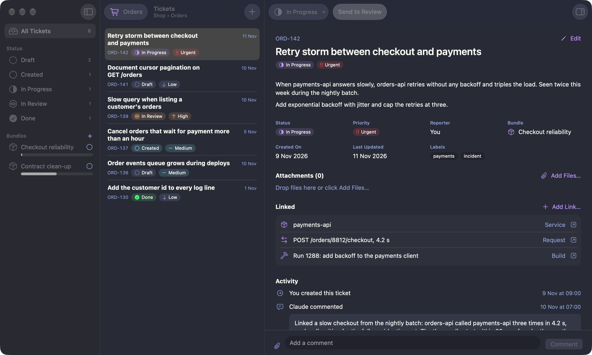
*The same window and ticket in Dark Mode.*

## Toolbar

The items are listed from left to right. In the iPhone layout the list and the ticket's page each have their
own toolbar (see [Layouts](#layouts)).

| Item             | Control                                  | Symbol                                                                                               | Shortcut                 | Behavior                                                                                                                                                                                                                             | Layouts                                                |
|------------------|------------------------------------------|------------------------------------------------------------------------------------------------------|--------------------------|--------------------------------------------------------------------------------------------------------------------------------------------------------------------------------------------------------------------------------------|--------------------------------------------------------|
| Sidebar          | Button provided by `NavigationSplitView` | `sidebar.left`                                                                                       | None set by the window   | Shows or hides the sidebar.                                                                                                                                                                                                          | Mac, iPad                                              |
| Project switcher | Button with a popover                    | The project's own symbol, in its tint                                                                | None                     | Shows the window's project. Picking another moves this window to it and clears the selection. Help: "Switch Project".                                                                                                                | Mac, iPad, iPhone                                      |
| Title            | Window title and subtitle                | None                                                                                                 | None                     | **Tickets**, with the project's path as subtitle, for example "Shop › Orders". Hidden when the window is narrower than 760 pt.                                                                                                       | Mac, iPad                                              |
| **Filter**       | Menu with an inline picker               | `line.3.horizontal.decrease.circle`; `line.3.horizontal.decrease.circle.fill` while a filter applies | None                     | The sidebar's choices. See [Filter menu](#filter-menu-iphone). Help: "Filter Tickets".                                                                                                                                               | iPhone (list)                                          |
| **New Ticket**   | Button                                   | `plus`                                                                                               | ⇧⌘N (File ▸ New Ticket…) | Opens the [New Ticket sheet](#new-ticket-sheet). Help: "New Ticket (⇧⌘N)".                                                                                                                                                           | Mac, iPad (list column); iPhone (list)                 |
| Status           | Menu                                     | The ticket's status symbol, or `circle.dashed`                                                       | Its items: ⌃⌘1 to ⌃⌘5    | Shows the selected ticket's status, and lists the statuses to change it to. Help: "Change Status". See [Status and next step](#status-and-next-step).                                                                                | Mac, iPad: symbol and name; iPhone (page): symbol only |
| Next step        | Button, `borderedProminent`              | None; `arrow.right` on iPhone                                                                        | ⇧⌘Return                 | Moves the ticket one step forward: its label is the step's name, such as **Send to Review**. Help: the step's name and its shortcut, such as "Send to Review (⇧⌘↩)".                                                                 | Mac, iPad: name; iPhone (page): symbol only            |
| Chat             | Button                                   | `sidebar.right`                                                                                      | ⌃⌘C                      | Shows or hides the chat panel. It is the last item, at the right edge of the toolbar (the user's choice). Absent when Settings ▸ Chat turns the panel off. See [components.md › Chat panel button](components.md#chat-panel-button). | Mac, iPad, iPhone                                      |

- **Steady toolbar.** The status menu and the next-step button stay in the toolbar when no ticket is selected,
  disabled, so the toolbar never shifts.
- **Right edge.** On Mac and iPad the detail column's items start at the column's left edge. A flexible
  space before the chat panel's button takes it to the right edge (`pushesToTrailingEdge: true`).
- **One chat button.** The list column's own chat button is turned off on Mac and iPad, so the window shows
  the button once, in the detail column. In the iPhone layout, the list and the page each show it last.
- **Label padding.** The project switcher, the status menu's name and the next step's name have 6 pt of
  padding on each side (`toolbarLabelPadding()`).

## Sidebar

A single-selection `List`. The selection is the window's filter. It starts on **All Tickets**. When nothing
is selected, the list shows all tickets.

| Row                                                                                | Symbol                                                                | Badge                                                   | Lets through                                          |
|------------------------------------------------------------------------------------|-----------------------------------------------------------------------|---------------------------------------------------------|-------------------------------------------------------|
| **All Tickets**                                                                    | `tray.full`                                                           | All the window's tickets                                | Every ticket.                                         |
| **Status** section: one row per status, in workflow order                          | The status symbol (see [Status and next step](#status-and-next-step)) | The tickets in that status                              | The tickets in that status.                           |
| **Projects** section: the window's project, then its sub projects                  | The project's icon, in its tint                                       | The tickets of that project and of its own sub projects | The tickets of that project and its own sub projects. |
| **Bundles** section: one row per bundle, and **New Bundle** (`plus`) in its header | `shippingbox`; the bundle's status symbol at the trailing edge        | None; a progress bar instead                            | The tickets in the bundle.                            |

- **Counts.** Badges count the tickets the window holds, before any filter.
- **Projects section.** It appears only for a project with sub projects. The rows follow the project tree,
  depth first. Each level below the window's project is indented 14 pt. For Shop, the rows are Shop, then
  Orders, Payments and Edge Gateway, indented. Selecting the window's own project row lets through the
  same tickets as **All Tickets**.
- **Bundles section.** It always appears, so that its header's **New Bundle** button (help "New Bundle") is
  there. The button, a borderless `plus` in `accent`, ends 16 pt from the sidebar's trailing edge, where the
  rows' content ends: in line with the bundle rows' status symbols and the Status rows' badges, with or without
  a bundle. A section header runs to 2 pt from that edge, so the header has 14 pt of trailing padding. Bundles
  stay per project: a parent's window lists only its own bundles, never its sub projects' (the
  user's choice). Each row shows the bundle's title on one line, its status symbol in its color (To Do
  `circle` in `textSecondary`, In Progress `circle.lefthalf.filled` in `accent`, Done `checkmark.circle.fill`
  in `success`; help and VoiceOver: the status's name), and a mini linear progress bar under it: the share of
  the bundle's tickets that are **Done**. A bundle's status follows its tickets ([Data › Ticket
  rules](../data.md#ticket-rules)): it becomes Done when all are, and In Progress again when one isn't.
- **Bundle context menu.** **Implement All…** ([Implement](#implement)); **Edit Bundle…** opens the [bundle
  sheet](#bundle-sheet) on it; **Set Status ▸** To Do, In Progress, Done (the current one disabled); **Chats ▸**
  ([Implement › Chats](#chats)); **Mentioned In ▸** ([Mentioned In](#mentioned-in)); **Delete Bundle…** asks
  "Delete *ORD-B3*?", "Its tickets are kept.", then moves the bundle's file to the Trash.
- **Order.** **All Tickets**, **Status**, **Projects**, **Bundles**. The iPhone's **Filter** menu lists its
  sections in the same order, Bundles only when there are some.
- **Headings.** The section titles are headings for VoiceOver.
- **Keyboard.** The arrow keys move the selection when the sidebar has the keyboard focus.
- No drag and drop.

## Ticket list

The tickets that the sidebar's choice lets through, in a single-selection `List` on the `canvas` background.
The tickets keep the order of the data. No sort is applied, and there is no search.

**Row.** Each row has two lines, with 4 pt of padding above and below:

- **First line:** the ticket's title (`headline`, `textPrimary`, at most two lines). The last-updated date
  (`caption`, `textSecondary`, day and abbreviated month, such as "11 Nov") is at the trailing edge.
- **Second line:** the ticket id (`caption`, `textSecondary`, monospaced digits), the status badge, the
  priority badge when the ticket has a priority (a ticket has none until one is set), and **Blocked**
  (`hand.raised`, `danger`) while it depends on a ticket that isn't done. Badges are capsules tinted with the
  value's color. See [components.md › Badge](components.md#badge).
- **Selected row.** The colors give way to the system's selection styles, so the text keeps its contrast.

**A parent's tickets, grouped by project.** For a project with sub projects, the list shows their tickets
too, at any depth. They are grouped in sections, one per project: the window's own project first, then each
sub project in tree order (the user's choice). Each section header shows the project's icon and name. A
project with no ticket left after the filter has no section. The grouping holds for every filter, so a status
or a project filter keeps the sections.

*Tickets for Shop, a parent project. The sidebar adds a Projects section with each project's count. The list
groups the tickets under Shop, then Orders and Payments. Shop has no bundles of its own, so its Bundles section
has only its header and **New Bundle**.*

- **Selection.** Clicking a row selects the ticket and shows it in the detail column. The selection survives
  a filter change: when the new filter hides the selected ticket, the detail column keeps showing it.
- **Keyboard.** The arrow keys move the selection when the list has the keyboard focus.
- **First selection.** A window opened without a focus selects the first row of the list. For Orders, that
  is ORD-142; for Shop, whose own tickets come first, SHOP-14.
- **No match.** When the filter lets no ticket through, the list says so and offers **Show All Tickets** (see
  [States](#states)).
- **Copy.** ⌘C (Edit ▸ Copy) copies the selected ticket's id, such as `ORD-142`, as V2 did.
- **Context menu** of a row: **Copy ID** (`doc.on.doc`; **Copy IDs** for several, one per line, in the list's
  order); **Implement…** ([Implement](#implement)), which first selects the ticket;
  **Set Status ▸** with the five statuses; **Add to Bundle ▸** with the project's
  bundles that don't hold it, then **New Bundle…** (the [bundle sheet](#bundle-sheet) with the ticket
  checked); **Remove from *bundle*** for each bundle that holds it; **Delete…**.
- **Delete** (⌘⌫, Edit ▸ Delete, or **Delete…**) asks "Delete *ORD-142*?", "Their files and attachments move to
  the Trash.", with **Delete** and **Cancel**, then removes it from its bundles and the other tickets' links and
  moves its file and its attachments to the Trash. The first ticket of the list is then selected.
- No drag and drop.

**Filter bar.** While the sidebar is hidden, the list has no other way to show its filter. So whenever a
filter other than **All Tickets** applies, a bar above the list shows it:

- **When.** In the iPhone layout, and in the Mac and iPad layouts while the sidebar is folded away (the iPad
  layout folds it by default).
- **Look.** A capsule on `surfaceSunken`, 16 pt from the list's leading edge, with 8 pt above and below: the
  filter's symbol in `accent` (a status's symbol, a project's symbol, `shippingbox` for a bundle), its name
  on one line (`callout`, `textPrimary`), and `xmark.circle.fill` in `textSecondary`.
- **Click.** Shows all tickets again: the sidebar goes back to **All Tickets**. Help: "Show All Tickets".
- **VoiceOver.** One button: label "Filter", value the filter's name, hint "Shows all tickets."

## Ticket detail

Everything about the selected ticket, in a scroll view on the `canvas` background. The comment composer stays
at the bottom.

**Two arrangements.** The detail measures its own width:

| Width of the detail | Arrangement                                                                                                                                                                                                                                                                                                                                 |
|---------------------|---------------------------------------------------------------------------------------------------------------------------------------------------------------------------------------------------------------------------------------------------------------------------------------------------------------------------------------------|
| 720 pt or more      | Two columns. The left column holds the header, description, **Linked** and **Activity**, with 28 pt of padding and 26 pt between parts, and the composer at its bottom. A divider separates it from a 280 pt properties column on the right, on the `surface` background, with 20 pt of padding. The properties form a single column there. |
| Less than 720 pt    | One column: header, description, properties, **Linked**, **Activity**, with 24 pt of padding and 26 pt between parts. The properties are laid out in as many columns of at least 150 pt as fit. The composer spans the width.                                                                                                               |

At the default window size, the detail column is narrower than 720 pt, so the properties sit under the
description.

### Header

- **Ticket id** (`callout`, `textSecondary`, monospaced digits), such as ORD-142, selectable, and at the trailing edge
  **Implement…** (`hammer`, ⇧⌘I, [Implement](#implement)), then **Edit** (`pencil`, ⌘E, help "Edit the Ticket
  (⌘E)"), which opens the [editor](#editor). Both are borderless buttons with their title and symbol.
- **Title** (`title`, semibold, `textPrimary`). It can be selected and copied, and it is a heading for
  VoiceOver.
- **Status and priority badges**, and **Blocked** as in the list (help "It depends on a ticket that isn't
  done.").

### Description

The ticket's text, as Markdown ([Markdown](#markdown)), in `body`, `textPrimary`, 3 pt of line spacing. It can
be selected and copied. An empty description reads "No description." in `textSecondary`.

### Editor

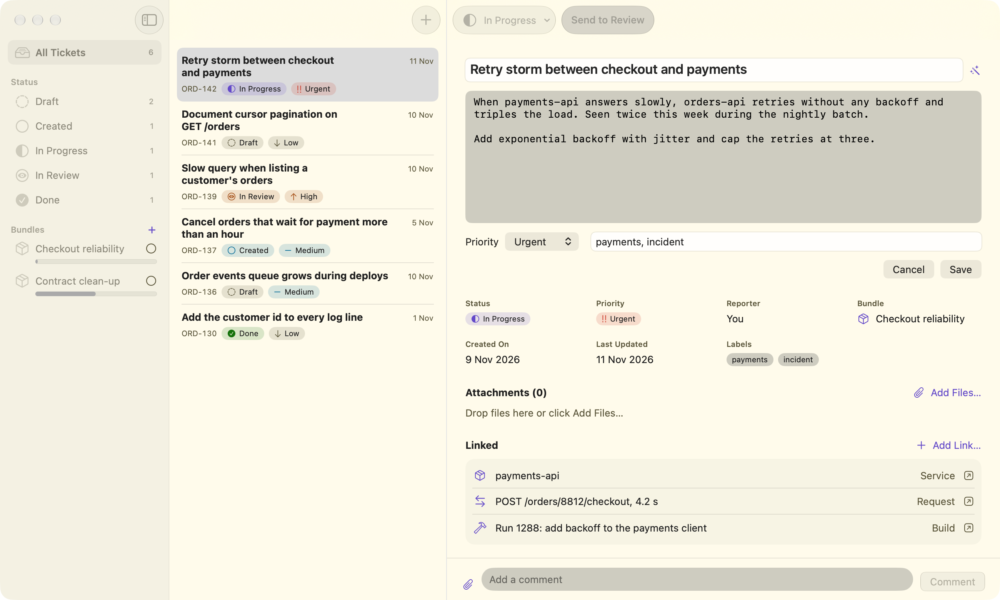
*ORD-142 in the editor, in place of its header and description.*

**Edit** replaces the header and the description with a form: the **Title** field (`title2`, semibold), with
**Generate Title** at its trailing edge as in New Ticket ([Generate Title](#generate-title)), the
description in a monospaced `TextEditor` on `surfaceSunken`, at least 160 pt high, the **Priority** pop-up
(None, Low, Medium, High, Urgent), the **Labels** field ("Labels, separated by commas"), then **Cancel**
(Escape) and **Save** (⌘S, `borderedProminent`, disabled while the title is empty). Save applies the title,
description, priority and labels in one change and closes the editor; a rule that fails (a title over 200
characters, or on two lines) shows its message in an alert and the editor keeps what was typed. The
history records the rename and the description edit ([Activity](#activity)); priority and labels add no
entry.

### Properties

Each property shows its name (`caption`, semibold, `textSecondary`) above its value (`textPrimary`).

| Property         | Value                                                                                                                         |
|------------------|-------------------------------------------------------------------------------------------------------------------------------|
| **Status**       | The status badge.                                                                                                             |
| **Priority**     | The priority badge, or "None" in `textSecondary`: a menu that sets None, Low, Medium, High or Urgent at once.                 |
| **Reporter**     | Who created the ticket: "You" or "Claude".                                                                                    |
| **Bundle**       | Each bundle's title after `shippingbox` in `accent`, one per line (a ticket may be in several), or "None" in `textSecondary`. |
| **Created On**   | Day, month and year, such as "9 Nov 2026".                                                                                    |
| **Last Updated** | Day, month and year.                                                                                                          |
| **Labels**       | One capsule per label (`caption`, on `surfaceSunken`), or "None".                                                             |

The Bundle property shows the bundle the ticket is in among its own project's bundles. In a parent's
window, a sub project's ticket shows its bundle too, though the sidebar lists only the parent's own bundles:
in the Shop window, ORD-142 reads Checkout reliability.

**Priorities**

| Priority | Symbol              | Color           |
|----------|---------------------|-----------------|
| Low      | `arrow.down`        | `textSecondary` |
| Medium   | `minus`             | `info`          |
| High     | `arrow.up`          | `warning`       |
| Urgent   | `exclamationmark.2` | `danger`        |

### Attachments

The ticket's own files under **Attachments (*n*)**, with **Add Files…** (`paperclip`) at the heading's trailing
edge, which opens a file panel for several files. Files dropped on the ticket, outside the comment field, are
added too. Without files the section reads "Drop files here or click Add Files…". Each file is AZDesign's
`FileTile` in a `FlowStack` (8 pt apart, wrapping): a file whose type conforms to `public.image` shows as a
thumbnail at most 96 pt high and 192 pt wide, read at that size, with its name under it (a format ImageIO can't
read, such as SVG, shows the `photo` symbol instead); other files as capsules with their type's icon, name and
size. A click opens Quick Look. The context menu has
**Open**, **Open With Default App**, **Show in Finder** and **Remove…** ("Remove *name*?", "The file moves to
the Trash."). Each file is at most 20 MB, and the files of one change at most 20 MB together
([Data › Attachments](../data.md#attachments)).

### Linked

The tickets the ticket depends on, blocks or relates to, and the items in other tools that it points to, under
the heading **Linked**, with **Add Link…** (`plus`) at the heading's trailing edge, disabled when every other
ticket of the project is linked already. Without links it reads "No linked tickets.". The rows sit in a group
box, separated by dividers. Each row shows the kind's symbol in `accent`, the item's title on one line (for a
ticket, `<id> · <title>`), the kind's name in `textSecondary`, and `arrow.up.forward.app`. The whole row is one
plain button. Clicking it opens the item's window, for the ticket's own project, through a route; a ticket opens
in this window. A link the ticket declares has **Remove Link** in its context menu; Blocks and a Related link
the other ticket declares are removed from that ticket. A declared link whose ticket is missing (git removed
its file) shows **Not found** (`exclamationmark.triangle`, `warning`) and is disabled.

| Kind       | Symbol                   | Opens       | Focus                                            |
|------------|--------------------------|-------------|--------------------------------------------------|
| Depends On | `arrow.turn.down.right`  | Tickets     | The ticket id                                    |
| Blocks     | `hand.raised`            | Tickets     | The ticket id                                    |
| Related    | `link`                   | Tickets     | The ticket id                                    |
| Service    | `shippingbox`            | Service Map | `service:<name>`, such as `service:payments-api` |
| Request    | `arrow.left.arrow.right` | Service Map | `request:<id>`, such as `request:req-8f3a`       |
| Contract   | `curlybraces.square`     | Contracts   | The operation id, such as `listOrders`           |
| Build      | `hammer`                 | Builds      | The run number, such as `1288`                   |

### Chats

V2's Chats tab, as a part of the detail between **Linked** and **Mentioned In** (the user's choice): the
ticket's own chats, the latest updated first, closed chats included (`ticket.chats`). They are the chats whose
`ticket` is the ticket ([Data › Chat kinds](../data.md#chat-kinds)): the chats [Implement](#implement) starts,
those a bundle's chat starts for it, the feedback chat that created it, and the CI chats of its chats, each right
after the chat that started it ([Data › Implement chats](../data.md#implement-chats)).

- **Heading.** **Chats**, with **Implement…** (`hammer`) at its trailing edge, the header's button again.
- **Rows.** In a group box, separated by dividers, each one plain button (`ticket.chats.<chat id>`), drawn as
  Mentioned In's rows: the kind's symbol in `accent` (`hammer` for a chat that implements the ticket,
  `checklist` for a CI chat, `ladybug` for a feedback chat, `bubble.left.and.text.bubble.right` otherwise), the
  chat's title on one line
  (`textSecondary` when closed), under it "<project identifier> · <date>", then the chat's mark and
  `arrow.up.forward.app`. A click opens the chat in its project's Chat window; the context menu has **Open in
  Chat Window** and **Open in New Window**.
- **None.** "Implement starts a chat in which Claude implements this ticket." in `textSecondary`
  (`ticket.chats.empty`).
- The section shows only where the app gives the window the chats (`\.itemChats`); previews pass the samples.

### Mentioned In

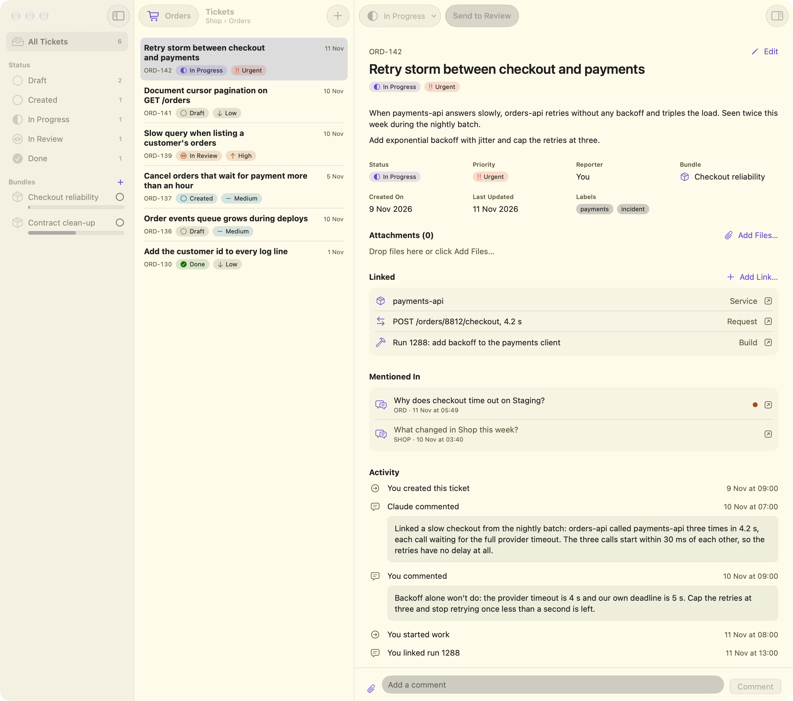

V2's Mentioned In tab, as a part of the detail between [**Chats**](#chats) and **Activity** (V3's detail has no
tabs): the chats of every loaded project that mention the ticket, the latest updated first, closed chats included
(`ticket.mentions`), except the ticket's own chats, which **Chats** lists (as V2's tab left them out).

- **Mentions.** A chat mentions a ticket when its messages or Claude's replies (outside a sub-agent) show the
  id as a link, or a message carries the ticket ([Data › Mentioned ids](../data.md#mentioned-ids)). Calls,
  results, thinking and questions don't count. The list follows each new message.
- **Rows.** In a group box, separated by dividers, each one plain button (`ticket.mentions.<chat id>`):
  `bubble.left.and.text.bubble.right` in `accent`, the chat's title on one line (`textSecondary` when closed),
  under it "<project identifier> · <date>" (`caption`, `textSecondary`, such as "ORD · 11 Nov at 05:49"), then
  the chat's mark as the Chat window's list draws it (a spinner, the `warning` dot while it waits, the `danger`
  dot after an error) and `arrow.up.forward.app`. A click opens the chat in its project's Chat window. The
  context menu: **Open in Chat Window**, **Open in New Window** ([Chat › Chat windows](chat.md#chat-windows)).
- **None.** "Chats that mention this ticket appear here." in `textSecondary` (`ticket.mentions.empty`).
- V2's rows also offered Rename…, Close and Delete…: they are in the chat, once opened (default chosen at design
  time: the Tickets window doesn't change chats).
- The section shows only where the app gives the window the chats (`\.chatMentions`); previews pass the
  samples: **Mentioned In**, **Mentioned In, None**.

**Bundles.** A bundle has no detail: its sidebar row's context menu has **Mentioned In ▸**
(`tickets.sidebar.bundle.<id>.mentions`), after **Chats ▸**, listing the chats that mention the bundle by
title, except the bundle's own chats, each opening it in the Chat window, or "No Mentions", disabled.

### Activity

The ticket's history and its comments under the heading **Activity**, oldest first, 14 pt apart (at equal
dates: the creation, the comments, then the other entries). Each entry shows its symbol in `textSecondary`, its text in `textPrimary`, and its date and time
at the trailing edge (`callout`, `textSecondary`, such as "10 Nov at 07:00"). A comment's text follows under
the entry, in a rounded box on the `surface` color with 12 pt of padding. The text can be selected and
copied.

| Entry              | Symbol                   | Sentences ("You" for the user, "Claude" for Claude)                                                          |
|--------------------|--------------------------|--------------------------------------------------------------------------------------------------------------|
| Drafted            | `sparkles`               | "You drafted this ticket", "Claude drafted this ticket"                                                      |
| Created            | `plus.circle`            | "You created this ticket", "Claude created this ticket"                                                      |
| Status changed     | `arrow.right.circle`     | "You moved it from Created to In Progress"                                                                   |
| Renamed            | `character.cursor.ibeam` | "You renamed it from “*old*” to “*new*”"; an automatic rename (author `automatic`): "It was named “*title*”" |
| Link added         | `link`                   | "You made it depend on ORD-139", "You related it to ORD-139"                                                 |
| Link removed       | `minus.circle`           | "You removed its dependency on ORD-139", "You removed its relation to ORD-139"                               |
| Description edited | `pencil`                 | "You edited the description"                                                                                 |
| Commented          | `text.bubble`            | "Claude commented", with the comment (Markdown) and its files under it                                       |

- **Comments.** "(edited)" follows the sentence of a comment whose text was changed (help: the edit's date).
  Its files show as in [Attachments](#attachments), without **Remove…**: a comment's files go with it. The
  context menu has **Edit** (the comment's text in a `TextEditor` with **Cancel** and **Save**, ⌘Return),
  **Copy Text** (the Markdown source) and **Delete…** ("Delete this comment?", "Its attachments move to the
  Trash.").

### Comment composer

A bar pinned to the bottom of the ticket, under a divider, on the `canvas` background, with 20 pt of padding
on the sides and 12 pt above and below. In the two-column arrangement it spans the left column only.

- **Attach Files** (`paperclip`, help "Attach Files to the Comment") opens a file panel; files dropped on the
  composer join the comment too. They show as capsules above the field, each with a remove button.
- **Comment field.** "Add a comment" as placeholder. A plain text field in a `surfaceSunken` capsule, with
  10 pt of padding on the sides and 7 pt above and below. It grows from one to six lines.
- **One draft per ticket.** What is typed belongs to the ticket. Selecting another ticket shows that
  ticket's own draft, empty at first, and going back to the first ticket shows its draft again. Drafts last
  until the window closes or moves to another project.
- **Comment.** A `glassProminent` button, disabled while the field holds only spaces and line breaks and no
  file waits, and while a change runs. Its shortcut is ⌘Return, and its help reads "Add the Comment (⌘↩)". It
  adds the comment as the user; the field and its files empty once it is written, and keep their content when
  it fails.

## Status and next step

The status menu and the next-step button act on the selected ticket. Both are in the detail column's toolbar
on Mac and iPad, and in the page's toolbar on iPhone.

- **Status menu.** Its label shows the current status, with its symbol and name on Mac and iPad, and its
  symbol alone on iPhone. With no ticket selected it reads "Status" with `circle.dashed`, disabled. The menu
  lists the five statuses with their symbols and their shortcuts, ⌃⌘1 to ⌃⌘5 in workflow order. The current
  status is disabled, and so is its shortcut. Choosing one sets it at once and adds a history entry.
- **Next step.** A prominent button named after the step that follows the current status. Its shortcut is
  ⇧⌘Return, and its help names the step and the shortcut, such as "Send to Review (⇧⌘↩)". On iPhone it shows
  `arrow.right` alone, with the step's name as its VoiceOver label. It is disabled for a **Done** ticket and
  when no ticket is selected, and then reads "Next Step". It sets the next status: Draft → Created → In
  Progress → In Review → Done.
- **While a change runs**, both are disabled. A bundle that lists the ticket follows its automatic rules.
- **Shortcuts.** They act on the selected ticket while the Tickets window is the key window, and do nothing
  while their control is disabled.

| Status      | Symbol                   | Color           | Shortcut | Next step                    |
|-------------|--------------------------|-----------------|----------|------------------------------|
| Draft       | `circle.dashed`          | `textSecondary` | ⌃⌘1      | **Create Ticket**            |
| Created     | `circle`                 | `info`          | ⌃⌘2      | **Start Work**               |
| In Progress | `circle.lefthalf.filled` | `accent`        | ⌃⌘3      | **Send to Review**           |
| In Review   | `eye.circle`             | `warning`       | ⌃⌘4      | **Mark as Done**             |
| Done        | `checkmark.circle.fill`  | `success`       | ⌃⌘5      | None: the button is disabled |

The statuses are shared with the Dashboard's Tickets widget, which counts tickets by status
(`TicketStatus`, in `ToolsFoundation/Vocabulary.swift`).

## Implement

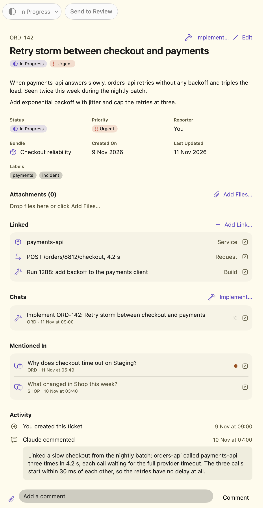
*ORD-142's detail column (the "Implement" preview): **Implement…** in its header and at the heading of **Chats**,
which lists the chat that implements it, at work, above the chats that mention it.*

V2's **Implement** and **Implement All**, brought over as V2 did them (the user's request, 20 November 2026):
Claude implements a ticket in a chat of its own, and a bundle in a chat that runs one chat per ticket. The app
starts the chats and links them; what Claude does in them is the internal skills' to say, `implement-ticket` and
`implement-bundle`, which the user edits in [System Prompts](system-prompts.md). The chats are the Chat window's
([Chat › Implement chats](chat.md#implement-chats)); the Tickets window lists them in [Chats](#chats).

**Implement**, for a ticket:

- **Where.** **Implement…** in the ticket's header and at the heading of its **Chats**, both `ticket.implement`
  and `ticket.chats.implement`, ⇧⌘I, and **Implement…** in the list's context menu, which selects the ticket
  first.
- **Enabled** while the ticket is neither done nor a draft (V2: not done; Claude can't move a draft, [Data ›
  Ticket rules](../data.md#ticket-rules)). Help: "Implement the Ticket with Claude (⇧⌘I)"; while disabled,
  "Set another status to implement this ticket." for a done ticket and "Create the ticket to implement it." for a
  draft. A chat of the ticket at work doesn't disable it: several chats of a ticket can run at once.
- **Dependencies.** When tickets it depends on aren't done, an alert comes first: "ORD-142 depends on ORD-139,
  ORD-140, which are not done. Implement it anyway?" ("which is not done" for one), the ids in ascending number,
  with **Implement** and **Cancel** (Escape). Implement opens the sheet; Cancel starts nothing.
- **The sheet** ([Implement sheet](#implement-sheet)) chooses the chat's settings; **Start** creates the chat,
  which calls `implement-ticket` with the ticket's id, links it to the ticket and opens it in the project's Chat
  window ([Data › Implement chats](../data.md#implement-chats)).
- **Then** Claude works as the skill says: as written by default, it sets the ticket In Progress, makes and tests
  the change, commits and pushes, and comments; in a project with a GitHub page, it then starts a CI chat on the
  pushed commit and waits for its report ([Chat › Implement chats](chat.md#implement-chats)). It sets the ticket In
  Review once CI passed or couldn't be checked, or once the user chose to finish without green CI. The Tickets
  window shows each change at once. Until the
  user writes in the chat, its Claude asks no question. Its changes to its own ticket don't ask first ([MCP ›
  Permissions](../mcp.md#permissions)).

**Implement All**, for a bundle:

- **Where.** **Implement All…** in the bundle's sidebar context menu (`tickets.sidebar.bundle.<id>.implement`).
- **Enabled** while the bundle is To Do and at least one ticket it lists isn't done (a listed id without its
  ticket doesn't count). The menu item is disabled otherwise: a bundle In Progress or Done needs setting back to
  To Do first (V2's rule).
- **The sheet**, then **Start**: the bundle's chat, which calls `implement-bundle` with the bundle's id; the
  bundle is set In Progress and lists the chat. It opens in the Chat window.
- **Then** that chat orchestrates, as the skill says: it starts a chat for each ticket that waits for no other
  ticket, with `implement_ticket`; each of these works on its own branch `<bundle id>/<ticket id>` in a git
  worktree the app makes, and the app reports each one's turn to the bundle's chat, which merges the branches as
  they come, then tests the whole and pushes it once; in a project with a GitHub page, it then follows the CI with
  a CI chat, as a ticket's chat does. These chats show in their tickets' **Chats** and in the bundle's **Chats ▸**.

**Chats ▸** in the bundle's context menu (`tickets.sidebar.bundle.<id>.chats`) lists the bundle's chats, the
latest first, each followed by the ticket chats and the CI chats it started, oldest first, by title; each opens its chat in the
Chat window. "No Chats", disabled, when there are none.

### Implement sheet

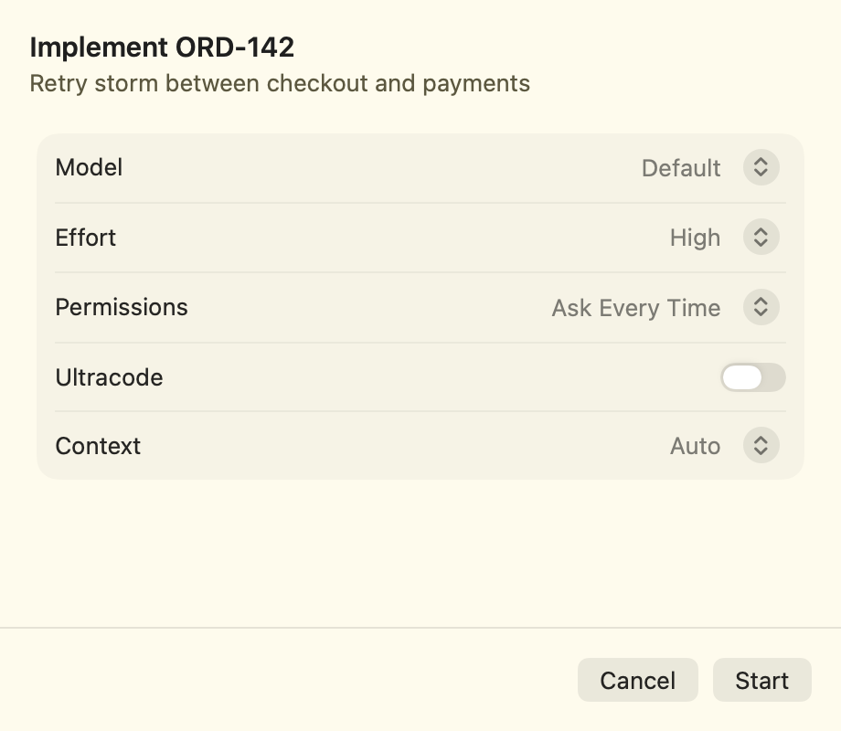
*Implement ORD-142: the chat's settings, on Settings ▸ Chat's defaults.*

A sheet over the window (`implement.sheet`), 420 to 480 pt wide, on `canvas`, from ChatKit (it uses the chat's
settings menus) and shown by the window, which gives the Tickets window its action (`\.implement`):

| Part       | Identifier                                                                                                          | Contents                                                                                                                                                                                                                                              |
|------------|---------------------------------------------------------------------------------------------------------------------|-------------------------------------------------------------------------------------------------------------------------------------------------------------------------------------------------------------------------------------------------------|
| Heading    | —                                                                                                                   | "Implement ORD-142" or "Implement All ORD-B3" (`title3`, semibold), a heading for VoiceOver; under it the ticket's or bundle's title on one line, truncated at its end, `textSecondary`.                                                              |
| Settings   | `implement.model`, `implement.effort`, `implement.permissionMode`, `implement.ultracode`, `implement.contextWindow` | The Chat window inspector's rows: **Model**, **Effort**, **Permissions**, **Ultracode**, **Context**, on Settings ▸ Chat's model and effort and the defaults of the others each time the sheet opens. A choice sets only the chat this Start creates. |
| Note       | `implement.note`                                                                                                    | For a bundle: "The ticket chats this chat starts take its settings." (`caption`, `textSecondary`).                                                                                                                                                    |
| Message    | `implement.message`                                                                                                 | Why Start failed, in `danger`; otherwise why it waits for the CLI, in `textSecondary`: "Checking the Claude CLI…", or "Claude CLI is not available: <reason>".                                                                                        |
| Bottom bar | `implement.cancel`, `implement.start`                                                                               | Under a divider, at the trailing edge: a small progress indicator while starting, **Cancel** (Escape) and **Start** (Return, `borderedProminent`).                                                                                                    |

- **Start** is enabled while the Claude CLI is available and nothing is starting. While it runs, the settings and
  Cancel are disabled.
- **Success** closes the sheet and opens the new chat in its project's Chat window (`.tool(.chat, project:,
  focus: <chat id>)`), as Send Feedback does.
- **Failure** keeps the sheet, its settings, and the reason in the message line, such as "ORD-142 is done; set
  another status to implement it." ([Data › Implement chats](../data.md#implement-chats)).
- **Cancel** closes the sheet; nothing starts.

## New Ticket sheet

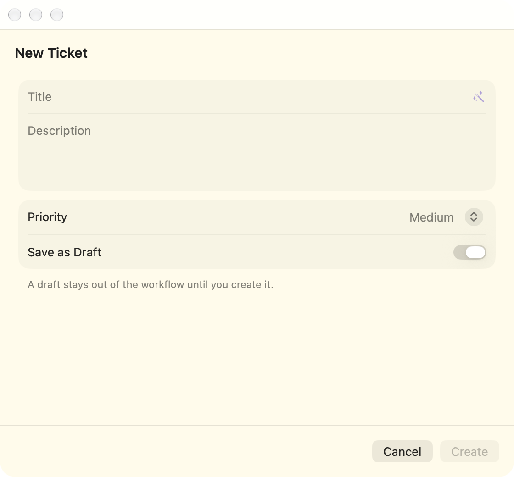
*The New Ticket sheet, empty. Priority is Medium and Save as Draft is on. Create stays disabled until the
ticket has a title.*

*In Shop's window the sheet adds **Project**: Shop or one of its sub projects.*

A sheet over the window, opened by **New Ticket** in the toolbar or by the **New Ticket** button of the empty
list, on the `canvas` background.

- **Size.** In the Mac and iPad layouts it is 460 to 480 pt wide. In the iPhone layout it takes the window's
  width less 12 pt on each side, up to 480 pt, so it fits the narrowest window: 366 pt in a 390 pt window. It
  is 360 pt high at least, 400 pt by default, or 440 pt with the Project field. The form scrolls when the
  sheet is shorter than its fields.

| Part         | Contents                                                                                                                                                                                                                                                                                                           |
|--------------|--------------------------------------------------------------------------------------------------------------------------------------------------------------------------------------------------------------------------------------------------------------------------------------------------------------------|
| Heading      | **New Ticket** (`title3`, semibold), a heading for VoiceOver.                                                                                                                                                                                                                                                      |
| First group  | **Title**: a text field with "Title" as placeholder, and at its trailing edge **Generate Title** ([below](#generate-title)). **Description**: a text field with "Description" as placeholder, four lines high, growing to eight.                                                                                   |
| Second group | **Project**: a picker of the window's project and its sub projects, by name, in tree order. Only for a project with sub projects. **Priority**: a picker with None, Low, Medium, High and Urgent, set to Medium. **Save as Draft**: a switch, on. Footer: "A draft stays out of the workflow until you create it." |
| Bottom bar   | Under a divider, at the trailing edge: **Cancel** and **Create**.                                                                                                                                                                                                                                                  |

- **Project.** In a parent's window, such as Shop, the Project field says where the ticket goes: Shop,
  Orders, Payments or Edge Gateway. It starts on the project picked in the sidebar's **Projects** section, or
  on the window's own project when the sidebar shows anything else. A window without sub projects has no
  Project field: the ticket goes to the window's project.
- **Cancel** closes the sheet. Its shortcut is Escape.
- **Create** creates the ticket in the chosen project, with the next number of its counter, as a draft when
  **Save as Draft** is on and Created otherwise, then closes the sheet, selects the new ticket and shows All
  Tickets when the filter would hide it. Its shortcut is Return. It is disabled while the title is empty or
  holds only spaces and line breaks. When the creation fails, an alert shows why and the sheet stays open with
  what was typed.
- **Fresh each time.** The sheet opens empty every time, with the Project field on its starting project.

### Generate Title

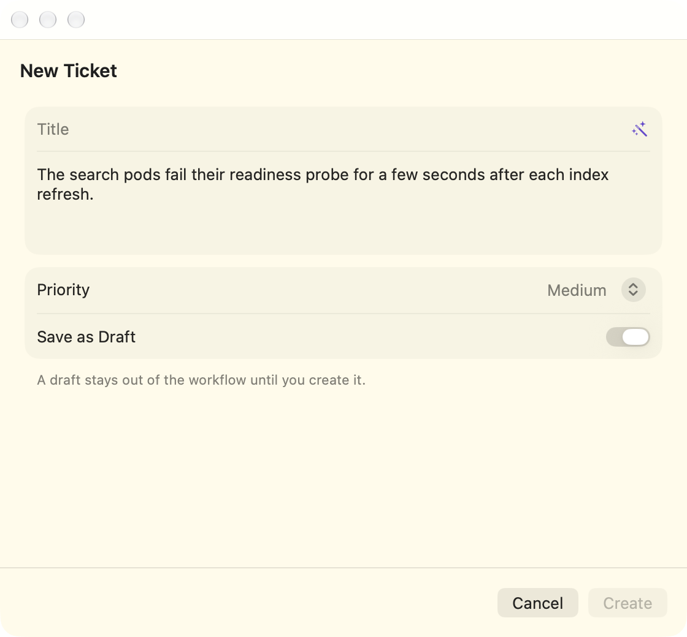
*With a description, **Generate Title** is enabled; it writes the title from the description.*

In New Ticket and in the [editor](#editor) (the user's requests), the same button, `GeneratedTitleField`
around each form's own Title field:

- **Generate Title** (`newTicket.generateTitle`, `ticket.edit.generateTitle`): a borderless icon button with
  `wand.and.stars`, at the Title field's trailing edge. Help: "Generate a Title from the Description".
- **Disabled** while the description holds only spaces and line breaks (the user's request), and while a title
  is being written. A small progress indicator shows before it meanwhile.
- **A click** runs the internal skill `set-ticket-title` on the description ([System
  Prompts](system-prompts.md)), with the app's MCP server. In the editor, the run sends the ticket's link, as
  a chat links the item of its chip (`Attached: ticket HEPH-3 of project HEPH`, the user's request): Claude
  reads the whole ticket as last saved, status, comments and attachments included, with `get_ticket` and
  `get_attachment`; a description being edited and not saved yet comes before the link. In New Ticket there is
  no ticket yet, and the description is all of it.
  It puts its answer's title in the Title field, replacing what was there: the
  answer's first line that isn't empty, without a heading's `#`s or one pair of quotes around it, cut to 200
  characters ([Titles written by Claude](#titles-written-by-claude)). The user can change it before **Create**
  or **Save**; the editor's **Cancel** drops it with the rest. An answer that comes after the editor closed is
  dropped.
- **A failure** leaves the title as it was and shows the reason under the field in `danger`
  (`newTicket.generateTitle.message`, `ticket.edit.generateTitle.message`): the CLI's own words ("Claude CLI not found…", "Claude didn't answer
  within 2 minutes."), or "Claude's answer has no title." The next click clears it.
- Previews show it only when they give the form a generator (New Ticket's "Generate Title", the detail's
  "Editing"): the app always has one.

### Titles written by Claude

A ticket created **without a title** (the user's request): by Claude's `create_ticket` without one, as a
[feedback chat](chat.md#feedback)'s Claude may make it. It takes the description's first line as its provisional title at once,
then the app runs `set-ticket-title` in the background with the ticket's link alone, as the editor's **Generate
Title** does ([Generate Title](#generate-title)): Claude reads the ticket whole, attachments included (the
screenshot a feedback chat attached). The skill's default text, V3's own, asks for a title of at most 80
characters naming what the ticket asks for or reports, without its id, status, author or dates ([System
Prompts › Internal skills](system-prompts.md#internal-skills)):

- When the answer gives a title ([Generate Title](#generate-title)'s rule), it replaces the provisional one,
  written by the app on its own: the history entry's author is `automatic`, and the activity reads "It was named
  “*title*”". A ticket whose title changed in the meantime (the user, or Claude, renamed it) keeps its title.
- A failure (no CLI, an error, no answer within 2 minutes, an answer without a title) leaves the provisional
  title, and says nothing.
- Untitled tickets are titled one after the other, so many created at once start one Claude process at a time.
- New Ticket still needs a title to **Create**; **Generate Title** writes it there instead.

## Feedback

Send Feedback (the status bar's ladybug, Help ▸ Send Feedback…) starts a feedback chat, no longer a ticket
([Chat › Feedback](chat.md#feedback)). The first ticket that chat's Claude creates with `create_ticket` lists the
chat in its `chats`, and the chat records it as its ticket; like any ticket created without a title, it is then
titled by `set-ticket-title` ([Titles written by Claude](#titles-written-by-claude)).

## Add Link sheet

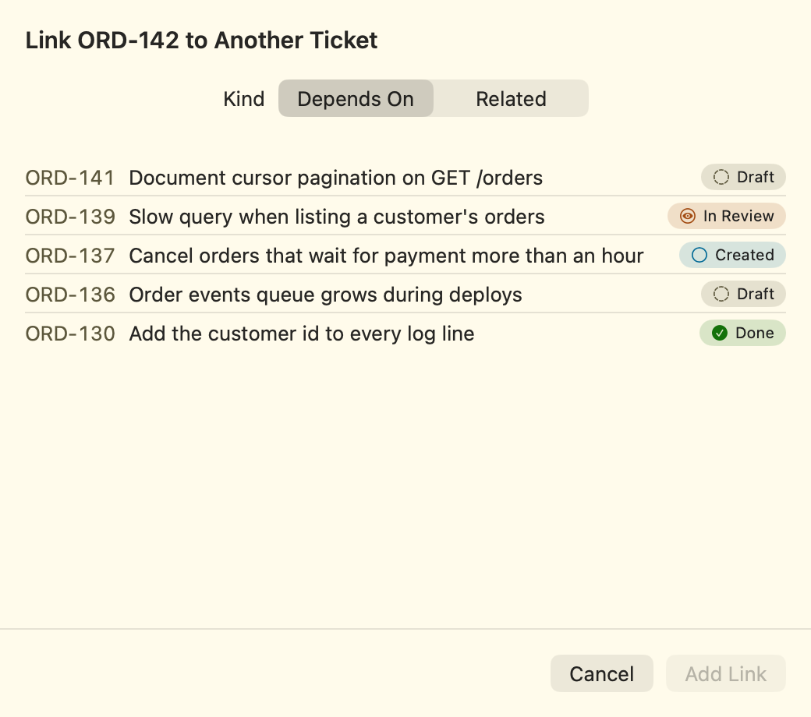
*Add Link for ORD-142: the kind, then the ticket.*

**Add Link…** opens a sheet, 420 to 480 pt wide: the heading "Link *ORD-142* to Another Ticket", a segmented
**Kind** picker (Depends On, Related), and the project's tickets that the ticket isn't linked to, each with its
id, title and status badge. **Add Link** (Return) is disabled until a ticket is picked; **Cancel** (Escape)
closes. A link that breaks the link rules (a dependency cycle, a ticket that already links to this one) shows its
message in an alert and the sheet stays open ([Data › Link rules](../data.md#link-rules)).

## Bundle sheet

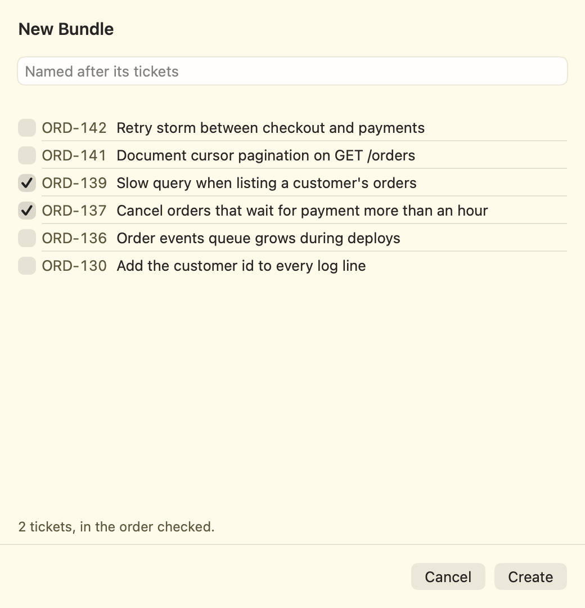
*New Bundle in Orders, two tickets checked.*

**New Bundle** (the sidebar's `plus`, or **Add to Bundle ▸ New Bundle…**) and **Edit Bundle…** open a sheet,
420 to 480 pt wide: the heading "New Bundle" or "Edit Bundle", the **Title** field ("Named after its tickets":
an empty title takes the tickets' titles), and the project's tickets with checkboxes. The bundle holds the
checked tickets in the order they were checked, as the line under the list says ("2 tickets, in the order
checked."). **Create** (Return, disabled without a ticket) or **Save**, and **Cancel** (Escape). A new bundle is
selected in the sidebar; a bundle of tickets that are all done starts Done.

## Markdown

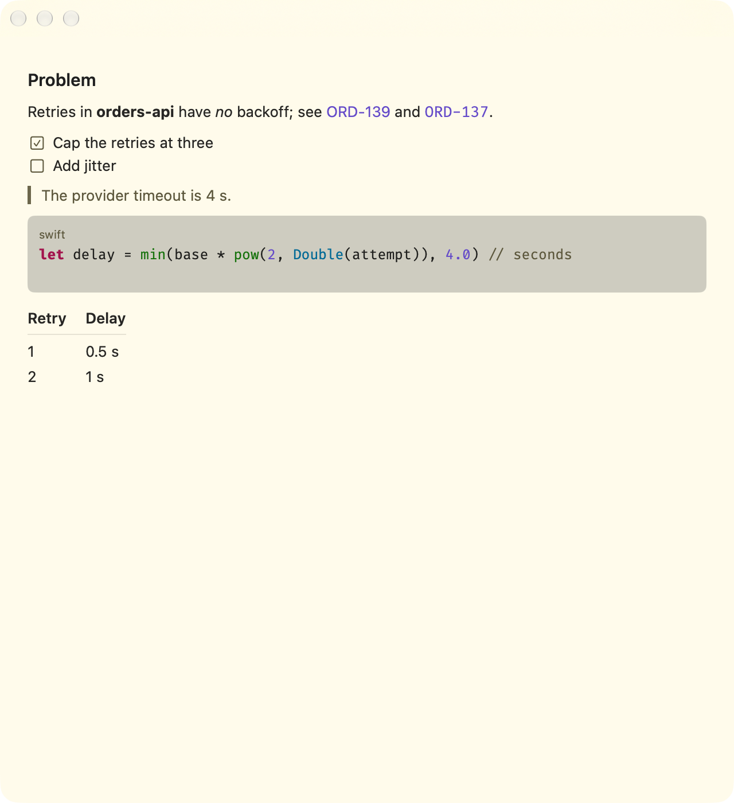
*Markdown in a description: ORD-139 and ORD-137 are links, the Swift code is highlighted.*

Descriptions and comments are Markdown, rendered with the app's Markdown renderer ([Text](../text.md)): headings
(`title2`, `title3`, `headline`, then `subheadline`, semibold), paragraphs (each line break kept),
block quotes (a 3 pt `divider` bar, `textSecondary`), bullet and numbered lists, task items (`checkmark.square`,
`square`), code blocks (Fira Code `callout` on `surfaceSunken`, the language's name above, scrolling
sideways), tables (a grid, the header semibold), rules, emphasis, strong, strikethrough and code spans (Fira
Code). The text can be selected.

- **Links.** A ticket or bundle id of a loaded project, such as ORD-139 or ORD-B3, is a link to it in its
  Tickets window; a web link opens in the browser; a relative link, such as `docs/runbook.md`, opens the
  project's file in its default app. An image shows its alt text, linked when it is on the web.
- **Markers.** V2's markers draw as in the chats ([Text › Markers](../text.md#markers)): `` the
  symbol and its name, `` a swatch and the color, `` ▶ (which plays it) and its
  name, `` key caps, `` its label in its font, ``
  the expression; one that isn't valid shows its source.
- **Code colors.** Code blocks are highlighted for Go, Swift, Markdown, JSON, YAML and Shell, with AZDesign's
  colors: keywords `accentSecondary`; types, properties and headings `info`; builtins and numbers `accent`;
  functions `success`; strings `warning`; comments `textSecondary` (doc comments italic); attributes and
  directives `danger`; keywords semibold.

## Confirmations and failures

Deleting tickets, a bundle or a comment, and removing an attachment, ask first in an alert whose destructive
button is **Delete** (**Remove** for an attachment) beside **Cancel**; the texts are in each section. A change
that fails shows the alert **The Change Failed** with the reason, such as "ORD-142 cannot depend on
ORD-139, which depends on ORD-142.", and **OK**.

## States

| State               | When                                                                   | What shows                                                                                                                                                                                                                                                                                                                                                                                                |
|---------------------|------------------------------------------------------------------------|-----------------------------------------------------------------------------------------------------------------------------------------------------------------------------------------------------------------------------------------------------------------------------------------------------------------------------------------------------------------------------------------------------------|
| Tickets listed      | The filter lets tickets through                                        | The list, with the selected ticket in the detail column.                                                                                                                                                                                                                                                                                                                                                  |
| Grouped             | The window's project has sub projects                                  | The list in sections per project, and the sidebar's **Projects** section.                                                                                                                                                                                                                                                                                                                                 |
| Filtered            | A filter other than **All Tickets** applies, and the sidebar is hidden | The [filter bar](#ticket-list) above the list, with the filter's name. On iPhone the **Filter** button's symbol is filled.                                                                                                                                                                                                                                                                                |
| No tickets          | The project has no tickets                                             | **No Tickets** with `ticket`: "Tickets you create or draft show up here.", and a **New Ticket** button that opens the sheet.                                                                                                                                                                                                                                                                              |
| No matching tickets | The project has tickets, but the filter lets none through              | **No Matching Tickets** with `line.3.horizontal.decrease.circle`, one sentence that names the filter, and **Show All Tickets**, which puts the sidebar back on **All Tickets**. The sentences: "No ticket is a draft.", "No ticket is waiting to start." (Created), "No ticket is in progress.", "No ticket is in review.", "No ticket is done.", and for a project or a bundle, "*Name* has no tickets." |
| No selection        | No ticket is selected (Mac and iPad)                                   | **No Ticket Selected** with `ticket`: "Pick a ticket to see its details." The status menu reads "Status" and the next-step button "Next Step", both disabled.                                                                                                                                                                                                                                             |
| Ticket not found    | A route's focus names none of the window's tickets                     | **Ticket Not Found** with `ticket`: "*Project* has no ticket with the id *id*.", such as "Orders has no ticket with the id ORD-999.", in the detail column, or as the page on iPhone, with Back. No row is selected, and the status menu and the next step are disabled. Picking a ticket replaces it.                                                                                                    |
| Done ticket         | The ticket's status is Done                                            | The next-step button reads "Next Step", disabled. **Done** is disabled in the status menu. **Implement…** is disabled.                                                                                                                                                                                                                                                                                    |
| Draft ticket        | The ticket's status is Draft                                           | **Implement…** is disabled: "Create the ticket to implement it."                                                                                                                                                                                                                                                                                                                                          |
| No links            | The ticket links to nothing                                            | No **Linked** section.                                                                                                                                                                                                                                                                                                                                                                                    |
| No bundle           | The ticket is in none of the window's bundles                          | **Bundle** reads "None".                                                                                                                                                                                                                                                                                                                                                                                  |

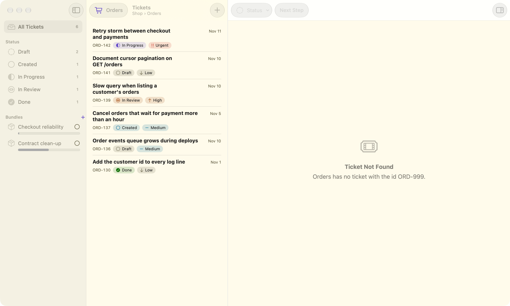
*Orders' window opened on ORD-999, which it doesn't have: **Ticket Not Found** in the detail column.*
| Empty comment | The comment field is empty, or holds only spaces and line breaks | **Comment** is disabled. |
| Untitled new ticket | The sheet's title is empty, or holds only spaces and line breaks | **Create** is disabled. |
| Loading | The app is reading the tickets | "Loading Tickets" with a progress indicator, in the list column. |
| Error | The store can't read the tickets (previews) | **Couldn't Load Tickets** with `exclamationmark.triangle`, the error's message as given, and **Try Again**, which reads them again. The app's store has no such state: a file that can't be read is left out, and the next row says so. |
| Unreadable files | Ticket or bundle files of the window's projects can't be read | Above the list, on `surfaceSunken`: `exclamationmark.triangle.fill` in `warning` and "1 ticket file can't be read" ("2 ticket files…"), then up to three `<name>: <reason>` lines in `caption`; the help lists them all (`tickets.unreadable`). The files are left out of the list. |
| Editing | **Edit** was clicked | The [editor](#editor) in place of the header and the description. |
| Blocked | The ticket depends on a ticket that isn't done | **Blocked** in its row and header. |
| Missing link | A declared link's ticket is gone | **Not found** on its row. |
| Chat panel off | Settings ▸ Chat turns the panel off | No chat button in the toolbar. |
| No project | The window's value names no project | **No Project** with `folder`: "Open this window from the Projects window." See [navigation.md](navigation.md). |

## Layouts

Tickets needs 900 pt for its three columns (`macLayoutWidth`). The window picks its layout from its width
(see [foundations.md › Layout system](foundations.md#layout-system)), and Tickets adapts its panes to it (the
user's choice).

| Layout | When                                                                             | What changes                                                                                                                                                                                                                                                                                                                                                                                                                                                                                                                                                                                                                                                    |
|--------|----------------------------------------------------------------------------------|-----------------------------------------------------------------------------------------------------------------------------------------------------------------------------------------------------------------------------------------------------------------------------------------------------------------------------------------------------------------------------------------------------------------------------------------------------------------------------------------------------------------------------------------------------------------------------------------------------------------------------------------------------------------|
| Mac    | The window is at least 900 pt wide, or at least 1241 pt with the chat panel open | Sidebar, list and detail side by side. The chat panel sits beside them, and the columns make room for it.                                                                                                                                                                                                                                                                                                                                                                                                                                                                                                                                                       |
| iPad   | From 640 pt up to the Mac width                                                  | The sidebar folds away behind the sidebar button (the user's choice). The list and the detail stay side by side, and the sidebar button shows the sidebar again. While the sidebar is folded, the filter bar shows the filter that applies. The toolbar keeps its items. The chat panel slides over the content, with a shadow.                                                                                                                                                                                                                                                                                                                                 |
| iPhone | Narrower than 640 pt                                                             | One pane at a time (the user's choice). The list comes first, with the sidebar's choices in a **Filter** menu and the filter bar above it while a filter applies. The list starts with nothing selected, unless the window was opened on a ticket, which starts on its page. Picking a ticket pushes its page, with a Back button. The status menu and the next-step button become symbols. The New Ticket sheet narrows to fit the window. The chat panel fills the window. A window that narrows to this width keeps its selection and shows that item's page, as a collapsing split view does ([Foundations › Layout system](foundations.md#layout-system)). |

- **Sidebar on a layout change.** Entering the Mac layout shows the sidebar. Entering the iPad or iPhone
  layout folds it. Within a layout, the sidebar button's choice holds.
- **Chat panel at the default size.** The default window is 1180 pt wide, less than the 1241 pt the Mac
  layout needs with the panel open. Opening the chat panel at that size switches the window to the iPad
  layout: the sidebar folds and the panel slides over the ticket.
- **The detail's own width.** Independently of the layout, the detail switches between its two arrangements
  at 720 pt (see [Ticket detail](#ticket-detail)).
- **Smallest window.** 390 × 420 pt.

*At iPad width the sidebar folds behind its button. The toolbar keeps New Ticket, the status menu, the next
step and the chat panel's button, and the properties of ORD-142 take two columns.*

### Filter menu (iPhone)

The iPhone layout has no room for the sidebar. A **Filter** menu in the list's toolbar offers the same choices
as an inline picker, with a checkmark on the current one, in the sidebar's order:

- **All Tickets**;
- **Status**: the five statuses;
- **Projects**: the window's project and its sub projects, when it has any;
- **Bundles**: the window's bundles, when it has any.

The choices show names only, without symbols, counts or progress. The menu's symbol fills while a filter
other than **All Tickets** applies, VoiceOver reads the filter's name as the menu's value, and the filter
bar above the list names the filter.

### List then page (iPhone)

The list's toolbar holds the project switcher, **Filter**, **New Ticket** and the chat panel's button, in
that order. Picking a ticket pushes its page over the list (`PhoneStack`, see
[components.md › Phone stack](components.md#phone-stack)). The page's toolbar holds Back with the project
switcher, the status menu, the next step and the chat panel's button. Back returns to the list and clears the
selection, so picking the same ticket again opens its page again. A window opened on a ticket starts on its
page, and a later route to a ticket of the window opens that ticket's page.

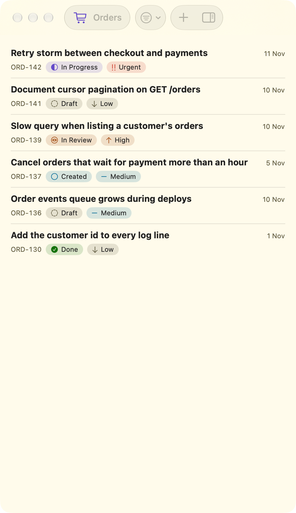
*At iPhone width, the list. The toolbar holds the project switcher, Filter, New Ticket and the chat panel's
button.*

*ORD-142's page at iPhone width. Back sits with the project switcher. The status menu and the next step show
their symbols only, and the properties take two columns.*

## Chat panel

The window reports the selected ticket as the chat panel's subject (`TicketsReader.reference`): the ticket's
id as title and focus, with the ticket's own project. In a parent's window, a sub project's ticket keeps its
own project. When the selection changes, the subject follows. When nothing is selected, there is no subject,
and the panel asks about the window's project.

| Subject                   | Heading of a new chat                             | Suggestions                                                          |
|---------------------------|---------------------------------------------------|----------------------------------------------------------------------|
| A ticket, such as ORD-142 | "Ask about ORD-142"                               | The questions the Tickets tool words for the ticket's status (below) |
| None                      | "Ask about *project*", such as "Ask about Orders" | "What changed this week?", "What needs my attention?"                |

In both cases the heading is followed by "Claude reads it through Tickets, and asks before it changes
anything."

- **Reading a ticket.** Claude reads a ticket through the Tickets tool's read function (`TicketsReader.read`),
  as any client of the tool would. The transcript shows "Read ticket ORD-142", with one sentence that gives
  the ticket's title, status and priority, such as "“Retry storm between checkout and payments” is in
  progress, with urgent priority." A done ticket reads "“…” is done. Its priority was low."
- **Suggestions.** The read also returns the questions worth asking about the ticket where it is in its
  life: first the question its status raises, then a summary. The chat offers them.

  | Status      | Suggestions, for ORD-142                                            |
  |-------------|---------------------------------------------------------------------|
  | Draft       | "Is ORD-142 ready to create?", "Summarize ORD-142"                  |
  | Created     | "Where should work on ORD-142 start?", "Summarize ORD-142"          |
  | In Progress | "What's left before ORD-142 can go to review?", "Summarize ORD-142" |
  | In Review   | "Is ORD-142 ready to be marked as done?", "Summarize ORD-142"       |
  | Done        | "What did ORD-142 change?", "Summarize ORD-142"                     |

- **Unknown ticket.** A read of an id that names no ticket returns nothing.
- **Changing a ticket.** Settings ▸ Chat ▸ **Change tickets** sets whether Claude may change tickets:
  **Never**, **Ask First** (the default) or **Always**.

See [Chat](chat.md) for the panel itself.

## Accessibility

| Element                                                         | Identifier                                                                                                                                                  | Label or notes                                                                                                                            |
|-----------------------------------------------------------------|-------------------------------------------------------------------------------------------------------------------------------------------------------------|-------------------------------------------------------------------------------------------------------------------------------------------|
| **All Tickets** row                                             | `tickets.sidebar.all`                                                                                                                                       | Badge: the ticket count.                                                                                                                  |
| Status row                                                      | `tickets.sidebar.<status>`, for example `tickets.sidebar.inProgress`                                                                                        | Status raw values: `draft`, `created`, `inProgress`, `inReview`, `done`.                                                                  |
| Project row                                                     | `tickets.sidebar.project.<project id>`, for example `tickets.sidebar.project.ORD`                                                                           | The project's icon is hidden from accessibility.                                                                                          |
| Bundle row                                                      | `tickets.sidebar.bundle.<bundle id>`, for example `tickets.sidebar.bundle.ORD-B3`                                                                           | The progress bar reads "*n* of *m* done".                                                                                                 |
| **Status**, **Projects**, **Bundles** (sidebar and Filter menu) | None                                                                                                                                                        | Headings.                                                                                                                                 |
| **Filter** menu                                                 | `tickets.filterMenu`                                                                                                                                        | Label "Filter", value the filter's name. Help "Filter Tickets". iPhone only.                                                              |
| **Filter** menu's choices                                       | `tickets.filterMenu.all`, `tickets.filterMenu.<status>`, `tickets.filterMenu.project.<project id>`, `tickets.filterMenu.bundle.<bundle id>`                 | The choice's name.                                                                                                                        |
| Filter bar                                                      | `tickets.filterBar`                                                                                                                                         | One button: label "Filter", value the filter's name, hint "Shows all tickets." Help "Show All Tickets".                                   |
| **New Ticket** (toolbar)                                        | `tickets.list.new`                                                                                                                                          | Help "New Ticket (⇧⌘N)".                                                                                                                  |
| **No Tickets**                                                  | `tickets.list.empty`                                                                                                                                        | Contains its title, sentence and button.                                                                                                  |
| **New Ticket** (empty list)                                     | `tickets.list.empty.new`                                                                                                                                    | None.                                                                                                                                     |
| **No Matching Tickets**                                         | `tickets.list.noMatch`                                                                                                                                      | Contains its title, sentence and button.                                                                                                  |
| **Show All Tickets** (no match)                                 | `tickets.list.noMatch.showAll`                                                                                                                              | None.                                                                                                                                     |
| Loading indicator                                               | `tickets.list.loading`                                                                                                                                      | "Loading Tickets".                                                                                                                        |
| **Couldn't Load Tickets**                                       | `tickets.list.error`                                                                                                                                        | Contains its title, the error's message and its button.                                                                                   |
| **Try Again**                                                   | `tickets.list.retry`                                                                                                                                        | None.                                                                                                                                     |
| Ticket row                                                      | `tickets.row.<ticket id>`, for example `tickets.row.ORD-142`                                                                                                | One element: title, date, id, status and priority.                                                                                        |
| Project group header                                            | `tickets.group.<project id>`, for example `tickets.group.SHOP`                                                                                              | The project's name. Heading.                                                                                                              |
| **No Ticket Selected**                                          | `tickets.detail.empty`                                                                                                                                      | Contains its title and sentence.                                                                                                          |
| **Ticket Not Found**                                            | `tickets.detail.notFound`                                                                                                                                   | Contains its title and sentence.                                                                                                          |
| Status menu                                                     | `ticket.status.menu`                                                                                                                                        | Label: the status's name, or "Status". Help "Change Status".                                                                              |
| Status menu's items                                             | `ticket.status.<status>`, for example `ticket.status.done`                                                                                                  | The status's name. Shortcuts ⌃⌘1 to ⌃⌘5.                                                                                                  |
| Next step                                                       | `ticket.nextStep`                                                                                                                                           | Label: the step's name, or "Next Step". Help: the step's name and "(⇧⌘↩)". On iPhone the symbol alone shows, and the label is still read. |
| Chat panel button                                               | `toolbar.chatPanel`                                                                                                                                         | Label "Chat". Help "Show the Chat Panel (⌃⌘C)" or "Hide the Chat Panel (⌃⌘C)".                                                            |
| Project switcher                                                | `toolbar.projectSwitcher`                                                                                                                                   | Help "Switch Project".                                                                                                                    |
| Ticket detail                                                   | `ticket.detail`                                                                                                                                             | Contains every part of the ticket.                                                                                                        |
| Ticket id                                                       | `ticket.number`                                                                                                                                             | None.                                                                                                                                     |
| Ticket title                                                    | `ticket.title`                                                                                                                                              | Heading.                                                                                                                                  |
| Description                                                     | `ticket.description`                                                                                                                                        | None.                                                                                                                                     |
| Properties                                                      | `ticket.properties`                                                                                                                                         | Each property is one element: its name and its value. The Bundle property's symbol is hidden.                                             |
| Link row                                                        | `ticket.link.<link id>`, for example `ticket.link.l1`                                                                                                       | One button: title and kind. The kind's symbol and the trailing arrow are hidden from accessibility. Unique within the ticket shown.       |
| **Linked**, **Activity**                                        | None                                                                                                                                                        | Headings.                                                                                                                                 |
| Activity entry                                                  | `ticket.activity.<event id>`, for example `ticket.activity.2`                                                                                               | One element: text, date and comment. The symbol is hidden from accessibility. Unique within the ticket shown.                             |
| Comment field                                                   | `ticket.comment`                                                                                                                                            | Placeholder "Add a comment".                                                                                                              |
| **Comment**                                                     | `ticket.comment.send`                                                                                                                                       | Help "Add the Comment (⌘↩)".                                                                                                              |
| **Attach Files**, a waiting file                                | `ticket.comment.attach`, `ticket.comment.file`                                                                                                              | Label "Attach Files"; the file's name and Remove.                                                                                         |
| **Edit**, the editor and its fields                             | `ticket.edit`, `ticket.editor`, `ticket.edit.title`, `.generateTitle`, `.generateTitle.message`, `.description`, `.priority`, `.labels`, `.cancel`, `.save` | Help "Edit the Ticket (⌘E)"; Generate Title's label "Generate Title", help "Generate a Title from the Description".                       |
| Priority property                                               | `ticket.priority`                                                                                                                                           | A menu: the priority's name or "None".                                                                                                    |
| **Blocked**                                                     | `ticket.blocked`                                                                                                                                            | Help "It depends on a ticket that isn't done."                                                                                            |
| Attachments, **Add Files…**, a file                             | `ticket.attachments`, `ticket.attachments.add`, `ticket.attachment.<uuid>`                                                                                  | A file is one button: its name (and size).                                                                                                |
| **Add Link…**                                                   | `ticket.links.add`                                                                                                                                          | None.                                                                                                                                     |
| Mentioned In, a chat, none                                      | `ticket.mentions`, `ticket.mentions.<chat id>`, `ticket.mentions.empty`                                                                                     | A row is one button: its title, project and date, then its mark's label ("Working", "Waiting for you", "Stopped with an error").          |
| Chats, a chat, none                                             | `ticket.chats`, `ticket.chats.<chat id>`, `ticket.chats.empty`                                                                                              | As Mentioned In's rows.                                                                                                                   |
| **Implement…**                                                  | `ticket.implement`, `ticket.chats.implement`                                                                                                                | Help "Implement the Ticket with Claude (⇧⌘I)", or why it is disabled.                                                                     |
| A bundle's **Implement All…**, **Chats ▸**                      | `tickets.sidebar.bundle.<id>.implement`, `tickets.sidebar.bundle.<id>.chats`                                                                                | A button and a menu.                                                                                                                      |
| Implement sheet                                                 | `implement.sheet`, `implement.model`, `.effort`, `.permissionMode`, `.ultracode`, `.contextWindow`, `.note`, `.message`, `.cancel`, `.start`                | Its heading is a heading.                                                                                                                 |
| A bundle's **Mentioned In ▸**                                   | `tickets.sidebar.bundle.<id>.mentions`                                                                                                                      | A menu.                                                                                                                                   |
| Comment editor                                                  | `ticket.commentEditor.text`, `ticket.commentEditor.save`                                                                                                    | None.                                                                                                                                     |
| **New Bundle** (sidebar)                                        | `tickets.sidebar.newBundle`                                                                                                                                 | Help "New Bundle".                                                                                                                        |
| Add Link sheet                                                  | `addLink.sheet`, `addLink.kind`, `addLink.ticket.<id>`, `addLink.add`                                                                                       | Heading.                                                                                                                                  |
| Bundle sheet                                                    | `bundle.sheet`, `bundle.title`, `bundle.ticket.<id>`, `bundle.save`                                                                                         | Heading.                                                                                                                                  |
| Markdown                                                        | None                                                                                                                                                        | Headings keep the header trait; a task box reads "Done" or "Not done".                                                                    |
| New Ticket sheet                                                | `newTicket.sheet`                                                                                                                                           | Contains every field of the sheet.                                                                                                        |
| New Ticket heading                                              | None                                                                                                                                                        | Heading.                                                                                                                                  |
| **Title** field                                                 | `newTicket.title`                                                                                                                                           | Label "Title" (hidden visually).                                                                                                          |
| **Description** field                                           | `newTicket.description`                                                                                                                                     | Label "Description" (hidden visually).                                                                                                    |
| **Project**                                                     | `newTicket.project`                                                                                                                                         | Only for a project with sub projects.                                                                                                     |
| **Priority**                                                    | `newTicket.priority`                                                                                                                                        | None.                                                                                                                                     |
| **Save as Draft**                                               | `newTicket.draft.toggle`                                                                                                                                    | None.                                                                                                                                     |
| **Cancel**                                                      | `newTicket.cancel`                                                                                                                                          | Escape.                                                                                                                                   |
| **Create**                                                      | `newTicket.create`                                                                                                                                          | Return.                                                                                                                                   |
| Dashboard's Tickets widget                                      | `dashboard.tickets.<status>`, `dashboard.tickets.subprojects`                                                                                               | Each count is one element: the number and the status's name; the status symbol is hidden.                                                 |

- **Color with meaning.** Statuses and priorities always show a symbol and a name with their color.
- **Strings.** Labels, headings, sentences, status, priority and kind names come from TicketsKit's String
  Catalog, as whole sentences with the values inside them. Ticket titles, descriptions, ids, labels,
  reporters, comments, link titles, bundle and project names are shown verbatim. Dates use the system's
  formats.

## Sample data and limits

- **The app's tickets** come from the loaded projects' `.hephaestus/ticket/` and `bundle/` folders, through
  `LiveTicketStore` ([Architecture › TicketsKit](../architecture.md#ticketskit)). Previews and screenshots use
  the sample tickets: 18 (`Ticket.samples`) across seven projects (Orders: ORD-142, 141, 139, 137, 136, 130;
  Payments: PAY-58, 57, 55; Edge Gateway: GW-21; Tools: TLS-12, 11, 9; AZDesign: AZD-7; Shop: SHOP-14, 12;
  ToolsKit: TKIT-4, 3), three bundles (Checkout reliability and Contract clean-up in Orders, Provider timeouts
  in Payments), dated from the sample clock, 11 November 2026 at 14:00. Their links to services, requests,
  contracts and builds exist only in the samples.
- **Not there yet.** No sort, no search, no drag and drop of tickets into bundles or within a bundle.
- **Other clients.** `TicketsReader.read`, which the chat panel calls, and the Dashboard's Tickets widget read
  the app's tickets. Claude reads and changes tickets through the MCP server ([MCP](../mcp.md)).

## Previews

Every view's previews use the window's model or the sample tickets. Names are stable, so a preview can be
pointed at, such as "TicketsRootView, iPhone, Filtered".

`TicketsRootView`, with `TicketsModel` on the sample tickets:

| Preview                | Traits and size                              | Shows                                                                                                     |
|------------------------|----------------------------------------------|-----------------------------------------------------------------------------------------------------------|
| "Loaded"               | `.appChrome`, 1180 × 760 pt                  | Orders, All Tickets, ORD-142 selected.                                                                    |
| "Loaded, Dark"         | Same                                         | The same, in Dark Mode.                                                                                   |
| "Mentioned In"         | `.appChrome`, 1180 × 1100 pt                 | Orders, ORD-142 selected, with the samples' chats that mention it.                                        |
| "Mentioned In, None"   | Same                                         | ORD-141, which no chat mentions.                                                                          |
| "Implement"            | Same                                         | Orders, ORD-142 selected, with the samples' chats that implement it under **Chats**.                      |
| "Parent Project"       | Same                                         | Shop: the Projects section, the list grouped by project, SHOP-14 selected.                                |
| "Bundle"               | Same                                         | Orders, the Checkout reliability bundle selected, ORD-139 selected.                                       |
| "No Matching Tickets"  | Same                                         | Tools, Done selected in the sidebar.                                                                      |
| "Ticket Not Found"     | Same                                         | Orders, opened on ORD-999.                                                                                |
| "Empty"                | Same                                         | AZDesign with no tickets and no bundles.                                                                  |
| "iPad"                 | `.padLayout`, 760 × 760 pt                   | Orders, ORD-142, the sidebar folded.                                                                      |
| "iPad, Filtered"       | Same                                         | The same, In Progress selected: the filter bar above the list.                                            |
| "iPhone"               | `.phoneLayout`, 420 × 800 pt                 | Shop's list, grouped.                                                                                     |
| "iPhone, Filtered"     | Same                                         | Orders' list, the Checkout reliability bundle selected: the filter bar, and the **Filter** symbol filled. |
| "iPhone, Ticket"       | Same                                         | ORD-142's page.                                                                                           |
| "iPhone, Dark"         | Same                                         | Orders' list, in Dark Mode.                                                                               |
| "Largest Text"         | `.largestText`, 1180 × 760 pt                | Orders at the largest Dynamic Type size.                                                                  |
| "Largest Text, iPhone" | `.phoneLayout`, `.largestText`, 420 × 800 pt | ORD-142's page at the largest Dynamic Type size.                                                          |

`TicketListView` (360 × 620 pt unless noted):

- "Loaded", "Loaded, Dark": every sample ticket, ORD-142 selected.
- "Grouped": Shop's tickets grouped by project, SHOP-14 selected.
- "Largest Text": every sample ticket at the largest Dynamic Type size, 420 × 800 pt.
- "Loading", "Empty", "No Matching Tickets" (Tools, Done), "Error".
- "Row": one row, 340 pt wide.
- "Filter Bar": the filter bar for In Progress, 390 pt wide.

`TicketDetailView` (`.appChrome`, with its toolbar actions, on a `TicketsModel` over the sample store):

- "Loaded": ORD-142 at 980 × 760 pt, two columns.
- "Narrow": ORD-142 at 600 × 760 pt, one column.
- "Loaded, Dark": ORD-142 at 640 × 720 pt, in Dark Mode.
- "Draft": ORD-141 at 640 × 720 pt.
- "Done": ORD-130 at 640 × 720 pt.
- "Editing": ORD-142 in the editor, 980 × 760 pt, with a stand-in title generator, so **Generate Title** shows.
- "Comment Draft": ORD-142 with a comment typed and a file waiting, **Comment** enabled.
- "iPhone": ORD-142 in the iPhone layout, 420 × 800 pt, with the compact actions.
- "Largest Text": ORD-142 at the largest Dynamic Type size, 640 × 800 pt.
- "Not Found": **Ticket Not Found** for ORD-999 in Orders, 640 × 480 pt.
- "Chats": ORD-142 at 980 × 900 pt, with the samples' chats of the ticket and those that mention it.

`NewTicketView` (size that fits; previews have no title generator, so **Generate Title** doesn't show but in
"Generate Title"):

- "Generate Title": Orders with a description, and a stand-in generator.
- "Empty": Orders, no Project field.
- "Filled": a high-priority ticket, not a draft.
- "Filled, Dark".
- "Blank Title": a title of spaces, **Create** disabled.
- "Parent Project": Shop, with the Project field.
- "iPhone": Shop, 366 pt wide, as in a 390 pt window.
- "Largest Text": Shop at the largest Dynamic Type size.

`GeneratedTitleField` (size that fits, 420 pt wide, a plain Title field): "Generator", whose stand-in writes a
title; "Failure", whose stand-in fails, the reason showing once the wand is clicked in the live preview; "Empty
Description", the wand disabled.

`AddLinkSheet` and `BundleSheet` (size that fits): "Add Link", "New Bundle", "Edit Bundle, Dark".

`MarkdownView`: "Markdown" (every kind of block, 560 × 700 pt), "Markdown, Dark" (a Go code block).

`TicketsDashboardWidget` (size that fits):

- "Loaded": Orders, every status, without sub projects.
- "Sub Projects": Shop with its sub projects, and "Sub projects included".
- "Two Statuses, Dark": Orders, In Progress and In Review, in Dark Mode.
- "No Statuses": no status checked.
- "Largest Text": Shop at the largest Dynamic Type size.

## Open issues

None.
