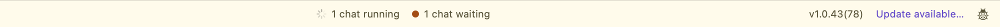
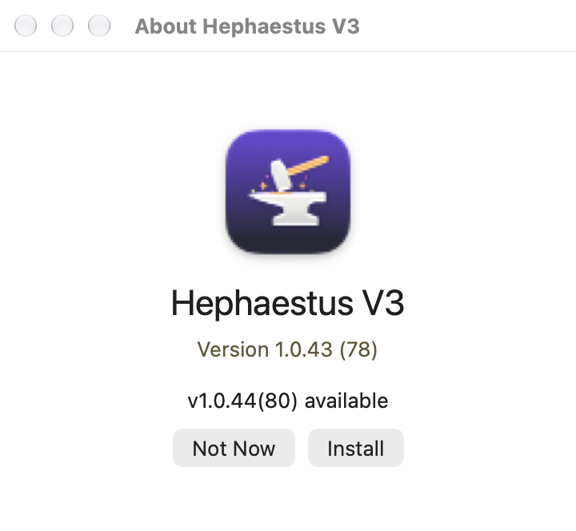
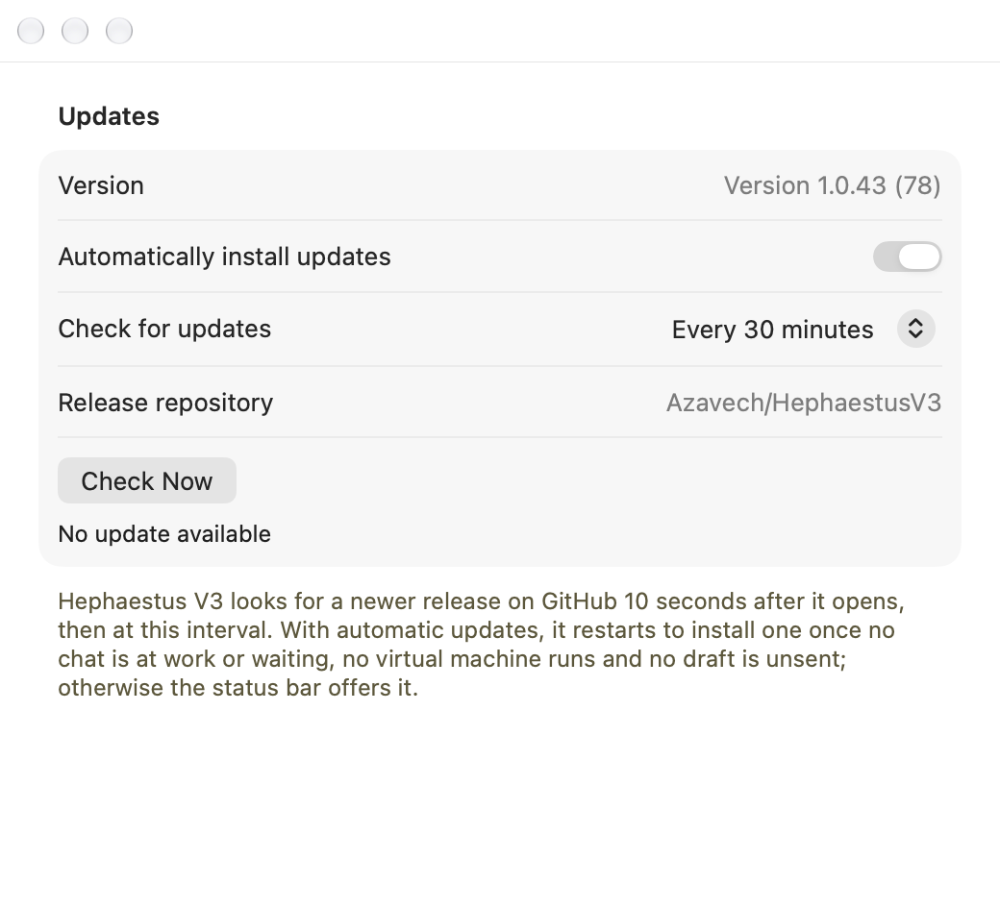

# Updates

V2's version in the status bar and its update feature (the owner's choices of 21 November 2026): the app shows its
version and build at the bottom of every window, finds a newer GitHub release by itself, offers it in the About
window, in the status bar and in Settings ▸ Updates, and restarts to install it, by itself once nothing is at work,
or when the user chooses Install. How the Updater checks, downloads, verifies and swaps the app is in
[Updater](../updater.md); the release it reads, in [Release](../release.md).

## Version

The status bar's **Version** item (`statusBar.version`) shows the running app's version and build as
`v<version>(<build>)`, such as `v1.0.43(78)`, V2's form ([Updater › Versions](../updater.md#versions)): in every
window that has the status bar, main windows and chat windows, always ([Navigation › Status
bar](navigation.md#status-bar)). VoiceOver reads "Version v1.0.43(78)". A development build shows build 0, such as
`v1.0(0)`.

The About window and Settings ▸ Updates show it as `Version 1.0.43 (78)`, selectable.

## About window

**Hephaestus V3 ▸ About Hephaestus V3** opens the About window, in place of macOS's About panel: a `Window` scene
with the id `about`, titled "About Hephaestus V3", 360 points wide, as high as its content, not resizable, not
restored at launch. The item brings it to front when it is open.

Centred, top to bottom:

| Element     | Identifier      | Content                                                                   |
|-------------|-----------------|---------------------------------------------------------------------------|
| Icon        | —               | The app's icon, 96 × 96 points.                                           |
| Name        | —               | "Hephaestus V3", `title`.                                                 |
| Version     | `about.version` | `Version 1.0.43 (78)`, in `textSecondary`, selectable.                    |
| Update area | `about.update`  | One line, with a small spinner where the table says so, then its buttons. |

Each time the window appears (opened while closed), the app asks the Updater for a check, while it runs, and the
area shows "Checking for updates…" until a status answers it. The first row that holds applies:

| #  | Situation                                                                                                           | Line                                                                                                                               | Buttons                                       |
|----|---------------------------------------------------------------------------------------------------------------------|------------------------------------------------------------------------------------------------------------------------------------|-----------------------------------------------|
| 1  | The Updater doesn't run ([Updater › Starting the Updater](../updater.md#starting-the-updater)), or stopped for good | Its reason, such as "Updates are off in development builds."                                                                       | none                                          |
| 2  | Install was chosen (here, with the Update item or with Update Now) and the app hasn't quit                          | "Installing…", with the spinner                                                                                                    | none                                          |
| 3  | No status came within 15 seconds after the last check asked                                                         | "The Updater isn't responding."                                                                                                    | **Try Again**                                 |
| 4  | The answer to the last check is awaited, or the state is `idle` or `checking`                                       | "Checking for updates…", with the spinner                                                                                          | none                                          |
| 5  | `upToDate`                                                                                                          | "No update available"                                                                                                              | none                                          |
| 6  | `upToDate` with a message                                                                                           | The message: "v1.0.44(80) requires macOS 28."                                                                                      | none                                          |
| 7  | `available`, `downloading` or `ready`, and Not Now was clicked since the window appeared                            | "v1.0.44(80) available"                                                                                                            | none                                          |
| 8  | `available`, `downloading` or `ready`                                                                               | "v1.0.44(80) available"                                                                                                            | **Not Now**, **Install** (the default button) |
| 9  | `error`                                                                                                             | The Updater's message, such as "GitHub doesn't show Azavech/HephaestusV3 to visitors: the repository is private or doesn't exist." | **Try Again**                                 |
| 10 | `installing`                                                                                                        | "Installing…", with the spinner                                                                                                    | none                                          |

- **Install** (`about.install`) marks the install as chosen: one mark for the app, which the Update item and Update
  Now set too, and which the window shows as row 2 wherever it was chosen. In `ready` the [restart
  checks](#restart-rules) run at once; in `available` the app asks the Updater to download, and the checks run
  when the update is `ready`. Cancelling them clears the mark (row 8 again); an `error` clears it too (row 9).
  Closing the window doesn't cancel a chosen install.
- **Not Now** (`about.notNow`) hides the two buttons until the window closes; it changes neither the setting nor a
  `ready` update.
- **Try Again** (`about.tryAgain`) asks for the download again when the error carries a build, for a check
  otherwise.
- After a restart that didn't happen ([Restart rules](#restart-rules)), rows 7 and 8 read "The Updater didn't
  answer; the update wasn't installed." until the update's state changes.

Previews: **About, Update Available**, **About, Up to Date, Dark**, **About, Checking**, **About, Error**, **About,
Development Build**.

## Update item

The status bar's **Update** item (`statusBar.update`), right of the Version item, before the ladybug, in the
windows of the app's tabs, not in chat windows (as V2). While the Updater runs, it shows when:

- the state is `available`, `downloading` or `ready`, whatever `autoUpdate` is, and the restart hasn't started; or
- the install is chosen and the app hasn't quit.

It is hidden otherwise, and always while the Updater doesn't run: no restart could install then.

| Situation                      | Item                             | Tooltip                                           | A click                                                                   |
|--------------------------------|----------------------------------|---------------------------------------------------|---------------------------------------------------------------------------|
| The install is chosen          | A mini spinner and "Installing…" | none                                              | nothing: not a button                                                     |
| `available`                    | "Update available…", in `accent` | "Update v1.0.44(80) available — click to install" | As Install: the mark, the download, then the restart checks once `ready`. |
| `downloading`                  | Same                             | "Downloading update v1.0.44(80)…"                 | The mark; the restart checks once `ready`.                                |
| `ready`, automatic updates on  | Same                             | "Update v1.0.44(80) ready — restarts when idle"   | The mark; the restart checks, then the restart.                           |
| `ready`, automatic updates off | Same                             | "Update v1.0.44(80) ready"                        | Same.                                                                     |

When the mark clears, the item follows the state again. The automatic restart marks nothing: the item goes when
that restart starts. The accent color is a default chosen at design time.

Previews (Navigation's status bar): **Status Bar, Update Available**, **Status Bar, Installing, Dark**.

## Settings ▸ Updates

The last tab of Settings (`arrow.down.circle`), after Notifications: V2's tab, a grouped form with one section,
**Updates**.

| Element                           | Identifier                                                | Content                                                                                                                                                                                                                                                                                              |
|-----------------------------------|-----------------------------------------------------------|------------------------------------------------------------------------------------------------------------------------------------------------------------------------------------------------------------------------------------------------------------------------------------------------------|
| **Version**                       | `settings.updates.version`                                | `Version 1.0.43 (78)`, selectable.                                                                                                                                                                                                                                                                   |
| **Automatically install updates** | `settings.updates.autoUpdate`                             | A switch, on by default: `settings.yml`'s `autoUpdate` ([Data › Settings file](../data.md#settings-file)). On, an update downloads as soon as it is found and the app restarts by itself when idle; off, the update waits for Install.                                                               |
| **Check for updates**             | `settings.updates.interval`                               | A menu: Every 15 minutes, Every 30 minutes (the default), Every hour, Every 2 hours, Every 6 hours, Every day; a value stored by hand that isn't one of them shows as "Every <n> minutes". `updateCheckIntervalMinutes`.                                                                             |
| **Release repository**            | `settings.updates.repository`                             | `Azavech/HephaestusV3`, selectable.                                                                                                                                                                                                                                                                  |
| **Check Now**, **Update Now**     | `settings.updates.checkNow`, `settings.updates.updateNow` | One row. Check Now asks for a check; disabled while the Updater doesn't run. Update Now, right of it, shows only while the Update item offers the update (`available`, `downloading` or `ready`, the install not chosen, no restart started), and does what a click on the item does.                |
| Status line                       | `settings.updates.status`                                 | Under the buttons, in `callout`: the About window's line and spinner (rows 1 to 10), without its buttons and without Not Now.                                                                                                                                                                        |
| Message                           | `settings.updates.message`                                | When `settings.yml` can't be written: the storage error, in `danger`; the choice still holds until the app quits.                                                                                                                                                                                    |
| Footer                            | —                                                         | "Hephaestus V3 looks for a newer release on GitHub 10 seconds after it opens, then at this interval. With automatic updates, it restarts to install one once no chat is at work or waiting, no virtual machine runs and no draft is unsent; otherwise the status bar offers it." In `textSecondary`. |

A change of either setting writes both keys and reaches the Updater with a check. Previews: **Up to Date**,
**Update Ready, Dark**, **Repository Private**, **Development Build**.

## Restart rules

The app is **idle** when the restart would stop or lose nothing (`AppData.runningWork`):

- no chat the status bar counts: starting, running, waiting for permission or for answers, or idle with its
  background work running ([Navigation › Status bar](navigation.md#status-bar));
- no chat holding an unsent draft, text or files ([Chat › Drafts](chat.md#drafts)): drafts live in memory;
- no virtual machine, setup or install running, and no image downloading ([Virtual
  Machines](virtual-machines.md)): a restart stops them as a power cut does;
- no window showing a sheet.

| Situation                                                           | What happens                                                                                                                                                                                                                        |
|---------------------------------------------------------------------|-------------------------------------------------------------------------------------------------------------------------------------------------------------------------------------------------------------------------------------|
| `available` or `downloading`, Install not chosen                    | The Update item and Update Now offer it; nothing restarts before `ready`.                                                                                                                                                           |
| `ready`, automatic updates on, Install not chosen, the app idle     | The restart starts at once, without an alert.                                                                                                                                                                                       |
| `ready`, automatic updates on, Install not chosen, the app not idle | The item shows "ready — restarts when idle"; the restart starts as soon as the app is idle, looked at again whenever a chat's state or background work, a draft, a machine or an image changes, and every 2 seconds for the sheets. |
| `ready`, automatic updates off, Install not chosen                  | The item shows "ready"; the app doesn't restart by itself.                                                                                                                                                                          |
| Install chosen (About window, Update item, Update Now)              | The restart checks, then the restart: at once in `ready`, otherwise once `ready` comes.                                                                                                                                             |

**Restart checks.** When the restart would stop chats or machines or lose drafts, an alert asks first:

| Title                             | Message                                                                                                             | Buttons                           |
|-----------------------------------|---------------------------------------------------------------------------------------------------------------------|-----------------------------------|
| "Restart to install v1.0.44(80)?" | The parts that apply: "2 chats will be stopped." "1 virtual machine will be stopped." "Unsent drafts will be lost." | **Restart** (default), **Cancel** |

Cancel clears the mark; the update stays `ready`, the About window offers Install and Not Now again, and the Update
item shows "Update available…". Without chats, machines or drafts, the restart starts without an alert. The
automatic restart never shows it: it happens only when the app is idle.

**The restart.** The app keeps its windows for the next launch whatever "Close windows when quitting an
application" says, asks the Updater to install, and quits once it answers; the Updater swaps the app and opens it
again by its path, `/Applications/HephaestusV3.app`, where macOS restores the windows ([Updater › Restart for an
update](../updater.md#restart-for-an-update)). When the Updater doesn't answer within 5 seconds, the app keeps
running and shows an alert: "The Updater didn't answer; the update wasn't installed.", with OK. It doesn't restart
by itself for that build again; Install, the Update item and Update Now start the restart again.

An ordinary quit (⌘Q) with an update `ready` installs it as the app quits, once the quit goes on ([Navigation ›
Quitting](navigation.md#quitting)); the next opening runs the new version.

Defaults chosen at design time: the drafts and sheets in the idle rule, the alert's texts and its parts, the 2
seconds, the windows kept over the restart. V2's restart rules, its alert and its automatic restart are the
owner's choices.
