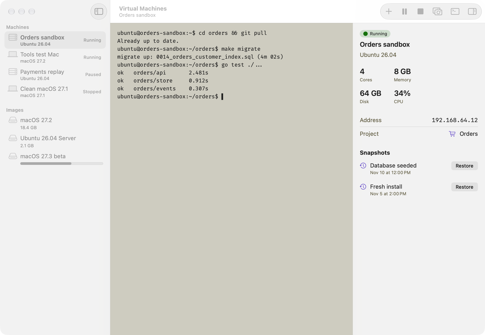
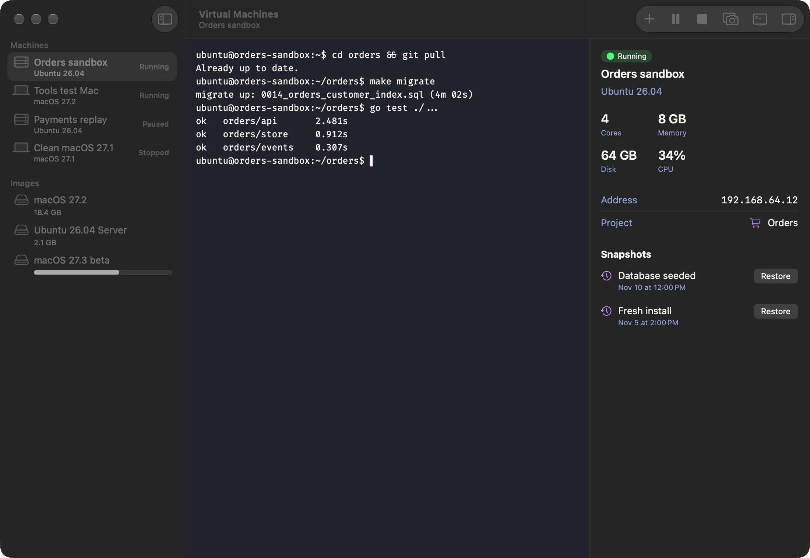
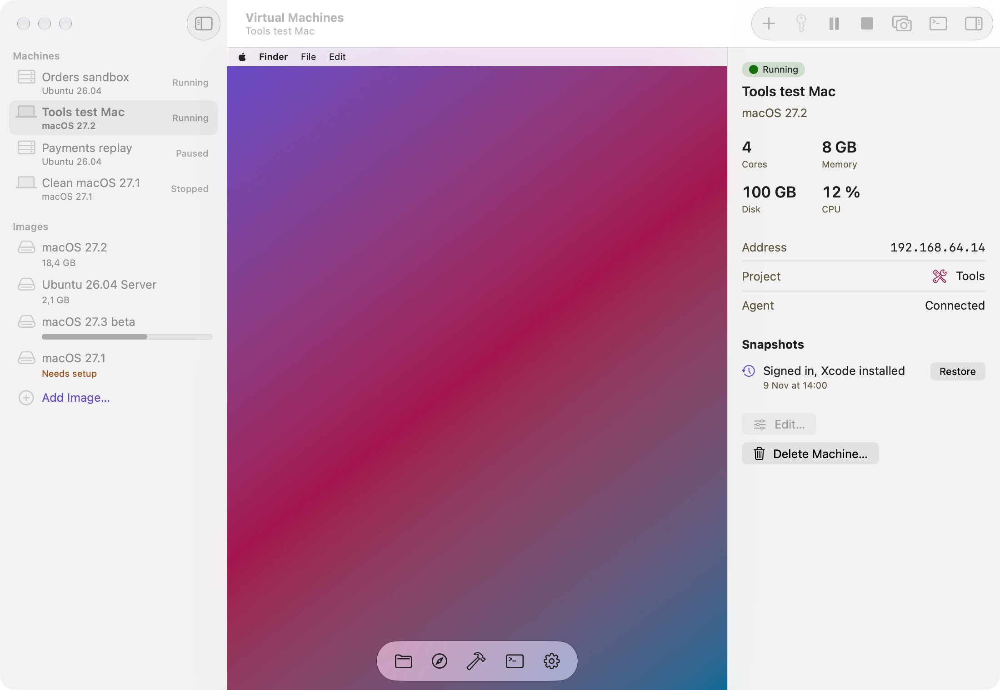
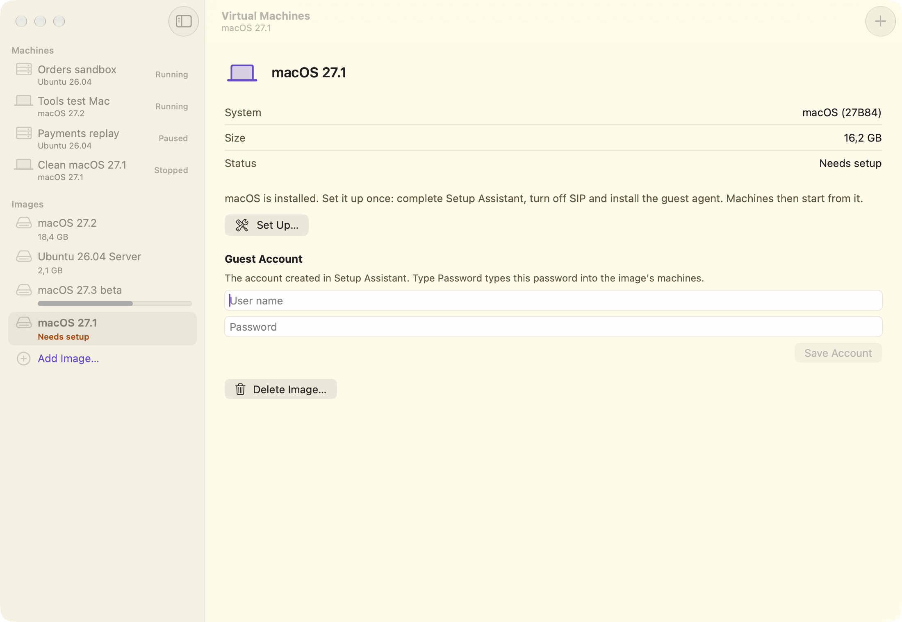
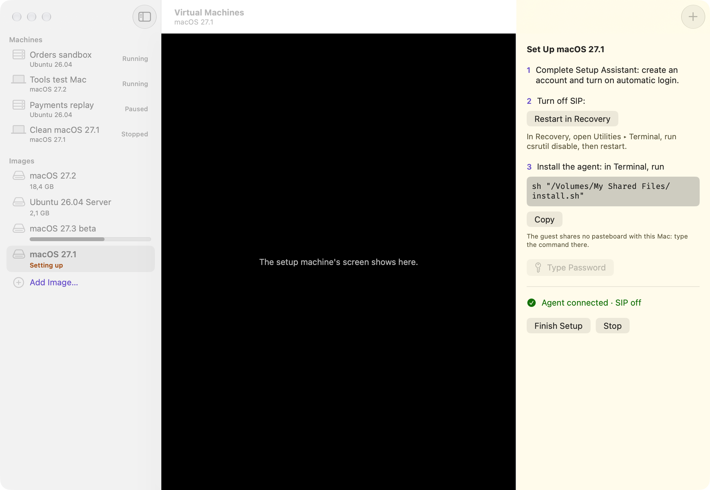
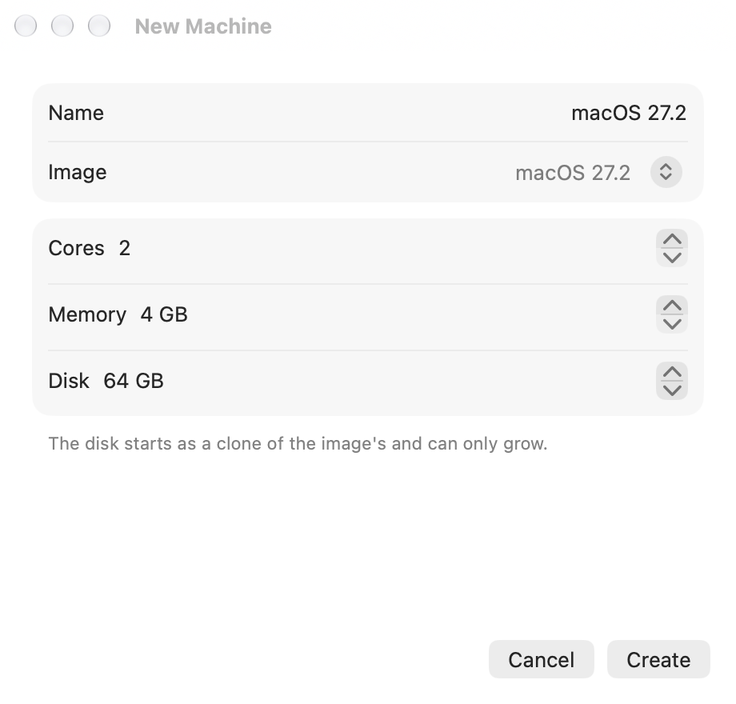
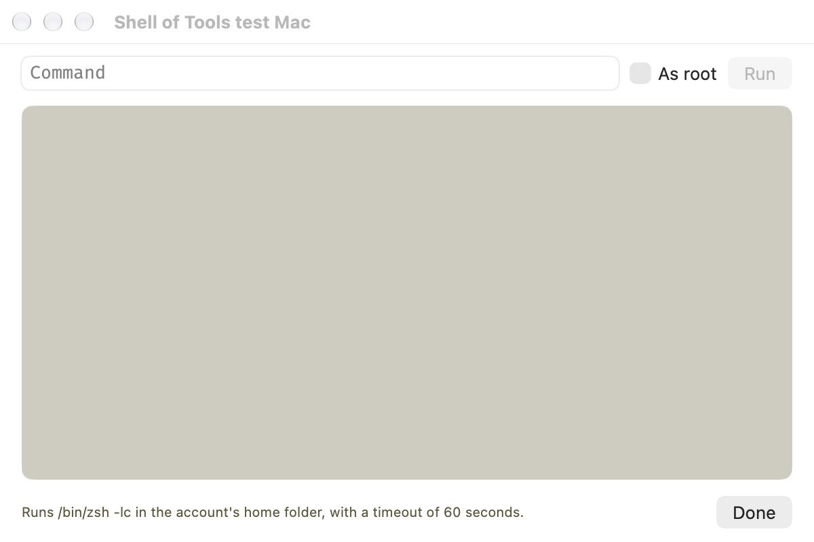
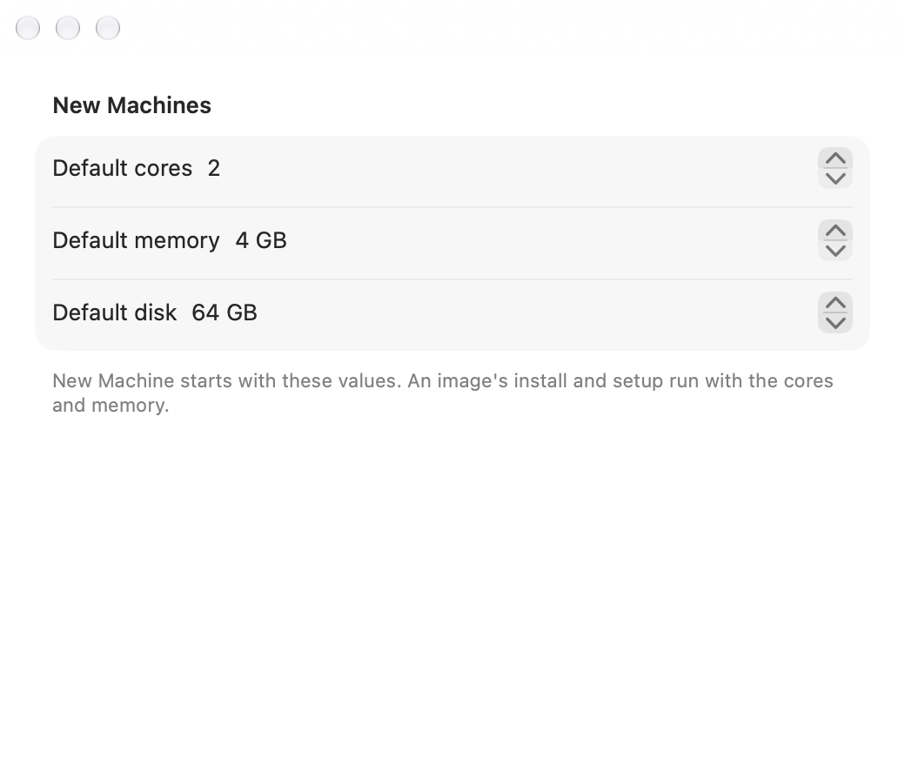
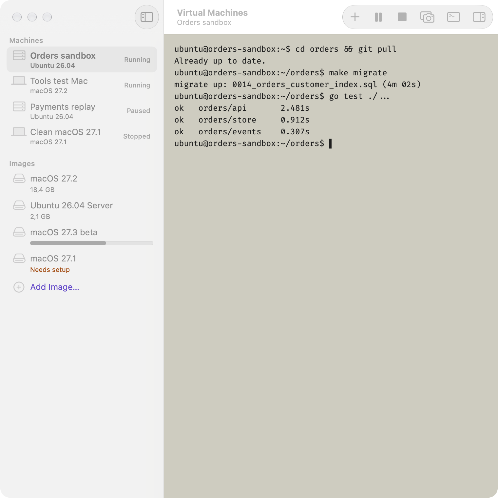
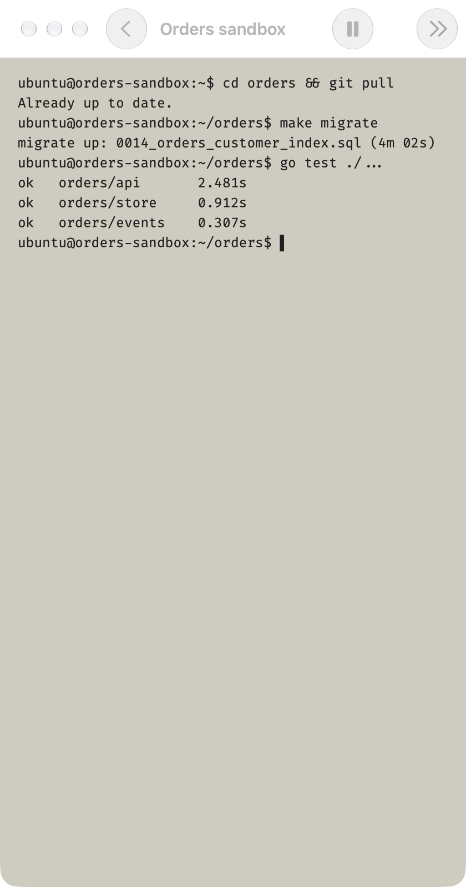

# Virtual Machines

The Virtual Machines window manages the virtual machines on this Mac. People use them to test an app in a closed environment. There is one window for the whole Mac. It is not tied to a project, though a machine can name the project it tests. The sidebar lists the machines and the system images that new machines start from. The detail area shows the selected machine's screen or console, as large as the window allows. Beside it, an inspector shows what the machine runs on, its project and its snapshots. Selecting an image shows its page instead: its system, size, status, then its download or install, its setup, or a button to make a machine from it. Like the tool windows, it changes layout as it narrows, from a Mac's to an iPad's to an iPhone's. The machines and images are those of the data folder: macOS guests of the Virtualization framework, at most two running at once ([Data › Virtual machines](../data.md#virtual-machines)). The screenshots show the sample store, which keeps the design's Linux machine, CPU figure and snapshots.

*The Orders sandbox machine, running Ubuntu 26.04: its console fills the middle, and the inspector shows its figures, address, project and two snapshots. 1100 × 760 points, Light Mode.*

## Opening it

| Way in | What happens |
| --- | --- |
| **Window ▸ Virtual Machines**, ⌘7 | Brings the Virtual Machines window forward if it is open, un-minimized if it was in the Dock. Otherwise it opens the window. The item is always enabled because it needs no project. It keeps the window's current selection. |
| `Route.machine(id)` | Brings the open window forward, un-minimized, and activates the app (the user's choice), then selects machine `id` in it. The window does not start again: its layout, sidebar and inspector stay as they were. A route to a machine the user has since left for another item selects that machine again. When the window is not open, the route opens it on machine `id` and activates the app. |

- **The Window menu.** The item comes after **Projects** (⌘0) and the six tool items (⌘1 to ⌘6), then a divider. See [navigation.md](navigation.md) for the Window menu.
- **Route focus format.** The focus is the machine's id, for example `orders-sandbox`, `tools-test-mac`, `payments-replay` or `clean-mac`. An id that matches no machine shows **Machine Not Found** (see [States](#states)).
- **A route with no id.** It brings the open window forward and keeps its selection. A window it opens selects the first machine, Orders sandbox.
- **Opening it again.** When the window is opened anew, it selects the machine of the last route, or Orders sandbox if no route has named one.
- **No route callers yet.** No tool or window sends `Route.machine` yet: a chat's `vm_` tool-call rows have no item to open, machines not being a `ToolKind`.
- **No project entry points.** The Projects window, the menu bar panel and the project switcher do not open this window. They are project-based, and this window is not.
- **One window.** The scene is a single `Window` (`id` `machines`), so there is never more than one Virtual Machines window. It registers with `WindowDirectory` as `.machines` with no project. This is how routes and the menu find it instead of opening a second one. See [navigation.md](navigation.md) › window reuse.
- **Launch and size.** It is a tab ([Navigation › Tabs](navigation.md#tabs)), which doesn't open at launch: ⌘7 or a route opens it, once in the app. Like every window, its window gets no narrower than 390 points and no lower than 420 points.

## Anatomy

| Region | Contents |
| --- | --- |
| Toolbar | The title **Virtual Machines**, with the selected machine's or image's name as the subtitle. The window's buttons sit at the trailing end. |
| Sidebar | Two sections, **Machines** and **Images**. The column is 220 to 320 points wide, 250 by default. |
| Machine screen | The selected machine's screen or console. It fills all the width and height that the sidebar and inspector leave. |
| Inspector | The selected machine's state, figures, address, project and snapshots. The column is 260 to 400 points wide, 300 by default. It shows from the start in the Mac layout, folds behind **Inspector** in the iPad layout, and opens as a sheet in the iPhone layout. |
| Image page | Shown in place of the screen and inspector when an image is selected. It shows the image's name, its system, size and status, then either its download or a button to make a machine from it. It fills the detail area. |

In the Mac and iPad layouts, the window is a two-column `NavigationSplitView`. The sidebar runs the full height on the leading side. The detail column holds the machine screen, with the inspector on its trailing side, or the image page. The toolbar spans the detail and the inspector. In the iPhone layout, the window shows one pane at a time with `PhoneStack` (see [components.md](components.md)): the list, then a machine's or an image's page. See [Layouts](#layouts).

*The same window and machine in Dark Mode.*

## Toolbar

The buttons sit together at the trailing end in the order listed. When an image is selected, or nothing is, only **New Machine** remains: the machine items and the inspector toggle belong to the machine detail. Every button shows only its symbol, and its tooltip gives its name. A button acting on a machine is disabled while one of its actions runs, and while the machine starts or shuts down.

| Item | Control | Symbol | Shortcut | Behavior | Layouts |
| --- | --- | --- | --- | --- | --- |
| Title | Navigation title and subtitle | None | None | **Virtual Machines**, with the selected machine's or image's name as the subtitle. In the iPhone layout, the list's title is **Virtual Machines**, and a page's title is the machine's or image's name, with no subtitle. The toolbar keeps the title at every width: the window has no project switcher to name it. | All |
| Sidebar toggle | Button provided by `NavigationSplitView` | `sidebar.left` | None set by the window | Hides and shows the sidebar. In the iPad layout, showing the sidebar folds the inspector. | Mac, iPad |
| Back | The stack's own button | None set by the window | None set by the window | Returns to the list and clears the selection. | iPhone, on a page |
| **New Machine** | Button | `plus` | ⇧⌘N (File ▸ New Machine…) | Opens the [New Machine sheet](#new-machine). Disabled while 2 machines, setups or installs run; its tooltip then reads "2 virtual machines are already running". Tooltip: "New Machine (⇧⌘N)". Always shown beside the list; in the iPhone layout, on the list's page only. | All |
| **Type Password** | Button | `key` | None | Shown for a running machine whose image has a password: types it through the screen ([Type Password](#type-password)). Disabled while it types. | All |
| **Pause** | Button | `pause.fill` | None | Shown for a running, starting or shutting-down machine; pauses it. Tooltip: "Pause". | All |
| **Stop** | Button | `stop.fill` | None | Shown with **Pause**: shuts the guest down through its agent, waiting up to 60 seconds, or stops it at once without the agent. Tooltip: "Stop". | All |
| **Resume** / **Start** | Button | `play.fill` | None | Replaces Pause and Stop: **Resume** for a paused machine, **Start** for a stopped one, disabled while 2 run. Tooltip: "Resume" or "Start". | All |
| **Take Snapshot** | Button | `camera.on.rectangle` | None | The sample store only: the machines of the data folder have no snapshots yet ([Future improvements](../future-improvements.md#virtual-machines)). Disabled while the machine is stopped. | Mac, iPad; in **More Actions** on iPhone |
| **Open Shell** | Button | `terminal` | None | Opens the [Open Shell sheet](#open-shell). Enabled while the machine runs with its agent connected; otherwise its tooltip reads "Open Shell: waiting for the guest agent". | Mac, iPad; in **More Actions** on iPhone |
| **More Actions** | Menu | `ellipsis.circle` | None | Holds **Take Snapshot** (sample store) and **Open Shell**, each enabled as in the toolbar, so that an iPhone-wide toolbar keeps room for the title. Tooltip: "More Actions". | iPhone |
| **Inspector** | Button | `sidebar.right` | None | Shows and hides the inspector. In the iPad layout, showing it folds the sidebar. In the iPhone layout, it opens the inspector as a sheet. Tooltip: "Hide Inspector" or "Show Inspector". Always the last item. | All |

## Machine list

The sidebar is a single-selection `List` with two sections. One selection covers both: picking an image deselects the machine, and the other way around. The arrow keys move the selection. The list has no context menus and no drag and drop. In the iPhone layout, the same list is the first page, and picking a row opens its page.

**Machines** shows one row per machine, in the order the machines are listed:

- **Icon:** `laptopcomputer` for a macOS machine, `server.rack` for a Linux machine.
- **Name:** the machine's name, with its system version under it in caption size and the secondary color (for example "Ubuntu 26.04" or "macOS 27.2").
- **State:** the row's trailing badge shows **Starting**, **Running**, **Paused**, **Shutting Down** or **Stopped** as plain text.

With no machines, the section shows **No machines yet.** in the secondary text color. Selecting a machine shows its screen and inspector.

**Images** shows one row per system image:

- **Icon:** `opticaldiscdrive`.
- **Name:** the image's name.
- **Second line:** for a ready image, its size with one decimal and its unit, written in the user's locale, in caption size and the secondary color (for example "18.4 GB"): the space its files take. For an image that is downloading or installing, a mini progress bar ("Downloading, 62%", "Installing, 40%" for VoiceOver). **Needs setup**, or **Setting up** while its setup machine runs, in the warning color; **Failed** in the danger color.

The section always shows, and ends with an **Add Image…** button (`plus.circle`, borderless, accent color), which opens the [Add Image sheet](#add-image). Selecting an image shows the image page.

## Machine screen

The screen fills the detail column in both directions and clips its contents to that area. A virtual machine's display takes the size of its window, and the screen follows the window as it resizes (every window fills the room it gets, with no capped widths: the user's choice).

A machine of the data folder that runs, is paused, starts or shuts down shows the Virtualization framework's view (`VZVirtualMachineView`, wrapped by `VirtualMachineScreen`) on black: the user's mouse and keyboard drive the guest, system keys included (`capturesSystemKeys`), and the guest's display follows the view's size (`automaticallyReconfiguresDisplay`). A paused machine keeps the veil below. The sample store's machines show the stand-ins of this table:

| Machine | What the screen shows |
| --- | --- |
| Running Linux | A console on the sunken surface (`surfaceSunken`): sample shell output for `cd orders && git pull`, `make migrate` and `go test ./...`. The prompt carries the machine's id (`ubuntu@orders-sandbox:~$`) and the last line ends in a block cursor. The text is in the code font, Fira Code, at callout size (see [foundations.md](foundations.md)). It is aligned to the top leading corner, with 16 points of padding. |
| Running macOS | A desktop: a gradient from the accent color through the secondary accent to the info color, top leading to bottom trailing. Across the top is a menu bar strip on regular material with `apple.logo`, "Finder", "File" and "Edit". Near the bottom, 10 points from the edge, is a Liquid Glass dock with `folder`, `safari`, `hammer`, `terminal` and `gearshape`. The menu bar's words are part of the picture, like the console's text: they are shown as they are and not translated. |
| Paused | The machine's screen as above, under a veil of the sunken surface color (`surfaceSunken`, AZDesign's color for inactive regions) at 60% opacity. A **Paused** label with `pause.fill` sits in a Liquid Glass capsule in the center. |
| Stopped | The sunken surface with the `power` symbol (large title size, hidden from VoiceOver), **Stopped** (title 3 size) and a **Start** button (`play.fill`) stacked in the center. **Start** starts the machine; it is disabled while 2 run. |

**Two prominent styles.** The stopped screen's **Start** uses the glass prominent style (`.glassProminent`): it floats over the machine's screen, like the screen's other overlays, which is where Hephaestus V3 uses Liquid Glass (see [foundations.md](foundations.md) › Liquid Glass). The image page's **New Machine from This Image** sits on the page's own background, not over other content, so it uses the bordered prominent style (`.borderedProminent`).

*The Tools test Mac, running macOS 27.2: the stand-in desktop fills the screen area, with its menu bar strip and glass dock.*

## Machine details inspector

The inspector sits on the trailing side of the screen. It is 260 to 400 points wide, 300 by default. Its contents scroll vertically, with 16 points of padding and 20 points between groups. The **Inspector** toolbar button (`sidebar.right`) shows and hides it with AZDesign's panel motion, which fades instead under Reduce Motion (see [foundations.md](foundations.md) › Motion). This window has no chat panel, so `sidebar.right` here belongs to the inspector alone.

**Visibility.**

- **Mac layout.** The inspector shows when the window opens. It stays shown or hidden as the selection moves between machines and images, and when a route selects a machine.
- **iPad layout.** The inspector starts folded behind **Inspector**. The window shows one side column at a time, so the screen keeps its room: showing the inspector folds the sidebar, and showing the sidebar folds the inspector.
- **iPhone layout.** **Inspector** opens the same contents as a sheet over the machine's page, at least 360 × 480 points, with **Done** (Return) at its bottom trailing corner.
- **Layout changes.** Each time the layout changes, the sidebar and the inspector take that layout's starting visibility, and an open sheet closes. Within a layout, the panes stay as the user last showed or hid them. The visibility is not kept across launches.

From top to bottom:

1. **State and name.**
   - A badge with `circle.fill` and the state, using the badge label style (see [components.md](components.md)). Running is tinted `success`, Paused `warning` and Stopped `textSecondary`.
   - The machine's name in semibold title 3 size, a header for accessibility.
   - Its system version in the secondary text color.
2. **Figures.** A two-by-two grid of `Figure`s (see [components.md](components.md)), 28 points apart horizontally and 14 points vertically. When two don't fit side by side, at the largest text sizes, they stack in one column, 14 points apart.

   | Figure | Shows |
   | --- | --- |
   | **Cores** | The number of cores. |
   | **Memory** | The memory, with its unit, written in the user's locale (for example "8 GB"). |
   | **Disk** | The disk size, with its unit (for example "64 GB"). |
   | **CPU** | The current CPU use, as a whole percentage. The sample store only: it isn't measured for the machines of the data folder, which show three figures. |

3. **Details.** Two rows, each with the name on the leading side in the secondary text color and the value on the trailing side. A divider separates them. At the accessibility text sizes, each value goes under its name.

   | Row | Value | Action |
   | --- | --- | --- |
   | **Address** | The machine's IP address, in the system's monospaced font. **None while stopped** when the machine has no address. | The address text can be selected. |
   | **Project** | The project the machine tests (`vm.yml`'s `projectID`): its `ProjectIcon` and name, from the app's projects. **None** when the machine names no project, or a project this Mac doesn't have. | The name is a link-style button. It opens the Projects window with that project selected (`Route.project`), bringing the window forward if it is open. |
   | **Agent** | **Connected** or **Not connected** while the machine runs; **Not running** while it is stopped. | None. |

   The **Address** is the guest's IP address, found in the DHCP leases of macOS's NAT; it appears a few seconds after the guest starts its network.
4. **Snapshots.** The sample store only. See the next section.
5. **Edit…** (`slider.horizontal.3`) opens the [Edit Machine sheet](#edit-machine); disabled unless the machine is stopped, its tooltip then reading "Stop the machine to edit it". **Delete Machine…** (`trash`, destructive) asks first ([Alerts](#alerts)).

## Snapshots

The **Snapshots** heading (headline, a header for accessibility) is followed by the machine's snapshots in the order the machine lists them. In the sample data this is newest first. Each row shows:

- **Icon:** `clock.arrow.circlepath` in the accent color, hidden from accessibility.
- **Name:** the snapshot's name.
- **Date:** under the name, in caption size and the secondary color, formatted as day, abbreviated month, hour and minute in the user's locale (for example "10 Nov at 12:00").
- **Restore:** a small button on the trailing side, sample data only. At the accessibility text sizes, it goes under the name and date.

A machine with no snapshots shows **No snapshots yet.** in the secondary text color.

To take a snapshot, use **Take Snapshot** (`camera.on.rectangle`) in the toolbar, or in **More Actions** in the iPhone layout. It is disabled while the machine is stopped and enabled while it is running or paused. Snapshots are the sample store's only: the section and the button don't show for the machines of the data folder.

## Image page

Selecting an image replaces the screen and inspector with the image's page, on the canvas background. While its setup machine runs, the [setup view](#setup) takes the page's place. The page takes the whole detail area: its contents line up on the leading edge, and its rows and bars span its full width (every window fills the room it gets, with no capped widths: the user's choice). It has 24 points of padding and 20 points between groups, and it scrolls when the window is too low. From top to bottom:

1. **Header.** The image's system symbol (`laptopcomputer`) in large title size and the accent color, hidden from VoiceOver, then the image's name ("macOS 27.2.1") in semibold title 2 size, a header for accessibility.
2. **Rows.** Three rows, laid out as the inspector's details, with dividers between them:

   | Row | Value |
   | --- | --- |
   | **System** | macOS, with its build: "macOS (26B131)". |
   | **Size** | The space its files take, with one decimal and its unit; while it downloads, the IPSW's size. |
   | **Status** | **Ready**, **Downloading**, **Installing**, **Needs setup** or **Failed**. |

3. **By state:**
   - **Ready:** **New Machine from This Image** (`plus`, bordered prominent style) opens [New Machine](#new-machine) with the image chosen; disabled while 2 run.
   - **Downloading or installing:** a progress bar across the page's width. Its label is the amount downloaded out of the IPSW's size, for example "11.7 GB of 18.9 GB", while downloading with a known size, else **Downloading** or **Installing macOS**; its current value is the percentage. **Cancel Download** follows, 12 points below: it asks, then deletes the image.
   - **Needs setup:** "macOS is installed. Set it up once: complete Setup Assistant, turn off SIP and install the guest agent. Machines then start from it." in the secondary color, then **Set Up…** (`wrench.and.screwdriver`, bordered prominent), which starts the setup machine; disabled while 2 run. A failure shows the alert **Set Up failed**.
   - **Failed:** the failure's message with `exclamationmark.triangle.fill`, in the danger color.
4. **Guest Account.** A headline, a sentence ("The account created in Setup Assistant. Type Password types this password into the image's machines."), a **User name** field, a **Password** secure field and **Save Account**, enabled when a value changed. A refused value shows its message beside the button. What is typed is kept, by image, across Set Up… and tab switches until it is saved; untouched fields show the stored account, so a change Claude makes with `vm_set_account` shows. **Set Up…** saves a changed account first, so that Type Password works in the setup.
5. **Delete Image…** (`trash`, destructive): asks first ([Alerts](#alerts)). The selection then moves to the first machine of another image, or to nothing: never to a machine the deletion removes.

*An image waiting for its setup (sample store). 1100 × 760 points.*

The window's subtitle shows the image's name, or the page's title does in the iPhone layout.

## Setup

The setup view shows an image's setup machine, booted on the image's own disk ([Data › Virtual machines › Setup](../data.md#setup)). It replaces the image page while the machine runs; leaving the image doesn't stop it. Its screen fills the leading side on black (**The setup machine's screen shows here.** before the framework's view is ready). Beside it, a column 300 points wide on the canvas, scrolling, with 16 points of padding; in the iPhone layout the column goes under the screen, at most 360 points high:

1. **Set Up macOS *version***, a headline and a header.
2. Numbered steps (the number in the accent color):
   1. "Complete Setup Assistant: create an account and turn on automatic login."
   2. "Turn off SIP:", **Restart in Recovery** (disabled while it restarts or the machine isn't running; a failure shows **Restart in Recovery failed**), then "In Recovery, open Utilities ▸ Terminal, run csrutil disable, then restart." in the secondary color.
   3. "Install the agent: in Terminal, run", the command `sh "/Volumes/My Shared Files/install.sh"` in the code font on the sunken surface, selectable, then **Copy**, which reads **Copied** for 2 seconds, and "The guest shares no pasteboard with this Mac: type the command there." in caption size.
3. **Type Password** ([Type Password](#type-password)), enabled while the machine runs and the image has a password.
4. A divider, then the status line: `hourglass` with **Waiting for the agent…**, **Restarting in Recovery…**; `checkmark.circle.fill` with **Agent connected · SIP on**, or **Agent connected · SIP off** in the success color.
5. **Finish Setup** (bordered prominent), enabled only with the agent connected and SIP off: shuts the guest down and makes the image Ready; a failure shows **Finish Setup failed**. **Stop** ends the setup; the image stays waiting for setup.

These texts and the view's parts are the user's choices.

*The setup view, the agent connected with SIP off (sample store, so the screen's place reads its placeholder).*

## Type Password

Types the image's stored password into the guest through the machine's screen, as the user's keyboard does: the keys reach the guest's keyboard focus without the agent (Setup Assistant, the login window, a password dialog). The screen takes the window's keyboard focus, then each character's key is pressed on this Mac's keyboard layout, with Shift, Option or both as the character needs, 10 ms apart; Return isn't pressed. A character the layout can't type fails before any key is pressed: the alert **Type Password failed** with "The keyboard layout of this Mac cannot type “*c*”." (`GuestKeyboard`.)

## Sheets

### New Machine

A grouped form, at least 420 × 380 points, titled **New Machine**:

- **Name** (prefilled with the image's name) and **Image**, a pop-up of the Ready images (the one chosen, else the first). With none: "No image is Ready: add an image and finish its setup first."
- **Cores**, **Memory** and **Disk** steppers with their values, from Settings ▸ Virtual Machines' defaults: cores 2 to this Mac's, memory 4 GB to this Mac's, disk from the image's disk size to 2048 GB, by 8. Footer: "The disk starts as a clone of the image's and can only grow."
- **Cancel** (Escape) and **Create** (Return), enabled with a name and an image.

  
  *New Machine on macOS 27.2.*

- Create makes the machine, starts it, selects it and closes the sheet; a refusal shows its message under the form, with a small progress indicator while it works. A machine made whose start failed is selected, stopped.

### Edit Machine

A stopped machine's **Name**, **Cores**, **Memory** and **Disk** (from its current size), footer "A larger disk grows the guest's container at the next start.", **Cancel** and **Save**. Save shows a small progress indicator while a larger disk grows, which takes seconds and leaves the app usable; a refusal shows its message under the form.

### Add Image

Reads ipsw.me's list ("Reading the versions from ipsw.me…"), then a **Version** pop-up ("macOS 27.2.1 (26B131) · 18.4 GB", newest first) and "The IPSW is downloaded from Apple, then macOS is installed on a 32 GB disk. You finish its setup in the image's page." A list that can't be read shows **No Versions** with **Try Again** and the message. **Add** starts the download, selects the new image and closes the sheet.

### Open Shell

At least 560 × 380 points, titled **Shell of *name***: a **Command** field in the code font (Return runs it), **As root**, **Run**; the output below on the sunken surface, standard output then standard error in the code font, selectable, and "Exit status *n*", "Timed out", with "output cut at 1 MB" when cut, in the danger color when not 0. "Runs /bin/zsh -lc in the account's home folder, with a timeout of 60 seconds." and **Done** at the bottom.

*Open Shell, before a command.*

## Alerts

| Alert | When | Buttons |
| --- | --- | --- |
| **Delete “*name*”?** (confirmation dialog) | Delete Machine…, Delete Image…, Cancel Download | **Delete** (destructive), Cancel. The message: "A running machine stops at once. Its folder and disk are deleted, not moved to the Trash." for a machine; for an image, "The image's folder and its disk are deleted, not moved to the Trash." or "The image and its *n* machines are deleted, with their disks, not moved to the Trash." |
| **Start failed**, **Stop failed**, **Pause failed**, **Delete failed**, **Set Up failed**, **Restart in Recovery failed**, **Finish Setup failed**, **Type Password failed** | The action failed | **OK**, with the message. |
| ***name* stopped** | A machine or setup stopped by itself with a failure | **OK**, with the framework's message. Shown once. |

## Settings ▸ Virtual Machines

A tab of the Settings window (`desktopcomputer`): **New Machines**, three steppers, **Default cores** (2 to this Mac's), **Default memory** (4 GB to this Mac's) and **Default disk** (32 to 2048 GB, by 8), saved in `settings.yml` as they change ([Data › Virtual machines › Defaults](../data.md#defaults)). Footer: "New Machine starts with these values. An image's install and setup run with the cores and memory." A refusal shows under it.

*Settings ▸ Virtual Machines with its default values: 2 cores, 4 GB of memory, a 64 GB disk.* Identifiers: `settings.machines`, `settings.machines.cores`, `.memory`, `.disk`.

## States

| State | When | What shows |
| --- | --- | --- |
| Machine running | Orders sandbox, Tools test Mac | Badges read **Running** (`success` in the inspector). The screen shows the console or desktop. **Pause**, **Stop**, **Take Snapshot** and **Open Shell** are enabled. **Address** shows the IP address. |
| Machine paused | Payments replay | Badges read **Paused** (`warning` in the inspector). The screen is veiled and shows **Paused**. The toolbar shows **Resume**. **Take Snapshot** is enabled and **Open Shell** is disabled. |
| Machine stopped | Clean macOS 27.1 | Badges read **Stopped** (`textSecondary` in the inspector). The screen shows the `power` placeholder with **Start**. The toolbar shows **Start**. **Take Snapshot** and **Open Shell** are disabled. **Address** reads **None while stopped**. |
| No project | A machine with no project (Clean macOS 27.1) | The **Project** row reads **None**. |
| No snapshots | A machine with no snapshots (Payments replay) | **No snapshots yet.** under **Snapshots**. |
| Inspector hidden | After **Inspector** is toggled off, and at first in the iPad layout | The screen takes the inspector's width as well. |
| Image ready | macOS 27.2, Ubuntu 26.04 Server | The row shows the size. The page's **Status** reads **Ready**, and the page offers **New Machine from This Image**. |
| Image downloading | macOS 27.3 beta, at 62% | The row shows a mini progress bar. The page's **Status** reads **Downloading**, and the page shows the progress bar, "11.7 GB of 18.9 GB" at 62%, and **Cancel Download**. |
| Image installing | An image after its download | As downloading, **Installing** and **Installing macOS**. |
| Image needs setup | macOS 27.1 | The row reads **Needs setup**; the page explains the setup and offers **Set Up…**. |
| Setting up | The "Setting Up" preview | The row reads **Setting up**; the setup view replaces the page. |
| Image failed | The "Image Failed" preview | The row reads **Failed**; the page shows the message. |
| Starting, shutting down | A machine between states | Badges read **Starting** or **Shutting Down** (`info`); **Pause** and **Stop** are disabled. |
| Two running | 2 machines, setups or installs run | **New Machine**, **Start**, **Set Up…** and **New Machine from This Image** are disabled. |
| Agent not connected | A running machine before its agent connects, or without one | **Agent** reads **Not connected**; **Open Shell** is disabled. |
| No selection | The list's selection is cleared, or the iPhone layout's list is showing. With machines, the Mac and iPad layouts open with a machine selected. | **No Machine Selected** with `desktopcomputer` and "Pick a machine or an image in the list.", centered on the canvas background. No subtitle. Only **New Machine** is in the toolbar. |
| Unknown machine | A route names an id that no machine has | **Machine Not Found** with `desktopcomputer.trianglebadge.exclamationmark` and "No machine on this Mac has the id “*id*”.", centered on the canvas background. No row is selected in the list, and only **New Machine** is in the toolbar. |
| No machines | The Mac has no machines (previews only: the sample data always has four) | **No machines yet.** under **Machines**, and **No Machine Selected** in the detail. With no images either, the **Images** section is left out. |
| Sample store | Previews and screenshots | The sample machines and images, the stand-in screens, the CPU figure and snapshots. |

## Layouts

The window measures its width and picks a layout, as the tool windows do; see [foundations.md](foundations.md) › Layout system. The Virtual Machines window needs 900 points for its Mac layout: the sidebar and the inspector at their default widths, 250 and 300 points, leave the screen 350 points. It has no chat panel, so no panel width is added.

| Layout | When | What changes |
| --- | --- | --- |
| Mac | 900 pt and wider | Sidebar, screen and inspector side by side. The sidebar and the inspector show, and each has its own button. |
| iPad | 640 to 899 pt | The sidebar shows and the inspector folds behind **Inspector**. One side column shows at a time: showing the inspector folds the sidebar, and showing the sidebar folds the inspector. The toolbar keeps its items. |
| iPhone | Narrower than 640 pt | One pane at a time (`PhoneStack`). The list fills the window, with nothing selected, unless a route opened the window on a machine, which starts on its page. Picking a machine or an image pushes its page, with Back; a route's machine opens its page too. A page's title is the item's name. **Take Snapshot** and **Open Shell** move into **More Actions**, and **Inspector** opens a sheet. **New Machine** shows on the list's page only. A window that narrows to this width keeps its selection and shows that item's page, as a collapsing split view does ([Foundations › Layout system](foundations.md#layout-system)). |

*At 760 pt, an iPad's layout: the sidebar and the Orders sandbox's console, the inspector folded behind its button.*

*At 420 pt, an iPhone's layout, opened on Orders sandbox: its page, with Back to the list.*

- **Panes on a layout change.** Entering a layout shows its starting panes (see [Machine details inspector](#machine-details-inspector)). Within a layout, the panes stay as the user last showed or hid them.
- **The screen.** In every layout, the machine screen takes all the width and height the other panes leave (the user's choice: every window fills the room it gets, with no capped widths).
- **Smallest window.** 390 × 420 pt.

It is not a tool: it is one tab in the whole app ([Navigation › Tabs](navigation.md#tabs)) rather than a tool's tab, and it measures its own width. As a result:

- **No project switcher.** The tab is one for the whole Mac. It reports no active project, so while it is selected, the tool items ⌘1 to ⌘6 in the Window menu are disabled. With nothing else naming the tab, the toolbar keeps its title at every width, where the tools' tabs drop it below 760 points.
- **The window's chat panel** stays beside it, on the last project the window showed ([Chat › Chat panel](chat.md#chat-panel)). Chat cannot read a machine: machines are not a `ToolKind`, and the app's `ToolReader` has no case for them.

## Accessibility

| Element | Identifier | Label or notes |
| --- | --- | --- |
| Machine list | `machines.list` | The sidebar, and the iPhone layout's first page. Its section titles, **Machines** and **Images**, are headers. |
| Machine row | `machines.row.<machine id>`, for example `machines.row.orders-sandbox` | One element: the name and system version, with the state badge. |
| No machines | `machines.noMachines` | **No machines yet.** |
| Image row | `machines.image.<image id>`, for example `machines.image.macos-27-3-beta` | One element: the name and the size. While downloading, the progress bar reads "Downloading, 62%". |
| **New Machine** | `machines.new` | Tooltip "New Machine". |
| **Type Password** | `machines.typePassword` | Tooltip "Type the image's password into the machine". |
| **Pause** | `machines.pause` | Tooltip "Pause". |
| **Stop** | `machines.stop` | Tooltip "Stop". |
| **Start** / **Resume** (toolbar) | `machines.start` | The label and tooltip change with the state. |
| **Take Snapshot** | `machines.snapshot` | Tooltip "Take Snapshot". In **More Actions** in the iPhone layout. |
| **Open Shell** | `machines.shell` | Tooltip "Open Shell". In **More Actions** in the iPhone layout. |
| **More Actions** | `machines.more` | iPhone layout only. Tooltip "More Actions". |
| **Inspector** | `machines.inspectorToggle` | Label "Inspector". Tooltip "Hide Inspector" or "Show Inspector". |
| Machine screen | `machines.screen` | A container labeled "Screen of *name*". The stand-in desktop and console, the paused veil and the `power` symbol are hidden from accessibility. The Paused label and the stopped placeholder's text and button are not. |
| **Paused** label | `machines.screen.paused` | The state's title. |
| Stopped screen's **Start** | `machines.screen.start` | None. |
| Inspector | `machines.info` | The scroll view, beside the screen or in the sheet. The machine's name and **Snapshots** are headers. |
| State badge | `machines.info.state` | The state's title. |
| Figures | `machines.info.cores`, `machines.info.memory`, `machines.info.disk`, `machines.info.cpu` | Each `Figure` reads as one element: value and caption. |
| **Address** row | `machines.info.address` | One element: name and value. |
| **Project** row | `machines.info.project` | Keeps its parts apart: the name, then the link. |
| **Project** link | `machines.detail.project` | The project's name. The `ProjectIcon` is hidden from accessibility. |
| No snapshots | `machines.info.noSnapshots` | **No snapshots yet.** |
| Snapshot row | `machines.snapshot.<snapshot id>`, for example `machines.snapshot.s1` | Unique within the machine shown. The name and date read as one element; the clock icon is hidden from accessibility. |
| Snapshot **Restore** | `machines.snapshot.<snapshot id>.restore`, for example `machines.snapshot.s1.restore` | Unique within the machine shown. |
| Inspector sheet's **Done** | `machines.info.done` | iPhone layout only. The default button: Return. |
| Image page | `machines.imageDetail` | The image's name is a header. Its symbol is hidden from accessibility. |
| Image rows | `machines.imageDetail.system`, `machines.imageDetail.size`, `machines.imageDetail.status` | Each row reads as one element: name and value. |
| Download progress | `machines.imageDetail.progress` | Reads the amount downloaded out of the size, and the percentage. |
| **New Machine from This Image** | `machines.imageDetail.newMachine` | None. |
| **Cancel Download** | `machines.imageDetail.cancelDownload` | None. |
| **Set Up…** | `machines.imageDetail.setUp` | None. |
| Failure | `machines.imageDetail.failure` | The message. |
| Guest account | `machines.imageDetail.userName`, `machines.imageDetail.password`, `machines.imageDetail.saveAccount` | The fields and Save Account. |
| **Delete Image…** | `machines.imageDetail.delete` | None. |
| **Add Image…** | `machines.addImage.button` | In the list. |
| **Agent** row | `machines.info.agent` | One element. |
| **Edit…**, **Delete Machine…** | `machines.info.edit`, `machines.info.delete` | None. |
| Setup view | `machines.setup`, `machines.setup.screen` | The screen is labeled "Screen of *name*". |
| Setup controls | `machines.setup.recovery`, `machines.setup.command`, `machines.setup.copy`, `machines.setup.typePassword`, `machines.setup.status`, `machines.setup.finish`, `machines.setup.stop` | None. |
| New Machine sheet | `machines.newMachine`, `.name`, `.image`, `.cancel`, `.confirm`; `machines.sheet.cores`, `.memory`, `.disk`, `machines.sheet.error` | None. |
| Edit Machine sheet | `machines.editMachine`, `.name`, `.cancel`, `.confirm` | None. |
| Add Image sheet | `machines.addImage`, `.version`, `.loading`, `.retry`, `.cancel`, `.confirm` | None. |
| Open Shell sheet | `machines.shell`, `machines.shell.command`, `.root`, `.run`, `.output`, `.done` | Note: the sheet shares `machines.shell` with the toolbar button, each in its own window. |
| Delete confirmation | `machines.delete.confirm` | The destructive button. |
| No selection | `machines.noSelection` | **No Machine Selected** and its sentence. |
| Unknown machine | `machines.notFound` | **Machine Not Found** and its sentence. |

**Localization.** Every label, title, state, caption and message comes from MachinesKit's own String Catalog. Machine, image, snapshot and project names, ids, addresses, system names (macOS, Linux), the console text and the desktop stand-in's words are shown verbatim. Sizes, percentages and dates use Foundation's formatters, in the user's locale. The state titles carry a comment for translators, as do **Start**, **Resume**, **Restore**, **Done**, **None**, **Ready** and **Downloading**.

**Colors** are AZDesign semantic colors (see [foundations.md](foundations.md)), the paused veil included.

## Sample data and limits

- **Live data.** The window reads `LiveMachineStore`, over the app's `MachineHost` ([Architecture › MachineData](../architecture.md#machinedata)). Every control above is wired.
- **Sample store.** The previews and screenshots use `SampleMachineStore`, whose actions change its data in memory:

  | Machine | System | State | Project |
  | --- | --- | --- | --- |
  | Orders sandbox | Ubuntu 26.04 | Running | Orders |
  | Tools test Mac | macOS 27.2 | Running | Tools |
  | Payments replay | Ubuntu 26.04 | Paused | Payments |
  | Clean macOS 27.1 | macOS 27.1 | Stopped | None |

  and four images: macOS 27.2 (ready, with a guest account), Ubuntu 26.04 Server (ready), macOS 27.3 beta (downloading, 62%) and macOS 27.1 (needs setup).
- **Sample dates.** Snapshot dates are relative to the sample clock, 11 November 2026 at 14:00.
- **Not on the data folder's machines:** Linux machines, snapshots (**Take Snapshot**, **Restore**) and the CPU figure stay sample data ([Future improvements](../future-improvements.md#virtual-machines)).
- **Not checked on a real guest yet:** the install, the setup and the agent were tested with fakes only; a real IPSW download, install and setup, and a grown disk's first start, haven't been run (they need the owner's Mac time and network).

## Previews

The previews use the window's model with the sample store, at a fixed size. The Mac ones are 1100 × 760 points with the `.appChrome` trait:

- "Linux Running": Orders sandbox selected.
- "Mac Running, Dark": Tools test Mac selected, in Dark Mode.
- "Paused" and "Paused, Dark": Payments replay selected, in Light and Dark Mode.
- "Stopped": Clean macOS 27.1 selected.
- "Image Ready": the macOS 27.2 image selected.
- "Downloading Image": the macOS 27.3 beta image selected.
- "Image Needs Setup": the macOS 27.1 image selected.
- "Setting Up": macOS 27.1's setup view, its agent connected with SIP off.
- "Image Failed": an image whose download failed.
- "No Selection": nothing selected.
- "Machine Not Found": opened on an id that no machine has.
- "Empty": no machines and no images.

The others:

- "Wide": the macOS 27.3 beta image at 1900 × 1150 points, where the page spans the room it gets.
- "iPad" and "iPad, Dark": 760 × 760 points with `.padLayout`, on Orders sandbox and on Tools test Mac in Dark Mode.
- "iPhone List": 420 × 800 points with `.phoneLayout`, on the list.
- "iPhone Machine": the same size, opened on Orders sandbox's page.
- "iPhone Image": the same size, on the macOS 27.3 beta image's page.
- "Largest Text" and "Largest Text, Image": 1100 × 760 points with `.largestText`, on Orders sandbox and on the macOS 27.3 beta image.

## Open issues

None.
